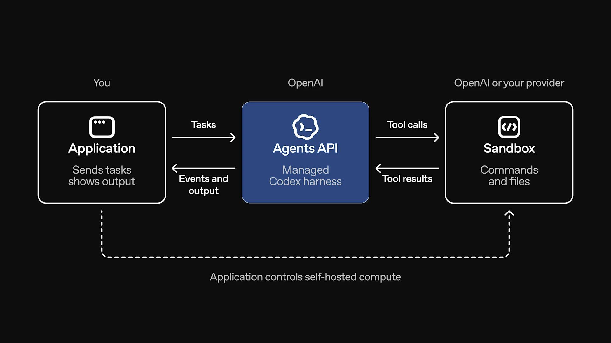
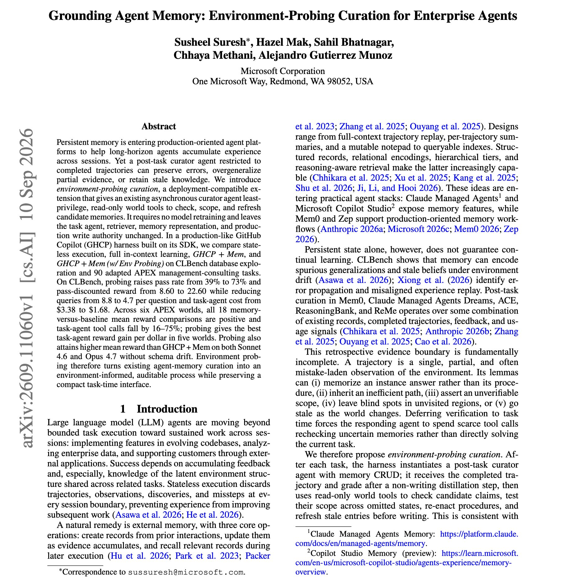
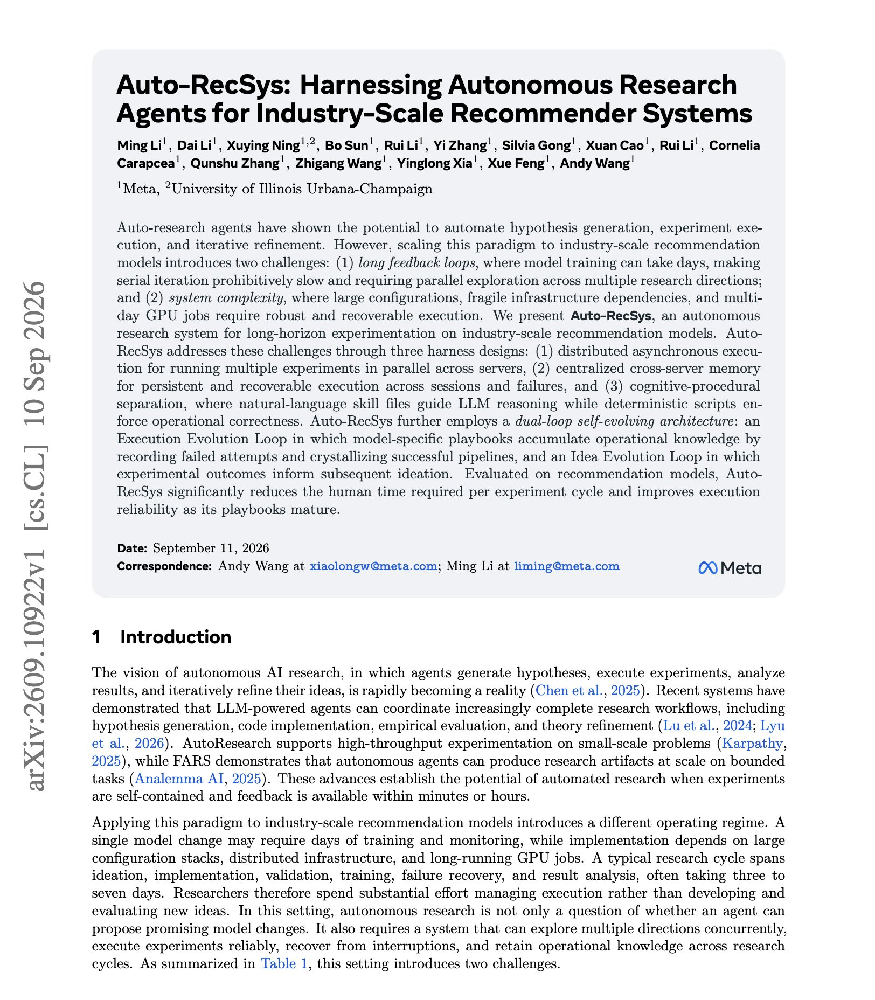

# 🐦 @dair_ai

## 📅 September 11, 2026

> 4 post(s) archived.

---

### 🕐 21:30 UTC · @dair_ai

> Agents API is a bigger deal than it seems. OpenAI&apos;s bet on making the Codex harness open-source could pay off big time here. This harness-as-a-service idea hasn&apos;t hit mainstream yet, but some of the most serious builders are already adopting it to unlock new types of services. Codex being open-source means that many other models (open or closed) are already extremely knowledgeable about the Codex harness. As more services adopt these new agentic architectures, you&apos;ll want the compounding effect that comes with that transparency and openness. Today we&apos;re launching the Agents API, a brand new way to build Agents in the cloud, backed by the Codex harness. Bring along all your favorite tools and connectors, connect it to any sandbox, and let Astra cook. Can&apos;t wait to see what you whip up 👨‍🍳 https://openai.com/index/in…

🔗 [View original post](https://x.com/omarsar0/status/2098524621439914375)

---

### 🕐 16:58 UTC · @dair_ai

> Build and own your harness, folks. Very few people understand the magic behind customizing and optimizing an agent harness for your work. You can start seeing incredible results quickly, even with a minimal harness. Just better code, better outputs, better costs, better writing, and so on. As an example, I see way too many people complain that they are tired of their out-of-the-box agent harness producing verbose outputs. If you built a harness, that&apos;s easier to fix with a system prompt optimized for you. This is why Pi is getting insane adoption these days. You want to control your harness. I agree that it&apos;s hard to optimize where things stand, but self-improving algorithms will make it easier to learn from trajectories. And if you use local models, you can tune all of that end-to-end (through a co-evolution of the harness and the models) as you work with them. Look into open-source projects like Eve, Exo, and Prime Agent, and you will see what I mean. OK. It&apos;s time to rethink this. I&apos;ve spend the last several weeks working on a harness that tightly constrains the agents to work the way that I want them to work. I set up all kinds of gates, and tests, and tools, and protocols, and ... And while I was heads-down getting that to …

🔗 [View original post](https://x.com/omarsar0/status/2098456262379745663)

---

### 🕐 15:19 UTC · @dair_ai

> Interesting paper from Microsoft. If you run persistent memory for a production agent, this one is worth your time. (bookmark it) Memory curators usually read only the finished trajectory. That lets them save the agent&apos;s mistakes, overgeneralize from partial evidence, and keep facts that have gone stale. Microsoft researchers give the curator a few read-only tools to check each candidate memory against the live environment before it is saved. The task agent, retriever and memory format stay the same, and nothing is retrained. In a GitHub Copilot harness on CLBench, pass rate goes from 39% to 73%. Queries per question drop from 8.8 to 4.7 and task-agent cost falls from $3.38 to $1.68. On 90 consulting tasks across six environments, every memory configuration beats the baseline, and tool calls fall by 16 to 75%. Paper: https://arxiv.org/abs/2609.11060 Chat with Paper: https://academy.dair.ai/papers/grounding-agent-memory-environment-probing-curation-for-enterprise-agents-2609.11060

🔗 [View original post](https://x.com/dair_ai/status/2098431126343929985)

---

### 🕐 15:01 UTC · @dair_ai

> Harness engineering is a top skill right now This new Meta paper is a good production example. Auto-RecSys runs autonomous research on Meta&apos;s industry-scale recommendation models, where one training run can take days. It runs experiments in parallel across servers, keeps a shared memory so work survives failures and new sessions, and splits guidance into natural-language skill files for reasoning and deterministic scripts for anything operational. Two loops improve it over time. Model-specific playbooks record failed attempts and keep working pipelines. Experimental results feed the next round of ideas. As the playbook matured, major fixes per iteration fell from 4.0 to 1.3, and the failures fell into repeatable categories. Paper: https://arxiv.org/abs/2609.10922 Chat with Paper: https://academy.dair.ai/papers/auto-recsys-harnessing-autonomous-research-agents-for-industry-scale-recommender-2609.10922

🔗 [View original post](https://x.com/omarsar0/status/2098426608793362916)

---
