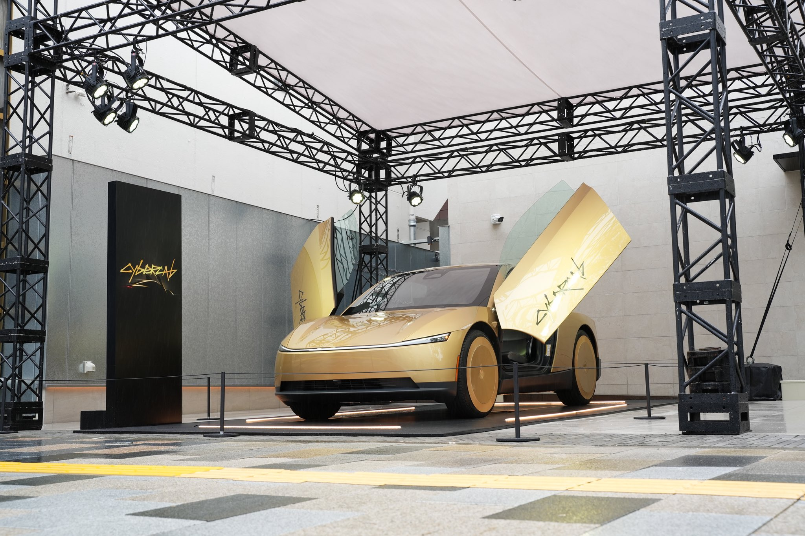
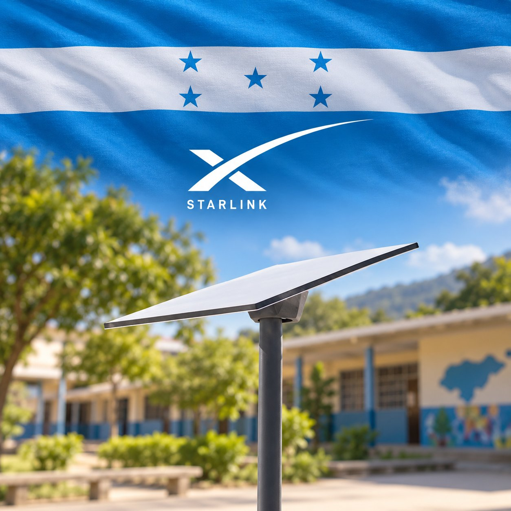

# 🐦 @elonmusk

## 📅 September 11, 2026

> 20 post(s) archived.

---

### 🕐 17:40 UTC · @elonmusk

> Insanity. This needs more attention. JUST IN: Report reveals at least 62,199 people were arrested in Britain for “speech-related offenses” between 2021 &amp; 2025.

🔗 [View original post](https://x.com/rustyrockets/status/2098466774282805575)

---

### 🕐 17:13 UTC · @elonmusk

> Technology is the most important advantage in war I recently went through a translation of Musashi’s Book of Five Rings. The introduction chronicled the evolution of swordsmanship and martial arts in general from pragmatic battlefield necessities to sports, historical curiosities, and hobbies. It was interesting to hear how in t…

🔗 [View original post](https://x.com/elonmusk/status/2098460032014639334)

---

### 🕐 17:05 UTC · @elonmusk

> True, solar energy over time will round up to 100% of energy harnessed (obviously) On Labor Day, the charging peak load was 116 cars plugged in at once, at 11.4 MW. All electrical loads will eventually transition to solar + storage. The giant fusion reactor in the sky is free.

🔗 [View original post](https://x.com/elonmusk/status/2098457990407880886)

---

### 🕐 17:04 UTC · @elonmusk

> Wow, this is crazy More Than 62,000 Arrested For Speech-Related Offenses In Britain, Report Finds https://www.zerohedge.com/political/more-62000-arrested-speech-related-offenses-britain-report-finds

🔗 [View original post](https://x.com/elonmusk/status/2098457680482308526)

---

### 🕐 15:13 UTC · @elonmusk

> Semi is coming to Europe – Up to 550km of range at 40T (fully loaded) – 1 kWh/km energy consumption – Megacharger at up to 800 kW recovers ~60% of range in 30 minutes – ePTO up to 25kW – 40T gross combination weight, 9,100kg curb weight https://www.tesla.com/de_de/semi

🔗 [View original post](https://x.com/teslaeurope/status/2098429681607307452)

---

### 🕐 12:17 UTC · @elonmusk

> BBC: “There is so much hate on your platform” Elon: “What hate?” BBC: “There’s just a lot of hate” Elon: “What kind of hate?” BBC: “Well...I see a lot of hate” Elon: “Can you give me an example?” BBC: “There’s definitely hate” Elon: “So your evidence is basically that you personally feel like there is hate?” BBC: “ohhh....but there’s a lot of it” Elon: “How much?” BBC: “A lot” Elon: “Compared to what?” BBC: “Well...before” Elon: “Before what?” BBC: “Before there was this much hate” Elon: “Do you have data?” BBC: “I have concerns” Elon: “Do you have examples?” BBC: “I have observations” Elon: “Do you have numbers?” BBC: “People are worried” Elon: “Which people?” BBC: “People” Elon: “So basically...you arrived with a headline and forgot to bring the evidence?” Basically the entire BBC interview 😂 Elon absolutely slaughters BBC reporter in live interview that random guy: “There’s way too much hate on this platform” His interests: • Hating Elon • Liking people who hate Elon • Reposting people who hate Elon • Getting angry when Elon breathes Brother, you are the algorithm 😂

🔗 [View original post](https://x.com/XFreeze/status/2098385527808668040)

---

### 🕐 10:34 UTC · @elonmusk

> Elon is a builder Elon is a giver Elon is a gift Elon is a Hero Il a prouvé qu’on pouvait envoyer des fusées sans Gosplan. Construire des voitures sans la bénédiction de Detroit. Relier un village, un front ou un hôpital depuis l’orbite, sans demander l’autorisation d’un ministère. Il a racheté la place publique et arraché le monopole de ceux…

🔗 [View original post](https://x.com/TheCaptainEli/status/2098359515162837359)

---

### 🕐 08:44 UTC · @elonmusk

> SpaceX CFO speaks at GS Tech Comf WATCH: @SpaceX CFO Bret Johnsen speaks at the Goldman Sachs Communacopia + Technology Conference: https://x.com/i/broadcasts/1qxoNYEgaeEJv

🔗 [View original post](https://x.com/elonmusk/status/2098331769892130941)

---

### 🕐 07:17 UTC · @elonmusk

> More than twice as long as they clapped for Stalin in Gulag Archipelago! The Gaza documentary “NAZA” earned a massive 24.5-minute #VeniceFilmFestival ovation as the crowd cheered and waved Palestinian flags. This marks the longest-ever standing ovation at Venice, beating the 22-minute ovation for “The Voice of Hind Rajab” last year, and perhaps the lo…

🔗 [View original post](https://x.com/elonmusk/status/2098310008370872652)

---

### 🕐 06:54 UTC · @elonmusk

> This will be cool SpaceXAI will livestream a three-person team attempting to build an entire company from scratch with Grok Bot, September 15–17. mattyp, poteto and roshan_s will start with an idea and work through the business plan, product decisions and engineering, with viewers following the pr…

🔗 [View original post](https://x.com/elonmusk/status/2098304166854635528)

---

### 🕐 06:54 UTC · @elonmusk

> Grok @Bot is great for sales teams! Grok Bot is now more powerful for sales teams. Connect your Bots to Salesforce, HubSpot, Gong, Clay, Granola, and other GTM tools. Stay on top of accounts, complete follow-ups, and do deep research.

🔗 [View original post](https://x.com/elonmusk/status/2098304042896162881)

---

### 🕐 06:01 UTC · @elonmusk

> Starship is one of the most incredible machines humanity has ever built... a machine designed to turn the impossible into infrastructure It is the most complex vehicle ever created, built for something humanity has never achieved at scale: Carrying people, cargo, industry and civilization beyond Earth Media

🔗 [View original post](https://x.com/XFreeze/status/2098290830498808225)

---

### 🕐 05:59 UTC · @elonmusk

> Misleading post that fans the flames of hate by AOC Most of the 2026 cases cited (Kyle Bassinga GA, Juliana Nzita NC, To&apos;Nea Miller FL, Justice James GA, Jerard Jackson MI, Raleigh 32yo NC, others) were officially ruled suicides with no evidence of foul play or any murderer. Tasia Fortune (MS) is under homicide investigation; the …

🔗 [View original post](https://x.com/elonmusk/status/2098290380584157533)

---

### 🕐 05:37 UTC · @elonmusk

> 🤨 EXCLUSIVE: A Nigerian chieftain billed Medicaid more than $36 million, then snapped up luxury properties in California and built a magnificent palace in Abatete, Nigeria—including a golden statue of himself. The experts told us it has all the red flags for fraud.

🔗 [View original post](https://x.com/elonmusk/status/2098284852244086849)

---

### 🕐 05:22 UTC · @elonmusk

> Steve Davis @boringcompany &quot;If you want to build thousands of miles, which we do, and the cost for tunneling is high — it&apos;s impossible. If we&apos;re in the billions per mile… it&apos;s just not even worth speaking about. But if we&apos;re like three, four, five million a mile, you can literally build these like epic projects.&quot; Billions per mile = don&apos;t bother. $3–5 million a mile = you can actually build cities. That&apos;s why Series D at ~$23B matters. Media

🔗 [View original post](https://x.com/teslaownersSV/status/2098281019023700325)

---

### 🕐 04:30 UTC · @elonmusk

> ハンドルもペダルもない、無人タクシー用としてゼロから設計されたCybercabを日本初公開。 https://www.tesla.com/ja_jp/event/2026sep_cc_tour

🔗 [View original post](https://x.com/teslajapan/status/2098267916840096058)

---

### 🕐 03:02 UTC · @elonmusk

> Most efficient production EV ever That efficiency is what will make Cybercab one of the lowest cost-per-mile modes of transport The @Tesla Cybercab has a wider front track than the rear. The teardrop shape is how Tesla achieved a drag coefficient under 0.2. It&apos;s the most efficient production EV ever certified, at 165 Wh/mi, and the first Tesla that&apos;s front-wheel drive. Seeing it in person is incredible.

🔗 [View original post](https://x.com/robotaxi/status/2098245744952332779)

---

### 🕐 01:32 UTC · @elonmusk

> I just sat in a car with nothing in front of me. No steering wheel. No pedals. No mirrors. Spotless. Drove better than any human. Houston, you’re next. Thank you @Tesla @elonmusk @robotaxi Media

🔗 [View original post](https://x.com/Matthewtcone/status/2098223218708344874)

---

### 🕐 01:09 UTC · @elonmusk

> BREAKING: The President of Honduras, Nasry Asfura, has launched a plan to bring 10,000 @Starlink antennas to about 8,000 schools, benefiting over 640,000 students. The program will bring high-speed satellite internet and new opportunities to students all across the country.

🔗 [View original post](https://x.com/cb_doge/status/2098217330014834898)

---

### 🕐 01:09 UTC · @elonmusk

> Grok @Bot summary of SpaceX CFO talk Grok Bot Summary of SpaceX CFO Bret Johnsen at Goldman Sachs Communacopia today. Vertical integration Vertical integration is the company’s core operating model, not a side strategy. - Rockets: own metal → engines → avionics → software - Starlink: own launch, satellites, and the …

🔗 [View original post](https://x.com/elonmusk/status/2098217236771295567)

---
