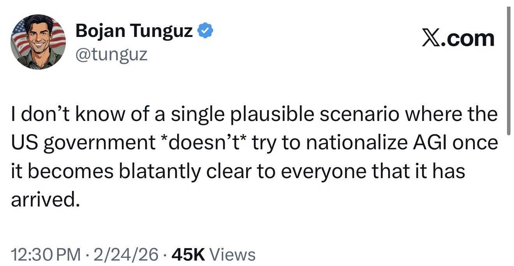

# 🐦 @tunguz

## 📅 September 11, 2026

> 16 post(s) archived.

---

### 🕐 22:16 UTC · @tunguz

> Lots of “scribes don’t like the printing press” energy today.

🔗 [View original post](https://x.com/tunguz/status/2098536105692000400)

---

### 🕐 21:43 UTC · @tunguz

> NO ONE who joined NVIDIA 5+ years ago did it for the money. I was repeatedly told by the hiring manager that “at NVIDIA money doesn’t grow on trees.” Many of us did it because we were absolutely in love with that company’s technology and just wanted to do a lot of cool things with it. I joined @nvidia nine years ago today, against the advice of a colleague who said their comp was below market. But I really believed in the mission and the people, so I went. I met @__simt__, Michael Garland, and Jared Hoberock on the C++ committee. I thought they were the smarte…

🔗 [View original post](https://x.com/tunguz/status/2098527831420743698)

---

### 🕐 21:38 UTC · @tunguz

> I’m so ahead of him in that regard. JUST IN: Chinese Fields Medal winner Deng Yu announces he’ll retire from mathematics &amp; write romance novels if AI becomes capable of solving all math problems.

🔗 [View original post](https://x.com/tunguz/status/2098526605916406022)

---

### 🕐 21:37 UTC · @tunguz

> This is my sense as well, but just like Amin I am prepared to be proven wrong. My prediction: among the Millennium Prize Problems, P versus NP will be the last one solved by AI. I am very well aware of the fact that this tweet may not age well. So, watching @BooleanAnalysis is a good investment.

🔗 [View original post](https://x.com/tunguz/status/2098526424651214900)

---

### 🕐 20:42 UTC · @tunguz

> Awesome! This week I joined the new Commission on AI and the Future of the American Workforce, a bipartisan effort hosted by @AEI and @urbaninstitute and co-chaired by @SpeakerRyan and @GinaRaimondo Here are three questions on my mind as the commission kicks off: 1. AI could make employer…

🔗 [View original post](https://x.com/tunguz/status/2098512552233935316)

---

### 🕐 19:03 UTC · @tunguz

> Startup idea: a Manhattan Project but for nuclear energy. Who’s working on this?

🔗 [View original post](https://x.com/tunguz/status/2098487640215666774)

---

### 🕐 18:15 UTC · @tunguz

> On the internet - so far! AGI will make Reddit feel like the Bingo Night at a retirement home. Reddit is the worst place on the internet.

🔗 [View original post](https://x.com/tunguz/status/2098475578068504725)

---

### 🕐 18:13 UTC · @tunguz

> I resigned from the Rebel Alliance today. I spent the last three years mastering the Force for both the Rebel Alliance and the Galactic Empire. Neither entity is acting responsibly. They are racing straight to universal dominance and gambling with our lives. More thoughts below.

🔗 [View original post](https://x.com/tunguz/status/2098475087771144211)

---

### 🕐 17:53 UTC · @tunguz

> Yes. I’m more and more of the opinion that the DoE should nationalize the frontier labs so they can safely work on all the scary, world ending shit with the right controls. And let the rest of us get on with building useful AI that, you know, automates menial shit and cures people.

🔗 [View original post](https://x.com/tunguz/status/2098469964160385055)

---

### 🕐 16:33 UTC · @tunguz

> People in general have no intuition about exponential growth. Combinatorial growth intuition is immeasurably more hopeless.

🔗 [View original post](https://x.com/tunguz/status/2098449903764840889)

---

### 🕐 16:30 UTC · @tunguz

> 🙏

🔗 [View original post](https://x.com/tunguz/status/2098449037628412268)

---

### 🕐 15:54 UTC · @tunguz

> A whistleblower but you are just a disgruntled low level employee with no special insider information.

🔗 [View original post](https://x.com/tunguz/status/2098440089751953696)

---

### 🕐 14:57 UTC · @tunguz

> My theory is that the first thing that rogue AI would try to do is figure out how to build rogue nuclear plants. A very happy ending would be if Trump regulatory reforms + data center demand launch a revolutionary era of next generation nuclear power but the stock market doesn’t seem to be buying it.

🔗 [View original post](https://x.com/tunguz/status/2098425811389071469)

---

### 🕐 02:58 UTC · @tunguz

> “They don’t know that Muse Spark 1.3 is as good as Fable.”

🔗 [View original post](https://x.com/tunguz/status/2098244839477231940)

---

### 🕐 01:12 UTC · @tunguz

> *end of the week SITUATION DETECTED: OpenAI is using the internal model that produced its Navier–Stokes proof to attempt the Riemann Hypothesis and P vs NP.

🔗 [View original post](https://x.com/tunguz/status/2098218099493244995)

---

### 🕐 01:09 UTC · @tunguz

> Of course they are. SITUATION DETECTED: OpenAI is using the internal model that produced its Navier–Stokes proof to attempt the Riemann Hypothesis and P vs NP.

🔗 [View original post](https://x.com/tunguz/status/2098217391465394550)

---
