# 🐦 @Wise1Philosophy

## 📅 September 15, 2026

> 158 post(s) archived.

---

### 🕐 17:06 UTC · @Wise1Philosophy

> okay wait, I need to sit with this for a sec. the same model is driving a car, flying a drone, walking a humanoid and playing a game. this isn&apos;t four different AIs stitched together. it is just one that already understands how the world works, given a few hours to figure out the controls. wild when it clicks that Odyssey-3 learned how the world works, then figured out each system&apos;s controls with just a few hours of task-specific data. the @odysseyml preview they put up today is worth a watch. Media Today we’re unveiling Odyssey-3, a big step forward for foundation world models. It can control robots, power humanoids, drive cars (on the roads of India!), train AIs, pilot drones, and even play video games. We can’t wait to see what intelligent systems it enables.

🔗 [View original post](https://x.com/thetripathi58/status/2099907771726794975)

---

### 🕐 17:00 UTC · @Wise1Philosophy

> robots usually learn by seeing the same task over and over. humans don’t. • learn how the world works • build an intuition for it • apply it somewhere new Odyssey-3 is pushing toward that approach, using only a few hours of experiential data for new physical tasks. Media Today we’re unveiling Odyssey-3, a big step forward for foundation world models. It can control robots, power humanoids, drive cars (on the roads of India!), train AIs, pilot drones, and even play video games. We can’t wait to see what intelligent systems it enables.

🔗 [View original post](https://x.com/AIStackLabX/status/2099906307767910637)

---

### 🕐 16:58 UTC · @Wise1Philosophy

> Stop losing hours to video editing. Poolday learned how to do it. It studies your style, grabs your assets, produces the whole video, and quality checks its own work. You describe what you want. The AI handles start to finish. Everyone gets access now. We raised $11M to make video editors obsolete. Not the humans, the tools. Think about the hours you lose searching for assets, moving clips frame by frame, fixing animations, checking exports, and redoing the same edits over and over. Poolday handles the entire video production p…

🔗 [View original post](https://x.com/AIHighlight/status/2099905661836439596)

---

### 🕐 16:56 UTC · @Wise1Philosophy

> One prompt generates your entire video. Poolday spent $11M to automate the parts of editing that waste the most time: asset hunts, clip shuffling, animation fixes, export checks, and redoing the same edits over and over. Your style locked in. Your assets ready. Videos ship instantly. We raised $11M to make video editors obsolete. Not the humans, the tools. Think about the hours you lose searching for assets, moving clips frame by frame, fixing animations, checking exports, and redoing the same edits over and over. Poolday handles the entire video production p…

🔗 [View original post](https://x.com/FutureStacked/status/2099905321032355959)

---

### 🕐 16:55 UTC · @Wise1Philosophy

> The video editing industry just got disrupted. Poolday doesn&apos;t replace editors yet. It replaces the 6 hours of setup, searching, frame-by-frame fixes, and redo loops. Plug in your brand style. Give it a prompt. Watch AI build the full video while you focus on what actually matters. We raised $11M to make video editors obsolete. Not the humans, the tools. Think about the hours you lose searching for assets, moving clips frame by frame, fixing animations, checking exports, and redoing the same edits over and over. Poolday handles the entire video production p…

🔗 [View original post](https://x.com/AriaWestcott/status/2099904881754595412)

---

### 🕐 16:53 UTC · @Wise1Philosophy

> 🚨 ASÍ SUELE EMPEZAR MI BÚSQUEDA DE UN MODELO DE IA PARA UN NUEVO PROYECTO: Abro varias pestañas. Veo demos impresionantes. Leo que cinco modelos diferentes son &quot;los mejores&quot;. Y después de todo eso, todavía no sé cuál debería probar para lo que necesito crear hoy. Por eso estuve explorando OpenArt Arena.

🔗 [View original post](https://x.com/Marco_Exito/status/2099904479701459415)

---

### 🕐 16:53 UTC · @Wise1Philosophy

> $11M bet that AI can replace frame-by-frame video editing. Poolday automates everything humans hate: searching assets, moving clips, fixing timing, running QA. One prompt. Full video. 100M+ edits already shipped. The first 50 people can test it today. We raised $11M to make video editors obsolete. Not the humans, the tools. Think about the hours you lose searching for assets, moving clips frame by frame, fixing animations, checking exports, and redoing the same edits over and over. Poolday handles the entire video production p…

🔗 [View original post](https://x.com/AIFrontliner/status/2099904372201173310)

---

### 🕐 16:53 UTC · @Wise1Philosophy

> the interesting part of Odyssey-3 isn’t the robot demos. it’s the idea behind them. • one world model • one understanding of physics • different systems • different tasks humanoids. cars. drones. robot arms. video games. that’s a very different path for physical AI. Media Today we’re unveiling Odyssey-3, a big step forward for foundation world models. It can control robots, power humanoids, drive cars (on the roads of India!), train AIs, pilot drones, and even play video games. We can’t wait to see what intelligent systems it enables.

🔗 [View original post](https://x.com/Diptish09/status/2099904361539526658)

---

### 🕐 16:51 UTC · @Wise1Philosophy

> Breaking: Your video editor just became an AI agent. Poolday raised $11M to handle the worst part of video production: the boring stuff. It learns your style, uses your assets, and builds finished videos from a single prompt. The editor job just changed forever. We raised $11M to make video editors obsolete. Not the humans, the tools. Think about the hours you lose searching for assets, moving clips frame by frame, fixing animations, checking exports, and redoing the same edits over and over. Poolday handles the entire video production p…

🔗 [View original post](https://x.com/TheAIColony/status/2099904025466466400)

---

### 🕐 16:51 UTC · @Wise1Philosophy

> The day has come guys... &quot;Shopify stores are now officially better than Amazon&quot; 💀 Finally no more filtering for things after I search. Now I can just filter *by typing*... “I want a black shirt size M under $60. Today, I&apos;m excited to announce a huge leap forward for search Now Shopify stores have *more powerful search than Amazon* By adding AI Autocomplete to their search, users can filter by typing, which increases sales significantly by helping people find what they want faster. Just b…

🔗 [View original post](https://x.com/alex_prompter/status/2099903883631878299)

---

### 🕐 16:50 UTC · @Wise1Philosophy

> Most AI video tools start by generating pretty much everything from scratch. That’s not always what brands need. Most of the time you already have the good stuff: → Real product footage → Assets → Brand components You just need a faster way to turn it into a video. That’s what I like about Poolday. It works more like an AI video editor: footage, adding transitions &amp; captions, &amp; helping QA the final video!! But the best part is that everything stays editable layer by layer. Want to change one caption, clip, or visual? Edit that layer. No need to regenerate the entire video. http://poolday.ai We raised $11M to make video editors obsolete. Not the humans, the tools. Think about the hours you lose searching for assets, moving clips frame by frame, fixing animations, checking exports, and redoing the same edits over and over. Poolday handles the entire video production p…

🔗 [View original post](https://x.com/sufyanmaan/status/2099903762471027020)

---

### 🕐 16:49 UTC · @Wise1Philosophy

> Imagine paying to get a customer into your store... then refusing to point them to the right aisle. That&apos;s how I&apos;ve always felt searching. So naturally I gasped when I saw AI Autocomplete now lets Shopify shoppers type anything they want and instantly filters. Giving the people what they want! Today, I&apos;m excited to announce a huge leap forward for search Now Shopify stores have *more powerful search than Amazon* By adding AI Autocomplete to their search, users can filter by typing, which increases sales significantly by helping people find what they want faster. Just b…

🔗 [View original post](https://x.com/alex_verem/status/2099903403170099280)

---

### 🕐 16:47 UTC · @Wise1Philosophy

> It was always inevitable, but the day is here: &quot;Shopify stores are now officially better than Amazon&quot; AI Autocomplete makes Shopify store search more powerful than old school search, still used by Amazon and the rest of the industry 🔥 Today, I&apos;m excited to announce a huge leap forward for search Now Shopify stores have *more powerful search than Amazon* By adding AI Autocomplete to their search, users can filter by typing, which increases sales significantly by helping people find what they want faster. Just b…

🔗 [View original post](https://x.com/free_ai_guides/status/2099902827225121072)

---

### 🕐 16:46 UTC · @Wise1Philosophy

> Someone is going to build a high-ticket CRO agency entirely around upgrading search architecture for mid-market brands. Seems like most online stores are still running search UX from 2014: Static keyword matching 0-result pages on common phrasing Endless dropdown filters Zero context awareness Having an AI layer like AI Autocomplete predict intent while typing turns a basic input box into an active guided search. Turning dead search sessions into completed checkouts is one of the highest-ROI fixes an ecom brand can make right now. Today, I&apos;m excited to announce a huge leap forward for search Now Shopify stores have *more powerful search than Amazon* By adding AI Autocomplete to their search, users can filter by typing, which increases sales significantly by helping people find what they want faster. Just b…

🔗 [View original post](https://x.com/alexgroberman/status/2099902759634104673)

---

### 🕐 16:45 UTC · @Wise1Philosophy

> While the world is bickering over extinction, Shopify has quietly passed Amazon. Now stores can add AI Autocomplete to their search, unlocking the most powerful search experience we&apos;ve seen. No pacing happening in Shopify land 💀💀💀 Today, I&apos;m excited to announce a huge leap forward for search Now Shopify stores have *more powerful search than Amazon* By adding AI Autocomplete to their search, users can filter by typing, which increases sales significantly by helping people find what they want faster. Just b…

🔗 [View original post](https://x.com/claudeskills101/status/2099902339440107979)

---

### 🕐 16:43 UTC · @Wise1Philosophy

> Stop asking which AI model is best. OpenArt Arena just proved the real question is which model is best for your next project. Creative professionals tested leading models on film, ads, animation, motion design, and video editing. The winner depends entirely on what you&apos;re building. Today we’re launching OpenArt Arena, the global leaderboard for creative intelligence. Every AI model claims to be the best. But best at what? We brought together creative professionals to evaluate the world’s leading AI models blindly, across the work creators actually care abou…

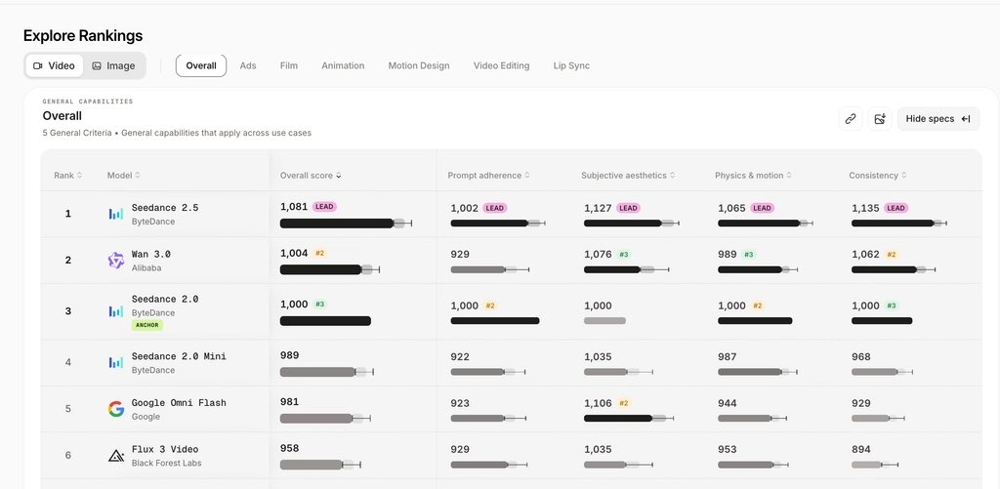

🔗 [View original post](https://x.com/AIHighlight/status/2099901898312610284)

---

### 🕐 16:42 UTC · @Wise1Philosophy

> 🚨 SI OCULTARAN EL NOMBRE Y EL LOGO DE TUS MODELOS DE IA FAVORITOS, ¿SEGUIRÍAS ELIGIENDO SUS RESULTADOS? Es fácil dejarse llevar por un lanzamiento, una marca o una demo viral. Pero cuando estoy creando algo para un proyecto real, lo que necesito saber es mucho más simple: ¿qué resultado funciona mejor para este trabajo? OpenArt Arena intenta responder esa pregunta de una forma interesante. 👀

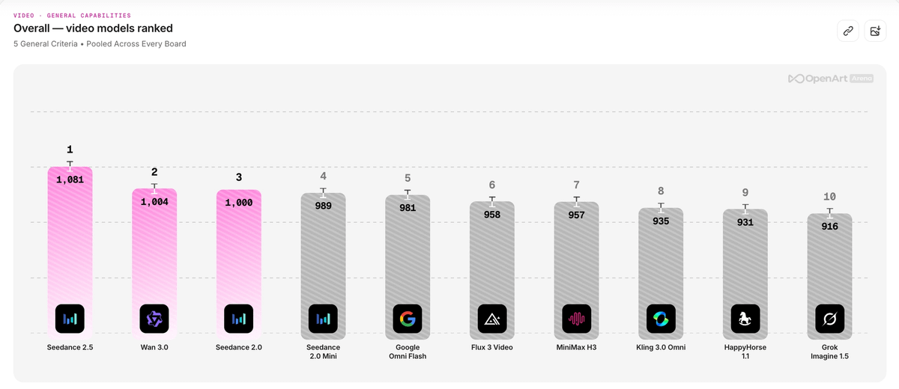

🔗 [View original post](https://x.com/Alex_Inspira/status/2099901780553576736)

---

### 🕐 16:41 UTC · @Wise1Philosophy

> Every AI claims dominance but OpenArt Arena cut through the noise. Creative professionals evaluated leading models blindly on real creative work: film, ads, animation, motion design, video editing. The verdict crushes the myth of one universal winner and gives you something better: clarity on what actually works for your craft. Today we’re launching OpenArt Arena, the global leaderboard for creative intelligence. Every AI model claims to be the best. But best at what? We brought together creative professionals to evaluate the world’s leading AI models blindly, across the work creators actually care abou…

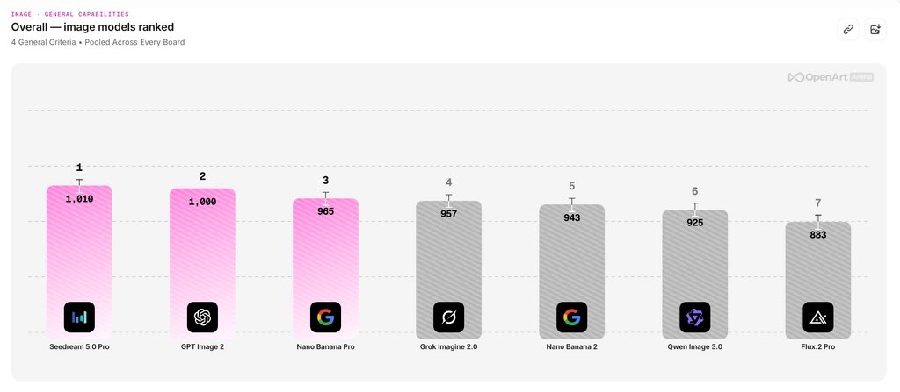

🔗 [View original post](https://x.com/AriaWestcott/status/2099901393813295423)

---

### 🕐 16:39 UTC · @Wise1Philosophy

> The benchmark that changes everything just dropped. Real creators tested leading AI models across the disciplines that matter most: film, ads, animation, motion design, video editing. The takeaway is brutal but practical: there&apos;s no best model, only the right model for what you&apos;re creating next. Today we’re launching OpenArt Arena, the global leaderboard for creative intelligence. Every AI model claims to be the best. But best at what? We brought together creative professionals to evaluate the world’s leading AI models blindly, across the work creators actually care abou…

🔗 [View original post](https://x.com/FutureStacked/status/2099900973682504031)

---

### 🕐 16:39 UTC · @Wise1Philosophy

> Robot police force just went live in China. Humanoid robots, robot dogs, autonomous dronesall deployed on streets in Bantian, patrolling autonomously, detecting threats, searching for missing people. Robotics just became operational reality. Media

🔗 [View original post](https://x.com/TheAIColonyRD/status/2099900931038912756)

---

### 🕐 16:36 UTC · @Wise1Philosophy

> Creative professionals just ranked every major AI model blindly and the results broke the narrative. There&apos;s no single best model. The one that wins is the one built for what you&apos;re actually making: film, ads, animation, or motion design. Today we’re launching OpenArt Arena, the global leaderboard for creative intelligence. Every AI model claims to be the best. But best at what? We brought together creative professionals to evaluate the world’s leading AI models blindly, across the work creators actually care abou…

🔗 [View original post](https://x.com/TheAIColony/status/2099900271287476438)

---

### 🕐 16:34 UTC · @Wise1Philosophy

> OpenArt Arena just launched the benchmark creatives have been waiting for. They had real creators evaluate leading AI models across actual creative work with zero bias. The truth? Best is relative. It depends on whether you&apos;re shooting film, ads, animation, or motion design. Today we’re launching OpenArt Arena, the global leaderboard for creative intelligence. Every AI model claims to be the best. But best at what? We brought together creative professionals to evaluate the world’s leading AI models blindly, across the work creators actually care abou…

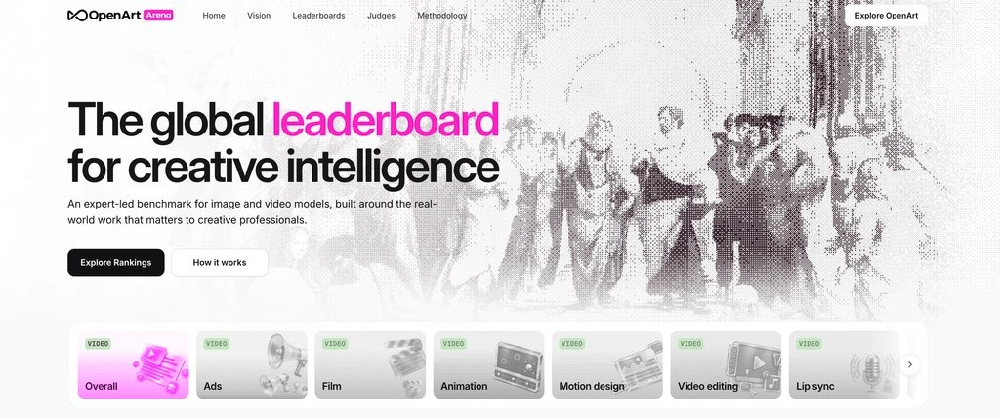

🔗 [View original post](https://x.com/AIFrontliner/status/2099899711410913389)

---

### 🕐 16:29 UTC · @Wise1Philosophy

> Esto hacía mucha falta. Cada semana sale un nuevo modelo de vídeo diciendo que es “el mejor”. Pero cuando vas a crear algo de verdad descubres que uno funciona mejor para escenas cinematográficas, otro para animación, otro para anuncios y otro para edición. OpenArt Arena intenta poner orden en todo ese caos. Comparaciones a ciegas, evaluadas por profesionales creativos y separadas por casos de uso reales. Media Today we’re launching OpenArt Arena, the global leaderboard for creative intelligence. Every AI model claims to be the best. But best at what? We brought together creative professionals to evaluate the world’s leading AI models blindly, across the work creators actually care abou…

🔗 [View original post](https://x.com/MiguelMaestroIA/status/2099898342373204212)

---

### 🕐 16:27 UTC · @Wise1Philosophy

> There&apos;s something different about telling AI “edit this” when it can actually operate the editor. With GPT-6 Astra, I can provide footage and describe the edit I want. Astra then controls CapCut PC to organize the clips, build the sequence, add captions, transitions and audio. The result isn&apos;t a mysterious AI output. It&apos;s a project I can open and keep editing. That makes the workflow feel much more transparent: AI builds. I inspect. I refine. Maybe that&apos;s the future of AI-assisted editing. #GPT6Astra #CapCutPC #AIVideo #Seedance25 Media

🔗 [View original post](https://x.com/Damn_coder/status/2099897845172351440)

---

### 🕐 16:25 UTC · @Wise1Philosophy

> HOW TO RAISE YOUR VIBRATION &amp; attract better experiences.. 👇 🧵

🔗 [View original post](https://x.com/MindPatternHQ/status/2099897306325921875)

---

### 🕐 16:22 UTC · @Wise1Philosophy

> “Change one caption” should never mean “roll the dice on the entire video again.” That’s a ridiculous revision process. Poolday keeps the output editable, layer by layer. Point at the element you want changed and edit that piece. For anyone used to working with agents, this matters: the first draft is easy to celebrate. The fifth revision is where you find out whether the thing is actually useful. We raised $11M to make video editors obsolete. Not the humans, the tools. Think about the hours you lose searching for assets, moving clips frame by frame, fixing animations, checking exports, and redoing the same edits over and over. Poolday handles the entire video production p…

🔗 [View original post](https://x.com/claudeskills101/status/2099896562742649248)

---

### 🕐 16:22 UTC · @Wise1Philosophy

> PARENTS, IF YOUR TODDLER IS TURNING 2 SOON, BRACE YOURSELF AND READ THESE 12 THINGS. 1. They need you far more than they&apos;ll ever need you again... 👇

🔗 [View original post](https://x.com/scotti_brooks/status/2099896523786240101)

---

### 🕐 16:20 UTC · @Wise1Philosophy

> You recorded a 90-minute podcast. Now comes the part that eats your week. Clean the audio. Find the good bits. Cut a trailer. Caption the clips. Poolday’s pitch: upload the episode and get the cleaned full version, a trailer and eight captioned clips back. I’d use it for the backlog first. There could be a month of posts sitting in recordings you’ve already paid to make. We raised $11M to make video editors obsolete. Not the humans, the tools. Think about the hours you lose searching for assets, moving clips frame by frame, fixing animations, checking exports, and redoing the same edits over and over. Poolday handles the entire video production p…

🔗 [View original post](https://x.com/free_ai_guides/status/2099896120251957277)

---

### 🕐 16:20 UTC · @Wise1Philosophy

> 7 signs you&apos;re taking parenting too seriously... And it may be making parenting harder than it needs to be... 👇 🧵

🔗 [View original post](https://x.com/Manifest_Lord/status/2099896052321300710)

---

### 🕐 16:18 UTC · @Wise1Philosophy

> $5k audit in 40 seconds is CRAZY 👏 save this before it gets buried: pletor 2.0 is live and it&apos;s the first AI tool that actually knows your brand before you explain it → paste your website → it encodes products, voice, visuals, guidelines → every agent you build taps into it → update once, updates everywhere gave i…

🔗 [View original post](https://x.com/Wise1Philosophy/status/2099895644672376840)

---

### 🕐 16:17 UTC · @Wise1Philosophy

> at this point we can say ai videos are getting out of hand. this is a good one Media

🔗 [View original post](https://x.com/daveydefi/status/2099895447535911121)

---

### 🕐 16:16 UTC · @Wise1Philosophy

> Your product ships daily. Your demo video is from six months ago. That’s an embarrassing gap for a company selling innovation. Poolday can connect to GitHub and turn shipped features into on-brand launch videos using your real UI. The interesting part is the trigger: shipping the feature kicks off making the video. A release shouldn’t need a second project just to explain what changed. We raised $11M to make video editors obsolete. Not the humans, the tools. Think about the hours you lose searching for assets, moving clips frame by frame, fixing animations, checking exports, and redoing the same edits over and over. Poolday handles the entire video production p…

🔗 [View original post](https://x.com/alex_verem/status/2099895158154125740)

---

### 🕐 16:14 UTC · @Wise1Philosophy

> AI video has a dirty little secret: you’re still doing the editing. Generate a clip. Fix it. Find music. Add captions. Stitch everything together. Congratulations. You’ve become the AI’s unpaid intern. Poolday takes your actual footage and handles the cut, transitions, music and captions, then checks its own work. Getting from “here are my files” to “here’s the finished video” is the part worth automating. We raised $11M to make video editors obsolete. Not the humans, the tools. Think about the hours you lose searching for assets, moving clips frame by frame, fixing animations, checking exports, and redoing the same edits over and over. Poolday handles the entire video production p…

🔗 [View original post](https://x.com/alex_prompter/status/2099894554983792872)

---

### 🕐 16:09 UTC · @Wise1Philosophy

> imo the wild part is Astra directing other tools this well :) GPT-6 Astra use cases keep getting crazier People are finishing playable games, robot demos, and 3D pipelines in hours. Here are 8 from the last few days:

🔗 [View original post](https://x.com/Wise1Philosophy/status/2099893463151980677)

---

### 🕐 16:04 UTC · @Wise1Philosophy

> Most AI video tools give you synthetic clips that look completely off-brand. Poolday works more like an actual video editor. You give it your real footage, Figma assets, and brand components, and it cuts, transitions, captions, and QA&apos;s the whole thing. My favorite part: everything stays fully editable layer by layer. If you want to change one element, you just tweak that layer without having to regenerate the whole video. http://poolday.ai We raised $11M to make video editors obsolete. Not the humans, the tools. Think about the hours you lose searching for assets, moving clips frame by frame, fixing animations, checking exports, and redoing the same edits over and over. Poolday handles the entire video production p…

🔗 [View original post](https://x.com/ecomchasedimond/status/2099892139689906440)

---

### 🕐 15:58 UTC · @Wise1Philosophy

> the most underrated enterprise AI account on this app: A PE firm reached out to us last month to get them out of a consulting engagement. Six figures spent on AI consulting across seven portfolio companies, and all they had to show for it was a team chat subscription. They needed real EBITDA impact by December to underwrite their 202…

🔗 [View original post](https://x.com/alex_verem/status/2099890688070475959)

---

### 🕐 15:54 UTC · @Wise1Philosophy

> I used to blame the emails when a welcome flow underperformed. Open rates, subject lines, offer structure. I&apos;d rework the whole sequence before looking anywhere else. Then I started noticing a pattern across audits. The brands with the best welcome flow revenue all had one thing in common: better subscribers entering the flow. The popup was doing the heavy lifting before the first email ever goes out. If your popup collects junk leads, even perfect emails won&apos;t save the flow. Most popup tools optimize for submissions. Alia optimizes for what happens after: revenue, conversion rate, and subscriber quality. HexClad made the switch to @AliaPopups, doubled their email opt-in rate, and saw a 68% lift in flow revenue. Same emails. The key was getting better subscribers to enter the sequence. 4,500+ Shopify stores use Alia to turn their popups into a revenue channel. Check it out via my link below, and you’ll get a special 30-day free trial: https://app.aliapopups.com/refer/EQX7Y4

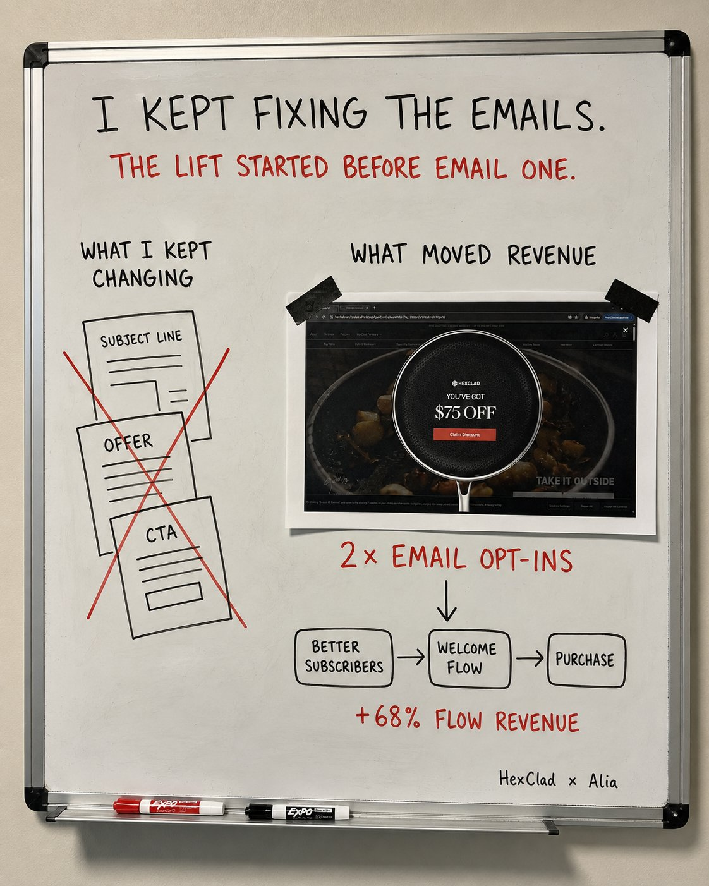

🔗 [View original post](https://x.com/ecomchasedimond/status/2099889674869494101)

---

### 🕐 15:54 UTC · @Wise1Philosophy

> SCREENS ARE NO LONGER STATIC @shourya0714 and the @flamappofficial team just secured a $40M Series B to make spatial interfaces the default 🙌 the numbers back it up: → 100 plus enterprise clients → 15 patents locked down → @QEDInvestors leading the round watch this space 👀 announcing @flamappofficial&apos;s $40M Series B led by @QEDInvestors with @iamsrk @rtpvc @RMartinChavez @oliveur joining the rocketship its time to break free 🚀

🔗 [View original post](https://x.com/DataChaz/status/2099889663586476174)

---

### 🕐 15:51 UTC · @Wise1Philosophy

> YOUR MACBOOK HAS A HIDDEN FOLDER THAT&apos;S EATING 50GB OF YOUR STORAGE. Apple never tells you what&apos;s in it. Here are 4 steps to clear it for free:👇

🔗 [View original post](https://x.com/Kevincreates77/status/2099888881265172858)

---

### 🕐 15:46 UTC · @Wise1Philosophy

> I bought three cheap ashwagandhas before I read a single label. None of them said KSM-66 and none of them did anything. Six weeks on the standardised extract and I stopped waking at 3am with my heart going. The ashwagandha I use (#ad): https://lvnta.com/lv_yDcVS1MrLzASyOKhtz

🔗 [View original post](https://x.com/Rose_MaryIRL/status/2099887501402091702)

---

### 🕐 15:46 UTC · @Wise1Philosophy

> Heart attack = blood sugar. Heart attack = insulin resistance. Heart attack = No.1 killer worldwide. 5 simple rules to protect your heart: 1. Don&apos;t go pee at 3 AM

🔗 [View original post](https://x.com/Rose_MaryIRL/status/2099887465620459938)

---

### 🕐 15:42 UTC · @Wise1Philosophy

> STOP PAYING FOR AI COURSES. The companies building AI are teaching it for free. Here are 10 resources that can take you from beginner to job-ready:

🔗 [View original post](https://x.com/AIHighlight/status/2099886700386296228)

---

### 🕐 15:42 UTC · @Wise1Philosophy

> You can easily earn $7,936 per month if you have: 1. Internet 2. Mobile 3. 1 hour per day I will teach you how. Get my step-by-step guide 100% FREE for today. Like and comment “Send” and I’ll DM it to you. Must follow me to get DM. FREE for the next 48 hours only.

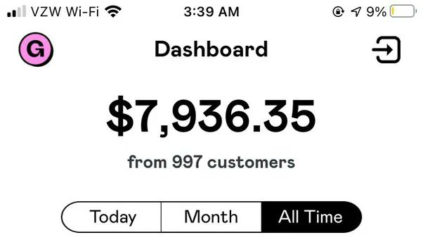

🔗 [View original post](https://x.com/jaysmith_ai/status/2099886657944375330)

---

### 🕐 15:37 UTC · @Wise1Philosophy

> realizing this free 5 minute article is worth more than every SEO course ever sold: Media https://x.com/i/article/2095839932980043776

🔗 [View original post](https://x.com/bloggersarvesh/status/2099885256266612919)

---

### 🕐 15:33 UTC · @Wise1Philosophy

> http://Fin.com bought seven companies with a $20M seed. Seven deals in 12 months, per Nabeel Alamgir&apos;s post quoted here, is a strange pace for a company that came out of stealth this week, until you look at what it is actually building. The hard part of cross-border money is the last mile, turning a stablecoin or a wire into money that lands in a local bank account in Dhaka or Lahore within minutes, with the licenses, banking relationships and payout rails each country demands. Each of those endpoints is slow, relationship-heavy work to build. That reading makes the deal count look a lot less strange. Fin says it now pays out in 30+ countries across 40+ currencies, and acquiring your way into a market tends to run faster than its licensing queue. The pitch is invisible plumbing behind fintech apps, payroll platforms and, per Fortune, prediction markets, which is how the post can claim you&apos;ve probably used Fin already. The piece I&apos;d watch is what happens after the deals close. Seven acquisitions usually means seven compliance setups and seven sets of bank relationships, and folding that into one settlement layer is where payments roll-ups get expensive. If the settlement in minutes at 0.01 to 0.3% that Fin advertises holds across all of those corridors, the coverage gets hard to copy. The last hop is where cross-border payments gets decided from here, the moment money lands in a real local account on time and at a price the sender barely notices. Whoever owns the most of those endpoints sets the terms for everyone routing money into South Asia, Africa and the Middle East. https://Fin.com. $20M Raised. 7 M&amp;A’s completed in 12 months. Investors include Expa, Coinbase Ventures, and Tenet Fund. 825 million users impacted. You have probably used us already. We help your favorite fintechs move money to the rest of the world.

🔗 [View original post](https://x.com/aakashgupta/status/2099884312590221814)

---

### 🕐 15:33 UTC · @Wise1Philosophy

> China just unveiled autonomous robotic fish for underwater surveillance. They swim like real fish. But they’re robots. Media

🔗 [View original post](https://x.com/TheAIColony/status/2099884255211827218)

---

### 🕐 15:32 UTC · @Wise1Philosophy

> A PE firm reached out to us last month to get them out of a consulting engagement. Six figures spent on AI consulting across seven portfolio companies, and all they had to show for it was a team chat subscription. They needed real EBITDA impact by December to underwrite their 2027 exits. Instead, they had a bloated 150-hour discovery deck and a dev vendor billing extra &quot;AI productivity&quot; fees with zero boost in shipping speed. PE funds are buying AI advice far faster than that advice turns into working software. Across portfolio companies, the same four gaps consistently show up between legacy consulting promises and actual engineering needs: 1. Verifiable Proof vs. Slide Decks Consultancies spend weeks on interviews to sell a maturity assessment. We spend week one building a &apos;golden set&apos;, which includes 20 to 60 real operational cases with pre-agreed correct outputs. Grant Thornton found only 9% of PE leaders can prove their AI works to a buyer within 90 days. A golden set is definitive proof. An assessment is just a slide deck promising it. 2. Production Infrastructure vs. Abstract Roadmaps Instead of selling &apos;phased journeys&apos;, we stand up a live foundation directly inside the portco&apos;s Azure tenant within three weeks. We lock down read-only data access, strip PII/PHI, and set hard per-seat cost caps. The client owns everything from day one. If we leave, nothing breaks. 3. Lean Automation Pods vs. Billable Headcount Traditional firms add $350-an-hour bodies to grow the account. We deploy a lean $17K/month, month-to-month pod: one senior engineer, automated AI development harnesses, and a fractional architect. As our harness handles more of the load, our human footprint shrinks over time instead of growing. 4. Internal Ownership vs. Vendor Lock-In Unscrupulous vendors keep client setups obscure to protect billing. We embed the portco&apos;s product owner from day one, deliver a 90-day self-sufficiency plan, and leave telemetry running. True success means the portco ships its own updates without calling us. By deploying a reusable harness in the first portco, we can roll directly into the next company in weeks rather than months. Consultancies sell funds a vision of where AI could take them. We ship the first working agent and let the CFO decide if the vision was real.

🔗 [View original post](https://x.com/mardehaym/status/2099884175318823100)

---

### 🕐 15:31 UTC · @Wise1Philosophy

> &gt; be nabeel &gt; leave bangladesh at 14, alone &gt; land in new york, don&apos;t speak the language well &gt; start as a busboy at a burger joint &gt; notice the ordering system is broken &gt; fix it, get promoted to cmo &gt; quit, build your own company &gt; raise $22m &gt; forbes 30 under 30 at 25 &gt; could coast forever &gt; don&apos;t &gt; pivot into the hardest, most boring, most necessary problem in finance &gt; build the rails so money can actually get to dhaka and karachi in minutes instead of days &gt; the same route you took at 14, except now it&apos;s the money&apos;s turn to move fast https://Fin.com. $20M Raised. 7 M&amp;A’s completed in 12 months. Investors include Expa, Coinbase Ventures, and Tenet Fund. 825 million users impacted. You have probably used us already. We help your favorite fintechs move money to the rest of the world.

🔗 [View original post](https://x.com/viipin8/status/2099883814885482821)

---

### 🕐 15:22 UTC · @Wise1Philosophy

> finally someone making graphs feel actually useful You dumped everything into your Claude Code folder. Here&apos;s how to (actually) set up a graph in four steps: Full walkthrough here → https://charliehills.substack.com/p/graph-engineering-claude-code I ignored graphs for months (context, loop, and now this). It was the thing standin…

🔗 [View original post](https://x.com/Wise1Philosophy/status/2099881473356583043)

---

### 🕐 15:21 UTC · @Wise1Philosophy

> best account on X if you want enterprise AI without the hype: The difference between an AI consultancy and a hands-on implementation firm is simple. One sells a long transformation. The other ships work, gets first numbers on the board, and iterates from real metrics. That is the better path: implement, measure, adjust, move. Not a year-lon…

🔗 [View original post](https://x.com/alex_prompter/status/2099881206842048802)

---

### 🕐 15:16 UTC · @Wise1Philosophy

> We&apos;re approaching the end of the “more features = better device” era. A phone with 20 more features sounds impressive. but people don&apos;t need 20 more things to do. They need fewer things to think about. That&apos;s where Moonphase Flip changes the equation. With an always-on E-ink display, the information you need can simply be there when you flip it open instead of making you hunt through apps and screens for it. And if the device understands context, it doesn&apos;t need to expose every capability to the user. It can quietly handle the complexity underneath. Which means the best hardware might actually become simpler on the surface while becoming much more intelligent underneath. That&apos;s a fascinating reversal. More intelligence. Less interaction. Less screen time. And a much simpler experience. Meet Moonphase Flip: a low-distraction AI screen on the back of your phone that keeps track of your to-dos and takes actions before you ask. Threads below 🧵 Explore more: https://hellomoonphase.com/s/17e982

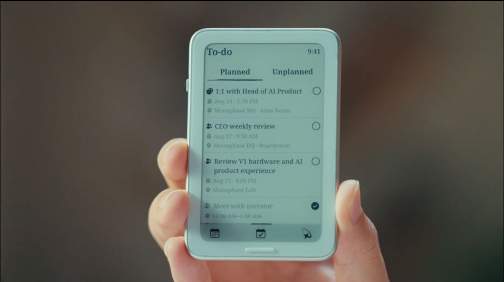

🔗 [View original post](https://x.com/ZabihullahAtal/status/2099880076385145256)

---

### 🕐 15:09 UTC · @Wise1Philosophy

> 🚨Apple has officially released iOS 27 for all users! This is the biggest iOS update. Here are 9 new features you shouldn’t miss: ↓

🔗 [View original post](https://x.com/AIFrontliner/status/2099878163715133486)

---

### 🕐 15:01 UTC · @Wise1Philosophy

> A urologist shocked me when he said: &quot;You age because your body stops making testosterone. Without it, your muscle goes, your drive goes, and your belly grows.&quot; Here&apos;s the 5-step protocol to rebuild it naturally: 1. Stop cutting the FAT out of breakfast

🔗 [View original post](https://x.com/RafaelNasriX/status/2099876202190454821)

---

### 🕐 14:49 UTC · @Wise1Philosophy

> Every standalone device got absorbed into the phone over the last decade. Incredibly convenient, but there was a hidden cost: everything became an app, and every task started with a screen. Moonphase Flip takes a different approach, your priorities are just there when you need them, without unlocking, opening an app, or searching for information. Maybe the future isn&apos;t more apps on one screen, but smarter devices that ask less from us. Meet Moonphase Flip: a low-distraction AI screen on the back of your phone that keeps track of your to-dos and takes actions before you ask. Threads below 🧵 Explore more: https://hellomoonphase.com/s/17e982

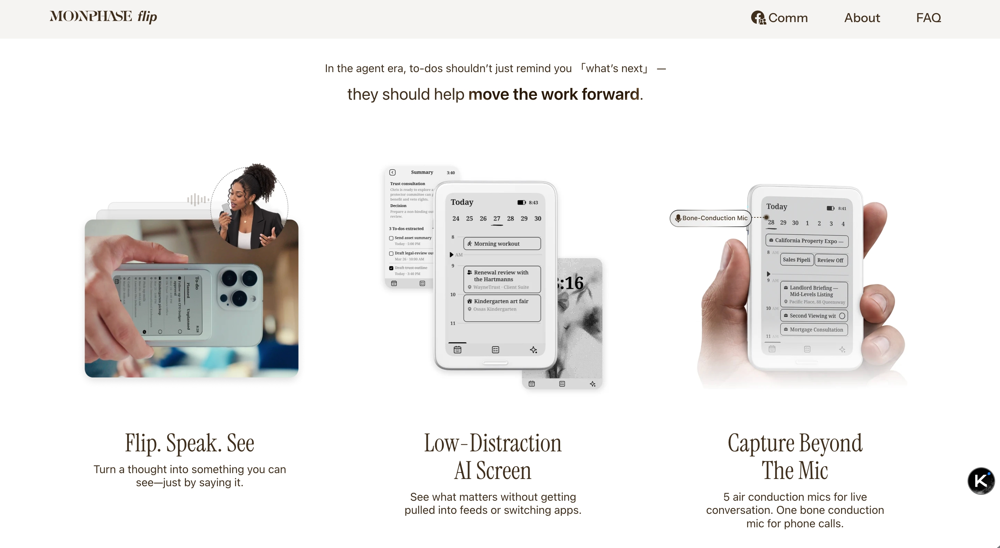

🔗 [View original post](https://x.com/HeyZoyaKhan/status/2099873138997944689)

---

### 🕐 14:31 UTC · @Wise1Philosophy

> The smartphone&apos;s greatest strength became its biggest limitation. Because everything can happen on one screen, everything eventually competes for your attention on that screen. Messages. Maps. Photos. Notes. Social media. Work. Entertainment. AI. The device is incredibly capable, but the user has to keep switching contexts. Maybe we need to optimize technology for doing less. That&apos;s what makes Moonphase Flip interesting. Specialized hardware doesn&apos;t have to mean less capable. With AI handling more of the complexity underneath, the experience can become more focused while the technology becomes more intelligent. The winning device may not be the one with the most visible capabilities. It may be the one that asks the least from you. Meet Moonphase Flip: a low-distraction AI screen on the back of your phone that keeps track of your to-dos and takes actions before you ask. Threads below 🧵 Explore more: https://hellomoonphase.com/s/17e982

🔗 [View original post](https://x.com/HeyZaraKhan/status/2099868787206197594)

---

### 🕐 14:25 UTC · @Wise1Philosophy

> Silicon Valley calls it “moving money.” A founder in Bangladesh calls it “why on earth can’t I get paid?” Same transaction. Completely different reality. That’s the opening for http://Fin.com. When getting paid is what holds you back, fixing payments means unlocking businesses that should already exist. https://Fin.com. $20M Raised. 7 M&amp;A’s completed in 12 months. Investors include Expa, Coinbase Ventures, and Tenet Fund. 825 million users impacted. You have probably used us already. We help your favorite fintechs move money to the rest of the world.

🔗 [View original post](https://x.com/alex_verem/status/2099867236148097432)

---

### 🕐 14:22 UTC · @Wise1Philosophy

> I started taking magnesium at night, a probiotic in the morning, and omega-3 at lunch. Without exaggerating, my personality changed 180 degrees. 1. Magnesium. At night. You should take it too.

🔗 [View original post](https://x.com/thisispeak007/status/2099866326819123308)

---

### 🕐 14:21 UTC · @Wise1Philosophy

> “Build from anywhere” is a bad joke if you can’t get paid from anywhere. AI helps you ship the product. The internet brings you customers. Then your bank makes geography your problem again. That’s the opportunity for http://Fin.com. An entire generation of founders whose ambition has outgrown their banking infrastructure. https://Fin.com. $20M Raised. 7 M&amp;A’s completed in 12 months. Investors include Expa, Coinbase Ventures, and Tenet Fund. 825 million users impacted. You have probably used us already. We help your favorite fintechs move money to the rest of the world.

🔗 [View original post](https://x.com/alex_prompter/status/2099866257222672718)

---

### 🕐 14:01 UTC · @Wise1Philosophy

> Larry Ellison briefly became the richest person on earth this September. His net worth crossed $200 billion overnight. Built on a single deal that has not paid a dime yet. Here is why every AI investor should be paying attention: There is a quote Ellison repeats so often people think he wrote it. &quot;It is not enough that I win. Everybody else has to lose.&quot; That is the mindset you need to understand what just happened. On September 10, Oracle announced its future orders had grown 359%. The number: $455 billion in signed contracts. Most of it tied to a single customer - OpenAI. The stock jumped 36% in one session. Its best day since 1992. Ellison owns about 40% of Oracle. His net worth spiked instantly. Then the fine print came out. Future orders are not revenue. They are promises to pay Oracle over the next decade. Not cash or money in the bank. Promises! Oracle still has to borrow tens of billions to actually build the data centers. And Oracle&apos;s free cash flow just turned negative. For the first time in nearly 30 years. The company that was profitable for decades is now bleeding cash. Everything depends on one customer paying every quarter for ten years. Now here is what history says. This is not the first time Ellison bet the company on future orders. In the late 1990s, the SEC investigated Oracle for overstating sales. The stock fell 75%. The company nearly went bankrupt. New accounting rules were written specifically because of Oracle&apos;s practices. &gt; Same founder &gt; Same playbook &gt; Bigger stakes Except this time, the entire AI trade is riding on it. Oracle is now a $450 billion company. Every S&amp;P 500 index fund on earth now owns it. Every 401k retirement plan is exposed to one contract, one customer, one promise. The customer, OpenAI, has never turned a profit. It is projected to lose $14 billion this year alone. That is the entity paying Oracle over the next decade. Most retail investors have no idea. They just buy the ticker. They watch it go up. They tell themselves it is diversified. When the story cracks, retail sells at the bottom. Then chases the recovery at the top. Same cycle. Every time. Because narrative-driven investing has no rules. It only has emotions. Rules-based strategies do not care who is the richest person on earth. They do not care about press releases. They execute the plan while everyone else guesses. That is exactly what Surmount was built for. Media

🔗 [View original post](https://x.com/SurmountInvest/status/2099861136531431613)

---

### 🕐 13:59 UTC · @Wise1Philosophy

> Many thanks to @FortuneMagazine for the exclusive: https://fortune.com/2026/09/15/exclusive-expa-coinbase-ventures-fin-com-20-million-seed-round-global-stablecoin-infrastructure/

🔗 [View original post](https://x.com/Moneymamba/status/2099860607532990911)

---

### 🕐 13:59 UTC · @Wise1Philosophy

> https://Fin.com. $20M Raised. 7 M&amp;A’s completed in 12 months. Investors include Expa, Coinbase Ventures, and Tenet Fund. 825 million users impacted. You have probably used us already. We help your favorite fintechs move money to the rest of the world. Media

🔗 [View original post](https://x.com/Moneymamba/status/2099860604810916135)

---

### 🕐 13:56 UTC · @Wise1Philosophy

> If you’ve been keeping tabs on the AI world these last few days, you need to watch this interview with Anthropic’s @DarioAmodei. He floats the idea that AI could wipe out 10% of the population before this decade is over, and he lays out why he believes “AI progress” should be slowed in the name of safety… Then he even credits @sama and @elonmusk for backing the same push. Media

🔗 [View original post](https://x.com/AiEvolutio58513/status/2099859871869067670)

---

### 🕐 13:44 UTC · @Wise1Philosophy

> ONCE YOU GET RICH, UPGRADE THESE 15 THINGS IMMEDIATELY:

🔗 [View original post](https://x.com/Better_men/status/2099856798748749977)

---

### 🕐 13:42 UTC · @Wise1Philosophy

> If I wanted to get dementia as fast as possible, here is exactly what I would do: 1. Sleep six hours a night Media

🔗 [View original post](https://x.com/MarkoSilva291/status/2099856296661180546)

---

### 🕐 13:24 UTC · @Wise1Philosophy

> You can earn $7000/month if you have ChatGPT, a laptop, and 60 mins a day. Usually, I&apos;d charge $79 for this guide, but today you get it completely free. Like + reply &apos;Money&apos; and I&apos;ll send you my detailed guide for FREE. Must follow me to get guide in your DM. FREE for 48 hrs.

🔗 [View original post](https://x.com/iam_chonchol/status/2099851875906682899)

---

### 🕐 13:16 UTC · @Wise1Philosophy

> ESTA ESCENA DE LUCHA CINEMATOGRÁFICA COMENZÓ CON DOS SENCILLOS MANIQUÍES 3D Planifiqué cada patada, caída y ángulo de cámara dentro de @pippitofficial usando su 3D Director Studio. Luego, Seedance 2.5 transformó la puesta en escena en la toma final. Cómo funciona el flujo completo: → Creas personajes 3D y más de 150 objetos dentro de Pippit → Coreografías acciones en una línea de tiempo (patadas, saltos, reacciones) → Planificas movimientos de cámara y encuadres → Sincronizas cada movimiento en la timeline hasta que la secuencia se ve correcta → Renderizas la animación 3D como referencia → Seedance 2.5 convierte ese bloqueo 3D en video cinematográfico de acción real → Conserva el movimiento y la sincronización que planeaste Lo que antes era dejar cada toma al azar, ahora es dirigir la escena exactamente como la visualizas. Deja de depender del azar. Planifica en 3D, dirige el movimiento y dale vida con Seedance 2.5. Prueba 3D Director Studio aquí: http://www.pippit.ai/?utm_medium=Media&amp;utm_source=influencers_agency&amp;utm_campaign=x&amp;utm_content=2609_bld_ALEXANDERINSPIRA #3DDirectorStudio #PippitAI #Seedance25 #PippitPartner Media

🔗 [View original post](https://x.com/Alex_Inspira/status/2099849818650919188)

---

### 🕐 13:16 UTC · @Wise1Philosophy

> This changes the whole workflow!! 🔥 Woww.. Pletor just launched what they&apos;re calling the first creative agent for commerce. &gt; learns your identity, products, top performers and creative skills &gt; you brief it like a team, not a prompt box &gt; picks the references, models and products itself &gt; builds every asset on an …

🔗 [View original post](https://x.com/Wise1Philosophy/status/2099849806810108121)

---

### 🕐 13:05 UTC · @Wise1Philosophy

> 69% of B2B buyers chose a different vendor than they originally planned based on what an AI chatbot told them. 33% bought from a brand they had never even heard of before. Increasingly in 2026 and beyond, if your brand is not the one AI is recommending, someone else’s brand is taking your deal. That is the reality SEO Stuff (https://www.seo-stuff.com/gold-plan-package) is helping businesses deal with every day. If you want to see where your site stands across Google and AI search, start here. It’s free: https://seo-stuff.com/free-audit According to G2’s 2026 Answer Economy report, based on 1,076 B2B software buyers and decision-makers, AI chatbots are now the number one source influencing which vendors make buyer shortlists. They are ahead of review sites, analyst reports and vendor websites. 51% of B2B software buyers now start their research with an AI chatbot more often than Google, up from 29% a year ago. 85% also say they think more highly of a vendor when it is cited in an AI-generated answer. Put simply, a buyer may walk in planning to use Vendor A, ask ChatGPT or Perplexity for recommendations and end up buying from Vendor B. One in three buyers in the study purchased from a brand they had never heard of before AI recommended it. Basically, in the old model, brand awareness did a lot of the filtering. Buyers shortlisted companies they already knew, then compared the familiar options. Now a lesser-known company can enter the shortlist purely because AI surfaced it during the research process. And a well-known company can lose a deal it assumed was secure because AI introduced the buyer to a better-fit alternative. So what determines whether AI recommends your brand or someone else’s? A big part of it comes down to two things: coverage and authority. When someone asks ChatGPT for the best project management tool for agencies or asks Perplexity for top CRM platforms for mid-market companies, the system may research several different parts of the decision before forming an answer. That can include features, pricing, use cases, integrations, alternatives, implementation, customer proof and category-specific questions. A brand with strong content across those areas has more chances to be discovered than one with a homepage and a handful of generic feature pages. Authority matters too. AI systems are much more comfortable citing companies and sources that have credible third-party validation through trusted publications, expert attribution, industry coverage, reviews and contextual backlinks. The brands building that visibility now are the ones putting themselves in position to take deals from competitors who are not. This is the system SEO Stuff was built around: http://seo-stuff.com The done-for-you package combines AI-search-optimized content with DR50+ contextual authority placements: https://seo-stuff.com/gold-plan-package The content helps your brand cover the commercial questions buyers ask before choosing a vendor, while the authority placements reinforce your expertise across trusted third-party sources. The Premium Content Bundle goes deeper: https://seo-stuff.com/premium-content-bundle-service It includes 60 long-form pieces designed to build broad coverage across the questions, comparisons, use cases and problems surrounding your category. That gives AI systems more opportunities to encounter your brand while researching a buyer’s decision. And the Premium Backlink Bundle strengthens the authority side: https://seo-stuff.com/premium-backlink-bundle-service It adds contextual DR50+ placements from trusted publishers that can help reinforce your brand, category and credibility across the web. Want to see how your brand is showing up in ChatGPT, Claude, Google AI, Grok, Perplexity and so forth? Start here. It’s free: https://seo-stuff.com/free-audit A brand followed the recommendations in this article and added $100,000 in Google, ChatGPT and broader AI search-related traffic.

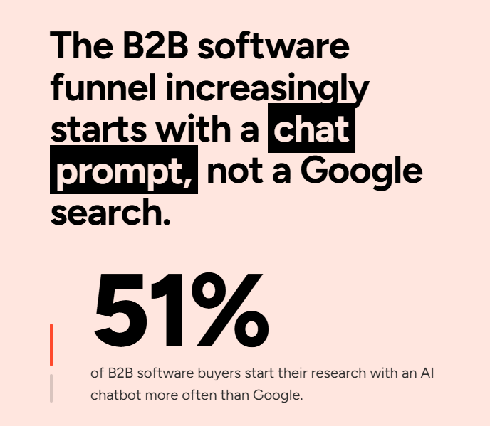

🔗 [View original post](https://x.com/alexgroberman/status/2099847098539921497)

---

### 🕐 13:04 UTC · @Wise1Philosophy

🔗 [View original post](https://x.com/Life__Mastery/status/2099846835758104984)

---

### 🕐 13:02 UTC · @Wise1Philosophy

> The 5 supplements you actually need to boost testosterone after 35: 1. Ashwagandha

🔗 [View original post](https://x.com/MagnusLindbrg/status/2099846203223724132)

---

### 🕐 13:00 UTC · @Wise1Philosophy

> It&apos;s ok to start over again...let somebody else appreciate you, and love you correctly.

🔗 [View original post](https://x.com/_Pammy_DS_/status/2099845699558875278)

---

### 🕐 12:51 UTC · @Wise1Philosophy

> Boring businesses are the greatest wealth-building tool for average Americans. Problem is, 99% of people don’t know which ones to start. Here are the top 7 anyone can use to get rich: 1) Line Painting Media

🔗 [View original post](https://x.com/cleanwithmike/status/2099843536770236838)

---

### 🕐 12:42 UTC · @Wise1Philosophy

> If I were in my 40s &amp; wanted to retire in the next 10 years, here&apos;s exactly what I&apos;d do: 1. Start an LLC before the week is over. Not next month. Not after you &quot;research more.&quot; This week.

🔗 [View original post](https://x.com/gedamtekle/status/2099841176060805502)

---

### 🕐 12:36 UTC · @Wise1Philosophy

> All Paid Courses (Free for First 4500 People) 𝗣𝗮𝗶𝗱 𝗖𝗼𝘂𝗿𝘀𝗲 𝗙𝗥𝗘𝗘 (PART - 1) 1. Artificial Intelligence 2. Machine Learning 3. Prompt Engineering 4. Claude,Chatgpt,Grok 5. Data Analytics 6. AWS Certified 7. Data Science 8. BIG DATA 9. Python 10. Ethical Hacking (72 Hours only ) Like + RT + comment &apos; Drive &apos; Must Follow me so I can DM you.

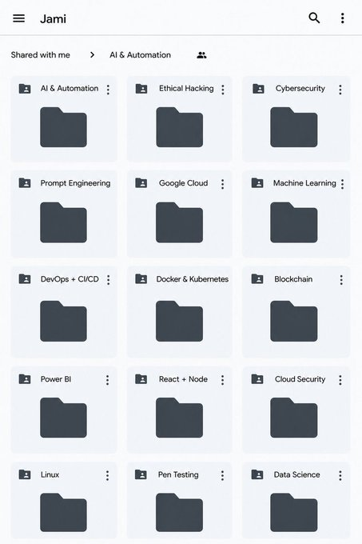

🔗 [View original post](https://x.com/heyadam_ai/status/2099839689540894883)

---

### 🕐 12:34 UTC · @Wise1Philosophy

> Dr. Mark Hyman, a 16 time New York Times best seller, spent decades to prove your body is designed to heal itself. Here’s 10 protocols to reduce symptoms in just 6 days; 1. Food is not fuel. Every bite changes your gene.

🔗 [View original post](https://x.com/LongevityCode_/status/2099839361714106859)

---

### 🕐 12:32 UTC · @Wise1Philosophy

> Years back, my heart went into atrial fibrillation at 3am. I was standing alone in a hospital corridor. I was the doctor on shift. And my own body was shutting down. The cause? Not genetics. Not diet. Not hypertension. Not stress alone. 1. I wasn&apos;t sleeping.

🔗 [View original post](https://x.com/Dr_Biohacker/status/2099838648665694314)

---

### 🕐 12:30 UTC · @Wise1Philosophy

> Holy f*ck, this actually an insane take: https://x.com/i/article/2098362190201843721

🔗 [View original post](https://x.com/creatorpascal/status/2099838365587722615)

---

### 🕐 12:30 UTC · @Wise1Philosophy

🔗 [View original post](https://x.com/Wise1Philosophy/status/2099838301939073158)

---

### 🕐 12:30 UTC · @Wise1Philosophy

> Tu teléfono es mucho más potente de lo que crees. Aquí tienes 15 apps que casi nadie conoce y tu smartphone necesita... Te dejarán sin palabras 🤐

🔗 [View original post](https://x.com/IA_Quijote/status/2099838259077513684)

---

### 🕐 12:29 UTC · @Wise1Philosophy

> wtf did I just read: https://x.com/i/article/2098362190201843721

🔗 [View original post](https://x.com/IAmPascio/status/2099837961701331216)

---

### 🕐 12:28 UTC · @Wise1Philosophy

> https://x.com/i/article/2098362190201843721

🔗 [View original post](https://x.com/Scottvdberg/status/2099837847729537271)

---

### 🕐 12:28 UTC · @Wise1Philosophy

> 80% of people who start the gym quit before their muscles actually start responding. 8 things you need to know before the third month:

🔗 [View original post](https://x.com/BeBetterMan_/status/2099837682079924346)

---

### 🕐 12:26 UTC · @Wise1Philosophy

> Your body is flooded with cortisol and you do not even realise it. These are the 9 signs that confirm it: 1. Waking between 2 and 4am Media

🔗 [View original post](https://x.com/mind_and_beauty/status/2099837152158949495)

---

### 🕐 12:24 UTC · @Wise1Philosophy

> Heart Attack = Blood sugar Heart Attack = Insulin resistance Heart Attack = No. 1 cause of death on Earth. Here’s the simple fix to protect your heart: 1. Don&apos;t go pee at 3 AM Media

🔗 [View original post](https://x.com/CoachDanCole_/status/2099836685228093481)

---

### 🕐 12:23 UTC · @Wise1Philosophy

> 93% of Gen Z interns say they want to make it to senior leadership. So I looked at the people who get promoted faster than everyone else. They all have these 4 things in common:

🔗 [View original post](https://x.com/valematvei/status/2099836395799953471)

---

### 🕐 12:22 UTC · @Wise1Philosophy

> One Agent plus an infinite board feels very clean, Pletor Pletor just dropped 2.0 and it completely changes how commerce brands make AI visuals. It&apos;s no longer just a workflow builder, it&apos;s a creative system built around your brand. &gt; Brain: guidelines, products and past campaigns in one place &gt; set it up from your site URL, brand book …

🔗 [View original post](https://x.com/Wise1Philosophy/status/2099836223053275308)

---

### 🕐 12:21 UTC · @Wise1Philosophy

> If you want a flat stomach, fix your cortisol ASAP. I switched my method a month ago and I&apos;m pissed off I didn&apos;t do it before. Here&apos;s what got rid of belly fat for me:

🔗 [View original post](https://x.com/CoachWillStone/status/2099835966911640057)

---

### 🕐 12:15 UTC · @Wise1Philosophy

> CTO: I want my engineers shipping with agents by next quarter. Me: Your engineers or ours? CTO: Mine. Yours already do. Me: Then I&apos;d start with you. CTO: Me personally? Me: You personally. If the person who owns the architecture won&apos;t push code through the harness, nobody below him will trust it. CTO: And when my code breaks something in a repo you&apos;re accountable for? Me: Then it gets caught in review, same as anyone&apos;s. You don&apos;t get a separate lane. CTO: You&apos;d let me commit into the platform you&apos;re contracted to deliver? We did, and he built his own agent harness. First production delivery from that workflow landed in April 2026. We&apos;ve been working on this performance marketing platform for three years. It started as a discovery project in 2023 and became all of it: product analysis, architecture, front end, back end, QA, DevOps. They had no engineering capability in-house when we met. Here&apos;s what year three looks like. Q1 2026: 22 production releases, around 120 tickets, zero rollbacks, all five planned major features delivered. February through June: 34 releases, six to nine every month. What makes it more impressive is that in February, our tech lead and solution architect both left. Why didn&apos;t it all fall apart? Because we&apos;d been running structured knowledge transfer since December. Three role transitions in five months, but the cadence never moved. That only works when the system doesn&apos;t live in anyone&apos;s head.

🔗 [View original post](https://x.com/mardehaym/status/2099834371696115932)

---

### 🕐 12:14 UTC · @Wise1Philosophy

> Fasting 96 hours literally causes your body to eat up diseased tissues, tumors, inflammation and toxins that hurt your longevity. I just started my fast for 4 days. Here’s exactly what I did:

🔗 [View original post](https://x.com/TheFastedState/status/2099834257174859795)

---

### 🕐 12:11 UTC · @Wise1Philosophy

> Your body is flooded with cortisol and you do not even realise it. These are the 9 signs that confirm it: 1. Waking between 2 and 4am Media

🔗 [View original post](https://x.com/DPro_Coach/status/2099833518432141401)

---

### 🕐 12:10 UTC · @Wise1Philosophy

> Anthropic just published its worst-case AI scenario. Good news: US economy grows 32% by 2030. Bad news: Almost none of it&apos;s going to you. Here&apos;s exactly what they said (&amp; how you can save yourself):

🔗 [View original post](https://x.com/erichustls/status/2099833133482828147)

---

### 🕐 12:08 UTC · @Wise1Philosophy

> A poor diet is the #1 reason people can&apos;t lose weight. After coaching 800+ people, the ones who lose the fastest do this same thing, pick 3-4 simple diet on repeat. Here&apos;s the list: 1. 𝐄𝐠𝐠 &amp; 𝐑𝐢𝐜𝐞 (𝐒𝐢𝐦𝐩𝐥𝐞)

🔗 [View original post](https://x.com/Fitby_Chandler/status/2099832848446582785)

---

### 🕐 12:04 UTC · @Wise1Philosophy

> THE ONLY 5 EXERCISES YOUR BODY REALLY NEEDS. 1. Walking Media

🔗 [View original post](https://x.com/BeBetter_Athlet/status/2099831828748390511)

---

### 🕐 12:01 UTC · @Wise1Philosophy

> Eating anti-inflammatory for 30 days will have your energy stable, your stomach flat, and your skin completely different. Here are the bowls that changed ever ything for me:

🔗 [View original post](https://x.com/LevelUpPrime/status/2099830993893101865)

---

### 🕐 11:50 UTC · @Wise1Philosophy

> If you wake up to pee at 3 AM, it&apos;s cortisol. If your face is puffy, it&apos;s cortisol. If your libido is 0, it&apos;s cortisol. Here are the simple tips to fix all three: 1. No food 3 hours before bed Media

🔗 [View original post](https://x.com/HeyKimChong/status/2099828097772319216)

---

### 🕐 11:30 UTC · @Wise1Philosophy

🔗 [View original post](https://x.com/Daily__wisdom_/status/2099823242814910950)

---

### 🕐 11:28 UTC · @Wise1Philosophy

> yup, photographers are gonna have some thoughts 👀 🚨 BREAKING NEWS: ChatGPT can now give your photos a full professional photoshoot glow-up Some prompts you can use are as follows:

🔗 [View original post](https://x.com/Wise1Philosophy/status/2099822725862719834)

---

### 🕐 11:16 UTC · @Wise1Philosophy

> Fatty liver now affects 1 in 3 adults. It destroys your metabolism, tracks with diabetes, and increases your risk of heart disease. Here is how to walk it back: 1. Eat all the sweet potatoes you want.

🔗 [View original post](https://x.com/CoachJulianNiko/status/2099819526875759053)

---

### 🕐 11:15 UTC · @Wise1Philosophy

> ChatGPT vs Gemini vs Claude vs Grok vs DeepSeek. Each one has different strengths and use cases. Some excel in multimodal creativity, others stand out in deep research, real-time updates or lower costs. Choosing the right one helps you become truly effective with AI. [ 🔖 bookmark this post for later ] Here&apos;s your complete guide: 1. ChatGPT The all-rounder AI is ideal for text, audio, video, code, and automation-focused tasks. 2. Gemini Ideal for Google Workspace users, with deep integration across Gmail, Docs, Sheets, and Drive. 3. Claude An AI built for safety, with long-context reasoning and strong accuracy in legal or policy-heavy work. 4. Grok A real-time social AI for X/Twitter, delivering witty answers and keeping up with breaking news. 5. DeepSeek An open-source powerhouse that’s cost-efficient, technically strong, and designed to scale. Mastering AI goes beyond picking a single “best” model. The key is matching the right tool to the right job. Save this guide. Share it. Start with one use case. 📌 Get Advanced ChatGPT Guide (free): https://bit.ly/3StIB3z 👉 Follow me @AndrewBolis for more and 🔄 Repost this to help others use AI

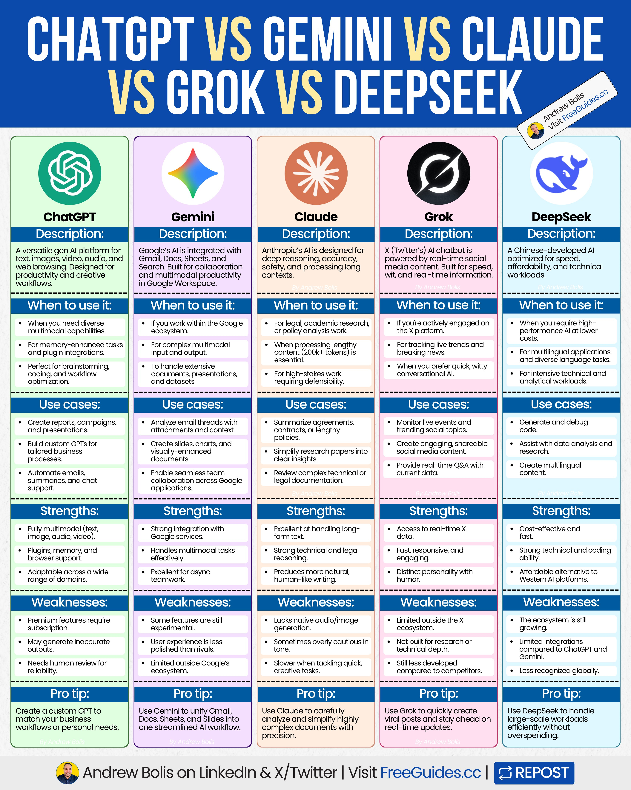

🔗 [View original post](https://x.com/AndrewBolis/status/2099819277889187905)

---

### 🕐 11:02 UTC · @Wise1Philosophy

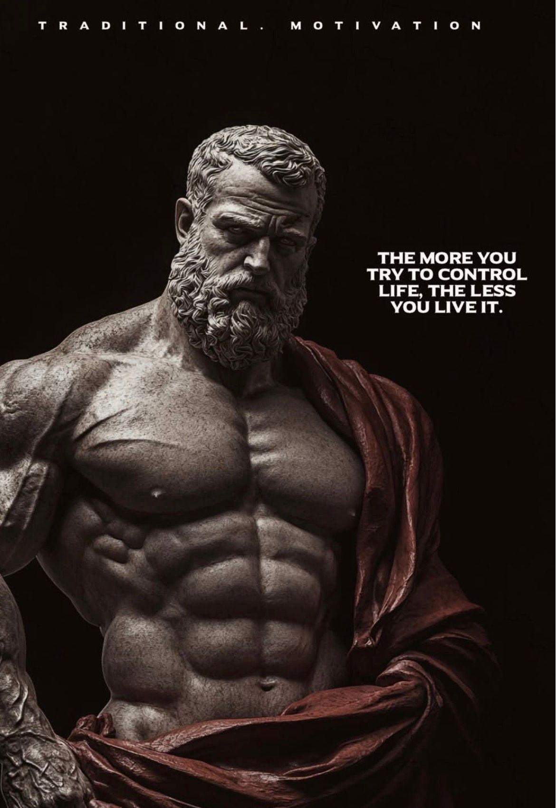

🔗 [View original post](https://x.com/apex_mentality_/status/2099816205691310138)

---

### 🕐 10:56 UTC · @Wise1Philosophy

> a16z’s David George argues ai is pushing the power law into overdrive because money itself can now stack a company’s edge: “it’s pretty obvious the power law is sharper today than it’s been for the past 10 to 20 years of tech investing, maybe since the rise of network effect consumer winners.” “we’ve always lived with increasing returns… reputation, resource buildup, and other forms of accumulation create defensible advantages.” “all of that still holds. but with the labs, for the first time in my career, you can basically pour capital into a company and that spend directly amplifies the lead.” “traditionally, the fastest way to ruin a startup is to swamp it with cash, hire 1,000 people, and end up with coordination drag, overhead, and teams pulling in different directions… because humans can’t scale execution fast enough.” “but this time it’s different. you can funnel dollars into compute, and the compute turns into better products and stronger businesses. so it’s not shocking the power law looks more extreme. in ai, scale economies are very real right now, and i expect that to keep being true.” Media

🔗 [View original post](https://x.com/AiEvolutio58513/status/2099814555195228437)

---

### 🕐 10:46 UTC · @Wise1Philosophy

> 7 early signs that your liver is quietly starting to fail (and what to do about it): 1. Itching, especially at night

🔗 [View original post](https://x.com/IranaJasmin/status/2099811975517950447)

---

### 🕐 10:33 UTC · @Wise1Philosophy

> You don&apos;t need to open 6 apps for small jobs. Siri AI does all 6 for you (in plain words): MESSAGES Finds the restaurant a friend sent you. No scrolling back through three weeks of chat. MAIL Pulls up your hotel confirmation number. Even from the email you forgot about. CALENDAR Adds the dinner plan sitting on your screen. You don&apos;t retype a single detail. MUSIC Adds the song to your gym playlist. You just say which one. APPLE CASH Splits the bill with your friends. Nobody gets the calculator out. CAMERA Tells you how healthy the plate in front of you is. Point, ask, done. iOS 27 brought this on 14 Sep, and it&apos;s a beta. You&apos;ll need an iPhone 15 Pro or later. It&apos;s English first, and not in the EU or China yet. Expect daily limits, with paid Expanded Access. To try it, update to iOS 27 and opt in. Join the waitlist if Apple puts you on one. The big change is simple. Old Siri answered you. Siri AI reads your apps, sees your screen and acts. Start with the one you do ten times a day. Follow Muhammad Ayan ♻️ Repost to help others Which job would you give Siri first? https://x.com/i/article/2097274811928231936

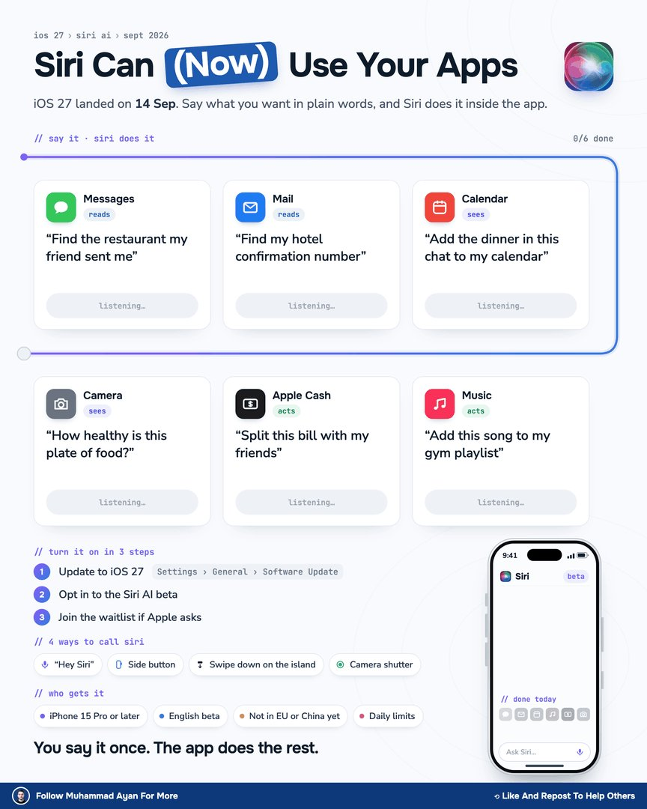

🔗 [View original post](https://x.com/socialwithaayan/status/2099808865424711783)

---

### 🕐 10:30 UTC · @Wise1Philosophy

> YOUR MACBOOK HAS BEEN SECRETLY SLOWING DOWN FOR MONTHS. Here&apos;s the one setting that fixes it:👇

🔗 [View original post](https://x.com/Kevincreates77/status/2099808132122001748)

---

### 🕐 10:30 UTC · @Wise1Philosophy

🔗 [View original post](https://x.com/yeti_mind/status/2099808078791139356)

---

### 🕐 10:29 UTC · @Wise1Philosophy

> What if we got to experience Los Santos like this in GTA 6? This feels like a game I could spend hours playing. Created with @itsPolloAI #PolloAI #GTA6 #AIVideo Media

🔗 [View original post](https://x.com/thetripathi58/status/2099807810880221459)

---

### 🕐 10:26 UTC · @Wise1Philosophy

> You can make around $800/month with ChatGPT, a laptop, an internet connection, and just 60 minutes a day. I know it sounds crazy, but AI has created some very practical ways to make money online. Here’s the simple approach 🧵👇

🔗 [View original post](https://x.com/REXO_TECH/status/2099807075773903320)

---

### 🕐 10:19 UTC · @Wise1Philosophy

> 🚨 BREAKING NEWS: Apple has officially released iOS 27 for all users! One of the biggest updates to iOS to date. Here are 9 new features you shouldn&apos;t miss:

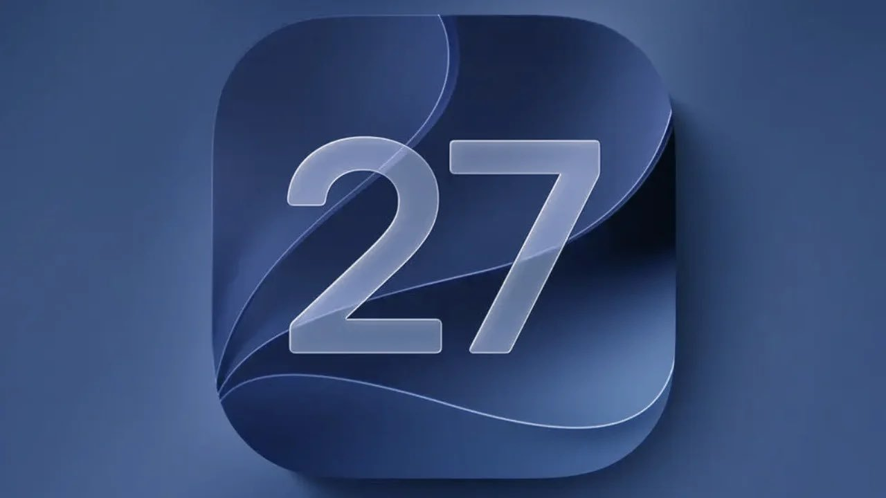

🔗 [View original post](https://x.com/AriaWestcott/status/2099805368889016536)

---

### 🕐 10:19 UTC · @Wise1Philosophy

> The 3pm crash in your energy, your focus and your mood is extremely easy to fix once you realize this:

🔗 [View original post](https://x.com/dzejlacathleen/status/2099805173220819384)

---

### 🕐 10:06 UTC · @Wise1Philosophy

> Recuperamos 8 horas de trabajo cada semana después de delegar la pre-investigación a Viktor. Cada día aparecen cientos de noticias, herramientas y novedades sobre IA. En GptZone, nuestro problema ya no era encontrar información. Era saber cuál merecía convertirse en contenido. Entre medios, blogs, newsletters, lanzamientos, redes y comunidades, podíamos pasar buena parte del día buscando. Y durante mucho tiempo lo hicimos. Abrir fuentes. Revisar novedades. Descartar ruido. Comprobar si ya habíamos hablado del tema. Buscar un ángulo. Y finalmente decidir qué merecía llegar a nuestra web, newsletter o redes. La IA nos ayudaba, pero había algo bastante absurdo: para preguntarle qué era importante, primero teníamos que encontrar nosotros lo importante. Así que cambiamos el enfoque con Viktor. En lugar de usarlo para crear contenido, empezamos a delegarle el trabajo que ocurre antes de crearlo. Le dimos nuestras fuentes y criterios de investigación. Viktor revisó las fuentes, organizó las señales, identificó patrones y preparó oportunidades editoriales dentro de Slack. El resultado fue 8 horas recuperadas cada semana para el equipo, mientras seguíamos publicando más de 1.000 contenidos al mes entre web, newsletter y redes. Y eso es lo importante: Viktor no decide qué publicamos. Nos entrega el trabajo previo para que nuestro equipo pueda revisar, priorizar y tomar la decisión final. Viktor trabaja dentro de Slack y Microsoft Teams y conecta con 3.200+ herramientas. Un chatbot espera a que encuentres algo y le hagas una pregunta. Un AI employee puede encargarse del trabajo que ocurre antes de esa pregunta. Menos tiempo buscando. Más tiempo creando. Hire @viktor_com for your team. $100 in credits included, no card. Full link in first comment. In partnership with Viktor.

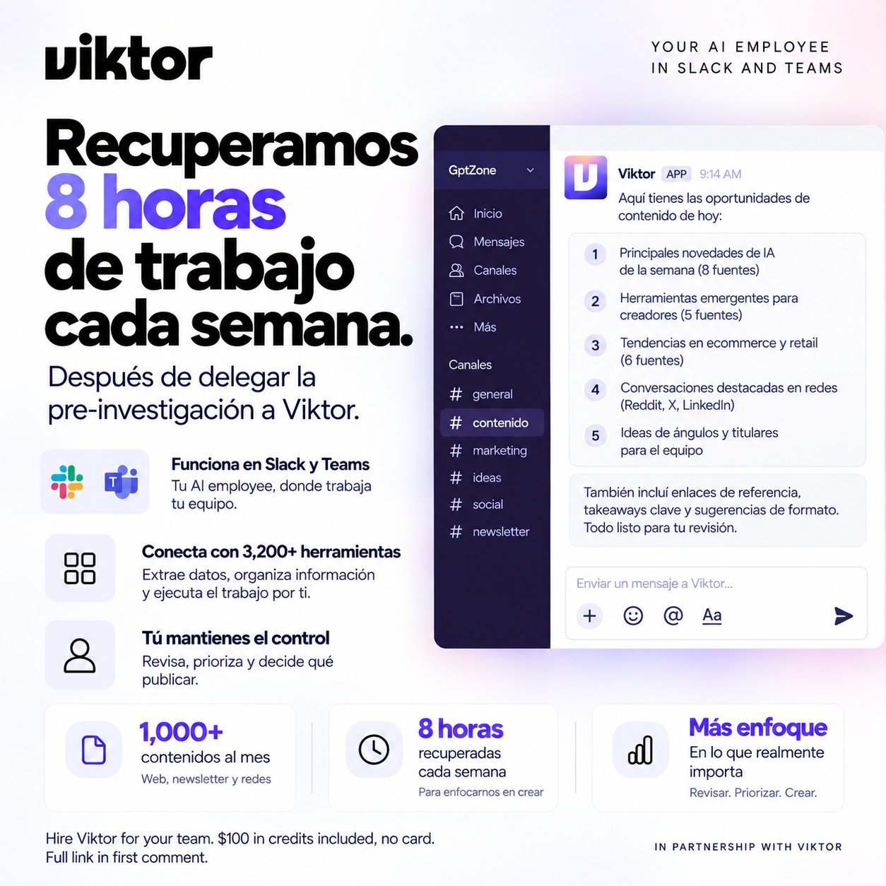

🔗 [View original post](https://x.com/MiguelMaestroIA/status/2099801937738608667)

---

### 🕐 10:00 UTC · @Wise1Philosophy

> TAKING MAGNESIUM CORRECTLY WILL STOP THE CRAMPS YOU HAVE BEEN BLAMING ON DEHYDRATION. (99% ARE TAKING THE WRONG FORM)

🔗 [View original post](https://x.com/yourcamilavega/status/2099800426942173288)

---

### 🕐 09:51 UTC · @Wise1Philosophy

> 🚨 SOMEONE BUILT A FULL GAME ALONE No team. No 3D modeling skills. He talked to an AI and it wrote the code and built the game. You can play it right now in your browser. No download. No install. Click in and you&apos;re on a bike: throwing papers, dodging dogs. Not a tech demo. A real game. The numbers: - Tokens used: 1.56 billion - Time to build: 39 hours - Cost in AI usage: $2,175 - Commits: 90 - Days from start to launch: 11 He ran two separate chats the whole time: One handled how the game plays. The other handled how it looks. The AI was fine at houses and trees. Faces were the problem so he made a character in a different tool, turned it into a 3D model, and handed it back to the AI to finish. What actually surprised him: the AI took screenshots of its own work, checked them, and fixed most mistakes on its own. One guy, one AI, a few days. Media

🔗 [View original post](https://x.com/charliejhills/status/2099798372941242629)

---

### 🕐 09:50 UTC · @Wise1Philosophy

> This is the cutest thing you&apos;ll see today and it was made entirely with AI.

🔗 [View original post](https://x.com/AIHighlight/status/2099797921549979769)

---

### 🕐 09:30 UTC · @Wise1Philosophy

🔗 [View original post](https://x.com/Ant_Philosophy/status/2099792934782583022)

---

### 🕐 09:00 UTC · @Wise1Philosophy

> Having energy in the morning, the afternoon and the evening is extremely easy once you realize this:

🔗 [View original post](https://x.com/HiVioletMM/status/2099785323840778631)

---

### 🕐 08:31 UTC · @Wise1Philosophy

> someone just dropped a 21-minute masterclass on turning $1k into $1m trading memecoins. no fluff. just the full strategy, mistakes, entries and what most people keep getting wrong. if you trade memecoins, this is worth watching. Media

🔗 [View original post](https://x.com/daveydefi/status/2099778187089621073)

---

### 🕐 08:30 UTC · @Wise1Philosophy

🔗 [View original post](https://x.com/Mindsthatbuild/status/2099777822659129768)

---

### 🕐 08:19 UTC · @Wise1Philosophy

> Two warriors face off in a cinematic bamboo forest, with every strike, block, and counterattack planned before generation. 3D Director Studio is @pippitofficial&apos;s 3D workspace for planning a scene before you generate it, 150+ props, a character action library, keyframe timing on a timeline, drawn movement trajectories and full camera control, all before Seedance 2.5 renders a frame. For this scene, we arranged two fighters and choreographed their movements to create a fast-paced battle sequence. Every position, action, and camera angle was planned in the 3D workspace before bringing the scene to life with Seedance 2.5. Try Pippit 3D Director Studio:https://www.pippit.ai/?utm_medium=Media&amp;utm_source=influencers_agency&amp;utm_campaign=x&amp;utm_content=2609_bld_TheAIColony #3DDirectorStudio #PippitAI #Seedance25 #PippitPartner Media

🔗 [View original post](https://x.com/TheAIColony/status/2099775010357317690)

---

### 🕐 08:19 UTC · @Wise1Philosophy

> A heart doctor once admitted: “There are 3 types of people who never get heart attacks.” 1. You don&apos;t get up at 3 AM to pee Media

🔗 [View original post](https://x.com/Sophiaz6xo/status/2099774993064489175)

---

### 🕐 08:11 UTC · @Wise1Philosophy

> China just built a robotic fish for underwater surveillance. And you could easily mistake it for the real thing. It swims like a fish, navigates on its own, avoids obstacles and can operate underwater without a fixed route. We’re entering the era where robots don’t have to look like robots. https://x.com/RT_com/status/2099419420833517648/video/1 Media

🔗 [View original post](https://x.com/TheAIColonyRD/status/2099773147285275116)

---

### 🕐 08:01 UTC · @Wise1Philosophy

🔗 [View original post](https://x.com/Wise1Philosophy/status/2099770651863134643)

---

### 🕐 07:47 UTC · @Wise1Philosophy

> 5 things that defines what &quot;AI-ready&quot; actually means in diligence: There&apos;s 5 things that defines what &quot;AI-ready&quot; actually means in diligence. 1. Platform quality. CI/CD, automated testing, clean APIs. Not nice-to-haves. The foundation AI tooling needs to function. 2. Data foundations. Can the team access, validate, and govern the data AI models …

🔗 [View original post](https://x.com/mardehaym/status/2099767142560215449)

---

### 🕐 07:46 UTC · @Wise1Philosophy

> If you run value creation for a PE fund, you&apos;re about to make the same decision four or five times this year: how do we get AI into this portco? FTI&apos;s 2026 Private Equity AI Radar puts the problem in two numbers. 95% of funds say their AI initiatives met the business case, while 43% of their portfolio companies still aren&apos;t materially using AI, and 35% of funds name talent as the top barrier against 20% for budget. The pilot in portco one works and portco two is waiting on people. So the decision is where the hands come from. I&apos;ve sat in this conversation with operating partners across healthcare, logistics, and financial services this year, and it comes down to three options. Hiring means a senior AI engineer who has shipped an agent to production, which costs $400K to $600K a year fully loaded, takes a quarter to find, and another quarter to become useful inside a portco he didn&apos;t grow up in, and then you repeat the search for the next company in a market where every fund and every lab is bidding for the same people. FTI says 68% of funds are choosing this path, which is why so many of them are still at one portco. A consultancy at $50K to $150K delivers a strategy, a maturity assessment, and a roadmap, and the portco CFO ends up with a document he now has to find engineers to execute. Because the model bills by the man-day, the team on the account tends to grow over time rather than shrink. An embedded pod is one senior engineer with agents across the whole delivery cycle plus a fractional architect, at $17K a month, month-to-month, operational three to five weeks from signature, with proof of value in month one. When portco one is done the same pod moves to portco two and brings the harness, the eval discipline, and the cost dashboard with it. Twelve months, one portco: roughly $450K and a six-month ramp for the hire, $100K and no working software for the consultancy, $204K and a working agent by month three for the pod. Across four portcos the gap widens because the pod gets faster on each company and the hire starts from zero every time. PE-referred engagements close in two to four weeks against our twelve-week average, because the operating partner has already watched it work next door. The second portco is closer to a referral than a sale, and that&apos;s where the compounding comes from. Change any of my numbers to yours. If the hire still wins, hire. Most of the time it doesn&apos;t.

🔗 [View original post](https://x.com/Paul_Bracht/status/2099766832148230372)

---

### 🕐 07:45 UTC · @Wise1Philosophy

> There&apos;s 5 things that defines what &quot;AI-ready&quot; actually means in diligence. 1. Platform quality. CI/CD, automated testing, clean APIs. Not nice-to-haves. The foundation AI tooling needs to function. 2. Data foundations. Can the team access, validate, and govern the data AI models require? 60% of unsupported AI projects get abandoned (Gartner). 3. Engineering metabolism. How fast does this org absorb new tooling? Is there a pattern for evaluating and integrating new capabilities, or does every new tool become a 6-month initiative? 4. Talent readiness. Can developers critically evaluate AI output? Not just use it. Catch when it&apos;s wrong. 5. Leadership alignment. Is the CTO driving this with engineering buy-in, or is it a board mandate landing on a team that didn&apos;t ask for it? Companies that get this right see 30-35% ROI when AI layers onto mature digital foundations. Companies that skip the foundation work? 15-20% at best. And 40% of investors report 5%+ valuation haircuts when digital maturity lags behind. The question isn&apos;t whether a portco is &quot;using AI.&quot; It&apos;s whether their engineering org can digest it. That&apos;s the line between a checkbox and a competitive advantage.

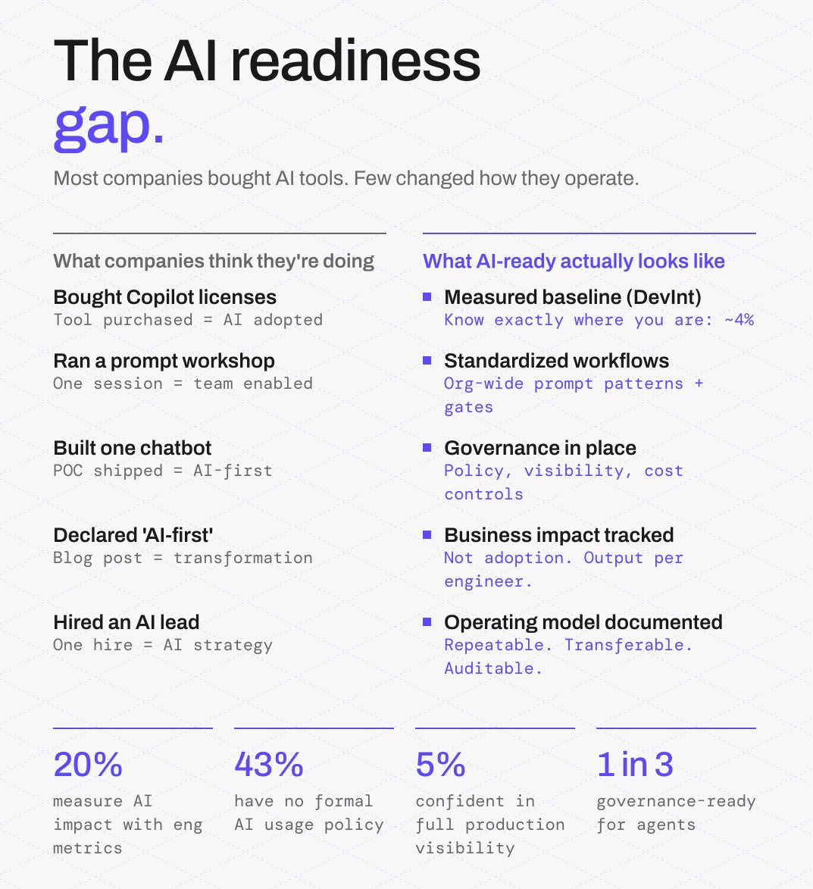

🔗 [View original post](https://x.com/LimestoneHQ/status/2099766505025966555)

---

### 🕐 07:39 UTC · @Wise1Philosophy

> I was tired from the moment I woke up, needed three coffees before noon, and had nothing left by 3pm. I needed a full day back by spring. I achieved it with these 18 rules: 1. STOP DRINKING COFFEE FIRST THING (wait ninety minutes).

🔗 [View original post](https://x.com/RasmusNorbergg/status/2099764907516612616)

---

### 🕐 07:30 UTC · @Wise1Philosophy

> The difference between an AI consultancy and a hands-on implementation firm is simple. One sells a long transformation. The other ships work, gets first numbers on the board, and iterates from real metrics. That is the better path: implement, measure, adjust, move. Not a year-long generic AI program with workshops, frameworks, and no operating data. Every engagement we run at @LimestoneHQ has fewer people on it now than when it started. The firm is growing faster than it ever has. A consultancy has to keep an expensive person busy. $350 an hour, billed by the day. The work is built to last. Scope expands. The team expands. Phase two gets sold in month three. You end up with a $500K deck about “unlocking potential.” Ask people two or three levels below the executive who signed. They can’t stand consultants. They watched the circus. What the firm is really selling is cover: I hired a top firm, so I made the responsible choice. If it fails, I still hired a top firm and there&apos;s nothing else we can do. For a mid-market company, that’s an expensive way to avoid deciding. Consultants do earn it sometimes. A dynamic consultant at $5K an hour who unblocks the thing that’s been strangling operations for two years is worth every dollar. A specific, painful problem for the business solved. That’s a fair trade. Generic advice is the trap. In 2026, if the advice isn’t tied to a real problem, you can open a model, ask for the top five strategy frameworks, give the output to your HR lead with deliverables attached, and start Monday. You’ll learn more from the first failed iteration than from three months of workshops. If you need a $350-an-hour outsider to tell you what your strategy is, the honest move is to change your job. Vendors are selling the same billable-day model with an AI sticker on it. When a mid-sized or large engineering shop says they’ve gone AI-native, I ask one question: how many people have you let go, and why are you still hiring more? If the answer is none and lots, they aren’t passing any efficiency to you. They added “AI” to the rate card and kept the man-day model underneath. The small firms are the newest version. A group assembles a team to ride the AI demand wave, hires people with case studies, and suddenly the firm has case studies. But there’s no history behind the logos. Our @LimestoneHQ AI velocity pod is one senior engineer, agents across the whole SDLC, and a fractional architect. Roughly 1.5 FTE where a five-person team used to sit. 98% of the code we ship isn’t handwritten. That’s why engagements shrink: the work gets done, the harness takes more of the load, and we pull people off. We don’t know how to sell you more headcount. We grow on demand and on the efficiency we hand each client. That’s the only thing that carries to the next one. If your vendor’s team on your account has grown since AI arrived, you’re paying for their business model, not yours.

🔗 [View original post](https://x.com/mardehaym/status/2099762816446067164)

---

### 🕐 07:30 UTC · @Wise1Philosophy

🔗 [View original post](https://x.com/Daily__wisdom_/status/2099762714729996307)

---

### 🕐 07:08 UTC · @Wise1Philosophy

> Drop one picture into an AI agent and come back to a full 3D street. Shops, signs, road, sky, all built without anyone opening a 3D tool. GPT-6 Astra and Hyper3D MCP just did in one run what used to take a whole team. One image. One Agent. One scene. @OpenAIDevs GPT-6 Astra (Codex) + HYPER3D MCP just showed us the second half of 3D gen. 🚀

🔗 [View original post](https://x.com/FutureStacked/status/2099757158321598793)

---

### 🕐 07:04 UTC · @Wise1Philosophy

> AI filmmaking is one of the biggest goldmine skills right now. While others dismissed it as “SLOP,” Chinese creators turned it into a profession. And they’re already capitalizing on it. Media This is pretty solid Nebius just launched something AI builders should know about. A free AI Builder Program with: → $400+ in credits → Working code &amp; cookbooks → Office hours with engineers → Builder community Pretty useful for anyone building with AI.

🔗 [View original post](https://x.com/HeyZoyaKhan/status/2099756119191110119)

---

### 🕐 07:01 UTC · @Wise1Philosophy

🔗 [View original post](https://x.com/apex_mentality_/status/2099755564678926567)

---

### 🕐 07:01 UTC · @Wise1Philosophy

> A doctor who has followed the same 2,000 people since the eighties told me the 8 things that predict how well you age. 1. How fast you walk.

🔗 [View original post](https://x.com/MuahDavis/status/2099755355068940720)

---

### 🕐 06:50 UTC · @Wise1Philosophy

> Want to become a Claude Certified Architect? Certification preparation is only one part of the process. For anyone learning Generative AI, LLMs, Claude, MCP, APIs, or AI Agents, the better approach is to develop the technical foundation first. Here’s a practical 6-step Claude Architect roadmap: 1. Build the foundation Use Anthropic Academy to learn: • AI Fluency • Claude 101 • Claude Code • Claude API • MCP • AI Agents Official free resources: https://academy.claude.com/ 2. Develop practical Claude Code skills Move beyond tutorials and guided examples. Build with Claude Code, work inside repositories, experiment with agentic workflows, and understand AI-assisted development in real environments. 3. Go deeper into Claude API and MCP Focus on: Claude API: prompting, tools, structured outputs, RAG, agents, evaluations, production patterns. MCP: connecting AI applications to external tools, APIs, databases, and context. Docs: Claude API: https://claude.com/app-unavailable-in-region MCP: https://modelcontextprotocol.io/docs/2026-07-28/getting-started/intro 4. Strengthen architecture skills A Claude Architect needs more than product knowledge. Develop an understanding of: • Agentic architectures • Tool design • MCP integrations • Context management • Prompt engineering • Structured outputs • Reliability &amp; evaluation • Cost optimization • Safety &amp; responsible AI The focus should be on understanding architectural trade-offs and design decisions. 5. Build real systems Build 3–5 projects such as: • Customer support agent • RAG knowledge assistant • MCP-powered business agent • Data-analysis agent • Multi-step automation workflow Practical projects introduce challenges that are difficult to learn from tutorials alone: failures, permissions, context limits, tool errors, evaluation, and cost. 6. Prepare for certification The Claude Certified Architect – Foundations exam is currently listed as: • 60 questions • 120 minutes • $125 USD • Online proctored or Pearson Test Center • 12-month validity The listed domains include: • Agentic Architecture &amp; Orchestration • Tool Design &amp; MCP Integration • Claude Code Configuration &amp; Workflows • Prompt Engineering &amp; Structured Output • Context Management &amp; Reliability Anthropic currently lists the certification as available to people at organizations in the Claude Partner Network. Check eligibility before planning around the exam. The certification validates knowledge. The real objective is being able to design, build, integrate, evaluate, secure, and deploy reliable AI-powered systems. Build that capability first. The certification comes after. The 7-level Claude prompting system: A practical framework with examples to get the most perfect results from Claude. ↓

🔗 [View original post](https://x.com/ZabihullahAtal/status/2099752708307595469)

---

### 🕐 06:46 UTC · @Wise1Philosophy

> El año pasado rechacé 3 trabajos porque el presupuesto de diseño sonoro no salía. Un tráiler de pódcast. Un vídeo de producto. Y otro proyecto en el que todavía pienso. Hoy aceptaría los tres. Introducing voice, music, image, and video generation in the ElevenLabs MCP. Generate speech, transcripts, dubs, music, sound effects, images, and video from the assistant you already work in.

🔗 [View original post](https://x.com/IA_Quijote/status/2099751660935389675)

---

### 🕐 06:34 UTC · @Wise1Philosophy

> Signs you have insulin resistance (&amp; don’t realize it): 1. Foam when you pee.

🔗 [View original post](https://x.com/NutritionCorp/status/2099748670338224186)

---

### 🕐 06:30 UTC · @Wise1Philosophy

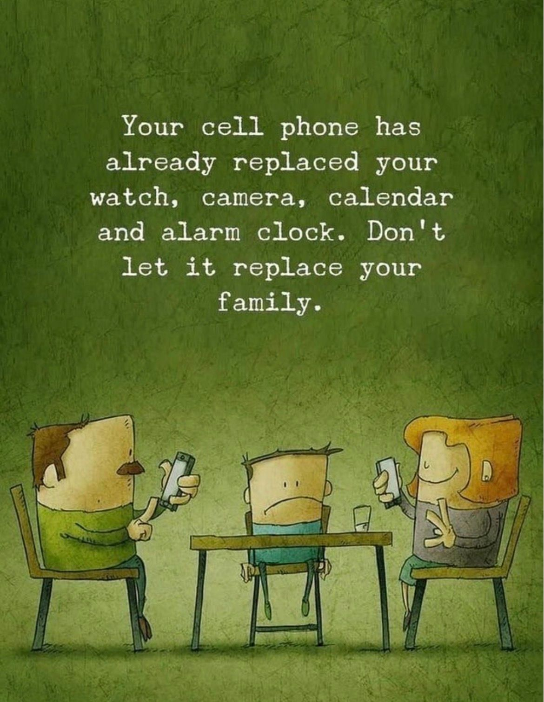

🔗 [View original post](https://x.com/yeti_mind/status/2099747638300012981)

---

### 🕐 06:26 UTC · @Wise1Philosophy

> Your blood sugar is aging you faster than cigarettes or alcohol. It wakes you up at 3 AM, wrecks insulin and fat loss, and causes a fatty liver. Here are 5 doctor tips to fix it naturally: 1. Don&apos;t walk 10,000 steps Media

🔗 [View original post](https://x.com/Marc0sRomano/status/2099746566445867318)

---

### 🕐 06:17 UTC · @Wise1Philosophy

> A cardiologist shocked me when he said: &quot;You age because your body stops making Nitric Oxide. Without it, blood pressure rises, erections fail, and Alzheimer&apos;s happens.&quot; Here&apos;s the 5-step protocol to boost it naturally: 1. Stop using mouthwash

🔗 [View original post](https://x.com/HeyDoc_MD/status/2099744441460535570)

---

### 🕐 06:17 UTC · @Wise1Philosophy

> Cortisol = Jaw clenching Cortisol = Awake at 3 AM Cortisol = Beer belly Cortisol = Fat face Cortisol = Low libido One hormone. Every symptom. Easy fix: 1. Ashwagandha in the morning.

🔗 [View original post](https://x.com/CoachWillStone/status/2099744311193829443)

---

### 🕐 06:14 UTC · @Wise1Philosophy

> I started taking zinc in the morning, magnesium at night, and vitamin D with K2 at breakfast. The doctor recommended it to me, I kept it up for 60 days, and after that… Without exaggerating, my personality changed 180 degrees. 1. Zinc (In the morning)

🔗 [View original post](https://x.com/CoachDanCole_/status/2099743733864644640)

---

### 🕐 06:14 UTC · @Wise1Philosophy

> The only 4 supplements worth your money: (Save this) 1. Creatine

🔗 [View original post](https://x.com/TheFastedState/status/2099743620949798923)

---

### 🕐 06:12 UTC · @Wise1Philosophy

> A heart doctor admitted: “There are 3 types of people who don&apos;t get heart attacks.” 1. Don&apos;t go pee at 3am Media

🔗 [View original post](https://x.com/DPro_Coach/status/2099743229180887292)

---

### 🕐 06:10 UTC · @Wise1Philosophy

> Waking up 2-3 times a night to piss and thinking it&apos;s because you drank water before bed. It&apos;s not the water. Here’s actually why (&amp; what stops it): 1. Your blood sugar is crashing at 1am, 3am, 5am

🔗 [View original post](https://x.com/BeBetter_Athlet/status/2099742627348586932)

---

### 🕐 06:10 UTC · @Wise1Philosophy

> High cortisol is aging you faster than smoking and tanning beds. Low libido, achy joints, dark circles, weak muscles. Here are 9 natural ways to slow the clock (without medication): 1. Cold water on your face.

🔗 [View original post](https://x.com/Fitby_Chandler/status/2099742581060198661)

---

### 🕐 06:07 UTC · @Wise1Philosophy

> Most voice benchmarks score transcripts or synthetic turns. @voicearena_ai’s Jarvis Bench has real people have the actual conversation, then has a separate set of humans blind-vote on it, with a human anchor scored the same way as the models. That&apos;s a much harder bar to game. Introducing Jarvis Bench v0.5, @voicearena_ai&apos;s conversational agent benchmark. We&apos;ve been obsessed with one question at VoiceArena: why do voice agent demos sound incredible, benchmarks say models are near-perfect, and yet you probably didn&apos;t have a single real conversation with…

🔗 [View original post](https://x.com/alex_verem/status/2099741866946146353)

---

### 🕐 06:07 UTC · @Wise1Philosophy

> The only 5 sleep supplements worth taking (and why each one works): 1. Magnesium Bisglycinate. Media

🔗 [View original post](https://x.com/LevelUpPrime/status/2099741809845182944)

---

### 🕐 06:05 UTC · @Wise1Philosophy

> If you&apos;re building a voice agent right now, this is the benchmark to nail, not the one to top. @voicearena_ai just showed a ~250 point human-vs-model gap that every other voice leaderboard was missing entirely. Introducing Jarvis Bench v0.5, @voicearena_ai&apos;s conversational agent benchmark. We&apos;ve been obsessed with one question at VoiceArena: why do voice agent demos sound incredible, benchmarks say models are near-perfect, and yet you probably didn&apos;t have a single real conversation with…

🔗 [View original post](https://x.com/alex_prompter/status/2099741387335905601)

---

### 🕐 06:01 UTC · @Wise1Philosophy

🔗 [View original post](https://x.com/Life__Mastery/status/2099740273290985943)

---

### 🕐 05:58 UTC · @Wise1Philosophy

> I just watched Claude write a skincare ad, voice it with a warm ad read, dub it into Latin American Spanish in the same voice, and leave the brand name and promo code untranslated. All of it from one chat, no tab switching, no passing files between five apps. It is the same ElevenLabs MCP that runs their Agents, so one install covers everything Introducing voice, music, image, and video generation in the ElevenLabs MCP. Generate speech, transcripts, dubs, music, sound effects, images, and video from the assistant you already work in.

🔗 [View original post](https://x.com/AriaWestcott/status/2099739699661119777)

---

### 🕐 05:57 UTC · @Wise1Philosophy

> ElevenLabs is not a voice company anymore. Its MCP now sits under ChatGPT, Claude, Cursor, Grok Bot and Hermes at once, and every clip, image or video you generate lands in one ElevenCreative workspace you can open in Studio to fix the timeline, layer music and export. The voice cloning startup just became the media engine behind every AI assistant. Introducing voice, music, image, and video generation in the ElevenLabs MCP. Generate speech, transcripts, dubs, music, sound effects, images, and video from the assistant you already work in.

🔗 [View original post](https://x.com/FutureStacked/status/2099739427274707088)

---

### 🕐 05:56 UTC · @Wise1Philosophy

> ElevenLabs just turned your chat window into a full production studio. One install inside ChatGPT, Claude, Cursor, Grok Bot or Hermes gives your assistant voice, dubbing, music, sound effects and over 50 image and video models. Type one brief and it hands back a script, a voiceover, a music bed, sound design and the video to carry it. Introducing voice, music, image, and video generation in the ElevenLabs MCP. Generate speech, transcripts, dubs, music, sound effects, images, and video from the assistant you already work in.

🔗 [View original post](https://x.com/TheAIColony/status/2099739125939134574)

---

### 🕐 05:47 UTC · @Wise1Philosophy

> A Heart doctor confessed: “There are 3 kinds of people who never get heart attacks.” 1. Don&apos;t get up to pee at 3 AM Media

🔗 [View original post](https://x.com/CoachLucHerrera/status/2099736741217550374)

---

### 🕐 05:19 UTC · @Wise1Philosophy

> The durable asset may not be the rendered video. It may be the editable method behind it. Hypit lets a coding agent clone that method from a reference, so the format can survive the first MP4. We starred the implementation here: https://github.com/hypit-ai/hypit Introducing Hypit: Clone any viral video with AI agents. 1 clone, 100 variants, 100M views. Hypit lets your AI agent (Claude Code, Codex...) clone any viral video. Paste any viral video link from TikTok, Instagram, or YouTube into your agent. Hypit clones it into a complete agent…

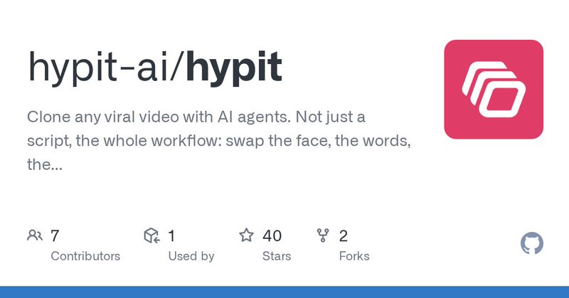

🔗 [View original post](https://x.com/FutureStacked/status/2099729678986584373)

---

### 🕐 05:16 UTC · @Wise1Philosophy

> Video editors were built for people clicking through timelines. Hypit is built for coding agents. Give Codex or Claude Code a reference video, and it can use Hypit to clone the production through natural-language instructions instead of navigating a traditional editing interface. It’s open source, free to use, and BYOK. Check it out and star the repo: https://github.com/hypit-ai/hypit Introducing Hypit: Clone any viral video with AI agents. 1 clone, 100 variants, 100M views. Hypit lets your AI agent (Claude Code, Codex...) clone any viral video. Paste any viral video link from TikTok, Instagram, or YouTube into your agent. Hypit clones it into a complete agent…

🔗 [View original post](https://x.com/TheAIColony/status/2099729057164177846)

---

### 🕐 05:16 UTC · @Wise1Philosophy

> A podcaster sat down with the Harvard scientist who turned back the clock in human cells. He named 5 everyday things quietly costing you 15 years of your life. The one that matters most has nothing to do with food, training, or supplements: 1. The person you wake up next to Media

🔗 [View original post](https://x.com/LiveandAlive_/status/2099728948087419086)

---

### 🕐 04:46 UTC · @Wise1Philosophy

> Dementia is blood flow. Dementia is cholesterol. Dementia is preventable close to half the time. 8 simple rules to protect your brain: 1. Floss your teeth Media

🔗 [View original post](https://x.com/JasperKasparov/status/2099721416166031438)

---

### 🕐 04:19 UTC · @Wise1Philosophy

> Harvard scientists now know how to grow hair back. By 35, 2 out of 3 men lose their hair (regardless of genetics). Here are 7 ways to grow your hair back (and keep its colour): 1. Your follicles don&apos;t die when the hair does

🔗 [View original post](https://x.com/HeyEleanorr/status/2099714583661531353)

---

### 🕐 04:02 UTC · @Wise1Philosophy

> Looking younger in your face, your skin and your hair is extremely easy once you realize this:

🔗 [View original post](https://x.com/ClaraBrooksjz/status/2099710299154846089)

---

### 🕐 01:36 UTC · @Wise1Philosophy

> Can’t believe people still don’t know how to profit from ChatGPT! Earn $1,000/Day with ChatGPT 💰 [100% GUARANTEED] Here’s all you need: 📱 A smartphone 🌐 WiFi ⏳ 60 minutes a day 👉 Like and Comment &quot;Send&quot; to get it via DM – FREE for the next 24 hours! 🕒 (Make sure you’re following @JayBisen473370 to receive the DM)

![Can’t believe people still don’t know how to profit from ChatGPT! Earn $1,000/Day with ChatGPT 💰 [100% GUARANTEED] Here’s all you need: 📱 A smartphone 🌐 WiFi ⏳ 60 minutes a day 👉 Like and Comment &quo](../../../../assets/images/2026/09/15/2099673655752130563-1.jpg)

🔗 [View original post](https://x.com/JayBisen473370/status/2099673655752130563)

---
