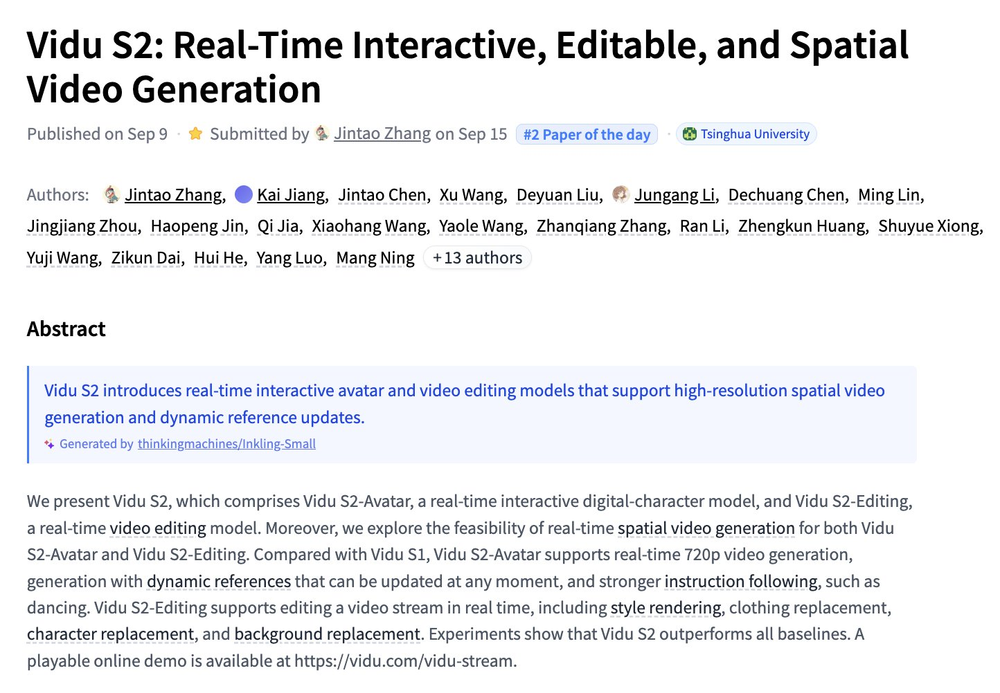

# 🐦 @_akhaliq

## 📅 September 15, 2026

> 2 post(s) archived.

---

### 🕐 16:36 UTC · @_akhaliq

> Today we’re unveiling Odyssey-3, a big step forward for foundation world models. It can control robots, power humanoids, drive cars (on the roads of India!), train AIs, pilot drones, and even play video games. We can’t wait to see what intelligent systems it enables. Media

🔗 [View original post](https://x.com/odysseyml/status/2099900067356586276)

---

### 🕐 15:28 UTC · @_akhaliq

> Vidu S2 Real-Time Interactive, Editable, and Spatial Video Generation paper: https://huggingface.co/papers/2609.11638

🔗 [View original post](https://x.com/_akhaliq/status/2099883001840828920)

---
