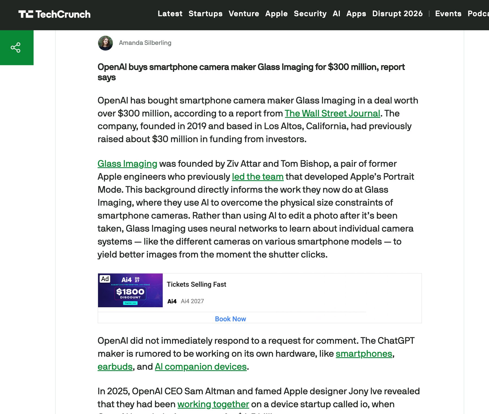
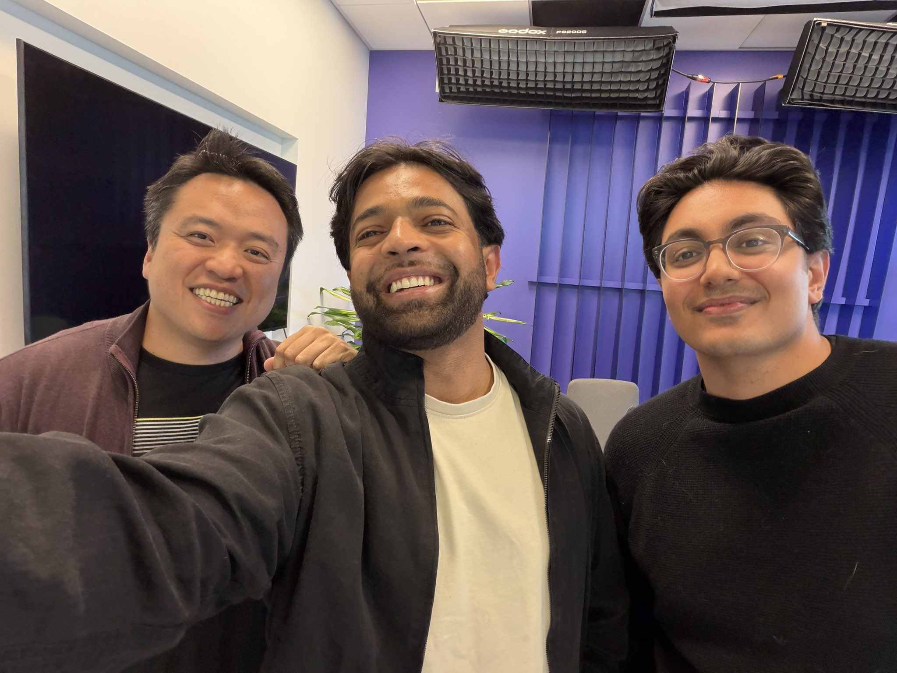

# 🐦 @swyx

## 📅 September 15, 2026

> 3 post(s) archived.

---

### 🕐 15:49 UTC · @swyx

> its happening! dear openai just make a new phone everyone wants openaiphone we can read 2-4x faster than we talk and speak openai alexa reachy hybrid is fine but pls just be a stepping stone to phone we want phone signed, everybody

🔗 [View original post](https://x.com/swyx/status/2099888258591429075)

---

### 🕐 09:14 UTC · @swyx

> AI Engineer Paris is one week away! A huge thank you to all our incredible sponsors for making this special event possible: @nvidia @FactoryAI @sentry @CockroachDB @SonarSource @NotionHQ @SierraPlatform @Cloudflare @neo4j @daytonaio @qdrant_engine @modal @langfuse and more! Media

🔗 [View original post](https://x.com/aiDotEngineer/status/2099788897899147654)

---

### 🕐 01:26 UTC · @swyx

> just finished recording on latent space I’m excited about this one- we get very technical about things we haven’t really talked about much yet

🔗 [View original post](https://x.com/trq212/status/2099671266068496802)

---
