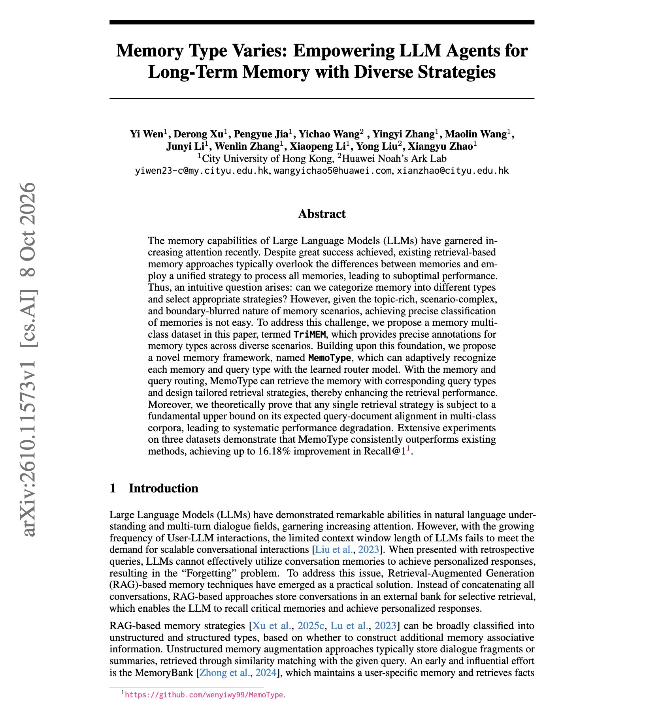
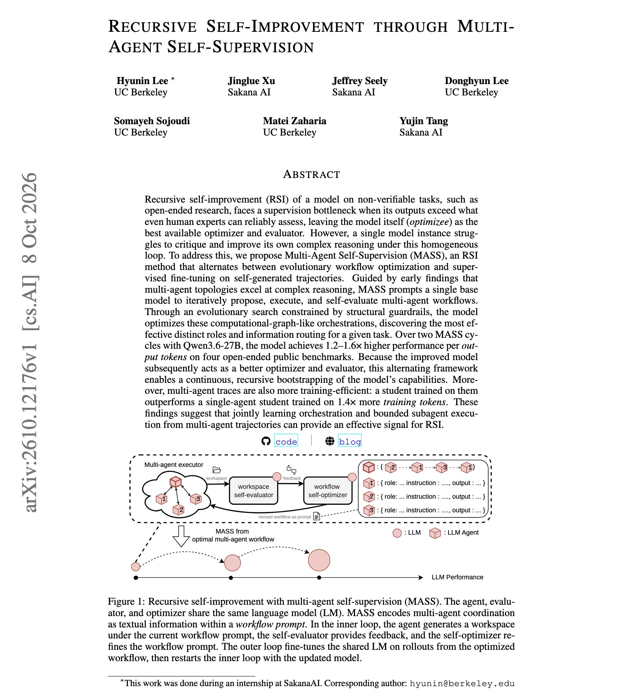

# 🐦 @dair_ai

## 📅 October 10, 2026

> 2 post(s) archived.

---

### 🕐 22:15 UTC · @dair_ai

> Nice paper on agent memory. It explores an effective routing mechanism for memory in agents. The overall finding is that you want a separate retrieval strategy for each type of memory instead of one embedding search over everything. The authors prove that any single retrieval strategy has an upper bound on expected precision when the memory store holds several types. MemoType classifies each memory and each query by type, retrieves memories that match the query type, and applies the strategy for that type. A new dataset, TriMEM, provides the type labels needed to train the classifier. Recall@1 improves by up to 16.18% across three datasets. Paper: https://academy.dair.ai/papers/memory-type-varies-empowering-llm-agents-for-long-term-memory-with-diverse-strat-2610.11573

🔗 [View original post](https://x.com/dair_ai/status/2109045065930981708)

---

### 🕐 14:55 UTC · @dair_ai

> Recommended paper from Sakana AI on recursive self-improvement. They propose an interesting way to scale recursive self-improvement through multi-agent self-supervision. In this line of research, self-improvement loops usually need an external verifier, so open-ended tasks without a checker are left out. MASS removes that requirement. One base model proposes multi-agent workflows, runs them and grades them, and an evolutionary search keeps the workflows that score best. The model is then fine-tuned on its own traces, and the improved model starts the next cycle as a better optimizer and grader. Two cycles on Qwen3.6-27B raise performance per output token from 1.2 to 1.6x on four open-ended benchmarks. A student trained on multi-agent traces also beats a single-agent student trained on 1.4x more tokens. Paper: https://arxiv.org/abs/2610.12176 Chat with Paper: https://academy.dair.ai/papers/recursive-self-improvement-through-multi-agent-self-supervision-2610.12176

🔗 [View original post](https://x.com/omarsar0/status/2108934334589857850)

---
