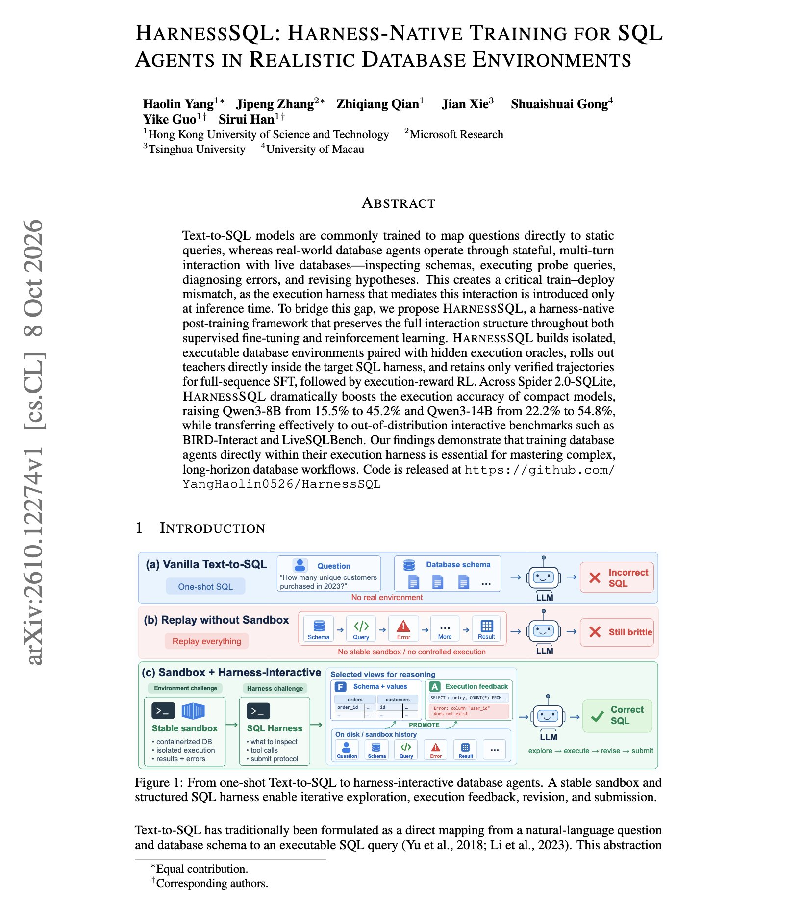

# 🐦 @omarsar0

## 📅 October 10, 2026

> 2 post(s) archived.

---

### 🕐 21:00 UTC · @omarsar0

> Pay close attention to custom harnesses. This is a super interesting paper showing the impact of training inside the harness. Qwen3-14B goes from 22.2% to 54.8% on Spider 2.0-SQLite when it is trained in the same execution harness it uses at deployment. Text-to-SQL models are usually trained to write one static query. Deployed database agents inspect schemas, run probe queries and revise, and the harness for that only appears at inference time. HarnessSQL builds isolated executable databases with hidden answer checks. Teachers run inside the target harness; we keep only verified trajectories for SFT, then apply execution-reward RL. In addition, Qwen3-8B rises from 15.5% to 45.2%, and both models transfer to BIRD-Interact and LiveSQLBench. Paper: https://arxiv.org/abs/2610.12274 Chat with Paper: https://academy.dair.ai/papers/harnesssql-harness-native-training-for-sql-agents-in-realistic-database-environm-2610.12274

🔗 [View original post](https://x.com/omarsar0/status/2109026263453294956)

---

### 🕐 03:53 UTC · @omarsar0

> Correction: 64k max output tokens.

🔗 [View original post](https://x.com/omarsar0/status/2108767737543634953)

---
