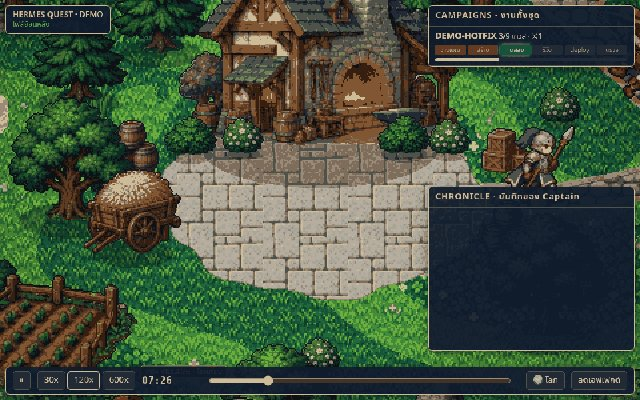

# 🐦 @tonysimons_

## 📅 October 10, 2026

> 6 post(s) archived.

---

### 🕐 20:13 UTC · @tonysimons_

> Nous just dropped another free model and this one is STEALTHY!! 👇🏻 Wild MISSINGNO. appeared! A coding and agentic reasoning model that is highly token efficient, free for a limited time on Nous Portal Try it out in your Hermes Agent today

🔗 [View original post](https://x.com/tonysimons_/status/2109014521025102179)

---

### 🕐 16:09 UTC · @tonysimons_

> Let&apos;s try this again... 🪽 https://x.com/i/broadcasts/1yKAPwEAVlexb

🔗 [View original post](https://x.com/tonysimons_/status/2108953040397242485)

---

### 🕐 13:20 UTC · @tonysimons_

> 11 AM CT today, I&apos;m going live with Hermes Agent. 🪽 The mission: clone a SaaS product from scratch. LIVE. No source code. No docs. Just Hermes, the app, and a lot of poking around. Which SaaS should we rip off first? 👇

🔗 [View original post](https://x.com/tonysimons_/status/2108910620644933702)

---

### 🕐 03:56 UTC · @tonysimons_

> Tomorrow. 11 AM CT. My first live stream. 🪽 Reverse Engineer Everything with Hermes Agent. I&apos;m going to point it at an app. Watch it figure out how it works. Then have it make me a clone. No script. No clue what I&apos;m doing. Expect chaos. 👇 https://x.com/i/broadcasts/1vJpPNowbeMJE

🔗 [View original post](https://x.com/tonysimons_/status/2108768512512848145)

---

### 🕐 01:24 UTC · @tonysimons_

> Another week full of exciting updates for Hermes! Hermes Agent got several convenient updates this week you may not even be aware of! I made a quick video demoing a few of them: - Voice Chat auxiliary model for faster voice conversations - Get local model recs that fit your hardware with hermes model - Install plugins and skills…

🔗 [View original post](https://x.com/tonysimons_/status/2108730231787851814)

---

### 🕐 00:00 UTC · @tonysimons_

> Still a community beta (v0.1.0), not in the official catalog yet. Pull request: https://github.com/NousResearch/hermes-agent/pull/135744

🔗 [View original post](https://x.com/tonysimons_/status/2108709156379148341)

---
