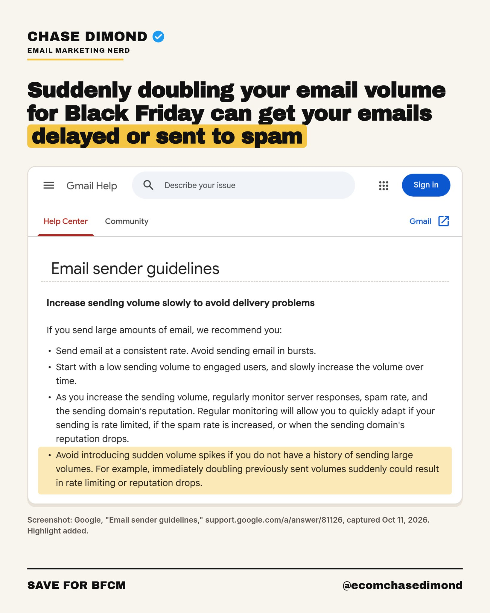

# 🐦 @AiEvolutio58513

## 📅 October 11, 2026

> 5 post(s) archived.

---

### 🕐 17:47 UTC · @AiEvolutio58513

> One of the biggest mistakes I see before Black Friday is brands suddenly sending way more email than usual. Sending more during BFCM is normal, since more emails can mean more sales. But you can&apos;t go from 0 to 100 overnight. Google&apos;s own guidelines warn that a sudden jump can get your emails delayed, blocked, or sent to spam. Here&apos;s how I&apos;d ramp up instead: Now to Oct 31: 1. Check your spam rate in Google Postmaster Tools. It&apos;s free, and all you need to do is verify your domain. You want it under 0.10%, and never let it hit 0.30%. 2. Find people who haven&apos;t opened or clicked in 90+ days. Ask if they still want your emails, and remove anyone who doesn&apos;t respond within 14 days. Nov 1 to Nov 20: 3. Add one extra send a week, and send it to the people who open and click most (your most active subscribers). If you send 2 a week now, go to 3, then 4, then 5 by Nov 20. Nov 21 to Nov 30: 4. Send your main sale emails (Black Friday and Cyber Monday) to your most active subscribers first. Then send to everyone else a few hours later, once you&apos;ve checked that unsubscribes and spam complaints look normal in your email platform. 5. Use real deadlines. If the sale ends Monday at 11:59 PM, end it then. Start this week, and your Black Friday emails will have a much better shot at the inbox.

🔗 [View original post](https://x.com/ecomchasedimond/status/2109340216444285104)

---

### 🕐 13:57 UTC · @AiEvolutio58513

> Dave Portnoy spent $10,000 on an AI clone to read his audiobook aloud, and says the result was “actually scary” in how accurate it sounded. His own parents couldn’t tell it from the real thing. Audible then blocked it, so he ended up recording every word on his own. “I could only do 15 minutes [of recording a day] because it was that hard for me to read it. I hated it. I tried to get out of it. I paid $10,000 to do AI. I had this AI program for it.” “My parents couldn’t tell the difference. And it could literally just scan the book and go word-for-word.” “It was actually scary how it was dead-on. And it could have literally just done every single word in that book.” “[Audible] wouldn’t let me use it... I was told, ‘No, they don’t let you do that.’ So I had to [record the whole book myself]. I hated it. Hated it!” Interested in AI? Follow @AiEvolutio58513 and never fall behind. I track ChatGPT, Claude, and every tool quietly changing how we work and create, then hand you the tested signals. Media

🔗 [View original post](https://x.com/AiEvolutio58513/status/2109282152437489968)

---

### 🕐 12:59 UTC · @AiEvolutio58513

> Terence Tao: The mathematics in modern LLMs is fundamentally uncomplicated. Building and running them relies on linear algebra, matrix operations, and basic calculus, tools an undergraduate understands. We know how these systems function. The actual mystery lies elsewhere: why they excel at some tasks and stumble at others, and why we can&apos;t foresee that. We lack solid frameworks for predicting results across different domains, so discovery remains largely experimental. A central issue is how real-world information works. Pure noise has clean mathematics, perfectly ordered data has clean mathematics, but written language sits in between, structured yet noisy. Our math for that zone is limited, like how physics struggles at the middle scale between atomic and continuous scales. This gap means we can map out the parts but can&apos;t yet clarify sudden ability jumps or make solid domain-level predictions. That inconsistency, simple design versus hard-to-anticipate results, is the core riddle. Via Brian Keating&apos;s YouTube channel. Interested in AI? Follow @AiEvolutio58513 and never fall behind. I track ChatGPT, Claude, and every tool quietly changing how we work and create, then hand you the tested signals. Media

🔗 [View original post](https://x.com/AiEvolutio58513/status/2109267603307086163)

---

### 🕐 11:00 UTC · @AiEvolutio58513

> Sam Altman on the advice from Peter Thiel that mattered most: “ChatGPT was growing super fast, but it felt very unstable, or kind of almost low-value growth.” “A lot of people in the company were like, ‘We gotta figure out something else. This is not sustainable value.’ And we were talking about this list of 5 or 6 other things that we could focus on instead.” “He was like, ‘It&apos;s an obvious mistake to do anything but this.’” “Besides the fact that it&apos;s growing, which is rare and great, he&apos;s like, ‘The power of this is the power of the Google text box. It&apos;s like a text box you can type anything into, and it does the right thing.’” “He&apos;s like, ‘People have just been chasing the Google business model for 20 years and this is the first thing that&apos;s come up, and clearly the empty text box worked for Google, so why don&apos;t you just double down on that? It&apos;s growing. It&apos;s very flexible and it has all of the signs other than it doesn&apos;t fit the current Silicon Valley wisdom.’” “So we went super hard on ChatGPT and it was great.” Interested in AI? Follow @AiEvolutio58513 and never fall behind. I track ChatGPT, Claude, and every tool quietly changing how we work and create, then hand you the tested signals. Media

🔗 [View original post](https://x.com/AiEvolutio58513/status/2109237720262607129)

---

### 🕐 03:57 UTC · @AiEvolutio58513

> If I had to rebuild an ecommerce email program from zero, here&apos;s my 30-day plan, week by week. My agency has helped 250+ ecommerce brands generate $200M in email revenue. Most audits show the same 3 problems: weak deliverability, short welcome flows, too many promos. Thread:

🔗 [View original post](https://x.com/ecomchasedimond/status/2109131142708556202)

---
