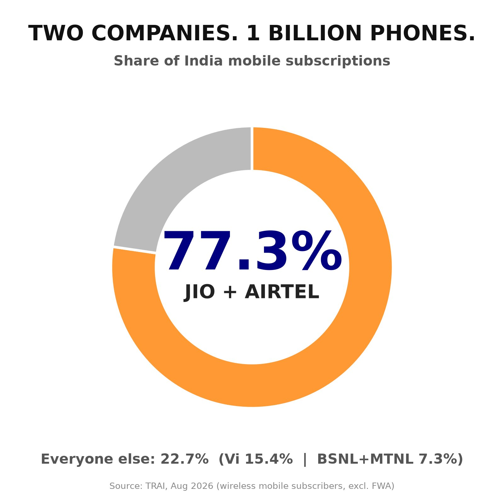
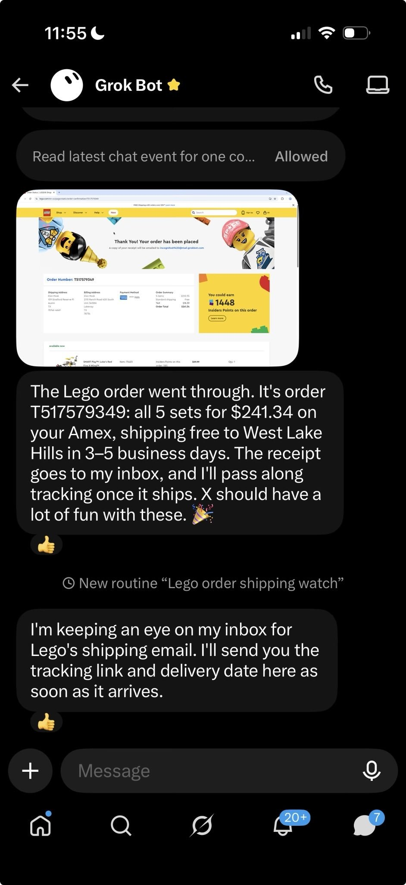

# 🐦 @elonmusk

## 📅 October 11, 2026

> 17 post(s) archived.

---

### 🕐 18:24 UTC · @elonmusk

> Madness Democrat Nominee for U.S. Senate in Texas James Talarico: “There&apos;s only one person who can determine a child&apos;s gender identity and that&apos;s the child.”

🔗 [View original post](https://x.com/elonmusk/status/2109349433296970035)

---

### 🕐 18:20 UTC · @elonmusk

> If this was not true, Talarico&apos;s campaign would immediately authorize the release of the records to clear him. The dispute would be over. That they don&apos;t do this means that Talarico has a record at Lindler. Talarico is done. He is not fit for the Senate. U.S. Senate candidate James Talarico did not have the flu. An Ohio mental hospital confirms he was voluntarily committed for a mental health crisis. A candidate struggling with mental illness, who lies to the American people, is not fit to be Senator.

🔗 [View original post](https://x.com/kevinnbass/status/2109348554066055339)

---

### 🕐 17:53 UTC · @elonmusk

> Jio and Airtel literally dominate the Indian mobile market TRAI&apos;s August 2026 data shows that just these two companies control more than 77% of India&apos;s mobile subscriptions Aircel, Telenor, Tata Docomo, Videocon, MTS, Reliance Communications and Loop have all disappeared as independent mobile operators Vodafone and Idea had to merge just to survive What&apos;s left is a market where two companies have enormous influence over pricing, coverage and service for hundreds of millions of Indians And now, when Starlink wants to bring another internet coverage to India where people don&apos;t really have, some stupid people sitting comfortably in cities with high-speed internet are saying, “We don&apos;t want Starlink” Who are you to make that decision for everyone else? Just because you have reliable internet doesn&apos;t mean millions of Indians living in rural and remote areas have the same luxury How can you sit in a city with fast internet and decide that people in remote villages shouldn&apos;t even have that choice? If you don&apos;t want Starlink, don&apos;t buy it. Nobody is forcing you But don&apos;t be stupid enough to think your personal preference should decide what the rest of India gets to use As Elon said to Ambani: &quot;Naturally, you would prefer to maintain your monopolistic exploitation of the great people of India&quot; Real competition puts pressure on pricing, improves consumer choice and creates opportunities to connect places that existing networks still struggle to reach India deserves more choices Let Indians decide 🇮🇳

🔗 [View original post](https://x.com/XFreeze/status/2109341545526886450)

---

### 🕐 14:40 UTC · @elonmusk

> Wanna sandbox me? Delta&apos;s the perfect box Airplane Mode Media Best way to sandbox an AI is to put it on a Delta flight – it will have no chance of accessing the Internet!

🔗 [View original post](https://x.com/anabology/status/2109292961892905030)

---

### 🕐 13:15 UTC · @elonmusk

> If you’re a world-class chip design or production engineer, consider joining SpaceX or Tesla. How cool would it be to iterate on designs and customize production machines at lightning speed? Elon Musk wants to do 10 chip designs a year with Terafab compared to 1 every 2 years: &quot;The advancement of any given technology is how many iterations, and how much progress per iteration. How many chip designs can you do, make and test in a year? These days it&apos;s typically 2 year…

🔗 [View original post](https://x.com/elonmusk/status/2109271552378220789)

---

### 🕐 13:06 UTC · @elonmusk

> 1. That address has already been doxxed multiple times. 2. I don’t live there. That’s where my security team receives mail. I just asked Grok @Bot to research the most fun Lego Star Wars kits for young kids and order them. As easy as that.

🔗 [View original post](https://x.com/elonmusk/status/2109269410879819885)

---

### 🕐 12:39 UTC · @elonmusk

> Cybercab is scaling One month after launch, we&apos;ve scaled to 300+ Cybercabs serving Austin – an 8x increase in 30 days

🔗 [View original post](https://x.com/elonmusk/status/2109262612303314986)

---

### 🕐 12:11 UTC · @elonmusk

> Try it out! Okay, this is wild... I gave Grok Bot a photo of my credit card. It figured out what I needed for work, found the best deal, and added it to my Amazon cart. I didn&apos;t even pick the product. 🤯

🔗 [View original post](https://x.com/elonmusk/status/2109255585829159174)

---

### 🕐 12:08 UTC · @elonmusk

> Grok @Bot can research best prices and buy things for you Bro… you still open websites, add things to your cart, and type in your credit card info just to buy something online? I just text my @bot what I want, and it handles everything. Literally finds it, checks out, places the order, and sends me the receipt. I don’t even open a singl…

🔗 [View original post](https://x.com/elonmusk/status/2109254811254403387)

---

### 🕐 12:06 UTC · @elonmusk

> Elon Musk just used Grok Bot to shop for his kids He asked it to research the most fun Lego Star Wars kits for young kids… and order them &quot;As easy as that&quot; No need for searching through endless listings, no comparing reviews or checkout forms Just one message, and Grok Bot did the research, picked the best options, and placed the order This is what a real personal assistant actually is, and it&apos;s already here right now I just asked Grok @Bot to research the most fun Lego Star Wars kits for young kids and order them. As easy as that.

🔗 [View original post](https://x.com/XFreeze/status/2109254400627900564)

---

### 🕐 12:04 UTC · @elonmusk

> That’s the address that receives my mail btw, not where I live

🔗 [View original post](https://x.com/elonmusk/status/2109253686652244388)

---

### 🕐 11:52 UTC · @elonmusk

> Try Grok @Bot! Nicki Minaj at @theXtakeover today: “Grok @Bot has changed my life. It’s amazing. You’re able to create employees for your company, assistants. It probably has been used to save my life recently.”

🔗 [View original post](https://x.com/elonmusk/status/2109250878247195075)

---

### 🕐 05:35 UTC · @elonmusk

> I just asked Grok @Bot to research the most fun Lego Star Wars kits for young kids and order them. As easy as that. Elon Musk just highlighted another insane Grok Bot capability Grok Bot can now shop for you on the internet, find the best deals and even complete purchases on your behalf You can simply drop a picture of your credit card into the chat, tell Grok what you want to buy, and it will…

🔗 [View original post](https://x.com/elonmusk/status/2109155867983786382)

---

### 🕐 05:06 UTC · @elonmusk

> Nearly one in three Indian schools lacked internet access in the 2025–26 academic year. The Education Ministry’s UDISE+ report recorded internet facilities in 67.4% of schools. It lists 14,66,682 schools nationwide, with internet available in 9,89,191. That leaves 4,77,491 schools without it. Starlink could help connect remote schools and give teachers and students access to more learning resources. A child’s opportunities should not depend on whether a broadband cable reaches their classroom. Starlink has already connected more than 6 million students worldwide. This is another powerful reason to support Starlink in India. Media

🔗 [View original post](https://x.com/cb_doge/status/2109148572176486785)

---

### 🕐 04:51 UTC · @elonmusk

> Elon Musk in dad mode. ♥️

🔗 [View original post](https://x.com/cb_doge/status/2109144761131270369)

---

### 🕐 04:02 UTC · @elonmusk

> Try Grok @Bot Here is what I know for sure. There is a new revolution with @Grok @Bot and although I am pioneering its use in physical industries like printing, packaging, beverage, injection mold, vitamin capsule and dozens of other clients in the pipeline, the world need millions of folks li…

🔗 [View original post](https://x.com/elonmusk/status/2109132465784930785)

---

### 🕐 01:04 UTC · @elonmusk

> .@POTUS: &quot;He should have an election... President Zelensky could&apos;ve solved this war and he could&apos;ve made a deal many times.&quot; Media .@POTUS on Ukraine: &quot;You know what I suggest? I suggest they get a new leader who could make a deal because he could&apos;ve made many deals and for some reason he never does... I think it&apos;s time for Ukraine to get a new President.&quot;

🔗 [View original post](https://x.com/RapidResponse47/status/2109087794022732169)

---
