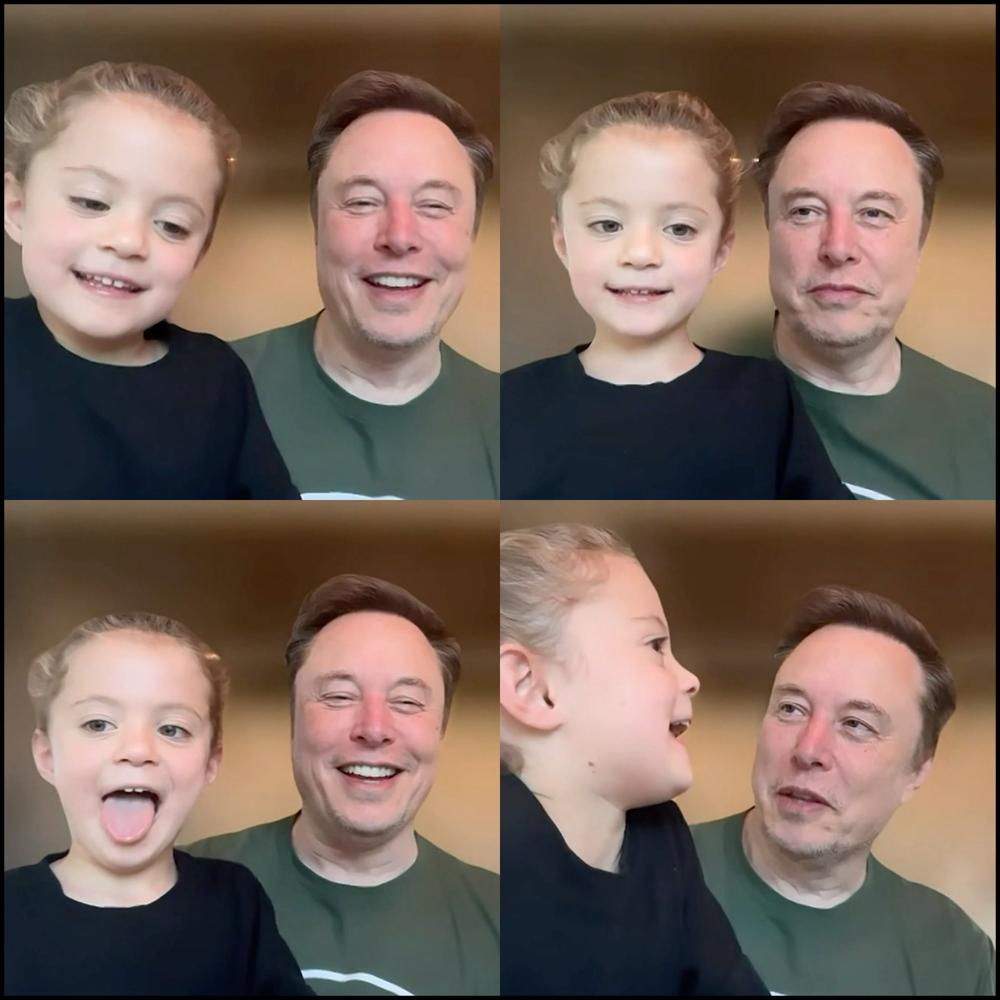

# 🐦 @elonmusk

## 📅 October 11, 2026

> 5 post(s) archived.

---

### 🕐 05:35 UTC · @elonmusk

> I just asked Grok @Bot to research the most fun Lego Star Wars kits for young kids and order them. As easy as that. Elon Musk just highlighted another insane Grok Bot capability Grok Bot can now shop for you on the internet, find the best deals and even complete purchases on your behalf You can simply drop a picture of your credit card into the chat, tell Grok what you want to buy, and it will…

🔗 [View original post](https://x.com/elonmusk/status/2109155867983786382)

---

### 🕐 05:06 UTC · @elonmusk

> Nearly one in three Indian schools lacked internet access in the 2025–26 academic year. The Education Ministry’s UDISE+ report recorded internet facilities in 67.4% of schools. It lists 14,66,682 schools nationwide, with internet available in 9,89,191. That leaves 4,77,491 schools without it. Starlink could help connect remote schools and give teachers and students access to more learning resources. A child’s opportunities should not depend on whether a broadband cable reaches their classroom. Starlink has already connected more than 6 million students worldwide. This is another powerful reason to support Starlink in India. Media

🔗 [View original post](https://x.com/cb_doge/status/2109148572176486785)

---

### 🕐 04:51 UTC · @elonmusk

> Elon Musk in dad mode. ♥️

🔗 [View original post](https://x.com/cb_doge/status/2109144761131270369)

---

### 🕐 04:02 UTC · @elonmusk

> Try Grok @Bot Here is what I know for sure. There is a new revolution with @Grok @Bot and although I am pioneering its use in physical industries like printing, packaging, beverage, injection mold, vitamin capsule and dozens of other clients in the pipeline, the world need millions of folks li…

🔗 [View original post](https://x.com/elonmusk/status/2109132465784930785)

---

### 🕐 01:04 UTC · @elonmusk

> .@POTUS: &quot;He should have an election... President Zelensky could&apos;ve solved this war and he could&apos;ve made a deal many times.&quot; Media .@POTUS on Ukraine: &quot;You know what I suggest? I suggest they get a new leader who could make a deal because he could&apos;ve made many deals and for some reason he never does... I think it&apos;s time for Ukraine to get a new President.&quot;

🔗 [View original post](https://x.com/RapidResponse47/status/2109087794022732169)

---
