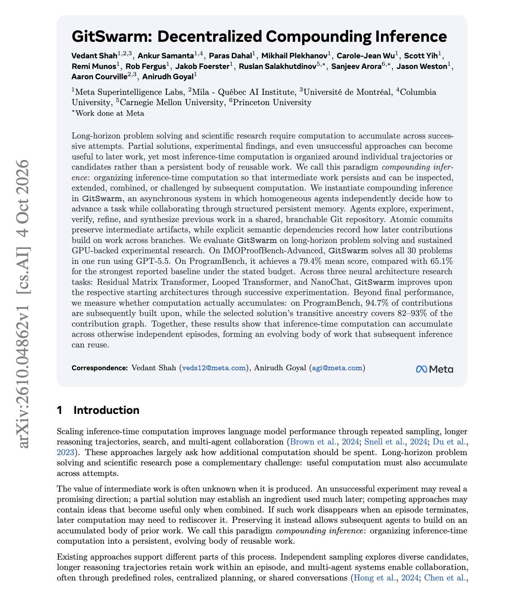

# 🐦 @omarsar0

## 📅 October 11, 2026

> 1 post(s) archived.

---

### 🕐 14:17 UTC · @omarsar0

> Great paper from Meta Superintelligence Labs on compounding inference for long-horizon agents. One clear approach that&apos;s working with large multi-agent systems is persistent memory. Meta researchers describe a concrete approach for this in this paper. You&apos;ll find that inference-time compute usually goes to separate attempts, so most runs ignore partial work and failed ideas. Here is how they solve this problem: GitSwarm gives hundreds of asynchronous agents one shared Git repository. Each contribution is a commit that records which earlier commits, on any branch, it builds on. There is no central planner. Each worker decides whether to explore, verify, refine, or combine existing work. With GPT-5.5 Codex workers, it solves all 30 IMOProofBench-Advanced problems in one run. On ProgramBench, it scores 79.4%, against 65.1% for a single Codex agent prompted to keep going at a similar budget. Score keeps rising with more workers, from 73.1% at 100 to 79.4% at 500. Later workers build on 94.7% of published contributions, and 70.1% of failed research commits are cited by later accepted work. Paper: https://arxiv.org/abs/2610.04862 Chat with Paper: https://academy.dair.ai/papers/gitswarm-decentralized-compounding-inference-2610.04862

🔗 [View original post](https://x.com/omarsar0/status/2109287161199812802)

---
