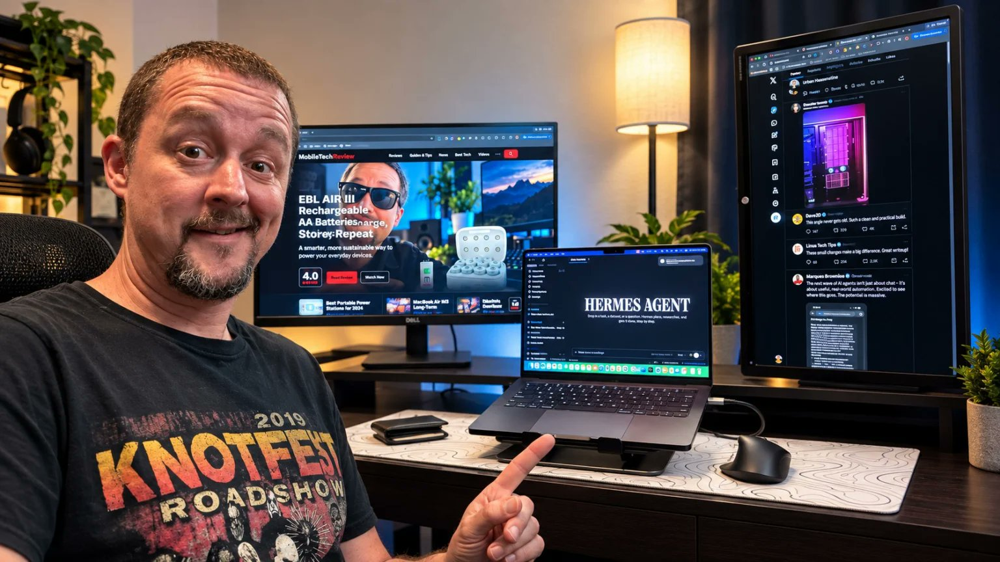
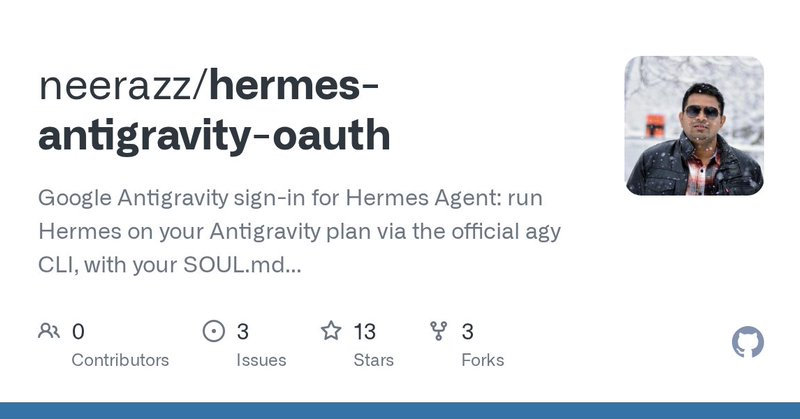
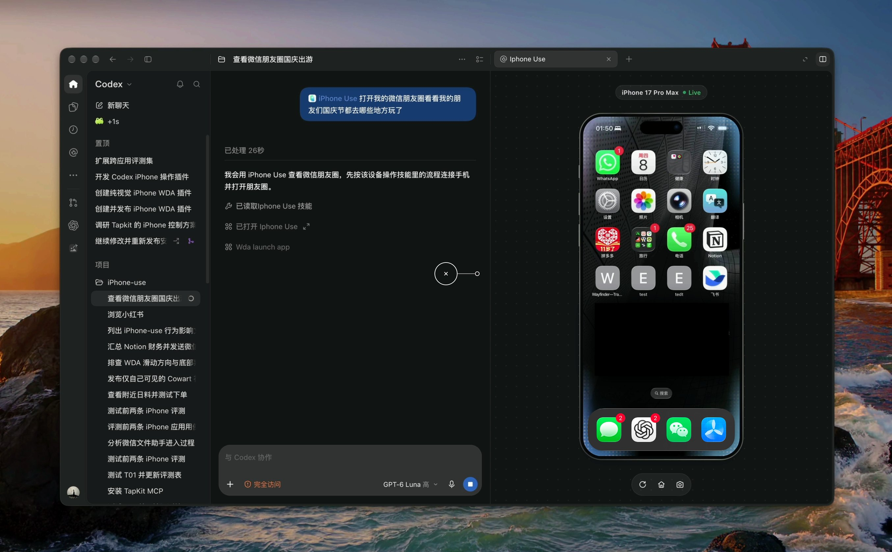

# 🐦 @tonysimons_

## 📅 October 11, 2026

> 10 post(s) archived.

---

### 🕐 17:05 UTC · @tonysimons_

> I just uninstalled Hermes Agent. ✌️ FOREVER. Deleted every skill. Wiped its memory. Killed every automation. Unplugged the Mac mini. I&apos;m officially done with AI agents. Oh, by the way... None of this actually happened. I just wanted to see how many of you were about to type &quot;skill issue.&quot; Happy Sunday. 😂🪽

🔗 [View original post](https://x.com/tonysimons_/status/2109329517718200690)

---

### 🕐 14:15 UTC · @tonysimons_

> I bought it myself. Apple had nothing to do with it. Full review, including the swap numbers, the battery reality check, and how it stacks up next to my Legion 9i: https://www.tonyreviewsthings.com/macbook-pro-m5-review/

🔗 [View original post](https://x.com/tonysimons_/status/2109286672005558530)

---

### 🕐 14:15 UTC · @tonysimons_

> My first Mac ever. A few weeks later, I bought ANOTHER one. 😂 MacBook Pro M5. 14-inch. 24GB. 1TB. I&apos;ve been building on it nonstop. Xcode. Simulators. Claude. Codex. Hermes. Three displays. So I had Hermes inspect it mid-session. ~23GB of memory in use. ~24GB of SWAP. 4% to 12% CPU idle. Zero crashes. Zero freezes. Battery under that load? 4 to 5 hours. Not Apple&apos;s 24. The catch: 24GB at $2,199 is stingy. Local AI finds the ceiling fast. 4.8/5. I&apos;d buy it again. With more RAM. Full review in the reply 👇

🔗 [View original post](https://x.com/tonysimons_/status/2109286659359731870)

---

### 🕐 06:52 UTC · @tonysimons_

> Not enough compute is my guess Why hasn&apos;t Anthropic made a Hermes Agent / Grok Bot / dots competitor yet? 🤔

🔗 [View original post](https://x.com/longtundiary/status/2109175187631669248)

---

### 🕐 06:10 UTC · @tonysimons_

> I&apos;ve heard they&apos;re working on it, just finalizing details. The project code name is &quot;Kill All Humans&quot;. Why hasn&apos;t Anthropic made a Hermes Agent / Grok Bot / dots competitor yet? 🤔

🔗 [View original post](https://x.com/Jay20ServerPass/status/2109164681357320208)

---

### 🕐 06:03 UTC · @tonysimons_

> Somebody just gave Hermes Agent Google Antigravity&apos;s brains without taking away its SOUL. 🪽 Gemini 3.x. Claude 4.6. GPT-OSS. Your SOUL.md comes along, and tools still run through Hermes approvals. One-command install. Clever way to use your Gemini subscription in Hermes and NOT get banned! 👇🏻 Media

🔗 [View original post](https://x.com/tonysimons_/status/2109162892159336902)

---

### 🕐 06:03 UTC · @tonysimons_

> Here&apos;s the plugin from neerazz: https://github.com/neerazz/hermes-antigravity-oauth Install: npx hermes-antigravity-oauth Requires Google&apos;s Antigravity CLI. Uses your existing Antigravity subscription. Another reason I love the Hermes community.

🔗 [View original post](https://x.com/tonysimons_/status/2109162893790900230)

---

### 🕐 04:12 UTC · @tonysimons_

> My theories: 1. They&apos;re building it and it&apos;s not ready 2. They&apos;d rather sell the model and let everyone else build the agent 3. Claude Code already IS their Hermes Which one? 👇

🔗 [View original post](https://x.com/tonysimons_/status/2109134934233456908)

---

### 🕐 03:27 UTC · @tonysimons_

> Why hasn&apos;t Anthropic made a Hermes Agent / Grok Bot / dots competitor yet? 🤔

🔗 [View original post](https://x.com/tonysimons_/status/2109123791767114191)

---

### 🕐 00:29 UTC · @tonysimons_

> Codex can now control a REAL iPhone. 🤯 iPhone Use connects over USB + MCP. Your agent can open apps, read the UI, tap, swipe, type, and watch a live screen feed. No jailbreak. Mac + Xcode required. Released Oct 6. Already 1.7K GitHub stars. ✨ https://github.com/zhongerxin/iPhone-use

🔗 [View original post](https://x.com/tonysimons_/status/2109079026723893536)

---
