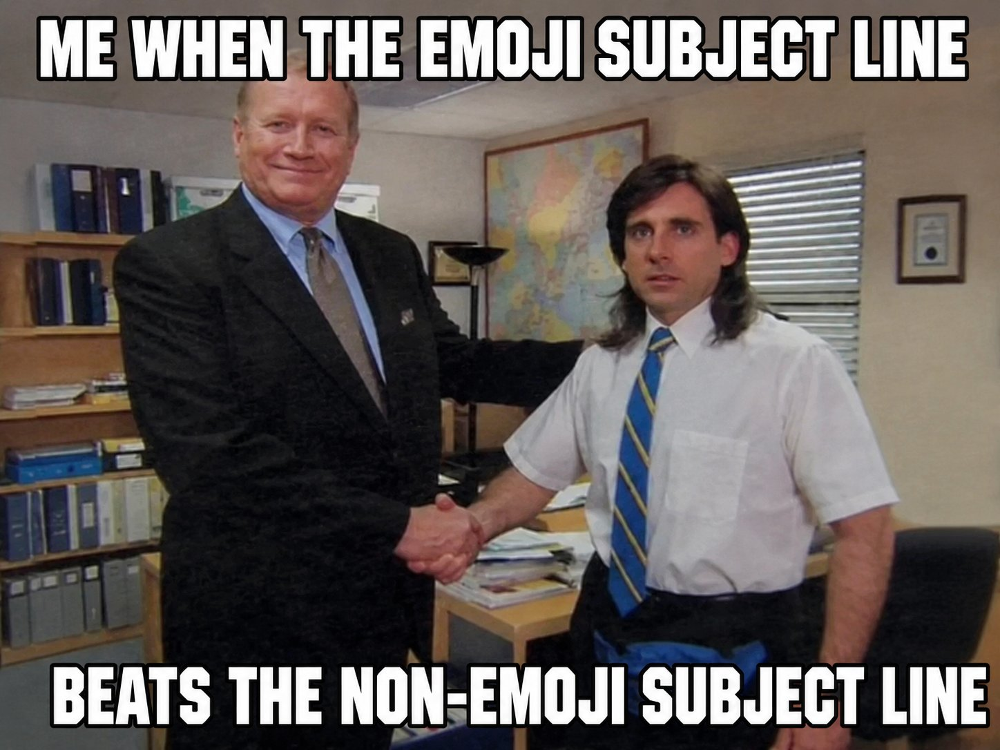
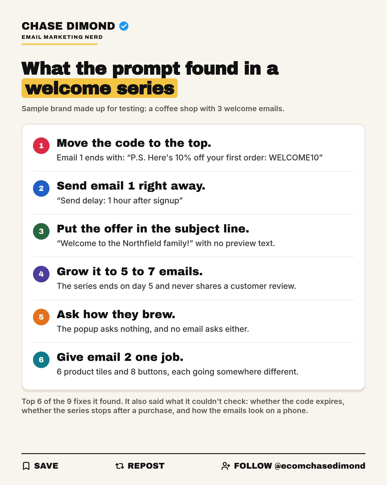

# 🐦 @AiEvolutio58513

## 📅 October 12, 2026

> 5 post(s) archived.

---

### 🕐 17:10 UTC · @AiEvolutio58513

> Every email marketer has sat in this exact meeting. Two versions on the screen. Everyone has an opinion. Someone says let&apos;s just test it. You split the list, send both, and one wins by 6%. Slack gets a green tick. Nice, version B it is. Everyone moves on. Nobody ever says the obvious part out loud: A 6% win means almost half your list just got the worse email. And you&apos;ll run it again next week. @getallanai is the first thing I&apos;ve seen that gets you out of that loop. It sits on top of Omnisend and Klaviyo. Your designer uploads blocks instead of finished emails, or you let Allan&apos;s AI generate assets for you. Allan assembles a different email for each subscriber and learns what that person responds to. Nobody gets handed the version they didn&apos;t want. I spent years getting good at picking. I&apos;d rather not have to. See it for yourself → https://getallan.com/?utm_source=chase

🔗 [View original post](https://x.com/ecomchasedimond/status/2109693304585716220)

---

### 🕐 13:58 UTC · @AiEvolutio58513

> Elon Musk has swapped his homes for an Airstream parked in Memphis so he can run xAI&apos;s giant AI build-out up close. xAI, his AI company, was bought by SpaceX earlier this year. In Memphis it is building Colossus, a huge supercomputer site meant to supply the compute that trains and runs Grok. He could stay in a luxury home. Instead, he says, he sleeps steps from the build so he can stay hands-on, and he has joked that the trailer is his palace. Gwynne Shotwell, SpaceX&apos;s president, has said he tends to sleep next to whatever he is building when he&apos;s deep in it. What&apos;s going up in Tennessee is the computing backbone of his AI plans: a massive data center and supercomputer built to make Grok and the models after it far more capable. Interested in AI? Follow @AiEvolutio58513 and never fall behind. I track ChatGPT, Claude, and every tool quietly changing how we work and create, then hand you the tested signals. Media

🔗 [View original post](https://x.com/AiEvolutio58513/status/2109644786890318043)

---

### 🕐 12:58 UTC · @AiEvolutio58513

> Ben Affleck, the actor who also runs Artists Equity, walks through his method for fine-tuning open video models: unfreeze the weights, then train only the final cinematic layer, so the output meets the standard a real film crew works to. Some background: in 2022 he started InterPositive, a 16-person AI company for film post-production. Netflix acquired it in March 2026 for $587M, all cash. Why build it at all? The public video models had learned from his colleagues&apos; films, and he didn&apos;t see a real business in that. So InterPositive raised money, spent 8 months filming its own dataset on a controlled stage, and used that footage only for late-stage training. From there, every new film trains its own private model on its own dailies. The production keeps both the footage and what the model learned from it. That is what Netflix paid $587 million for. Interested in AI? Follow @AiEvolutio58513 and never fall behind. I track ChatGPT, Claude, and every tool quietly changing how we work and create, then hand you the tested signals. Media

🔗 [View original post](https://x.com/AiEvolutio58513/status/2109629705137852675)

---

### 🕐 11:04 UTC · @AiEvolutio58513

> Bill Gates says the people promising that AI will create more jobs are missing what is about to happen. “Once AI becomes reliable enough to do the work, it starts replacing people.” “Once you replace human cognition as a scarce element, you blow it away.” “Working 24 hours a day, reading more, knowing every language.” “This isn’t like the PC. This is like evolutionary history.” “It’s like the aliens really are here. They just didn’t come in spacecraft.” Interested in AI? Follow @AiEvolutio58513 and never fall behind. I track ChatGPT, Claude, and every tool quietly changing how we work and create, then hand you the tested signals. Media

🔗 [View original post](https://x.com/AiEvolutio58513/status/2109601059056554339)

---

### 🕐 02:47 UTC · @AiEvolutio58513

> Before you spend another dollar on ads, run your welcome emails through this prompt. Every subscriber your ads bring in gets these emails first. Paste this into ChatGPT or Claude, then add your popup and your emails at the bottom: &quot;Audit my ecommerce welcome email series. Below I&apos;ll paste my signup popup (the offer and any question it asks), whether the series stops when someone buys, and every welcome email in order with its subject line, preview text, send delay, buttons, and body copy. If you can, also attach a phone screenshot of each email. Check it against these rules: 1. Email 1 sends right after signup, with no delay. 2. The promised code or offer is in the first lines of email 1, before any brand story. 3. The series has 5 to 7 emails spread over 10 to 14 days. 4. Across the series, it covers why the brand started, the problem the product solves, how it solves it, one specific customer review, and the biggest reason people hesitate (price, fit, quality, or shipping). 5. Each email asks for one action. Several buttons are fine if they all go to the same place. 6. If my popup asks a question, later emails use the answer. If it doesn&apos;t, an early email asks what they&apos;re shopping for. 7. If the offer expires, the last email gives the exact date and time. 8. The series stops once someone buys. 9. Each subject line makes clear what&apos;s inside, and the preview text adds to it instead of repeating it or showing filler like &quot;View in browser.&quot; 10. If I attached screenshots, check each email on mobile: the offer and main button show without scrolling, the text is easy to read, and it doesn&apos;t rely on one big image. Then give me: 1. Every fix, ranked by how much it likely affects sales. For each one, quote the line from my email that has the problem, say why it matters in one sentence, and give the fix. 2. Rewrites I can paste for the top 3 fixes, in my brand&apos;s voice. Don&apos;t make up reviews, numbers, or facts about my brand. Use [brackets] for anything I need to fill in. 3. Any rule you couldn&apos;t check from what I pasted. My popup: [paste] Does the series stop when someone buys? [yes / no / not sure] My emails: [paste]&quot; It checks your series against the welcome series rules I teach, then ranks the fixes and rewrites the top 3. Here&apos;s what it found in a sample 3-email series:

🔗 [View original post](https://x.com/ecomchasedimond/status/2109476098673143848)

---
