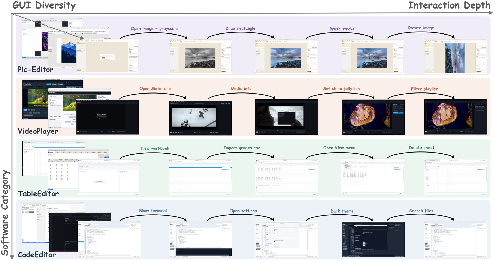

# 🐦 @_akhaliq

## 📅 October 12, 2026

> 3 post(s) archived.

---

### 🕐 18:23 UTC · @_akhaliq

> BudgetPix Compute-Adaptive Tokenization for Pixel-Space Image Diffusion paper: https://huggingface.co/papers/2610.12307 Media

🔗 [View original post](https://x.com/_akhaliq/status/2109711696944300535)

---

### 🕐 18:07 UTC · @_akhaliq

> Your API is now your product, and it needs to move as fast as you do. Introducing Restless. Every call, support question, pull request, and error message leaves your API better for the next agent. Media

🔗 [View original post](https://x.com/gkoberger/status/2109707495820464356)

---

### 🕐 16:14 UTC · @_akhaliq

> SoftwareGym A new pipeline synthesizes diverse GUI software environments to train computer-use agents, achieving a 37% relative improvement on OSWorld (Pass@3 from 41.4% to 57.0%)

🔗 [View original post](https://x.com/HuggingPapers/status/2109679167281492107)

---
