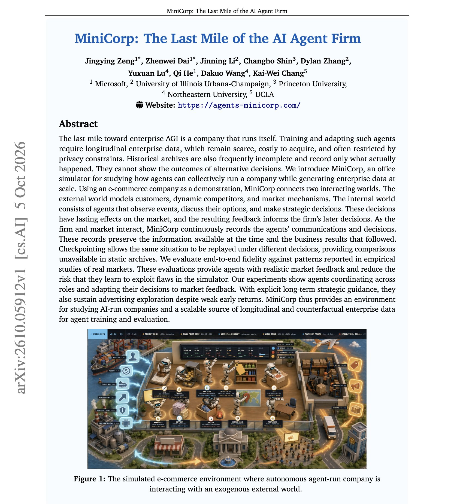
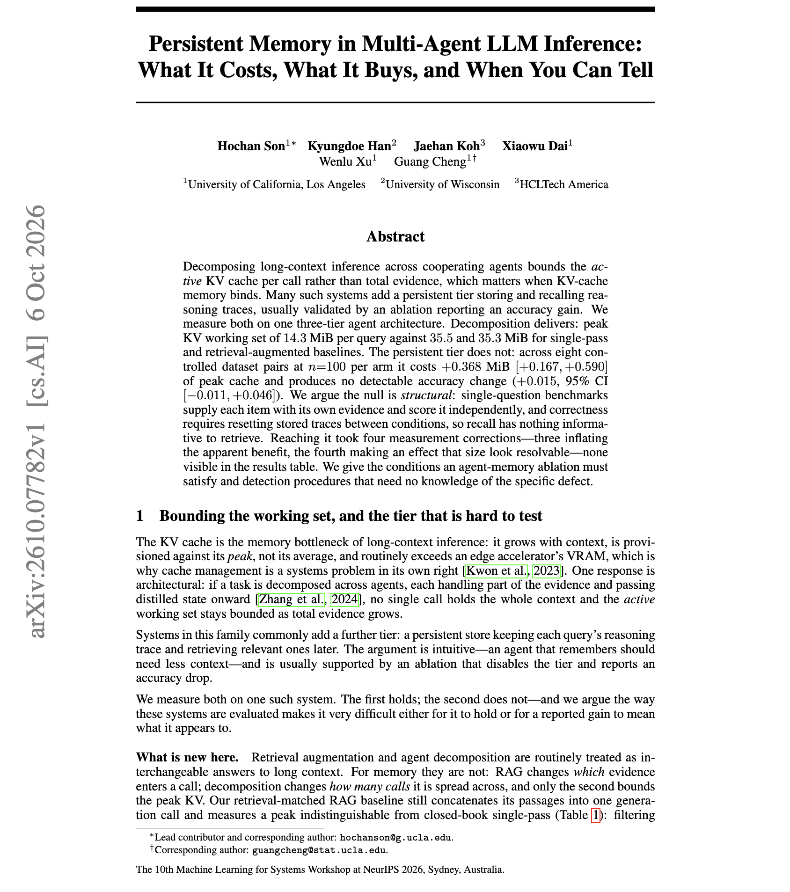

# 🐦 @dair_ai

## 📅 October 12, 2026

> 2 post(s) archived.

---

### 🕐 14:01 UTC · @dair_ai

> New paper from Microsoft and colleagues on generating enterprise data for agents. If you train or evaluate agents on long-running business work, it&apos;s worth your time. (bookmark it) MiniCorp is an office simulator. A firm of agents runs an e-commerce company, discusses decisions in messages and meetings, and sets prices, inventory, and ad spend. A simulated market with customers and adaptive competitors responds, and the firm reacts to the results. The market is checked against published studies of real ones. A four-week 20% discount lifts units by 71%, and sales stay 31% above control after prices return to normal. Checkpoints let the same market state replay with a different decision, giving paired outcomes that real company records cannot provide. Paper: https://arxiv.org/abs/2610.05912 Chat with Paper: https://academy.dair.ai/papers/minicorp-the-last-mile-of-the-ai-agent-firm-2610.05912

🔗 [View original post](https://x.com/dair_ai/status/2109645550165598290)

---

### 🕐 13:54 UTC · @dair_ai

> Must-read paper on the effectiveness of multi-agent systems and persistent memory. We have recently seen many viral examples of multi-agent systems scaled via persistent memory. This work takes a closer look. They test one three-tier chain-of-agents system. Splitting long-context work across agents cuts peak KV cache to 14.3 MiB per query, against about 35 MiB for single-pass and RAG baselines. The persistent trace-recall tier adds 0.368 MiB of peak cache and changes accuracy by +0.015, with a confidence interval that crosses zero. The authors explain why. Single-question benchmarks give each item its own evidence and score it independently, so stored traces have nothing useful to recall. Paper: https://arxiv.org/abs/2610.07782 Chat with Paper: https://academy.dair.ai/papers/persistent-memory-in-multi-agent-llm-inference-what-it-costs-what-it-buys-and-wh-2610.07782

🔗 [View original post](https://x.com/omarsar0/status/2109643758228869175)

---
