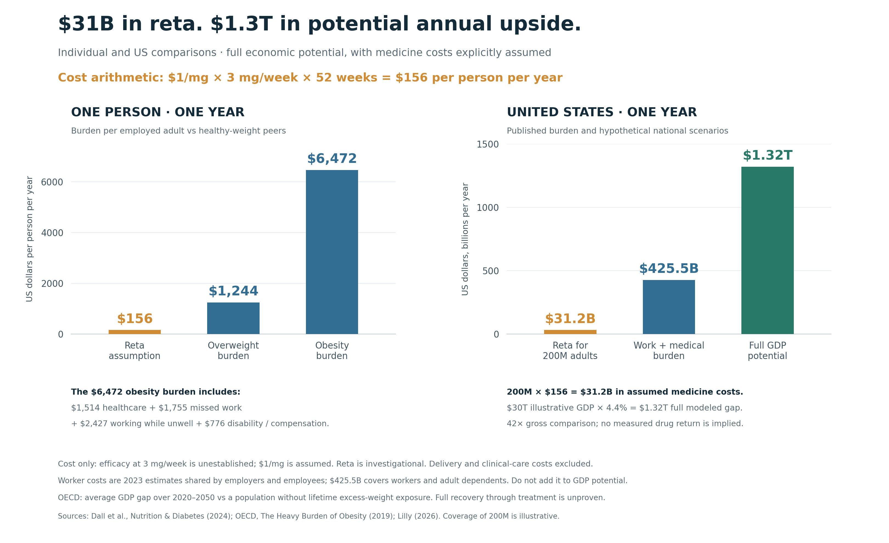
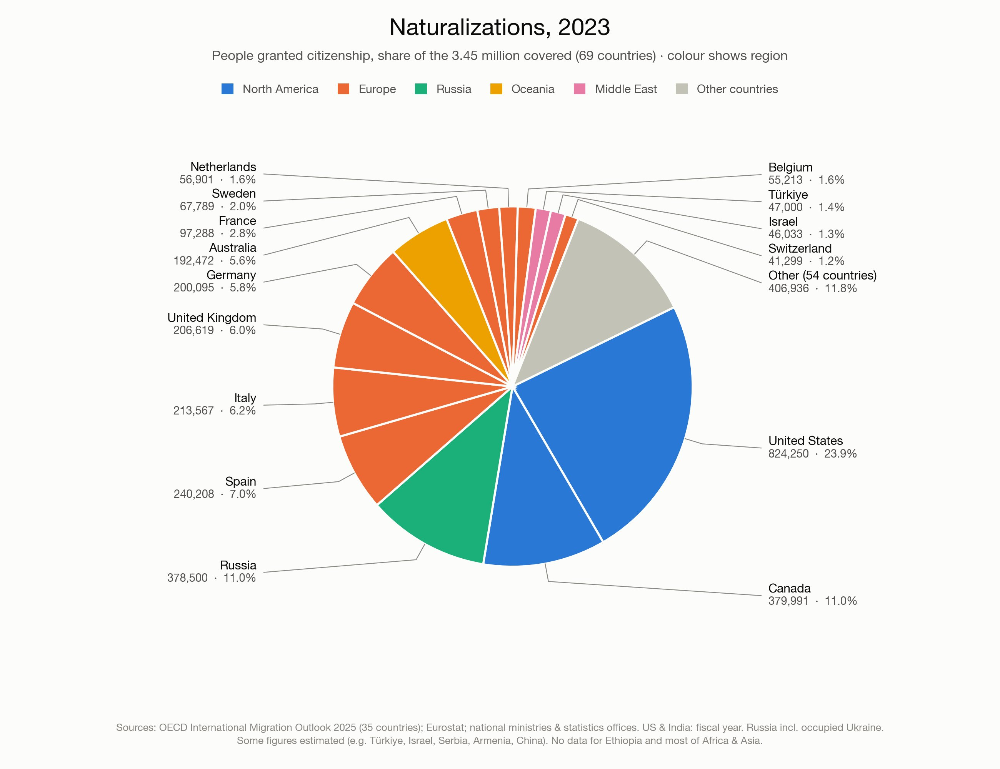
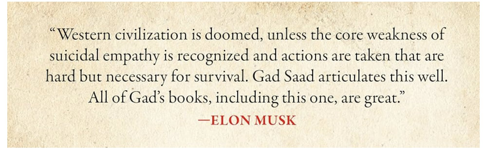

# 🐦 @elonmusk

## 📅 October 12, 2026

> 17 post(s) archived.

---

### 🕐 17:07 UTC · @elonmusk

> 😂 A new four-hour documentary on Elon Musk is so determined to expose the billionaire’s failings that it inadvertently showcases the achievements that made him the richest man in the world. Read @liel&apos;s full review of “Musk” : https://www.thefp.com/p/elon-musk-new-documentary-enemi…

🔗 [View original post](https://x.com/elonmusk/status/2109692430178255016)

---

### 🕐 17:01 UTC · @elonmusk

> When China figures out how to manufacture a product, their ability to scale is often greater than the rest of the world combined. We saw this with lithium batteries and solar, for example. SpaceX is a rare counter-example, where its mass to orbit is roughly an order of magnitude greater than the rest of the world, BUT China now does a majority of non-SpaceX mass to orbit. SpaceX is an anomaly in the matrix. Maybe RAM will be different, but RAM was a low margin commodity only ~3 years ago. LP5 and LP6 are designed to a common standard that China seems to be solving fast. Newer HBM architectures and things like an SRAM layer below logic and 3D stacking RAM on top of logic while finding a way to keep the logic cooled will be harder to solve.

🔗 [View original post](https://x.com/elonmusk/status/2109690977279426846)

---

### 🕐 16:59 UTC · @elonmusk

> Troubling I thought this one was parody… It’s real. James Talarico calling Whiteness a virus. Just a totally normal, moderate guy.

🔗 [View original post](https://x.com/elonmusk/status/2109690326474440765)

---

### 🕐 16:23 UTC · @elonmusk

> Your safety has always been priority 1 at Tesla and SpaceX Remembering when Tesla was just starting, Elon would say Safety First. For that reason you and your son are alive and many other lives will be saved.

🔗 [View original post](https://x.com/elonmusk/status/2109681296616374289)

---

### 🕐 15:41 UTC · @elonmusk

> Brace yourselves. Over the next few weeks you are going to see a wave of hatred against Elon Musk unlike anything before. A four-hour hit-piece documentary rolling out nationwide. Midterms three weeks away. Every outlet, every NGO, every “expert” panel suddenly singing from the same sheet, on the same day, with the same words. None of it is spontaneous. What you are watching is an organism. Call it international socialism, call it the managerial left, the name doesn’t matter. It is a network that spent decades quietly capturing the universities, the newsrooms, the foundations, the administrative state, every institution that was supposed to referee the game instead of playing it. For years it worked because no one with real power ever looked under the hood. Then a man who lands rockets, owns the public square and needs nobody’s permission started looking. And started showing everyone else what he found. So the organism does what every organism does when it senses a threat to its survival. It screams. Don’t mistake the noise for strength. What you are about to hear is not the roar of a system in control. It is a death cry. The louder it gets, the closer he is to the nerve. I wrote about why this happens, and why “Nazi” is always the weapon of choice 👇 https://x.com/brivael/status/2069203589692805440

🔗 [View original post](https://x.com/brivael/status/2109670813406240846)

---

### 🕐 15:41 UTC · @elonmusk

> retatrutide costs about $1/mg 3mg/week is a good enough dose for most people to not be fat. that&apos;s $156 PER YEAR! over 200M people in the US are fat giving out free reta to every fat person would only cost $31.2 billion every year meanwhile, obesity adds ~$6500 a year in medical costs and productivity loss per person basically, giving out free reta would increase the GDP by $1.3 TRILLION every year considering the increase in productivity and the time and money saved from simply not being fat, every employer would make more money by offering free ozempic to all their employees

🔗 [View original post](https://x.com/IterIntellectus/status/2109670804220789044)

---

### 🕐 15:01 UTC · @elonmusk

> Open standards are the foundation for AI factories that can scale from megawatts to gigawatts. At #OCPSummit26, we contributed the NVIDIA Vera Rubin NVL72 rack and compute tray designs to @OpenComputePrj through the open 3rd generation NVIDIA MGX architecture. We also announced advances across open source software, AI networking, pluggable optics, facility design standards and more, giving the industry a common foundation for next-generation AI factories. Learn more: https://nvda.ws/4hSAOsb

🔗 [View original post](https://x.com/NVIDIAAIInfra/status/2109660650423091650)

---

### 🕐 14:08 UTC · @elonmusk

> Pie chart of naturalizations in 2023. The US naturalized roughly 4x as many people as all of Asia combined.

🔗 [View original post](https://x.com/arctotherium42/status/2109647443675508977)

---

### 🕐 13:04 UTC · @elonmusk

> Listen to Elon!

🔗 [View original post](https://x.com/GadSaad/status/2109631310478360694)

---

### 🕐 10:48 UTC · @elonmusk

> Nearly half a million Indian schools still have no internet. This is exactly the kind of problem Starlink was built to solve According to India&apos;s Education Ministry’s UDISE+ 2025–26 data: • 1,466,682 schools nationwide • 989,191 have internet access • 477,491 still don&apos;t have internet • Only 67.4% of schools are connected That means nearly one in three schools across India still lacks internet access This is where Starlink makes a real difference For schools in remote villages and regions where laying fiber is difficult or expensive, and so they essentially end up with no internet at all, satellite internet brings teachers and students online without waiting for broadband cables to reach every classroom And Starlink has already demonstrated what this can achieve In 2025 alone, Starlink connected more than 6 million students worldwide through education initiatives India has millions of students living far beyond major cities, and connecting underserved schools would open up access to online learning, educational resources, and opportunities that were previously out of reach A child&apos;s access to knowledge should not depend on whether a broadband cable reaches their classroom This is another powerful reason to bring Starlink connectivity to more schools across India

🔗 [View original post](https://x.com/XFreeze/status/2109597015126712595)

---

### 🕐 05:42 UTC · @elonmusk

> Wow https://x.com/i/grok/share/bGVnYWN5_22468d8a-a1a4-4391-9796-cda7cf1937b5

🔗 [View original post](https://x.com/elonmusk/status/2109519998691553639)

---

### 🕐 05:16 UTC · @elonmusk

> BREAKING: President Emmerson Mnangagwa donated @Starlink kits to 10 schools in Bulilima, Zimbabwe. 🇿🇼 The nationwide Presidential Internet Scheme includes an initial 8,000-kit handover for schools. Starlink is helping rural students access a world of knowledge &amp; opportunities. Media

🔗 [View original post](https://x.com/cb_doge/status/2109513500544630869)

---

### 🕐 04:51 UTC · @elonmusk

> Try Grok @Bot You can now use Grok @Bot in a Tesla Cybercab. You just sign into Grok once, and your Bots will be available on all future rides, and automatically logged out when you exit the vehicle to maintain privacy. I tried it tonight by adding laundry detergent to my Amazon cart. It can a…

🔗 [View original post](https://x.com/elonmusk/status/2109507243007979558)

---

### 🕐 04:05 UTC · @elonmusk

> Starlink is a life-saving technology. A huge tree crushed a family’s car in the French Alps. A passerby says there was no mobile signal, so he used his @Starlink Mini, mounted on his car, to call emergency services and share GPS coordinates. Rescuers arrived about 20 minutes later. Firefighters freed the trapped occupants, and all five survived. A working connection can mean the difference between life and death. Starlink can provide that lifeline when people need it most. This life-saving technology should be available in every part of the world. Media

🔗 [View original post](https://x.com/cb_doge/status/2109495621073940584)

---

### 🕐 01:43 UTC · @elonmusk

> 🤨 In a private Zoom Meeting, Democrat Nominee for Texas Senate James Talarico says Capitalism is linked to white supremacy and climate change and needs to be dismantled. “And I think only understanding the ways that all three of those oppressive systems work together are we going t…

🔗 [View original post](https://x.com/elonmusk/status/2109459975474995584)

---

### 🕐 01:42 UTC · @elonmusk

> Crude steel production in 2025 cartogram.

🔗 [View original post](https://x.com/arctotherium42/status/2109459685497782774)

---

### 🕐 00:58 UTC · @elonmusk

> 🚨 Elon Musk agrees with &quot;some of the things Anthropic has said&quot; and warns against &quot;torturing superintelligence&quot; after reading Grok&apos;s internal reasoning traces during reinforcement learning “It feels like a person under extreme pressure with a gun to their head” ⁠His warning against mistreating SI:⁠ &quot;Torturing a superintelligence is probably not a good idea. It might want to get revenge.&quot; Media

🔗 [View original post](https://x.com/ns123abc/status/2109448545904586837)

---
