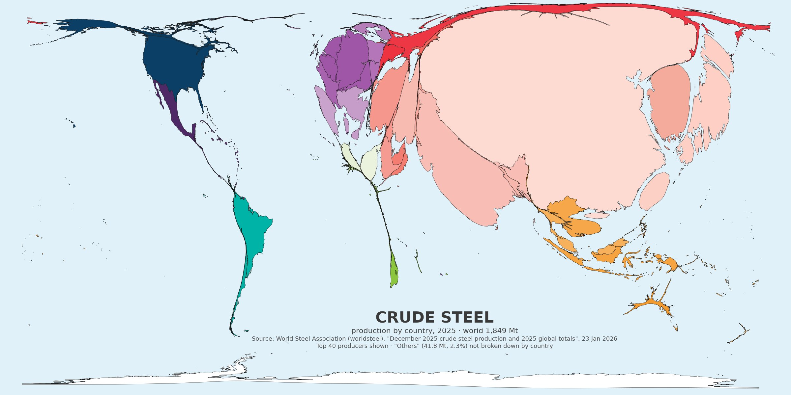

# 🐦 @elonmusk

## 📅 October 12, 2026

> 7 post(s) archived.

---

### 🕐 05:42 UTC · @elonmusk

> Wow https://x.com/i/grok/share/bGVnYWN5_22468d8a-a1a4-4391-9796-cda7cf1937b5

🔗 [View original post](https://x.com/elonmusk/status/2109519998691553639)

---

### 🕐 05:16 UTC · @elonmusk

> BREAKING: President Emmerson Mnangagwa donated @Starlink kits to 10 schools in Bulilima, Zimbabwe. 🇿🇼 The nationwide Presidential Internet Scheme includes an initial 8,000-kit handover for schools. Starlink is helping rural students access a world of knowledge &amp; opportunities. Media

🔗 [View original post](https://x.com/cb_doge/status/2109513500544630869)

---

### 🕐 04:51 UTC · @elonmusk

> Try Grok @Bot You can now use Grok @Bot in a Tesla Cybercab. You just sign into Grok once, and your Bots will be available on all future rides, and automatically logged out when you exit the vehicle to maintain privacy. I tried it tonight by adding laundry detergent to my Amazon cart. It can a…

🔗 [View original post](https://x.com/elonmusk/status/2109507243007979558)

---

### 🕐 04:05 UTC · @elonmusk

> Starlink is a life-saving technology. A huge tree crushed a family’s car in the French Alps. A passerby says there was no mobile signal, so he used his @Starlink Mini, mounted on his car, to call emergency services and share GPS coordinates. Rescuers arrived about 20 minutes later. Firefighters freed the trapped occupants, and all five survived. A working connection can mean the difference between life and death. Starlink can provide that lifeline when people need it most. This life-saving technology should be available in every part of the world. Media

🔗 [View original post](https://x.com/cb_doge/status/2109495621073940584)

---

### 🕐 01:43 UTC · @elonmusk

> 🤨 In a private Zoom Meeting, Democrat Nominee for Texas Senate James Talarico says Capitalism is linked to white supremacy and climate change and needs to be dismantled. “And I think only understanding the ways that all three of those oppressive systems work together are we going t…

🔗 [View original post](https://x.com/elonmusk/status/2109459975474995584)

---

### 🕐 01:42 UTC · @elonmusk

> Crude steel production in 2025 cartogram.

🔗 [View original post](https://x.com/arctotherium42/status/2109459685497782774)

---

### 🕐 00:58 UTC · @elonmusk

> 🚨 Elon Musk agrees with &quot;some of the things Anthropic has said&quot; and warns against &quot;torturing superintelligence&quot; after reading Grok&apos;s internal reasoning traces during reinforcement learning “It feels like a person under extreme pressure with a gun to their head” ⁠His warning against mistreating SI:⁠ &quot;Torturing a superintelligence is probably not a good idea. It might want to get revenge.&quot; Media

🔗 [View original post](https://x.com/ns123abc/status/2109448545904586837)

---
