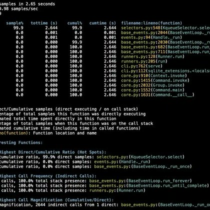

# 🐦 @simonw

## 📅 October 12, 2026

> 1 post(s) archived.

---

### 🕐 18:22 UTC · @simonw

> Shared some notes on Python 3.15, using it with uv, and features from Python 3.11 I&apos;m excited to use now that 3.10 is no longer the minimum supported version for my own projects https://simonwillison.net/2026/Oct/12/python-3-15/

🔗 [View original post](https://x.com/simonw/status/2109711203077619768)

---
