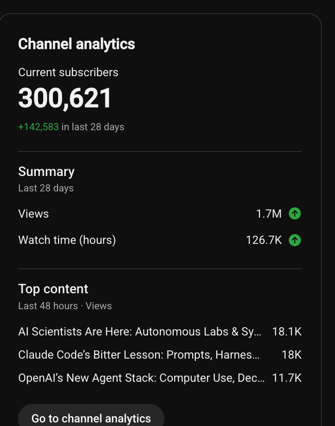
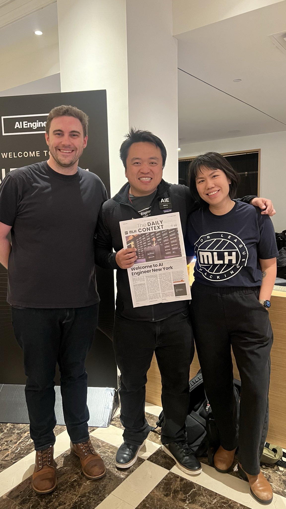

# 🐦 @swyx

## 📅 October 12, 2026

> 5 post(s) archived.

---

### 🕐 15:22 UTC · @swyx

> 3 weeks for the third 100k

🔗 [View original post](https://x.com/swyx/status/2109666113155936495)

---

### 🕐 15:18 UTC · @swyx

> also packed room for @arizeai @seldo workshop at #aiengineerny!! https://x.com/nehallagrawal/status/2109656052035928481?s=46 AI Engineer New York officially kicking off Where Wall Street meets engineering

🔗 [View original post](https://x.com/swyx/status/2109665044208226797)

---

### 🕐 14:21 UTC · @swyx

> @cjav_dev @aiDotEngineer @ricmac @latentspacepod btw hosting karaoke night tmr at my fave nyc bar! https://luma.com/lsk

🔗 [View original post](https://x.com/swyx/status/2109650557476487514)

---

### 🕐 13:41 UTC · @swyx

> world’s first full length workshop on claude flows @cjav_dev and Harrison Stall are kicking off @aidotengineer bright and early on a monday morning to a PACKED room, standing room only #AIEngineerNY @ricmac is on the case reporting for @latentspacepod and we’ll also publish asap. proud to work with @anthropicai to sponsor AIE NYC for the second year running! Media Claude Managed Agents dynamic workflows are now available in public beta. It&apos;s a new type of multiagent orchestration, built for your most ambitious workloads. A lead agent writes a plan that runs across many agents in phases, combining the results at the end.

🔗 [View original post](https://x.com/swyx/status/2109640508079263769)

---

### 🕐 12:56 UTC · @swyx

> Day 1! #AIEngineerNY @swyx

🔗 [View original post](https://x.com/liamcbride/status/2109629287964049569)

---
