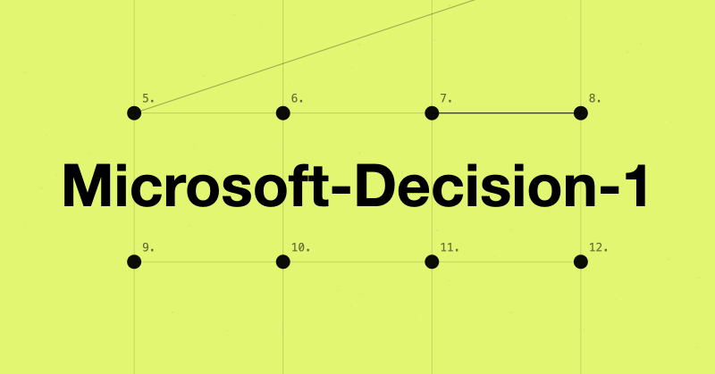
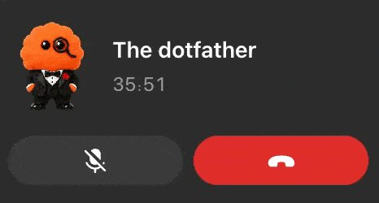
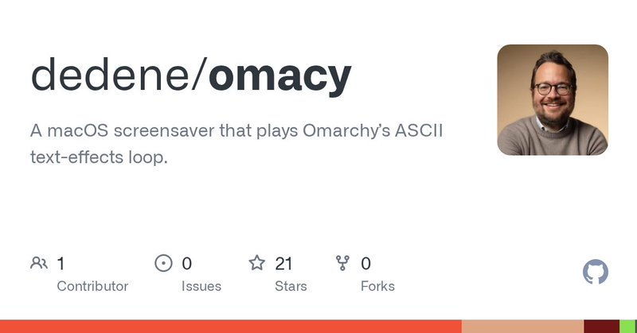

# 🐦 @tonysimons_

## 📅 October 12, 2026

> 14 post(s) archived.

---

### 🕐 17:52 UTC · @tonysimons_

> Hermes Agent Tip of the Day 🪽 Your agent needs two Gmail accounts. What could go wrong, right? 😂 Hermes now lets you NAME them: hermes connectors connect gmail –alias work hermes connectors connect gmail –alias home Then: “Send this from work.” Save this one. 🔖

🔗 [View original post](https://x.com/tonysimons_/status/2109703836143362317)

---

### 🕐 16:43 UTC · @tonysimons_

> Connecting apps to Hermes shouldn&apos;t be a weekend project. 🪽 60 connectors on Nous Portal right now. Canva. Notion. Slack. Discord. Shopify. Open Connectors, pick an app, follow the prompts. This is the &quot;just works&quot; layer the fleet actually needs. Connecting your apps to Hermes shouldn’t be a project of its own. 🔥 Nous Portal has currently has 60 connectors (and the list keeps growing), including Canva, Notion, Slack, Discord and Shopify. Open Connectors, choose an app and follow the prompts to link your account. You can …

🔗 [View original post](https://x.com/tonysimons_/status/2109686331295039663)

---

### 🕐 16:04 UTC · @tonysimons_

> Your agent doesn&apos;t need a bigger brain. 🧠 It needs a better TRAFFIC COP. 👮 Microsoft just dropped Decision-1, a fast routing model for deciding what runs next. This is the boring layer that makes Hermes feel less chaotic. 👇🏻 https://commandline.microsoft.com/microsoft-decision-1-model-foundry/

🔗 [View original post](https://x.com/tonysimons_/status/2109676639038636420)

---

### 🕐 15:01 UTC · @tonysimons_

> &quot;Find 50 clients. Research them. Pull work emails. Draft outreach for my approval.&quot; That&apos;s not a chat trick. That&apos;s a full outreach workflow with YOU still on the send button. 🔥 Everyone is talking about Claude + Treg But I’m thinking about Hermes + Treg Imagine telling Hermes: “Find 50 potential clients in my industry, research their companies, find their work emails, and prepare personalized outreach for my approval.” Hermes handles the workflow Treg p…

🔗 [View original post](https://x.com/tonysimons_/status/2109660624196354372)

---

### 🕐 14:20 UTC · @tonysimons_

> If you aren&apos;t safari 27 / MCP optimized, do you even exist? Grokbot template below is badass. Your website&apos;s got a new kind of visitor. 🤖 AI agents. And most sites aren&apos;t ready for them. @PixelRainbowNFT built a FREE Grok Bot template that tests your site in a real Safari 27 session, ranks what&apos;s broken, then writes the fix as a SKILL.md for Hermes or Claude Code. No des…

🔗 [View original post](https://x.com/PixelRainbowNFT/status/2109650347367288877)

---

### 🕐 12:05 UTC · @tonysimons_

> 𝕏 blows my MIND. 🤯 Almost 14 MILLION impressions in under a year. On my content. I&apos;m just a guy in the Midwest who cleans toilets by day and obsesses over AI at night. (And during the day. Don&apos;t tell my boss. 😂) If you&apos;re behind even ONE of those impressions... THANK YOU. 🙏🏻 Media

🔗 [View original post](https://x.com/tonysimons_/status/2109616321281323040)

---

### 🕐 09:06 UTC · @tonysimons_

> Some people use ChatGPT for quick answers. Me? I just spent 36 minutes on the phone with an orange fuzzball in a tuxedo. Forget token limits. The dotfather and I need unlimited minutes. 😂

🔗 [View original post](https://x.com/tonysimons_/status/2109571273638748355)

---

### 🕐 06:45 UTC · @tonysimons_

> Hermes plugins just got a real home. 🪽 Nous pulled the official ones into one place. Home Assistant. Spotify. Blender. Snyk. TouchDesigner. Memory Wiki. Claude DirectSDK. And here&apos;s the part people are gonna miss: Each one updates on its OWN. No waiting on a full Hermes release. Save this for your next setup. 👇 Hermes just got a whole lot more expandable. 🔥 Nous Research has brought its official Hermes plugins together in one place, giving users a growing collection of capabilities they can install as needed. Here&apos;s what&apos;s already available: • Home Assistant: Smart home automation • Sp…

🔗 [View original post](https://x.com/tonysimons_/status/2109535790283812879)

---

### 🕐 05:11 UTC · @tonysimons_

> If you’re on macOS and want to give it a try, grab it here:  https://github.com/dedene/omacy

🔗 [View original post](https://x.com/tonysimons_/status/2109512222686752874)

---

### 🕐 05:10 UTC · @tonysimons_

> The @OmarchyLinux screensaver is SO DOPE! 🔥 I just hadta throw it on my MacBook and Mac mini. GN! Media

🔗 [View original post](https://x.com/tonysimons_/status/2109511978058477600)

---

### 🕐 04:15 UTC · @tonysimons_

> Your website&apos;s got a new kind of visitor. 🤖 AI agents. And most sites aren&apos;t ready for them. @PixelRainbowNFT built a FREE Grok Bot template that tests your site in a real Safari 27 session, ranks what&apos;s broken, then writes the fix as a SKILL.md for Hermes or Claude Code. No design changes for humans. I&apos;ve got a handful of sites. I already know which one&apos;s getting this first. 👇🏻 Your website has a new visitor: AI agents. Safari 27 now lets AI drive a real browser. Most sites aren&apos;t ready for that. So I built Safari 27 MCP, a free Grok Bot template 🧵👇 https://x.ai/bot/8obMM4mRWRLf51EB2n4JV 🔍 Real-browser testing → it opens your site the way an AI agent…

🔗 [View original post](https://x.com/tonysimons_/status/2109498041065750854)

---

### 🕐 02:23 UTC · @tonysimons_

> Try it: hermes skills install official/creative/anatomy Anatomy by @wheresryan22, ported to Hermes by Nous Research.

🔗 [View original post](https://x.com/tonysimons_/status/2109470073073385868)

---

### 🕐 02:23 UTC · @tonysimons_

> I asked Hermes to explain rate limiting. It built me a MACHINE instead. 🪽 3 tokens. 4 requests. 3 get through. 1 gets bounced. Then you watch the bucket refill and try again. One voice prompt. About 90 minutes of Hermes cooking. This is Anatomy, a new Hermes skill that turns technical ideas into interactive diagrams you can actually play with. Way better than anything I could scribble up. 😂 Media

🔗 [View original post](https://x.com/tonysimons_/status/2109469969117241696)

---

### 🕐 00:01 UTC · @tonysimons_

> Working on @HermesFleet updates today. 🪽 Patching up issues from the last TestFlight and looking forward to new feature work. If you could control ONE more thing about your agents from your phone, what would it be?

🔗 [View original post](https://x.com/tonysimons_/status/2109434256267321395)

---
