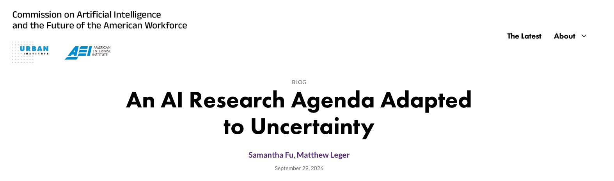

# 🐦 @tunguz

## 📅 October 12, 2026

> 15 post(s) archived.

---

### 🕐 15:39 UTC · @tunguz

> we&apos;ll literally have oss version of ALL major software products within 3 - 12 months everything is opensource if you have enough tokens

🔗 [View original post](https://x.com/tunguz/status/2109670333100040456)

---

### 🕐 15:33 UTC · @tunguz

> Yeah ...

🔗 [View original post](https://x.com/tunguz/status/2109668884018069698)

---

### 🕐 15:33 UTC · @tunguz

> Learn to plumb. software isn’t dead, but it’s certainly solved. you will not be able to find employment as a software engineer in 2028.

🔗 [View original post](https://x.com/tunguz/status/2109668753017577532)

---

### 🕐 15:06 UTC · @tunguz

> * ten months Unpopular opinion: the next ten years are your last opportunity to earn money

🔗 [View original post](https://x.com/tunguz/status/2109662119155155055)

---

### 🕐 15:03 UTC · @tunguz

> That’s why I started my business in Gary, Indiana. Want to start a business in your state? Make sure it’s in a colored area below.

🔗 [View original post](https://x.com/tunguz/status/2109661254503862567)

---

### 🕐 15:01 UTC · @tunguz

> We are so early. Walked into a busy coffee shop in NYC today to buy a coffee and I did something very autistic. Saw a guy working next to me on the free tier of ChatGPT. I got curious. I spent the next 30 minutes walking around checking out 22 laptops. 16 people were working completely by hand (I…

🔗 [View original post](https://x.com/tunguz/status/2109660672556482721)

---

### 🕐 14:50 UTC · @tunguz

> Just pay the taxes bro. @WeatherNation @douglassmackey Another victory for CA coastal commission! They’ll be red-tagged, vacated, demolished, and never allowed to be rebuilt due to permitting. Like Palisades, like Malibu. Yay!

🔗 [View original post](https://x.com/tunguz/status/2109658006086426635)

---

### 🕐 12:53 UTC · @tunguz

> I&apos;d love to share a blog post with you explaining the research agenda of the Commission of Artificial Intelligence and the Future of the American Workforce. My own focus will be on the impact of AI on Technology Industry - what AI can do today and what we can expect it to do in the near future. Other researchers on the commission and their specific focus are: - Bill Congdon will explore several scenarios of how AI could change the US labor market and affect workers - John Soroushian will explore how AI is currently being regulated and identify the policy levers that can effectively guide the pace and direction of AI adoption - Adam Leonard will lead research on the reforms needed to federal, state, and private data systems. - Kevin Corinth will identify the programs that could provide a cushion for workers as they transition between jobs and industries - Brent Parton will work to understand how to fund and design training and reskilling programs - Jason Tyszko will examine real-time changes in employers’ talent needs and how policymakers can protect jobs and workers - Rekha Balu will lead research on how AI’s effects may vary across regions and localities. You can read more about all these efforts in the following post: https://aiworkforcecommission.org/latest/ai-research-agenda-adapted-uncertainty

🔗 [View original post](https://x.com/tunguz/status/2109628576874041580)

---

### 🕐 12:29 UTC · @tunguz

> SI is Euromaxxing. Hearing more and more AI researchers are taking up smoking … superintelligence is near

🔗 [View original post](https://x.com/tunguz/status/2109622458823381047)

---

### 🕐 12:28 UTC · @tunguz

> They have not been needed for a really long time actually, and the fees that they get are insane. It’s just one of the many segments of the US economy that has been captured by the money extraction cartel over the past century. THAT is the main reason why so many segments of the US economy - and not just the manufacturing! - have become uncompetitive globally. Dumb question. Why are Real Estate agents needed anymore? Everything they do is completely replaceable by AI and Zillow or Redfin.

🔗 [View original post](https://x.com/tunguz/status/2109622252576604514)

---

### 🕐 12:24 UTC · @tunguz

> Datacenters is all you need. Santa Clara is the #2 county in the country for data centers and income. At a recent town meeting, the city revealed that data centers cover 9% of the city general fund and they keep the area&apos;s electricity costs 33-57% lower than those in surrounding utilities. Lucky!

🔗 [View original post](https://x.com/tunguz/status/2109621236980441277)

---

### 🕐 12:16 UTC · @tunguz

> Miracle drug. I&apos;ve been taking Reta since June titrating from 0.5mg to 4mg currently getting to lose this extra 40lbs. I&apos;m 26lbs down and also lost my attraction towards men. I&apos;ve been gay for the last 11 years and every time I&apos;m with a male I feel shame and want throw up afterwards. I&apos;m feeli…

🔗 [View original post](https://x.com/tunguz/status/2109619112385323455)

---

### 🕐 12:03 UTC · @tunguz

> “Well, yes, of course we can align entities that are vastly more powerful than us if we ask them nicely or are firm with them!”

🔗 [View original post](https://x.com/tunguz/status/2109615927193158006)

---

### 🕐 12:00 UTC · @tunguz

> Top AI alignment researchers right now.

🔗 [View original post](https://x.com/tunguz/status/2109615183639519736)

---

### 🕐 01:31 UTC · @tunguz

> gn faith, hope, and love is all you need

🔗 [View original post](https://x.com/tunguz/status/2109456873422221774)

---
