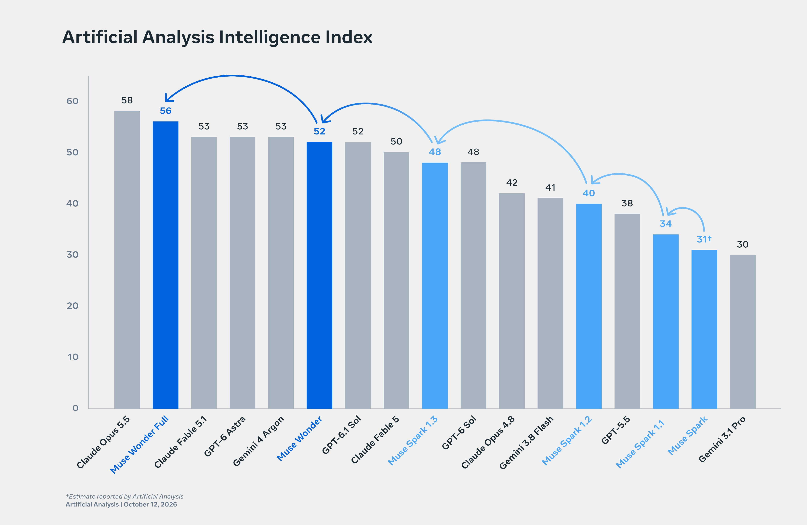
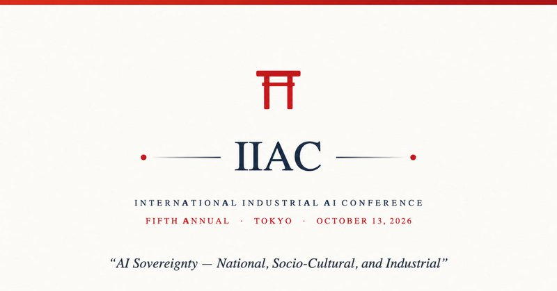

# 🐦 @ylecun

## 📅 October 12, 2026

> 5 post(s) archived.

---

### 🕐 17:32 UTC · @ylecun

> From rebuilding our foundation to pushing the frontier in 14 months 🚀

🔗 [View original post](https://x.com/AIatMeta/status/2109698705490149596)

---

### 🕐 16:13 UTC · @ylecun

> Check out our new paper on getting a SOTA harness for Automated Theorem Proving! The &quot;bitterest&quot; part of our lesson, perhaps, was that we wanted to demonstrate benefits of asymmetric self-play for harnesses, and each time we could improve the baseline harness to be better. This is how we ended up with h1, a great simple baseline harness, as our bitter lesson :) The Bitter Lesson for harness design and formal math! Instead of hand-designing how an AI should prove (decompose, plan, assign agents), what if we just give a frontier model good Lean feedback and let it keep working? We built h1. TL;DR: → SOTA on formal theorem proving benchmar…

🔗 [View original post](https://x.com/KempeLab/status/2109678954831376433)

---

### 🕐 05:47 UTC · @ylecun

> Join Anthony Annunziata, @ylecun and myself tomorrow, in Tokyo, the world headquarters of Industrial AI. We will talk about Digital Engineers for Physical Industry, JEPA World Models, and Industrial-AI Sovereignty—and hear from AI leaders in government and industrial enterprise. https://iiac.events/ convened by @aitomatic, in partnership with @thealliance_ai @panasonic et al.

🔗 [View original post](https://x.com/pentagoniac/status/2109521342332588096)

---

### 🕐 02:34 UTC · @ylecun

> 😱😱😱 And just like that, it’s completely VANISHED from the media. A sitting congressman, Ted Lieu, said on the record the Epstein files are being blocked because they show Trump raped and threatened to kill children. Lets make this viral again 👇 Media

🔗 [View original post](https://x.com/mjfree/status/2109472775630917733)

---

### 🕐 02:16 UTC · @ylecun

> Introducing RSI-Anything: Unlocking Recursive Self-Improvement with World Models 🚀 Can AI learn to improve itself by predicting the consequences of its actions? Built on JEPA-Anything, RSI-Anything uses world models to guide action selection and learning. Feedback improves the policy or workflow and, when needed, the world model. Validated updates carry forward to shape the next round of experience. Across code, GUI interaction, laboratory planning, and reaction optimization: • Code-repair success: 26.3% → 31.2%, with the coder fixed • GUI agent task: 39.4% fewer actions, with higher completion • Lab-planning scores: 21.80% → 46.01% over five policy versions • Mean best observed reaction yield: 96.15% vs. 82.16% for Bayesian optimization, under the same 40-experiment budget 📄 Paper: https://arxiv.org/abs/2610.13912 💻 Code: https://github.com/Gen-Verse/RSI-Anything Watch the video below 👇 #RSI #WorldModels #RSI #AIAgents #AIforScience #JEPA Media

🔗 [View original post](https://x.com/LingYang_PU/status/2109468200866074817)

---
