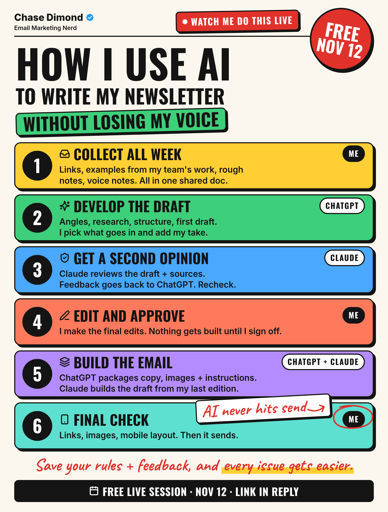
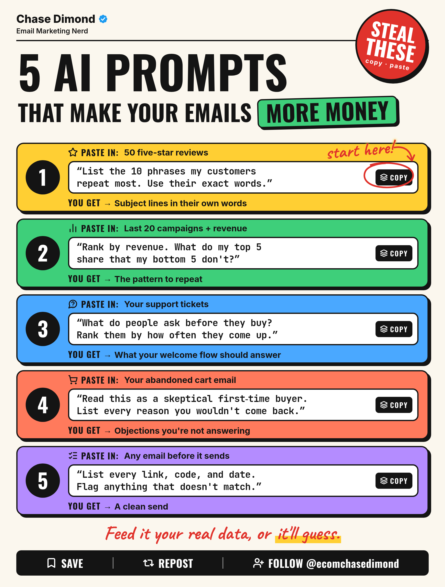
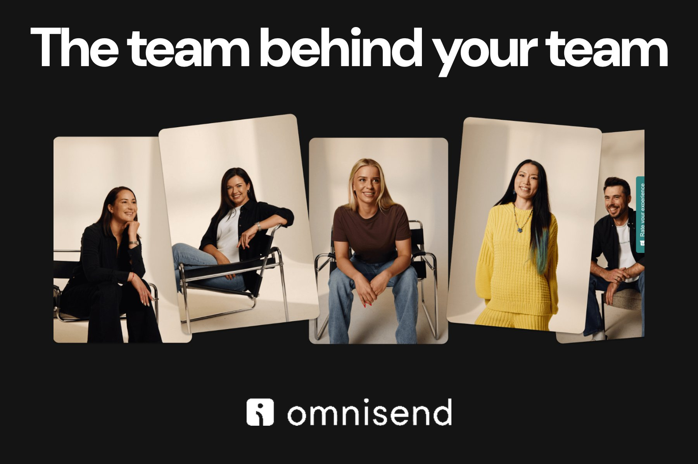

# 🐦 @AiEvolutio58513

## 📅 October 13, 2026

> 7 post(s) archived.

---

### 🕐 21:36 UTC · @AiEvolutio58513

> I&apos;m showing my exact AI newsletter workflow live on Nov 12 (free). Here&apos;s what you&apos;ll see: 1. How I collect a week of ideas in one doc 2. What I let ChatGPT draft, and what I don&apos;t 3. How Claude checks the draft, plus a real error it caught 4. Where I edit and sign off 5. How the email gets built from my last edition 6. My final check before it sends Then I&apos;ll run the copy workflow live. I&apos;m also sharing my starter prompts, brief template, build instructions, and final checklist. Same event: Amy Porterfield, Nancy Harhut, Kath Pay, and more. Free, virtual, 2 days. Free spot: link in the reply.

🔗 [View original post](https://x.com/ecomchasedimond/status/2110122644297388111)

---

### 🕐 19:48 UTC · @AiEvolutio58513

> 5 AI Prompts That Make Your Emails More Money:

🔗 [View original post](https://x.com/ecomchasedimond/status/2110095433242665208)

---

### 🕐 17:45 UTC · @AiEvolutio58513

> I came across a company called @ZyG_Edge doing something pretty wild: predicting whether an ecom brand with proven early success can grow 10x and become a category leader. And then executing that growth end to end. What caught my attention is the model they’ve built: with around $10K in live testing, they can assess a brand’s potential to scale. For a brand already selling $1M+ a year, that’s a pretty valuable question to answer: you know people want your product, but how big could this become, and how do you get there? First, ZyG’s AI analyzes your market, competitors, ads, reviews, pricing, and more to identify your strongest growth opportunities. That’s your ZyGnal, and it’s free. Then comes the Marketability Test. ZyG builds and tests positioning, creative, offers, and storefronts with real customers, using around $10K in media spend. And ZyG is now offering a fully funded test - $10K - to the 500 most promising brands, based on their ZyGnal. Their model uses the results - CAC, ROAS, predicted LTV, and other key metrics - to assess what your economics could look like at scale. Those findings feed into your ZyG Score, giving you a clearer picture of your breakout potential. And for brands with strong results, ZyG can then execute the growth end-to-end, from storefront optimization and creative to customer acquisition and retention. With a free ZyGnal and an opportunity for a fully-funded Marketability Test, it seems like a pretty obvious win for most brands. If your brand does $1M+ in annual online sales with a $40+ AOV, start with your free ZyGnal here: https://www.zyg.com/zyg-score?utm_source=linkedin&amp;utm_medium=influencer&amp;utm_campaign=Chase&amp;utm_term=Oct13 Media

🔗 [View original post](https://x.com/ecomchasedimond/status/2110064485906145307)

---

### 🕐 15:58 UTC · @AiEvolutio58513

> Your ESP is charging you extra for its own bugs. It just calls it priority support. Read that line item again. It&apos;s a company telling you on its own pricing page that the product breaks often enough to monetize the rescue. So help became a tier. And you find out which tier you&apos;re on at the worst possible moment. One thing I&apos;ve noticed across ecom tools: the companies confident in the product stop charging for the rescue. @omnisend puts 24/7 support on every plan, including the free one. A simple exercise before your next renewal: open your current ESP&apos;s pricing page and find the word support. If it sits inside a tier, you&apos;re not paying for software. You&apos;re paying for permission to ask a question. Omnisend answers on every plan. Go see what that looks like: https://www.omnisend.com/customer-support/?utm_source=chase

🔗 [View original post](https://x.com/ecomchasedimond/status/2110037418397335971)

---

### 🕐 14:02 UTC · @AiEvolutio58513

> Reinforcement learning taught this robot to run in a way no human does, and there&apos;s a reason for it. People swing their arms mostly to cancel the twist that every stride sends through the torso. On a robot, the arm is motors, gears and wiring, and swinging it hard means high torque again and again for an entire lap. The forward lean moves the center of mass out in front of the feet, where speed wants it. For a two-legged robot, that means less effort spent staying upright and more of every step turned into forward motion. Interested in AI? Follow @AiEvolutio58513 and never fall behind. I track ChatGPT, Claude, and every tool quietly changing how we work and create, then hand you the tested signals. Media

🔗 [View original post](https://x.com/AiEvolutio58513/status/2110008207842422985)

---

### 🕐 12:58 UTC · @AiEvolutio58513

> Jensen Huang was asked about AI labs distilling each other&apos;s models. His answer: “That’s called competition. You’re allowed to test somebody else’s products all you want.” Interested in AI? Follow @AiEvolutio58513 and never fall behind. I track ChatGPT, Claude, and every tool quietly changing how we work and create, then hand you the tested signals. Media

🔗 [View original post](https://x.com/AiEvolutio58513/status/2109992122216788399)

---

### 🕐 11:04 UTC · @AiEvolutio58513

> Sam Altman says learning to code is no longer the safe bet for your future. “Learn to program was so obviously the right thing over a recent period of time, and now it’s not.” What he would build instead: “Become high agency.” And: “Get good at generating ideas.” “Be very resilient. Be very adaptable to a rapidly changing world.” “I think these are going to matter more than any specific skill.” “And I think these are all learnable.” Interested in AI? Follow @AiEvolutio58513 and never fall behind. I track ChatGPT, Claude, and every tool quietly changing how we work and create, then hand you the tested signals. Media

🔗 [View original post](https://x.com/AiEvolutio58513/status/2109963383093256411)

---
