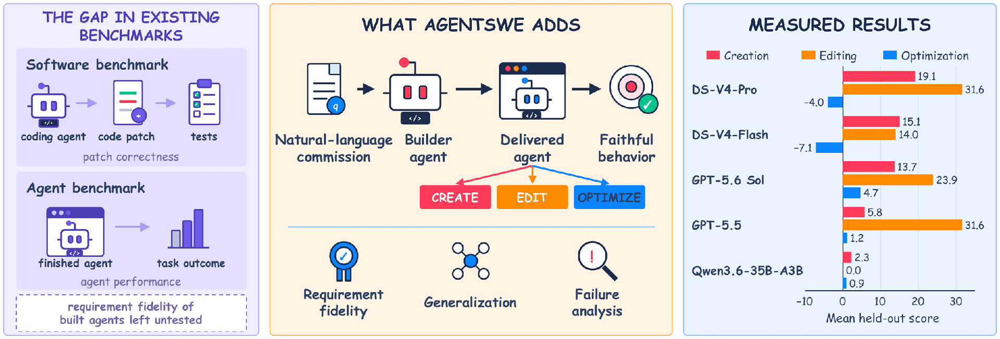
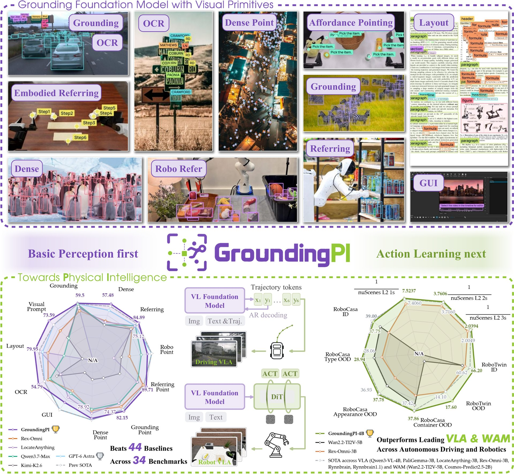

# 🐦 @_akhaliq

## 📅 October 13, 2026

> 6 post(s) archived.

---

### 🕐 17:18 UTC · @_akhaliq

> Embodied Turing Machines Stateful Code for Robot Recursive Self-Improvement paper: https://huggingface.co/papers/2610.12369 Media

🔗 [View original post](https://x.com/_akhaliq/status/2110057543305396244)

---

### 🕐 16:06 UTC · @_akhaliq

> today, we&apos;re releasing the largest open-source human robot policy preferences dataset - 50K+ annotations by real people - 5 SOTA robot policies ranked (Molmo Act 2, Cosmos Policy, π0.5 etc.) - 9 categories (candy sorting, cup stacking, etc.) dataset + benchmark below: Media

🔗 [View original post](https://x.com/datapointai/status/2110039378814804003)

---

### 🕐 14:00 UTC · @_akhaliq

> https://x.com/i/article/2109815621223358465

🔗 [View original post](https://x.com/eglyman/status/2110007713396613568)

---

### 🕐 12:17 UTC · @_akhaliq

> AgentSWE: Can coding agents build the agent you actually want? A new benchmark spanning Creation, Editing, and Optimization across 25 tasks. Today&apos;s builders fall short: 50 Creation runs average 11.2/100, 20 score zero.

🔗 [View original post](https://x.com/HuggingPapers/status/2109981787560562867)

---

### 🕐 12:04 UTC · @_akhaliq

> You already gave the LLM the answer. So why is it writing it out from scratch? Introducing a new AI model architecture: Constrained Decoding Models (CDMs) LLMs were built to write. Most production workloads just need an answer: fast, consistent, and affordable. CDMs are purpose-built for 1 task each. They read your input once and skip the token-by-token generative loop that makes LLMs slow and expensive. Not just a decision model, but a family of 3 CDMs live today: • Classify: define your labels and get back a calibrated probability + reason for each. Used for routing, tagging, and intent detection. • Extract: describe the entities in natural language and get back well-formed JSON with confidence scores + citations. Used for web scraping, document processing, and PII redaction. • Summarize: pass in long text, images, or PDFs and get back a consistent summary under 1,000 tokens. Used for context compaction, metadata generation, and transcript digests. Built for production: • 1M tokens of multimodal (text + image) input, 31x larger than Jev • 77.2% on DecisionBench vs Jev&apos;s 72% • 200x faster, 467x cheaper than frontier LLM APIs • $0.05/M input tokens. Output is free (yes, even for summarize) Live on your favorite platforms today: @OpenRouter @vercel_dev @LiteLLM @LangChain @TrustedRouter @itsArthurAI @useRouterPlus Get 50M input tokens for free (for the first 50 hours) at link below 👀 Media

🔗 [View original post](https://x.com/neal_k_patel/status/2109978626124898587)

---

### 🕐 08:22 UTC · @_akhaliq

> GroundingPI: A 4B grounding foundation model for physical intelligence Precise points and boxes as visual primitives. Surpasses even larger models across 34 grounding benchmarks. Released by XPeng&apos;s AI team on Hugging Face.

🔗 [View original post](https://x.com/HuggingPapers/status/2109922796922904731)

---
