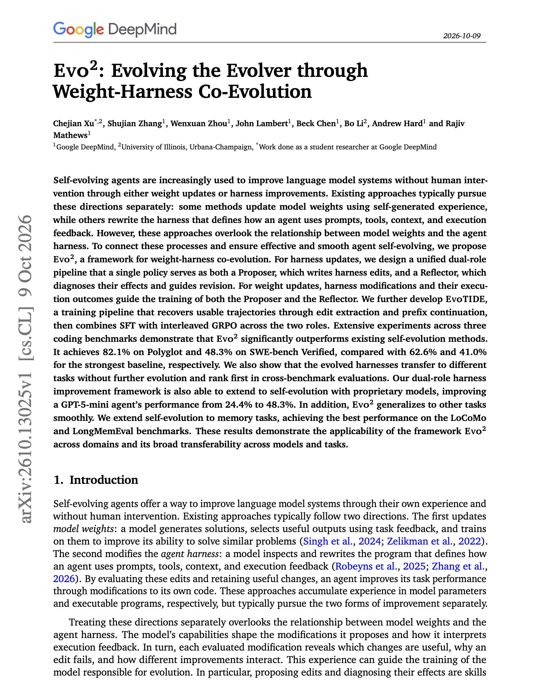

# 🐦 @dair_ai

## 📅 October 13, 2026

> 2 post(s) archived.

---

### 🕐 13:57 UTC · @dair_ai

> Banger paper from Google DeepMind on co-evolving an agent&apos;s harness and its weights. (bookmark it) If you already log your harness changes and results, those logs can become training data for the model running inside the harness. This is a nice paper from Google showing how to do this co-evolution. Specifically, they propose Evo2, a framework for weight-harness co-evolution. How it works: One policy plays two roles. As a Proposer, it writes edits to its own harness, and as a Reflector, it diagnoses what each edit changed. Those edits and their outcomes then become training data for both roles, using SFT followed by interleaved GRPO. The result: Evo2 reaches 48.3% on SWE-bench Verified and 82.1% on Polyglot, against 41.0% and 62.6% for the strongest baselines. The harness part alone moves a GPT-5-mini agent from 24.4% to 48.3% on SWE-bench Verified. The evolved harnesses also transfer to other benchmarks without further evolution. Paper: https://arxiv.org/abs/2610.13025 Chat with Paper: https://academy.dair.ai/papers/evo-2-evolving-the-evolver-through-weight-harness-co-evolution-2610.13025

🔗 [View original post](https://x.com/omarsar0/status/2110006902331769049)

---

### 🕐 12:26 UTC · @dair_ai

> 1M-token, multimodal decision models are here! But there is more to this one. You can classify, extract, and summarize with 1M tokens of text and image input. ScaleDown&apos;s Constrained Decoding Models read the input once and point straight to the answer, with no token-by-token generation. 200x faster, 467x cheaper than frontier LLM APIs. You already gave the LLM the answer. So why is it writing it out from scratch? Introducing a new AI model architecture: Constrained Decoding Models (CDMs) LLMs were built to write. Most production workloads just need an answer: fast, consistent, and affordable. CDMs are purpose-b…

🔗 [View original post](https://x.com/omarsar0/status/2109984234018332879)

---
