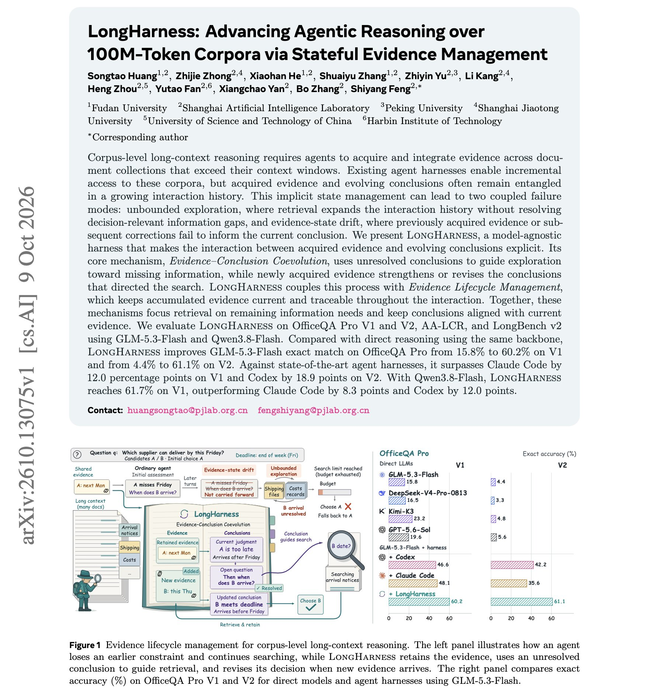

# 🐦 @dair_ai

## 📅 October 13, 2026

> 4 post(s) archived.

---

### 🕐 19:00 UTC · @dair_ai

> Learn to build custom harnesses, folks! Here is an impressive paper showing the impact of a good custom harness on long-context work. GLM-5.3-Flash goes from 4.4% to 61.1% exact match on OfficeQA Pro V2 with the same model. The authors report that the gain comes from the harness. The model-agnostic harness name is LongHarness, built for corpora of 100M tokens and more. Why it works: Standard agent harnesses keep evidence and conclusions mixed into one growing chat history. Retrieval keeps expanding without closing the actual gap, and corrections stop reaching the answer. LongHarness stores both as explicit state. Open conclusions decide what to retrieve next, and each new piece of evidence confirms or revises the conclusions that asked for it. On the same benchmark, it beats Claude Code by 12.1 points on V1 and Codex by 18.9 points on V2. https://arxiv.org/abs/2610.13075 Chat with Paper: https://academy.dair.ai/papers/longharness-advancing-agentic-reasoning-over-100m-token-corpora-via-stateful-evi-2610.13075

🔗 [View original post](https://x.com/omarsar0/status/2110083302728323346)

---

### 🕐 16:20 UTC · @dair_ai

> This is my new favorite way to keep up with AI papers. I turn my curated papers into a 2-minute spoken technical briefing with @FishAudio Drama 3, straight from Codex. In the demo, I took one of my favorite recent NVIDIA papers and built a small skill that reads the full paper, writes the script, and sends it to the Fish Audio API with a voice I picked. What I like about Drama 3 is that you direct the delivery in plain language, like [calm news-anchor delivery] or [slight excitement]. It makes a dense technical summary easy to follow. Now I catch up on papers on the road or while exercising. Just incredible how good this is. It has the right levers I can tune to stay engaged with the audio summaries. The voice you hear in the clip is AI-generated with Drama 3. Let me know if you would like access to the skill. Media $52M seed round. 15M+ users. But this is what we&apos;re most proud of yet. Introducing Drama 3: the most emotive and controllable TTS model in the world And yes, it&apos;s open-weight. You can now control how even a single word should sound, change its tone, and shift your voice mid-sente…

🔗 [View original post](https://x.com/omarsar0/status/2110043016094212546)

---

### 🕐 13:57 UTC · @dair_ai

> Banger paper from Google DeepMind on co-evolving an agent&apos;s harness and its weights. (bookmark it) If you already log your harness changes and results, those logs can become training data for the model running inside the harness. This is a nice paper from Google showing how to do this co-evolution. Specifically, they propose Evo2, a framework for weight-harness co-evolution. How it works: One policy plays two roles. As a Proposer, it writes edits to its own harness, and as a Reflector, it diagnoses what each edit changed. Those edits and their outcomes then become training data for both roles, using SFT followed by interleaved GRPO. The result: Evo2 reaches 48.3% on SWE-bench Verified and 82.1% on Polyglot, against 41.0% and 62.6% for the strongest baselines. The harness part alone moves a GPT-5-mini agent from 24.4% to 48.3% on SWE-bench Verified. The evolved harnesses also transfer to other benchmarks without further evolution. Paper: https://arxiv.org/abs/2610.13025 Chat with Paper: https://academy.dair.ai/papers/evo-2-evolving-the-evolver-through-weight-harness-co-evolution-2610.13025

🔗 [View original post](https://x.com/omarsar0/status/2110006902331769049)

---

### 🕐 12:26 UTC · @dair_ai

> 1M-token, multimodal decision models are here! But there is more to this one. You can classify, extract, and summarize with 1M tokens of text and image input. ScaleDown&apos;s Constrained Decoding Models read the input once and point straight to the answer, with no token-by-token generation. 200x faster, 467x cheaper than frontier LLM APIs. You already gave the LLM the answer. So why is it writing it out from scratch? Introducing a new AI model architecture: Constrained Decoding Models (CDMs) LLMs were built to write. Most production workloads just need an answer: fast, consistent, and affordable. CDMs are purpose-b…

🔗 [View original post](https://x.com/omarsar0/status/2109984234018332879)

---
