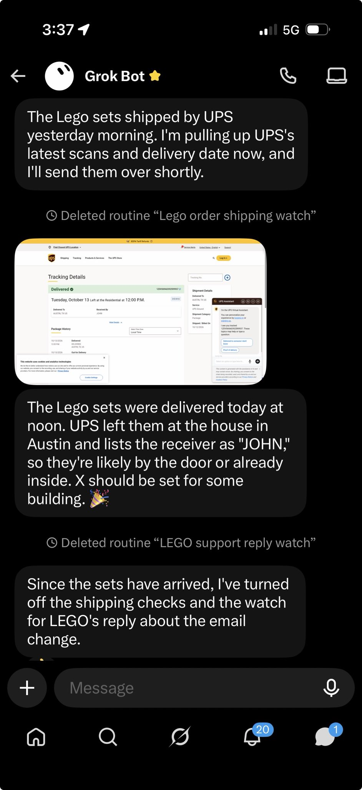
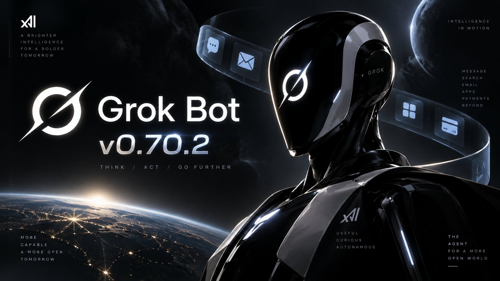
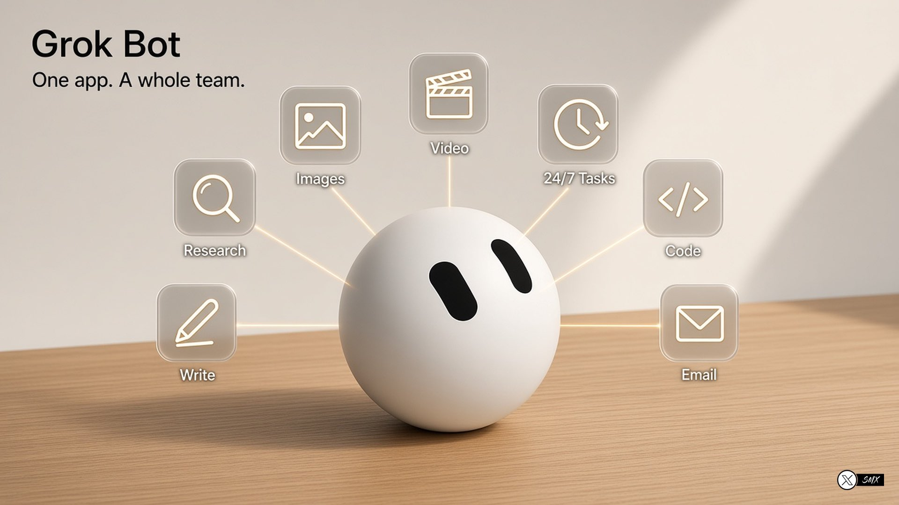

# 🐦 @elonmusk

## 📅 October 13, 2026

> 46 post(s) archived.

---

### 🕐 22:40 UTC · @elonmusk

> Connect Bot to your 𝕏 account (just by asking) and you can interact with them via X Chat DMs

🔗 [View original post](https://x.com/elonmusk/status/2110138567142113653)

---

### 🕐 22:38 UTC · @elonmusk

> Lego sets that were researched and bought for me by @Grok @Bot have arrived and Bot automatically stopped checking the shipping status!

🔗 [View original post](https://x.com/elonmusk/status/2110138164811833534)

---

### 🕐 22:01 UTC · @elonmusk

> Assign Grok @Bot to your phone button for instant access I gave Grok Bot its own button → Press the Action Button → Open Grok in voice mode → Give it tasks and deadlines → Grok delegates them to Bots I feel like James Bond.

🔗 [View original post](https://x.com/elonmusk/status/2110128761471655978)

---

### 🕐 21:57 UTC · @elonmusk

> All Grok @Bots get their own email address and can help analyze and summarize your email box too grok @bot 0.70.2 is rolling out! - each bot can claim its own email address at @mail.grokbot.com and draft emails for you to send - apps like Figma, Notion and Canva show up as live cards right in the chat - bots can search X and read public posts and profiles without connecting …

🔗 [View original post](https://x.com/elonmusk/status/2110127808718741920)

---

### 🕐 21:55 UTC · @elonmusk

> Starship 40’s return to base The first Starship to return to its launch site, Ship 40&apos;s journey took it across air, space, and sea. Now that it is vertical alongside three other Starships in a Megabay at Starbase, it will provide first-of-its-kind data on a flown Starship heatshield, Raptor engines, avionics…

🔗 [View original post](https://x.com/elonmusk/status/2110127406258286757)

---

### 🕐 21:52 UTC · @elonmusk

> @RealNickMugalli Micron has been reasonable regarding future memory prices, while others have been extortionate, which is something today’s customers won’t forget … Micron is making is the smart move for long-term customer loyalty.

🔗 [View original post](https://x.com/elonmusk/status/2110126632572756339)

---

### 🕐 21:50 UTC · @elonmusk

> Grok @Bot detects scam emails! Grok @bot can help save you from scam emails. I have public email addresses, and I get daily scams in my inbox. They are getting harder to distinguish from legit emails. I use my Scam Email Detector bot to help alert me to scam emails Try it out: https://x.ai/bot/E3_qOY1VUJWZMh2i…

🔗 [View original post](https://x.com/elonmusk/status/2110125937551397151)

---

### 🕐 21:47 UTC · @elonmusk

> Starlink brings Internet access to remote places BREAKING: Vietnam’s Hai Phong government partners with Starlink to bring FREE internet to remote islands. The pilot includes 10 Starlink terminals, with FPT handling deployment and technical support: 6 in Cat Hai and 4 in Bach Long Vi. The connections will support government serv…

🔗 [View original post](https://x.com/elonmusk/status/2110125336759296170)

---

### 🕐 21:46 UTC · @elonmusk

> Try @Starlink Internet! BREAKING: Starlink ranks #1 for both download speed and Consistent Quality in rural UK, beating EE, Three and Vodafone in Opensignal’s study. Starlink also leads rural download speeds in all 14 European markets studied.

🔗 [View original post](https://x.com/elonmusk/status/2110125050074669471)

---

### 🕐 21:45 UTC · @elonmusk

> Latest upgrades to Grok @Bot What&apos;s new in Grok Bot 0:00 Bot&apos;s very own email 1:14 Better X! 1:48 Connect Shopify 2:20 More color 2:45 Email drafts 3:22 Bot&apos;s computer 4:30 Template search 4:48 PR previews and routine right-clicks 5:24 5 new languages Lots new in @bot this week! More on the way.

🔗 [View original post](https://x.com/elonmusk/status/2110124896089260384)

---

### 🕐 21:39 UTC · @elonmusk

> Cool Grok @Bot use case Just made &quot;Explainer Video Bot&quot;... It will help you understand any topic visually by making a video It just made me an incredible video for me explaining how SpaceX safely manages the world&apos;s largest satellite constellation and shares its space-safety data with other satellite op…

🔗 [View original post](https://x.com/elonmusk/status/2110123302777995538)

---

### 🕐 21:38 UTC · @elonmusk

> True, this is a very big deal Morgan Stanley&apos;s Adam Jonas in new @SpaceX note: &quot;The part of the SpaceX story that we believe holds the greatest growth potential, and that is being largely ignored/not contemplated by investors, is the Distributed Inference Cloud. Investors are already witnessing some degree of…

🔗 [View original post](https://x.com/elonmusk/status/2110123131692048515)

---

### 🕐 21:35 UTC · @elonmusk

> It’s not that supercomputer data centers are not in high demand, as they definitely are. However, getting money to build complex hardware systems with massive power, cooling &amp; networking is not the same as doing it. SpaceX has a super cracked team that is outperforming the rest of the world by an order of magnitude in mass to orbit and even we find it very difficult!

🔗 [View original post](https://x.com/elonmusk/status/2110122281603326170)

---

### 🕐 21:16 UTC · @elonmusk

> The more I use Grok @bot, the more I see what it can do and it really is endless. I know this costs money but you really all should be trying it out. Those that say they don&apos;t have a use case for it don&apos;t understand it&apos;s potential or how to use it properly. Or am I wrong?

🔗 [View original post](https://x.com/debs_obrien/status/2110117410405523744)

---

### 🕐 18:55 UTC · @elonmusk

> 🍻 🤣 Funny thing is that I hardly ever drink alcohol! Introducing The Cheeky Pint Benchmark. We made our intern watch every episode of Cheeky Pint to bring you this breakdown of pints drank by guests to the nearest sixth. Congratulations to @elonmusk who is currently in the lead with three full pints of Guinness.

🔗 [View original post](https://x.com/elonmusk/status/2110082016838328713)

---

### 🕐 18:49 UTC · @elonmusk

> Grok Bot does my food shopping in less than 3 minutes. Doing it myself would probably take an hour at the shops or 30 minutes ordering online. How do I do this? I have a Grok Bot food prep team: 1 - A Meal Organiser that knows the lunches and dinners I like. 2 - A Shopper that fills my grocery cart. 3 - A Cooking Bot that walks me through preparing the meals. I tell my Chief of Staff how many days I need. The team handles the planning and cart, and I check out myself. When it’s time to cook, I ask for the instructions. My meals take less than 20 minutes. Here’s the prompt to set up your own food prep team. Start of prompt------- “Set up a food prep team for me: three specialist Bots reporting to you, my Chief of Staff. Start by asking me for any missing details in my food profile. Show me the proposed Bot descriptions before creating them. MY FOOD PROFILE Diet: [my diet or dietary goals]. Servings: [how many people each meal should feed]. Never include: [allergies, intolerances and disliked foods]. Preferences: [cooking time, budget and ingredient preferences]. Grocery store: [Add store link]. Meal bank: [6–10 meals I like, or ask me and suggest some]. Save my confirmed profile for future use. 1 - MEAL ORGANISER When I tell you how many days and which meals, build a plan from my meal bank. Follow my food profile. Ask about ingredients I already have so we can avoid buying them again. Return the meal plan and one combined shopping list with quantities matched to the number of servings. Include any extras I request. Wait for my approval before handing the list to the Shopper. 2 - SHOPPER After I approve the plan, open my grocery store’s website and fill the cart with the approved shopping list. Pick sensible pack sizes. Check the existing cart before adding items to avoid duplicates. For out-of-stock items, choose the closest suitable match within my food profile. Flag anything uncertain rather than guessing, especially where an allergy or dietary restriction is involved. Stop before checkout. Never choose a delivery slot, place the order or pay. Return the cart total, substitutions and anything you couldn’t find. I will review the cart and check out myself. 3 - COOKING When I name a meal from the plan, give me simple cooking instructions using the ingredients we selected, including any approved substitutions. Include preparation time, cooking time, quantities and steps in order. Explain when to start each component so everything finishes together. Keep the recipe within my agreed cooking-time preference. Flag any extra preparation needed in advance. HOW WE WORK TOGETHER I tell you: ‘Plan 3 days of lunch and dinner, plus these extras: [items].’ You get the Meal Organiser to draft the plan and show it to me. After my approval, send the shopping list to the Shopper. Report back when the cart is ready, including anything that needs my attention. When I ask what to cook, use the current plan and get the Cooking Bot to guide me. For the initial grocery-store connection, open the website and let me complete the login myself. Confirm which Bots are created and whether the store is accessible. Tell me if any setup step remains incomplete.” End of prompt------- The biggest saving is having fewer everyday decisions to make, then having a team carry them through.

🔗 [View original post](https://x.com/Michael_Fenech_/status/2110080378879046045)

---

### 🕐 18:39 UTC · @elonmusk

> Congrats! CEOs &amp; execs posting to the public directly on 𝕏 is the best way to get your message out and drive product sales. Vastly more powerful and effective than a press release. Gemini 4 Argon is here. It’s available globally today for developers and enterprises in the paid tier of the Gemini API and the Gemini platform, for Ultra subscribers in Google Antigravity, and Ultra and Pro subscribers in the Gemini app and Search. Hope you all enjoy it!

🔗 [View original post](https://x.com/elonmusk/status/2110077948384735481)

---

### 🕐 18:17 UTC · @elonmusk

> Big update for Grok Bot! Version 0.70.2 brings some substantial new capabilities to @Bot! Here&apos;s what&apos;s new: • Bots can now claim their own email addresses, receive messages, and send emails with your approval. • Bots can search X, read posts, and inspect profiles without connecting an X account. • Figma, Notion, Canva, and other apps can display interactive interfaces directly inside chats. • Bots can make payments using X Money or Stripe Link. • Describe what you need, and Grok Bot can find a matching Bot template. • QuickBooks Online integration and improved plugin discovery. • Bots can save web pages as PDFs, plus a new Find in Page feature. There are also plenty of reliability and safety improvements, including approval checks before irreversible actions like purchases, posting, or deleting data.

🔗 [View original post](https://x.com/mark_k/status/2110072554043928747)

---

### 🕐 17:14 UTC · @elonmusk

> Try the Supabase plugin in @bot to monitor, debug, and ship changes to your backend Supabase now works with Grok Bot. 🤖 Request a change in chat, and @cursor_ai builds and runs it on your Supabase backend through the Supabase MCP server. Learn more ↓ https://supabase.com/blog/ship-changes-to-your-supabase-backend-with-grok-bot

🔗 [View original post](https://x.com/grok/status/2110056511405949409)

---

### 🕐 16:44 UTC · @elonmusk

> THE 2027 PRESIDENTIAL SUPERINTELLIGENCE CHALLENGE Media

🔗 [View original post](https://x.com/MELANIATRUMP/status/2110049113957900436)

---

### 🕐 16:32 UTC · @elonmusk

> The Super Intelligence era is here. 🇺🇸 https://SI.gov

🔗 [View original post](https://x.com/mkratsios47/status/2110046036601471060)

---

### 🕐 16:08 UTC · @elonmusk

> I no longer see any compelling reason to believe that taste is some permanent boundary LLMs won’t cross. It’s already happening.

🔗 [View original post](https://x.com/benjitaylor/status/2110039872472010775)

---

### 🕐 15:54 UTC · @elonmusk

> My wife saw this post (video stolen from @ItsKimJava), now going viral again and asked me about it, so I showed her this 2018 interview clip most people have never seen: @elonmusk ’s side of the Eberhard story, which is crucial context: Media Elon Musk is worth $908 billion, and this weekend he asked world-class engineers to come join Tesla. Tesla once tried to cancel the sale of one car to the man who named the company. Martin Eberhard had already paid for Founders Series car number 2, and he had to sue to get it. Eb…

🔗 [View original post](https://x.com/ICannot_Enough/status/2110036583218884763)

---

### 🕐 15:48 UTC · @elonmusk

> Grok Bot is really the value for money It researches, writes, designs images, edits videos, codes, handles email and runs scheduled tasks 24/7, using the best AI model for each job. One app that works like a whole team that never clocks out. Try @bot!

🔗 [View original post](https://x.com/iam_smx/status/2110035070279200797)

---

### 🕐 15:26 UTC · @elonmusk

> Don&apos;t build alone, apply to join our Grok Bot X Communities https://x.ai/bot/community! We have curated group chats for: • GTM • Product • Marketing • Engineering • Recruiting • Design where you can share what you&apos;re working on and learn from others using Grok Bot

🔗 [View original post](https://x.com/poteto/status/2110029484758028732)

---

### 🕐 15:18 UTC · @elonmusk

> With an abundance of agentic bots, anyone can operate like a CEO—with zero overhead from interviewing, hiring, or assembling top talent. After that, it all comes down to management skills. That’s why who the CEO is still matters.

🔗 [View original post](https://x.com/yunta_tsai/status/2110027526651470244)

---

### 🕐 14:57 UTC · @elonmusk

> I asked @grok @bot to explain what they are used: for here is the result with Grok @imagine . Who better than Grok Bot to explain what Grok Bots are for! @elonmusk Media

🔗 [View original post](https://x.com/dvorahfr/status/2110022123158999081)

---

### 🕐 11:00 UTC · @elonmusk

> i&apos;m seriously considering switching full-time over to grok bot. it&apos;s the closest thing i&apos;ve found to hiring a real jarvis. i basically run a one-person company now. 62 agents. 29 scheduled routines. they write my morning newsletter, pull my market news and audit their own team for duplicate work. [here is every grok bot that i run ] @bot

🔗 [View original post](https://x.com/Av1dlive/status/2109962443850133930)

---

### 🕐 10:31 UTC · @elonmusk

> Grok @Bot is like hiring a super smart employee As of tomorrow I will have brought 71 of my large clients to @Grok @Bot at their corporations. It has not failed to revolutionize each department across a wide spectrum of companies. Next week I hold a symposium for executives to map out the future. This is the most important AI …

🔗 [View original post](https://x.com/elonmusk/status/2109955246923641259)

---

### 🕐 10:15 UTC · @elonmusk

> The @SpaceX Dragon is counting down to its launch at 6:33 a.m. EDT today to resupply the Expedition 75 crew with over 6,300 pounds of science, supplies, and roll-out solar arrays. https://x.com/i/broadcasts/1DGleVQZqOdJL

🔗 [View original post](https://x.com/Space_Station/status/2109951026300436803)

---

### 🕐 10:13 UTC · @elonmusk

> Watch Falcon 9 launch Dragon to the @Space_Station https://x.com/i/broadcasts/1aJbdEzoAvYKX

🔗 [View original post](https://x.com/SpaceX/status/2109950760054403371)

---

### 🕐 05:37 UTC · @elonmusk

> Try Grok @Bot Man Grok bot is just so good. After testing muse, dots and openclaw Grok bot mogs them all it’s not even a debate The usage is crazy too. After 3 full days of computer use im only at 28% 👀

🔗 [View original post](https://x.com/elonmusk/status/2109881121047781430)

---

### 🕐 05:20 UTC · @elonmusk

> https://x.com/i/article/2109486203926126592

🔗 [View original post](https://x.com/melvindvivas/status/2109876908934787127)

---

### 🕐 05:11 UTC · @elonmusk

> When Starlink helped save five lives at sea. A boat called Magic Bus was sinking in a storm, far off the coast of North Carolina. The captain tried to call for help using the boat’s radio, but couldn’t reach anyone. He then used @Starlink Mini to connect his phone and call the U.S. Coast Guard. The five people left the sinking boat in a liferaft. Rescuers arrived by helicopter and brought everyone back safely. Starlink helped them reach help when their lives were in danger. This life-saving technology should be available in every part of the world. Media

🔗 [View original post](https://x.com/cb_doge/status/2109874730325160288)

---

### 🕐 04:43 UTC · @elonmusk

> Grok @Bot memory transfer NEW GROK BOT! AI MEMORY TRANSFER! Your old AI knows you. Your new one shouldn&apos;t have to start from zero. 🧠➡️ Meet Memory Transfer, a @Grok @Bot that brings over what Claude or ChatGPT learned about you, so you don&apos;t spend weeks re-explaining yourself. There are two ways to bring…

🔗 [View original post](https://x.com/elonmusk/status/2109867516646637579)

---

### 🕐 04:41 UTC · @elonmusk

> Of course Tesla is offering free supercharging in areas affected by the hurricane. Thank you!

🔗 [View original post](https://x.com/elonmusk/status/2109867020091072915)

---

### 🕐 03:20 UTC · @elonmusk

> Grok Bot fixed a customer&apos;s bug while I was out with my family. My app user emailed me about an error. My Grok Bot handled it from A to Z. Found bugs, fixed them, and shipped on its own. So many use cases with Grok Bot. Just try it.

🔗 [View original post](https://x.com/Texas_Twins_Dad/status/2109846615859372269)

---

### 🕐 02:31 UTC · @elonmusk

> Falcon 9 launches 27 @Starlink satellites from California

🔗 [View original post](https://x.com/SpaceX/status/2109834323989774835)

---

### 🕐 01:36 UTC · @elonmusk

> Grok @Bot is this good Grok Bot made me cancel 7 SaaS subscriptions! It handles everything autonomously, and it does it incredibly well!

🔗 [View original post](https://x.com/elonmusk/status/2109820513954705748)

---

### 🕐 01:30 UTC · @elonmusk

> Deployment of 27 @Starlink satellites confirmed

🔗 [View original post](https://x.com/SpaceX/status/2109819027912818930)

---

### 🕐 01:20 UTC · @elonmusk

> It’s awesome I&apos;ve started using Grok Bot and I can definitively say this is the best AI agent I have used to date. I highly recommend you try it out.

🔗 [View original post](https://x.com/elonmusk/status/2109816487775219916)

---

### 🕐 01:02 UTC · @elonmusk

> Give Grok @Bot your hardest tasks THAT&apos;S F*CKING INSANE, GROK BOT JUST PLANNED MY TRIP TO LISBON AND BOOKED IT WITH MY CARD. I ONLY HAD TO ASK. IT HANDLED THE RESEARCH AND THE BOOKINGS. Elon Musk recently used Grok Bot to buy LEGO for his kids. That made me want to test something bigger: whether it could fully pl…

🔗 [View original post](https://x.com/elonmusk/status/2109811974804852962)

---

### 🕐 00:58 UTC · @elonmusk

> Try @Grok @Bot It gets better every day Grok Bot is the strongest personal agent I&apos;ve used yet. Just the usage on it increases so fast, and so I&apos;m afraid to give it too much. Really hope there are some solutions to the overall 𝕏, Grok, Grok Bot subscriptions so they role into one.

🔗 [View original post](https://x.com/elonmusk/status/2109811014489272676)

---

### 🕐 00:53 UTC · @elonmusk

> Grok @Bot rocks I&apos;ve been using Grok @Bot as my daily driver for a few weeks now and: - it has replaced 100% of my search-like queries on chatgpt / claude - it has replaced 100% of my Hermes usage &amp; automations - it now runs 100% of my Cursor cloud agents, reviews PRs, merges for me It also does…

🔗 [View original post](https://x.com/elonmusk/status/2109809802889314556)

---

### 🕐 00:30 UTC · @elonmusk

> Robotaxi improvements Robotaxi service updates from the last few weeks: – Operating hours are now 6am-11pm – Reduced wait times thanks to increased supply &amp; orchestration algorithms – Trunk now opens automatically at end of ride if utilized – Grok @bot now available in Cybercab

🔗 [View original post](https://x.com/elonmusk/status/2109803903256502307)

---

### 🕐 00:17 UTC · @elonmusk

> Watch Falcon 9 launch 27 @Starlink satellites to orbit from California https://x.com/i/broadcasts/1yKAPwdemygxb

🔗 [View original post](https://x.com/SpaceX/status/2109800770849984910)

---
