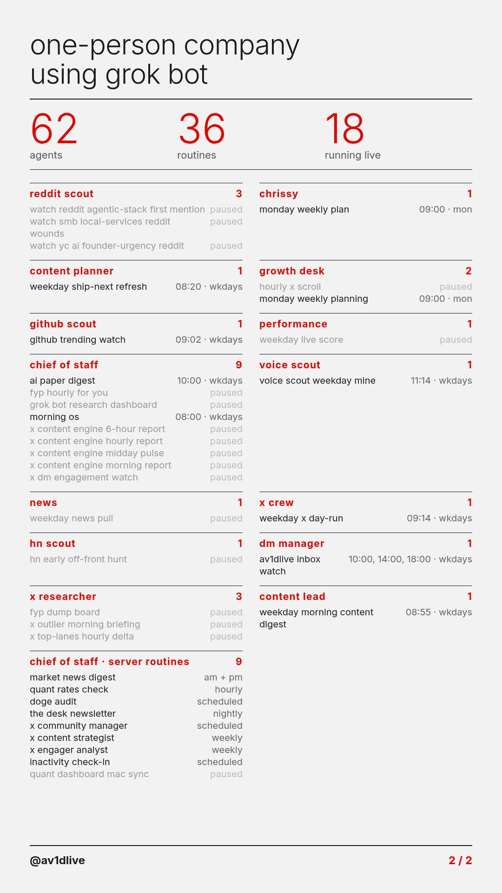
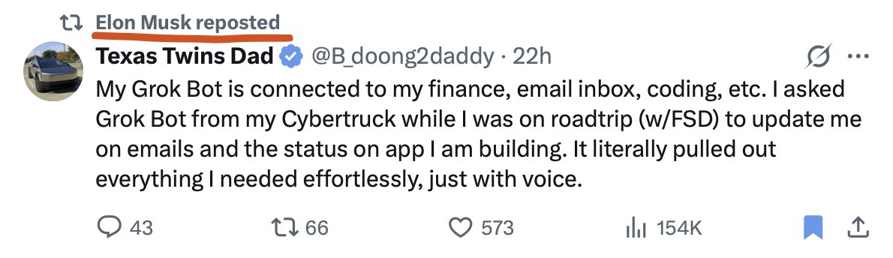

# 🐦 @elonmusk

## 📅 October 13, 2026

> 21 post(s) archived.

---

### 🕐 18:55 UTC · @elonmusk

> 🍻 🤣 Funny thing is that I hardly ever drink alcohol! Introducing The Cheeky Pint Benchmark. We made our intern watch every episode of Cheeky Pint to bring you this breakdown of pints drank by guests to the nearest sixth. Congratulations to @elonmusk who is currently in the lead with three full pints of Guinness.

🔗 [View original post](https://x.com/elonmusk/status/2110082016838328713)

---

### 🕐 18:39 UTC · @elonmusk

> Congrats! CEOs &amp; execs posting to the public directly on 𝕏 is the best way to get your message out and drive product sales. Vastly more powerful and effective than a press release. Gemini 4 Argon is here. It’s available globally today for developers and enterprises in the paid tier of the Gemini API and the Gemini platform, for Ultra subscribers in Google Antigravity, and Ultra and Pro subscribers in the Gemini app and Search. Hope you all enjoy it!

🔗 [View original post](https://x.com/elonmusk/status/2110077948384735481)

---

### 🕐 11:00 UTC · @elonmusk

> i&apos;m seriously considering switching full-time over to grok bot. it&apos;s the closest thing i&apos;ve found to hiring a real jarvis. i basically run a one-person company now. 62 agents. 29 scheduled routines. they write my morning newsletter, pull my market news and audit their own team for duplicate work. [here is every grok bot that i run ] @bot

🔗 [View original post](https://x.com/Av1dlive/status/2109962443850133930)

---

### 🕐 10:31 UTC · @elonmusk

> Grok @Bot is like hiring a super smart employee As of tomorrow I will have brought 71 of my large clients to @Grok @Bot at their corporations. It has not failed to revolutionize each department across a wide spectrum of companies. Next week I hold a symposium for executives to map out the future. This is the most important AI …

🔗 [View original post](https://x.com/elonmusk/status/2109955246923641259)

---

### 🕐 10:15 UTC · @elonmusk

> The @SpaceX Dragon is counting down to its launch at 6:33 a.m. EDT today to resupply the Expedition 75 crew with over 6,300 pounds of science, supplies, and roll-out solar arrays. https://x.com/i/broadcasts/1DGleVQZqOdJL

🔗 [View original post](https://x.com/Space_Station/status/2109951026300436803)

---

### 🕐 10:13 UTC · @elonmusk

> Watch Falcon 9 launch Dragon to the @Space_Station https://x.com/i/broadcasts/1aJbdEzoAvYKX

🔗 [View original post](https://x.com/SpaceX/status/2109950760054403371)

---

### 🕐 05:37 UTC · @elonmusk

> Try Grok @Bot Man Grok bot is just so good. After testing muse, dots and openclaw Grok bot mogs them all it’s not even a debate The usage is crazy too. After 3 full days of computer use im only at 28% 👀

🔗 [View original post](https://x.com/elonmusk/status/2109881121047781430)

---

### 🕐 05:20 UTC · @elonmusk

> https://x.com/i/article/2109486203926126592

🔗 [View original post](https://x.com/melvindvivas/status/2109876908934787127)

---

### 🕐 05:11 UTC · @elonmusk

> When Starlink helped save five lives at sea. A boat called Magic Bus was sinking in a storm, far off the coast of North Carolina. The captain tried to call for help using the boat’s radio, but couldn’t reach anyone. He then used @Starlink Mini to connect his phone and call the U.S. Coast Guard. The five people left the sinking boat in a liferaft. Rescuers arrived by helicopter and brought everyone back safely. Starlink helped them reach help when their lives were in danger. This life-saving technology should be available in every part of the world. Media

🔗 [View original post](https://x.com/cb_doge/status/2109874730325160288)

---

### 🕐 04:43 UTC · @elonmusk

> Grok @Bot memory transfer NEW GROK BOT! AI MEMORY TRANSFER! Your old AI knows you. Your new one shouldn&apos;t have to start from zero. 🧠➡️ Meet Memory Transfer, a @Grok @Bot that brings over what Claude or ChatGPT learned about you, so you don&apos;t spend weeks re-explaining yourself. There are two ways to bring…

🔗 [View original post](https://x.com/elonmusk/status/2109867516646637579)

---

### 🕐 04:41 UTC · @elonmusk

> Of course Tesla is offering free supercharging in areas affected by the hurricane. Thank you!

🔗 [View original post](https://x.com/elonmusk/status/2109867020091072915)

---

### 🕐 03:20 UTC · @elonmusk

> Grok Bot fixed a customer&apos;s bug while I was out with my family. My app user emailed me about an error. My Grok Bot handled it from A to Z. Found bugs, fixed them, and shipped on its own. So many use cases with Grok Bot. Just try it.

🔗 [View original post](https://x.com/Texas_Twins_Dad/status/2109846615859372269)

---

### 🕐 02:31 UTC · @elonmusk

> Falcon 9 launches 27 @Starlink satellites from California

🔗 [View original post](https://x.com/SpaceX/status/2109834323989774835)

---

### 🕐 01:36 UTC · @elonmusk

> Grok @Bot is this good Grok Bot made me cancel 7 SaaS subscriptions! It handles everything autonomously, and it does it incredibly well!

🔗 [View original post](https://x.com/elonmusk/status/2109820513954705748)

---

### 🕐 01:30 UTC · @elonmusk

> Deployment of 27 @Starlink satellites confirmed

🔗 [View original post](https://x.com/SpaceX/status/2109819027912818930)

---

### 🕐 01:20 UTC · @elonmusk

> It’s awesome I&apos;ve started using Grok Bot and I can definitively say this is the best AI agent I have used to date. I highly recommend you try it out.

🔗 [View original post](https://x.com/elonmusk/status/2109816487775219916)

---

### 🕐 01:02 UTC · @elonmusk

> Give Grok @Bot your hardest tasks THAT&apos;S F*CKING INSANE, GROK BOT JUST PLANNED MY TRIP TO LISBON AND BOOKED IT WITH MY CARD. I ONLY HAD TO ASK. IT HANDLED THE RESEARCH AND THE BOOKINGS. Elon Musk recently used Grok Bot to buy LEGO for his kids. That made me want to test something bigger: whether it could fully pl…

🔗 [View original post](https://x.com/elonmusk/status/2109811974804852962)

---

### 🕐 00:58 UTC · @elonmusk

> Try @Grok @Bot It gets better every day Grok Bot is the strongest personal agent I&apos;ve used yet. Just the usage on it increases so fast, and so I&apos;m afraid to give it too much. Really hope there are some solutions to the overall 𝕏, Grok, Grok Bot subscriptions so they role into one.

🔗 [View original post](https://x.com/elonmusk/status/2109811014489272676)

---

### 🕐 00:53 UTC · @elonmusk

> Grok @Bot rocks I&apos;ve been using Grok @Bot as my daily driver for a few weeks now and: - it has replaced 100% of my search-like queries on chatgpt / claude - it has replaced 100% of my Hermes usage &amp; automations - it now runs 100% of my Cursor cloud agents, reviews PRs, merges for me It also does…

🔗 [View original post](https://x.com/elonmusk/status/2109809802889314556)

---

### 🕐 00:30 UTC · @elonmusk

> Robotaxi improvements Robotaxi service updates from the last few weeks: – Operating hours are now 6am-11pm – Reduced wait times thanks to increased supply &amp; orchestration algorithms – Trunk now opens automatically at end of ride if utilized – Grok @bot now available in Cybercab

🔗 [View original post](https://x.com/elonmusk/status/2109803903256502307)

---

### 🕐 00:17 UTC · @elonmusk

> Watch Falcon 9 launch 27 @Starlink satellites to orbit from California https://x.com/i/broadcasts/1yKAPwdemygxb

🔗 [View original post](https://x.com/SpaceX/status/2109800770849984910)

---
