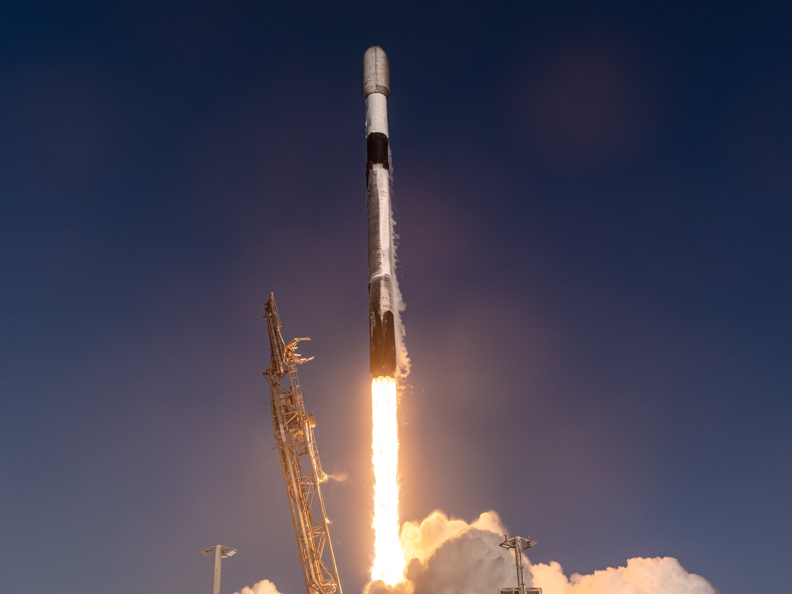

# 🐦 @elonmusk

## 📅 October 13, 2026

> 10 post(s) archived.

---

### 🕐 04:41 UTC · @elonmusk

> Of course Tesla is offering free supercharging in areas affected by the hurricane. Thank you!

🔗 [View original post](https://x.com/elonmusk/status/2109867020091072915)

---

### 🕐 02:31 UTC · @elonmusk

> Falcon 9 launches 27 @Starlink satellites from California

🔗 [View original post](https://x.com/SpaceX/status/2109834323989774835)

---

### 🕐 01:36 UTC · @elonmusk

> Grok @Bot is this good Grok Bot made me cancel 7 SaaS subscriptions! It handles everything autonomously, and it does it incredibly well!

🔗 [View original post](https://x.com/elonmusk/status/2109820513954705748)

---

### 🕐 01:30 UTC · @elonmusk

> Deployment of 27 @Starlink satellites confirmed

🔗 [View original post](https://x.com/SpaceX/status/2109819027912818930)

---

### 🕐 01:20 UTC · @elonmusk

> It’s awesome I&apos;ve started using Grok Bot and I can definitively say this is the best AI agent I have used to date. I highly recommend you try it out.

🔗 [View original post](https://x.com/elonmusk/status/2109816487775219916)

---

### 🕐 01:02 UTC · @elonmusk

> Give Grok @Bot your hardest tasks THAT&apos;S F*CKING INSANE, GROK BOT JUST PLANNED MY TRIP TO LISBON AND BOOKED IT WITH MY CARD. I ONLY HAD TO ASK. IT HANDLED THE RESEARCH AND THE BOOKINGS. Elon Musk recently used Grok Bot to buy LEGO for his kids. That made me want to test something bigger: whether it could fully pl…

🔗 [View original post](https://x.com/elonmusk/status/2109811974804852962)

---

### 🕐 00:58 UTC · @elonmusk

> Try @Grok @Bot It gets better every day Grok Bot is the strongest personal agent I&apos;ve used yet. Just the usage on it increases so fast, and so I&apos;m afraid to give it too much. Really hope there are some solutions to the overall 𝕏, Grok, Grok Bot subscriptions so they role into one.

🔗 [View original post](https://x.com/elonmusk/status/2109811014489272676)

---

### 🕐 00:53 UTC · @elonmusk

> Grok @Bot rocks I&apos;ve been using Grok @Bot as my daily driver for a few weeks now and: - it has replaced 100% of my search-like queries on chatgpt / claude - it has replaced 100% of my Hermes usage &amp; automations - it now runs 100% of my Cursor cloud agents, reviews PRs, merges for me It also does…

🔗 [View original post](https://x.com/elonmusk/status/2109809802889314556)

---

### 🕐 00:30 UTC · @elonmusk

> Robotaxi improvements Robotaxi service updates from the last few weeks: – Operating hours are now 6am-11pm – Reduced wait times thanks to increased supply &amp; orchestration algorithms – Trunk now opens automatically at end of ride if utilized – Grok @bot now available in Cybercab

🔗 [View original post](https://x.com/elonmusk/status/2109803903256502307)

---

### 🕐 00:17 UTC · @elonmusk

> Watch Falcon 9 launch 27 @Starlink satellites to orbit from California https://x.com/i/broadcasts/1yKAPwdemygxb

🔗 [View original post](https://x.com/SpaceX/status/2109800770849984910)

---
