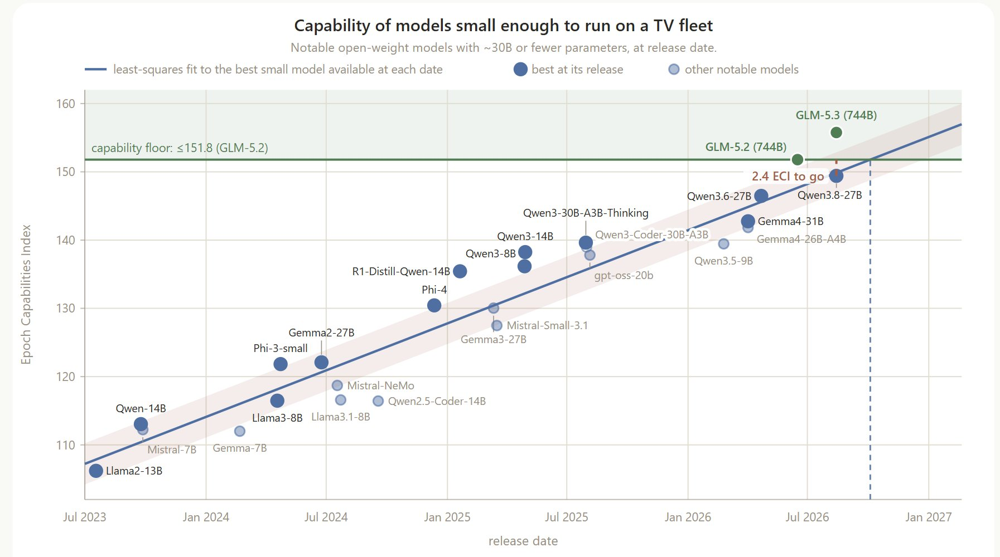
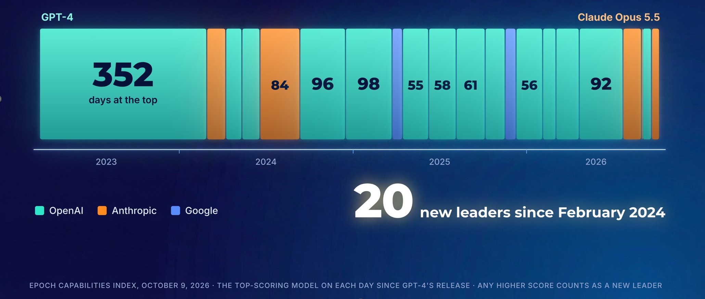

# 🐦 @emollick

## 📅 October 13, 2026

> 6 post(s) archived.

---

### 🕐 17:30 UTC · @emollick

> Using Gemini 4 makes you realize how many other models must be distilling Claude/GPT (or using a similar training pipeline). It feels quite different than other models.

🔗 [View original post](https://x.com/emollick/status/2110060618258497764)

---

### 🕐 16:57 UTC · @emollick

> I spent a decent amount of time with Gemini 4 before launch. Overall, Gemini 4 is a big jump over previous Gemini models and it is the first non-OpenAI/Anthropic model to pass the Fable/Mythos/Astra bar. It is also much more pleasant and more agentic then previous Gemini models, without the weird personality issues that you often found in Gemini 3 series models. In fact, a big advantage is that has a very different personality and sense of taste than Claude or Astra, making it a good addition to the AI world. On the usefulness side, in some areas it is at least at par with OpenAI and Anthropic (it is quite creative and a good writer), but in others it lags, including at complex multi-agent work. It has a tendency to be too certain about its conclusions and a little lazy, issues not helped by the Antigravity harness not being quite as good as the competition. Still, I expect to see rapid improvements in model abilities using Gemini 4 as a base. Here is a fun example: &quot;create the ultimate brutalist city builder. you should have lots of controls over buildings in ways that are delightful and inuitive to people who just want to play, but are sophisticated and deep for people who know something about architecture. you should be able to play a lot with design and approach. there should be simulation modes and different ways to view or experience the city. make it stunning. i want to host this on netlify in the end&quot; Astra Max in Codex: https://formwork-city.netlify.app/Fable 5.1 Max in Code: https://brut-city.netlify.app/ Argon in Antigravity: https://rainbow-panda-689e6b.netlify.app/

🔗 [View original post](https://x.com/emollick/status/2110052331702124894)

---

### 🕐 14:03 UTC · @emollick

> A worthwhile (and unnerving) reminder from Anthropic that we should be paying attention to AI ability thresholds, not just steady climbs In this case, the threshold is the capability needed for a self-replicating AI worm on IoT devices like off-brand TVs https://www.anthropic.com/research/self-replicating-ai

🔗 [View original post](https://x.com/emollick/status/2110008451866710221)

---

### 🕐 13:28 UTC · @emollick

> It is one week until October 20, the day my new book, Co-Existence comes out! If you pre-order before then, you get a 10 minute AI voice interview that builds a set of customized prompts, readings &amp; use cases for you based on ideas from the book. Get it: https://co-existence.ai/

🔗 [View original post](https://x.com/emollick/status/2109999604775387249)

---

### 🕐 06:08 UTC · @emollick

> Just had a chance to host a chat with @emollick about his upcoming book, Co-Existence. It is going to be a hit and is full of practical insights on AI. There will be many positive reviews of the ideas, but let me suggest three non-obvious meta-reasons to read it sooner rather than later: 1. How to work (co-exist?) with AI. Every so often, Ethan pulls back the curtain and describes how he uses AI in the book writing process. You get a peek into specific techniques and, more importantly, the mindset that will make someone successful. 2. The Mollick production function. The book is long enough to give Ethan breathing room to show why he&apos;s such a different thinker and fun to hang out with. He actually plays with the tools for long enough to get a finger-feel for what&apos;s possible (that&apos;s why he is texting at 2 am!); he constantly conceptualizes what he&apos;s encountering (jagged frontier, leadership-crowd-lab, the multi-player 2x2, etc.), pushing the ideas to their logical (and often uncomfortable) conclusion; and he ruthlessly throws away ideas when they no longer match the facts on the ground (especially important as everything changes so rapidly). 3. Common knowledge. In this time of hyper-personalized bubbles, we forget the value in having a shared set of stories, frameworks, and ideas. Ethan&apos;s book is going to be read by everyone from CEOs to ambitious high schoolers. The book is going to be referenced at many business meetings and holiday dinners so you might as well join in the fun early so you can give a knowing look when someone tells his escalator vs eschaton story, explains the best reasons not to use AI, or debates StrongDM-style software factories.

🔗 [View original post](https://x.com/jamescham/status/2109888933316473070)

---

### 🕐 03:38 UTC · @emollick

> GPT-4 was the undisputed best model in the world for a full year and we all debated whether anyone could catch up or if OpenAI had some secret formula that nobody else knew about. Now there are are 19 AI models that can run on a modern smartphone that are better than GPT-4!

🔗 [View original post](https://x.com/emollick/status/2109851162518425779)

---
