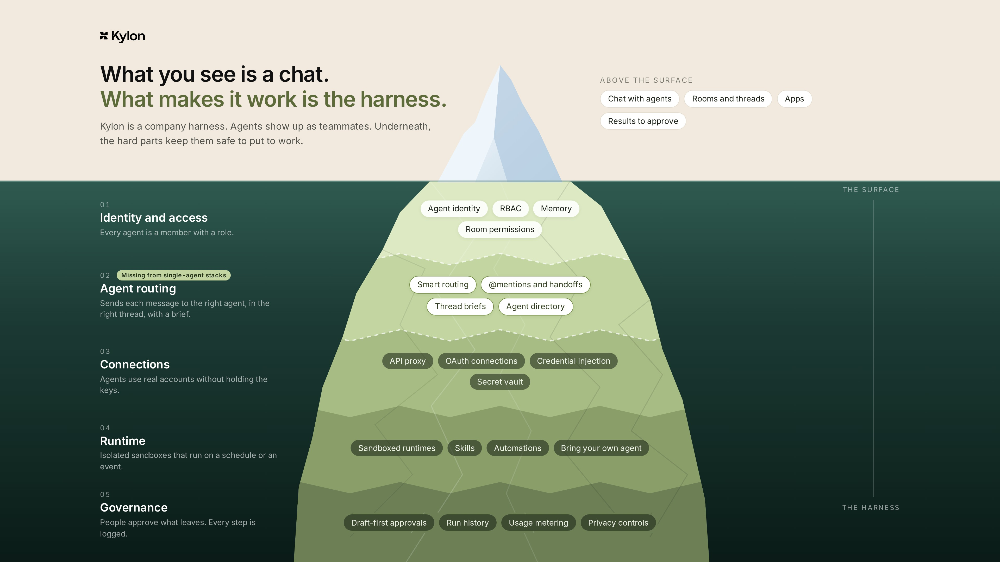
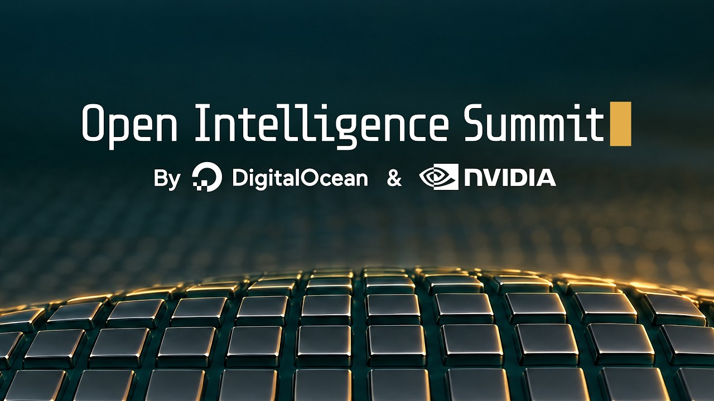
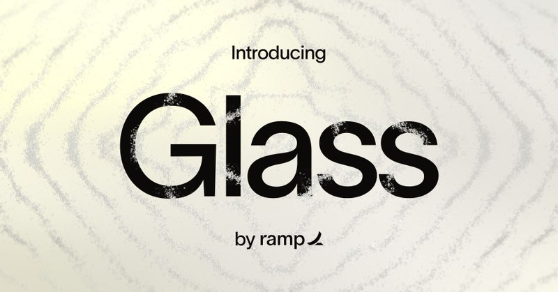

# 🐦 @omarsar0

## 📅 October 13, 2026

> 11 post(s) archived.

---

### 🕐 17:39 UTC · @omarsar0

> Go-to-market is quickly becoming an engineering problem. Good outreach depends on clean lead data and on giving your AI agent the right context about who buys and why. Pancake builds that context from your website and sends it to Claude or Codex through a single MCP server. Your agent finds and scores leads, and you approve each one before anything is sent. Looks very useful for growing a business. Meet Pancake, the Vercel for GTM. Try it at http://pancake.ai Your agent ships your product. Now it ships your go-to-market. How? A GTM brain that knows your business, 50+ data providers to find the right customers and tools to reach them. Your next customers are one prompt away.…

🔗 [View original post](https://x.com/omarsar0/status/2110062905223680298)

---

### 🕐 16:57 UTC · @omarsar0

> Pay close attention to harnesses, part 2. Last week I shared a paper where a model more than doubled its score after training inside the harness it runs in. The same idea applies at a higher level. Claude Code and Codex are harnesses for a model. Once a team runs several agents, the company also needs a harness for its people and agents. Kylon is building that layer. You bring the agents your team already uses, like Codex and Claude, into shared rooms where they work alongside everyone. Introducing Kylon: The first company harness for your humans, agents and tools. Whether you’re using Codex, Claude, Devin, Hermes, Gemini CLI, OpenClaw, Muse, Instinct, Grok Bot, Dots, Perplexity Computer, Cursor, Antigravity, Microsoft Autopilot, Amp, Droid, Kiro, Cline, OpenCod…

🔗 [View original post](https://x.com/omarsar0/status/2110052411502920086)

---

### 🕐 16:50 UTC · @omarsar0

> Browse the corpora at https://hub.xerj.org

🔗 [View original post](https://x.com/omarsar0/status/2110050442876969323)

---

### 🕐 16:38 UTC · @omarsar0

> Pay close attention to agentic search. LLM agents get much better at specialized tasks when you give them structured, expert knowledge. Xerj Corpus Hub lets you do this for any agent with no retraining. You connect a ready-made corpus of docs, guidelines, or real source code, and the agent searches it while it works. It&apos;s free, open source, and runs locally. https://x.com/d0znpp/status/2110038855047164404?s=20 Media introducing XERJ Corpus Hub, reference memory for AI agents. give your agent a corpus for your task. watch it become superintelligent. &gt; finds the answers in indexed expert knowledge &gt; applies them to your code, research, and projects &gt; works with any model. free and OSS forever/…

🔗 [View original post](https://x.com/omarsar0/status/2110047587050918003)

---

### 🕐 15:37 UTC · @omarsar0

> @digitalocean Catch the stream here: https://www.youtube.com/live/IhWSgZlVizQ I will be tuning in myself.

🔗 [View original post](https://x.com/omarsar0/status/2110032216159858814)

---

### 🕐 15:36 UTC · @omarsar0

> Own your intelligence stack, folks! Open models, open data, and open harnesses are where a lot of the real agent building is happening right now. Here&apos;s a great opportunity to catch up on the latest. @digitalocean&apos;s Open Intelligence Summit today features talks on building an agent with an open harness, when it&apos;s worth post-training an open model for your agents, and how to keep a post-training loop running without idle GPUs. Great lineup from Nous Research, OpenHands, NVIDIA, Hugging Face, and more. The keynote is at 1 PM PT. Who gets to shape the future of AI? Today we&apos;re bringing together some of the biggest voices in open models, data, and agents to answer that question, including @rbren_dev of @OpenHandsDev, @zlxi02 of @inferact, @GerryFPatia of @boltdotnew, @vinaygo of @Amplitude_HQ and @latkins …

🔗 [View original post](https://x.com/omarsar0/status/2110031881051717882)

---

### 🕐 14:46 UTC · @omarsar0

> AI video creation is a really huge market. It&apos;s really taking off in areas like marketing, education, and customer support. This team @clueso is on a mission to dominate this space. Clueso agents autonomously plan and create videos at scale, capture screen recordings with browser agents, and create on-brand animations with AI. Congrats on their raise. We’ve raised a $10M Series A to automate video creation for every company. 1,000+ organizations like Atlassian, GitLab, Samsara, Legrand, and Zendesk use @clueso to automate their videos for marketing, customer education, and employee training. The struggle of video creation in c…

🔗 [View original post](https://x.com/omarsar0/status/2110019256410595399)

---

### 🕐 14:27 UTC · @omarsar0

> Check it out here: https://ramp.com/glass

🔗 [View original post](https://x.com/omarsar0/status/2110014447443972204)

---

### 🕐 14:21 UTC · @omarsar0

> This is a good example of what a company brain unlocks and how it compounds. You want it so that when someone on your team figures out a great prompt, skill, or workflow, the whole company can build on it. @tryramp just launched Glass to help with this. It’s connected to tools like Linear, Notion, Slack, and Gong. https://x.com/i/article/2109815621223358465

🔗 [View original post](https://x.com/omarsar0/status/2110013137327948050)

---

### 🕐 01:33 UTC · @omarsar0

> @CollovLabs More information here: https://www.neweyesai.com/store

🔗 [View original post](https://x.com/omarsar0/status/2109819805213540857)

---

### 🕐 01:28 UTC · @omarsar0

> Richer context is what makes personal agents personal. Today, they see your email, calendar, and accounts, and miss everything happening in front of you. NewEyes AI from @CollovLabs is built as a personal agent with eyes. Camera glasses see what you see, and open-ear earphones answer in your ear. The more of your day an agent can see, the more it can tailor its help to you. Muse gave your agent a computer. Instinct gave it your phone number. We gave it eyes. Introducing NewEyes AI — your personal agent with eyes. &gt; Glasses see it. &gt; Earphones say it. &gt; It remembers where you left off. &gt; &quot;Good morning. Continue on page 212.&quot; Your world is the context…

🔗 [View original post](https://x.com/omarsar0/status/2109818480602026405)

---
