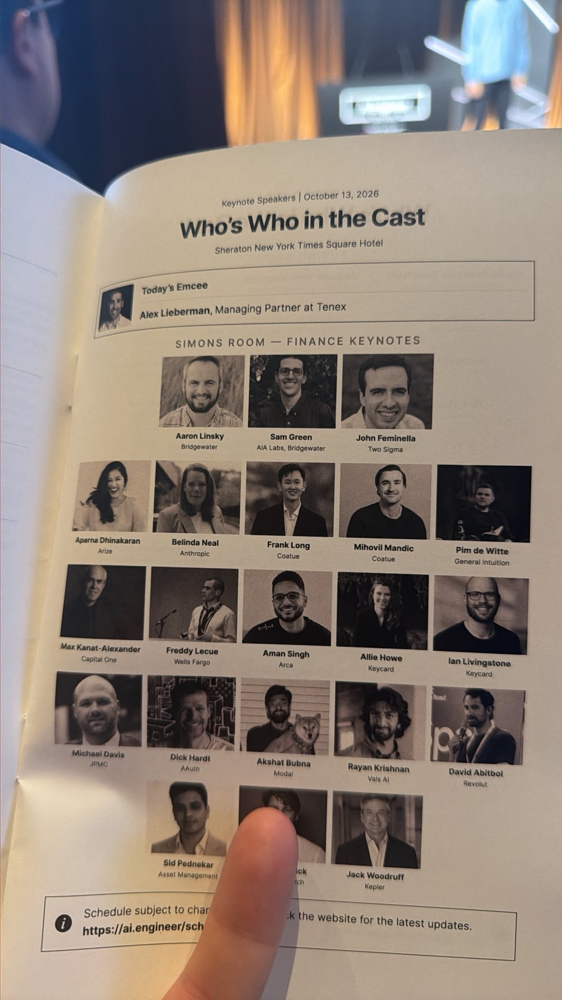
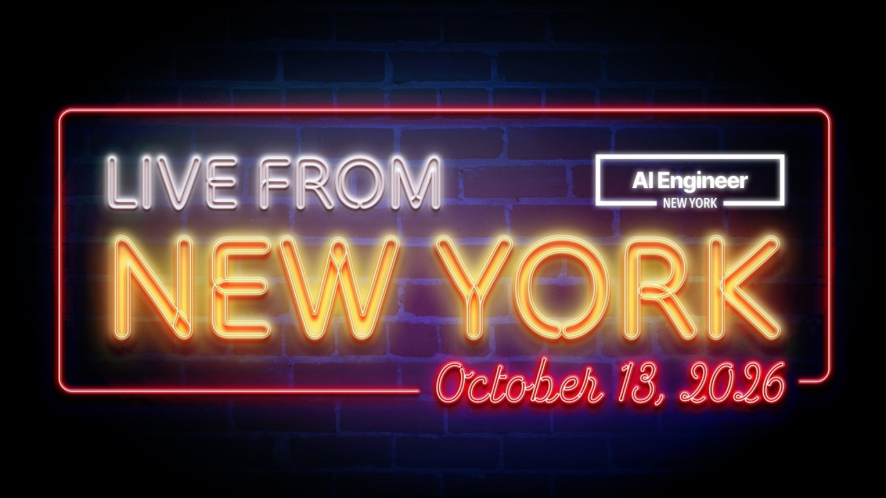
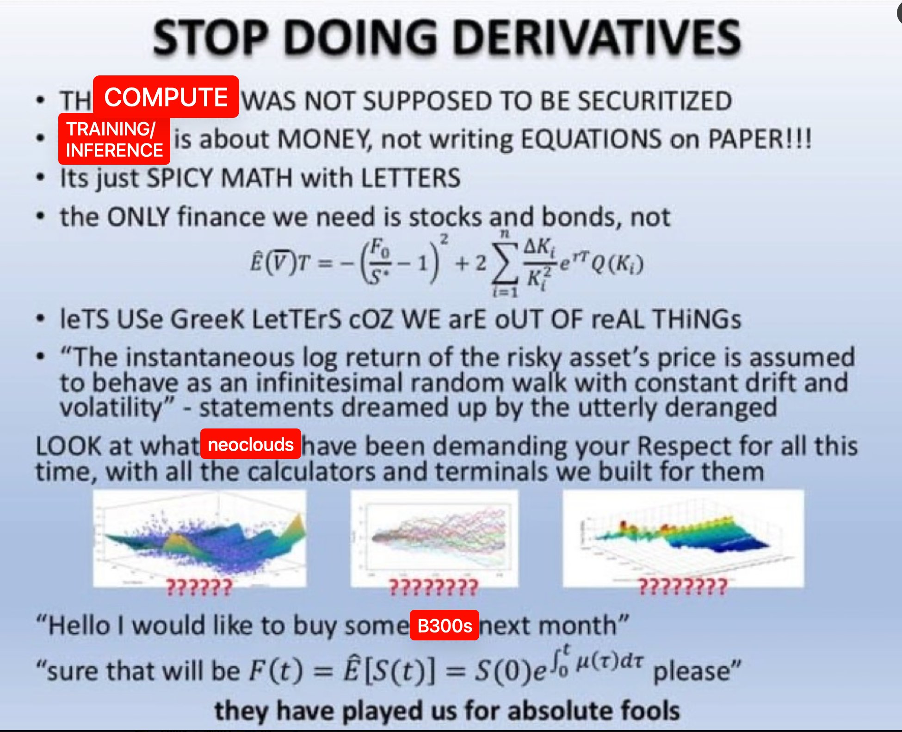

# 🐦 @swyx

## 📅 October 13, 2026

> 12 post(s) archived.

---

### 🕐 13:12 UTC · @swyx

> Got a pleasant surprise walking into the @aiDotEngineer keynote theater at the Sheraton NY! PromptBill on every seat! Ahahaa Swyx is a theater kid at heart and it shows! one of the best parts of my job is bringing out the best in ai in each city i love new york ♥️

🔗 [View original post](https://x.com/altryne/status/2109995628977889441)

---

### 🕐 13:08 UTC · @swyx

> and livestream now https://x.com/aidotengineer/status/2109994269800808626?s=46 Live from New York: AI Engineer NYC! https://www.youtube.com/live/akEqiXFo3GM - @Bridgewater Head of Product Eng - @AnthropicAI MD FinServ - @twosigma SVP Arch - @CapitalOne Principal - @ArizeAI CPO - @WellsFargo Head of AI - @apolloglobal - @coatuemgmt Head of AI - @gen_intuitio…

🔗 [View original post](https://x.com/swyx/status/2109994742998303191)

---

### 🕐 13:06 UTC · @swyx

> Live from New York: AI Engineer NYC! https://www.youtube.com/live/akEqiXFo3GM - @Bridgewater Head of Product Eng - @AnthropicAI MD FinServ - @twosigma SVP Arch - @CapitalOne Principal - @ArizeAI CPO - @WellsFargo Head of AI - @apolloglobal - @coatuemgmt Head of AI - @gen_intuition CEO - @NousResearch CEO and lots more! Emceed by @businessbarista for the second year in a row, presented by Arize! tune in 👀

🔗 [View original post](https://x.com/aiDotEngineer/status/2109994269800808626)

---

### 🕐 12:51 UTC · @swyx

> btw hosting karaoke tonight at my fave nyc bar! https://luma.com/lsk

🔗 [View original post](https://x.com/swyx/status/2109990469098967118)

---

### 🕐 12:51 UTC · @swyx

> @aiDotEngineer @evanjconrad btw hosting karaoke evening tonight at my fave nyc bar! https://luma.com/lsk join - singing not required but highly encouraged

🔗 [View original post](https://x.com/swyx/status/2109990402212446660)

---

### 🕐 12:50 UTC · @swyx

> I used to be a FICC trader so this announcement is absolutely freaking surreal — its not every year that we get to launch a NEW ASSET CLASS at @aidotengineer but this is finally public! ANNOUNCING THE COMPUTE TRADING MICROTRACK of AIE NYC - @evanjconrad: CEO SFCompute - Oliver Kennon: @dylan522p&apos;s Compute Trading star - @affaan + @absurdistphil: Jump&apos;s new heads of Compute Trading - @carmenli: CEO Compute Exchange + Silicon Data we&apos;re completely sold out so there&apos;s basically no reason to tell u about this apart from TUNE IN TO THE LIVESTREAM!!! https://www.youtube.com/@aiDotEngineer/streams live from new york! ANNOUNCEMENT: I&apos;m on the main stage @aiDotEngineer on Oct 14 w The Dark Pools of Compute - a look at how compute is actually bought and sold, what sets its price, from power and financing to policy, and what a more mature market could mean for anyone building on it.

🔗 [View original post](https://x.com/swyx/status/2109990238533677520)

---

### 🕐 11:51 UTC · @swyx

> Going to emcee @swyx’s AI Engineering conference right now. It’s one of my favorite events of the year because it’s a day spent in Edge City: a place that’s living months-to-years in the future in a specific domain relative to society. If you’re at the conference and want to hang come say what up!

🔗 [View original post](https://x.com/businessbarista/status/2109975308400996827)

---

### 🕐 04:51 UTC · @swyx

> Also a separate shoutout to @cognition (@mattbergland) for the amazing Token Billionaire lounge! They got haircuts, massages, and a friggin personal tailor in there?! I personally loved the smash station and the &quot;books by @DevinAI&quot; It pays off to be an AIE Token Billionaire! Media I tell all my friends, apply to speak at @aiDotEngineer ! The speakers dinner and the speakers lounge are the highest density of AI talent and AI conversation anywhere in the world! Amazing first day in NY today! Excited to see the keynote tomorrow!

🔗 [View original post](https://x.com/altryne/status/2109869706974765160)

---

### 🕐 02:44 UTC · @swyx

> @cjav_dev @aiDotEngineer @ricmac @latentspacepod our workshop writeup is live now! https://x.com/latentspacepod/status/2109713951604826153?s=20 At AI Engineer New York, Anthropic&apos;s @cjav_dev &amp; @HarrisonStall from @ClaudeDevs drew on lessons from Unix and Linux to explain how agents can tackle bigger projects without overwhelming developers. https://www.latent.space/p/claude-dynamic-workflows

🔗 [View original post](https://x.com/swyx/status/2109837651893485844)

---

### 🕐 02:42 UTC · @swyx

> My favorite AI event. See you around, folks Definitely come Oct 14, in emceeing! But actually come everyday or watch online - the best talks are at @aiDotEngineer one of the best parts of my job is bringing out the best in ai in each city i love new york ♥️

🔗 [View original post](https://x.com/TheTuringPost/status/2109837132387000326)

---

### 🕐 01:01 UTC · @swyx

> i&apos;m giving a talk in a few days, and as part of it, I need photos of you at the beginning of your startup can you share them in the thread below or DM me? I&apos;ll start

🔗 [View original post](https://x.com/evanjconrad/status/2109811681736225181)

---

### 🕐 00:04 UTC · @swyx

> one of the best parts of my job is bringing out the best in ai in each city i love new york ♥️ Media We&apos;re excited to announce our AI Engineer New York speaker lineup! Presented by @arizeai CEO @ExaAILabs CTO @tryramp CEO @ValsAI CEO @RogoAI CTO @modal CEO @trybasis CEO @SonarSource CEO @runwayml CTO @mintlify CEO @sfcompute CTO Bridgewater CTO @turbopuffer CEO @NousResearch CEO…

🔗 [View original post](https://x.com/swyx/status/2109797444204572880)

---
