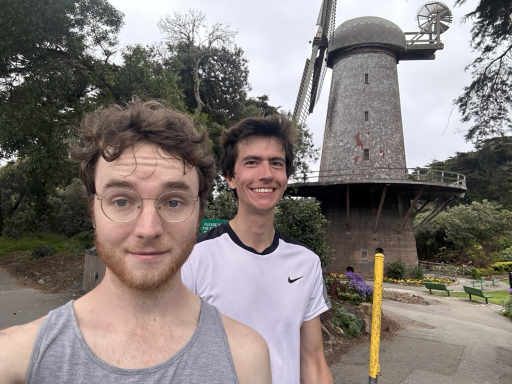

# 🐦 @swyx

## 📅 October 13, 2026

> 5 post(s) archived.

---

### 🕐 04:51 UTC · @swyx

> Also a separate shoutout to @cognition (@mattbergland) for the amazing Token Billionaire lounge! They got haircuts, massages, and a friggin personal tailor in there?! I personally loved the smash station and the &quot;books by @DevinAI&quot; It pays off to be an AIE Token Billionaire! Media I tell all my friends, apply to speak at @aiDotEngineer ! The speakers dinner and the speakers lounge are the highest density of AI talent and AI conversation anywhere in the world! Amazing first day in NY today! Excited to see the keynote tomorrow!

🔗 [View original post](https://x.com/altryne/status/2109869706974765160)

---

### 🕐 02:44 UTC · @swyx

> @cjav_dev @aiDotEngineer @ricmac @latentspacepod our workshop writeup is live now! https://x.com/latentspacepod/status/2109713951604826153?s=20 At AI Engineer New York, Anthropic&apos;s @cjav_dev &amp; @HarrisonStall from @ClaudeDevs drew on lessons from Unix and Linux to explain how agents can tackle bigger projects without overwhelming developers. https://www.latent.space/p/claude-dynamic-workflows

🔗 [View original post](https://x.com/swyx/status/2109837651893485844)

---

### 🕐 02:42 UTC · @swyx

> My favorite AI event. See you around, folks Definitely come Oct 14, in emceeing! But actually come everyday or watch online - the best talks are at @aiDotEngineer one of the best parts of my job is bringing out the best in ai in each city i love new york ♥️

🔗 [View original post](https://x.com/TheTuringPost/status/2109837132387000326)

---

### 🕐 01:01 UTC · @swyx

> i&apos;m giving a talk in a few days, and as part of it, I need photos of you at the beginning of your startup can you share them in the thread below or DM me? I&apos;ll start

🔗 [View original post](https://x.com/evanjconrad/status/2109811681736225181)

---

### 🕐 00:04 UTC · @swyx

> one of the best parts of my job is bringing out the best in ai in each city i love new york ♥️ Media We&apos;re excited to announce our AI Engineer New York speaker lineup! Presented by @arizeai CEO @ExaAILabs CTO @tryramp CEO @ValsAI CEO @RogoAI CTO @modal CEO @trybasis CEO @SonarSource CEO @runwayml CTO @mintlify CEO @sfcompute CTO Bridgewater CTO @turbopuffer CEO @NousResearch CEO…

🔗 [View original post](https://x.com/swyx/status/2109797444204572880)

---
