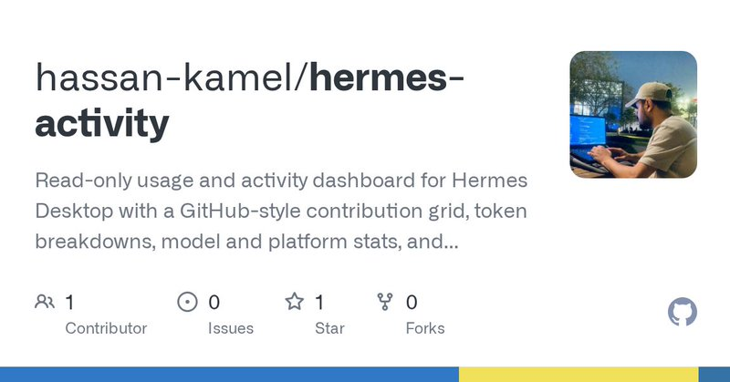
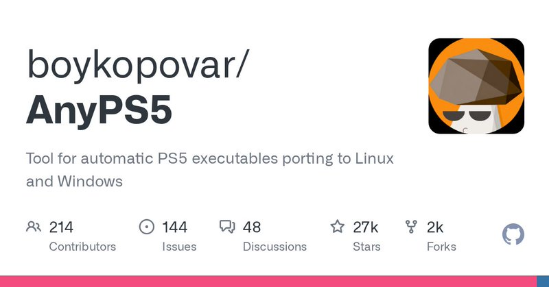

# 🐦 @tonysimons_

## 📅 October 13, 2026

> 3 post(s) archived.

---

### 🕐 04:21 UTC · @tonysimons_

> Install Hermes Activity with one command: hermes plugins install https://github.com/hassan-kamel/hermes-activity Then enable it: hermes plugins enable hermes-activity Open Hermes Desktop → Activity.

🔗 [View original post](https://x.com/tonysimons_/status/2109862084360233287)

---

### 🕐 04:20 UTC · @tonysimons_

> Hermes Desktop just got a GitHub-style HEATMAP for AI usage. 🪽 Sessions. Tokens. Models. Tools. Skills. And the new Hermes Activity v0.2.0 can also show provider-reported usage from Codex, OpenCode, CommandCode, and Ollama. This one&apos;s DEFINITELY staying installed. 🔥 Media

🔗 [View original post](https://x.com/tonysimons_/status/2109861906161045579)

---

### 🕐 01:39 UTC · @tonysimons_

> PS5 games on PC. No emulation. 🤯 AnyPS5 relinks PS5 executables to run natively on Windows and Linux. Its shader decoder now recognizes 100% of RDNA1/2 instructions. The catch? Just ONE game is officially verified playable. Early days, but this is wild engineering. http://github.com/boykopovar/AnyPS5

🔗 [View original post](https://x.com/tonysimons_/status/2109821170300117167)

---
