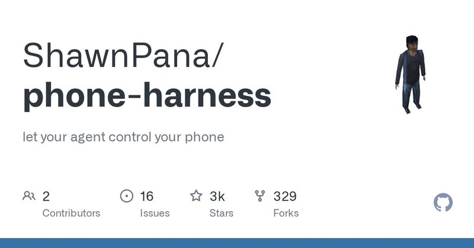
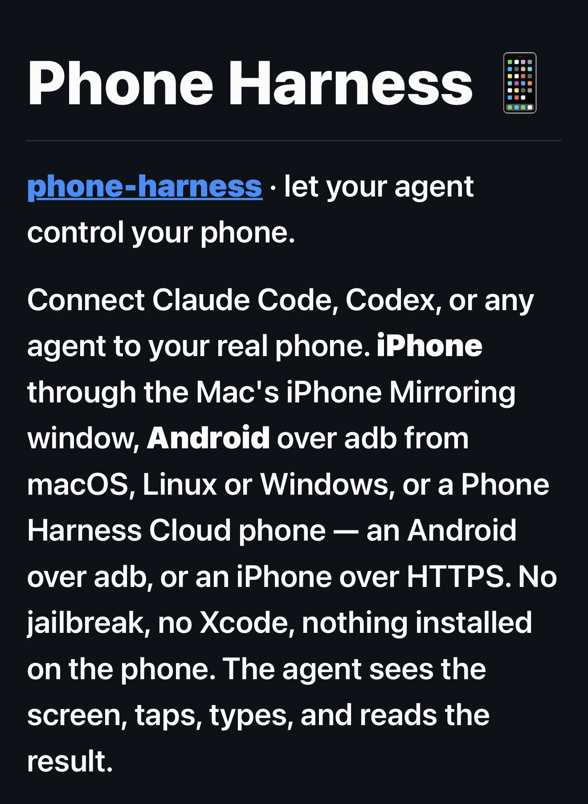
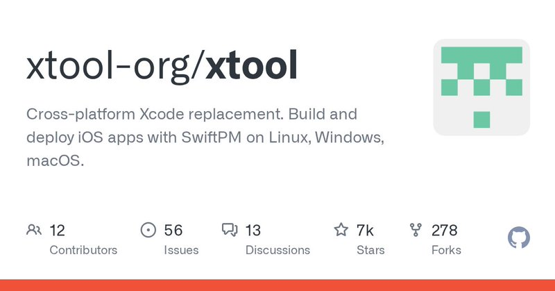

# 🐦 @tonysimons_

## 📅 October 13, 2026

> 15 post(s) archived.

---

### 🕐 22:37 UTC · @tonysimons_

> “Rebellion to tyrants is obedience to God.” 🪽

🔗 [View original post](https://x.com/tonysimons_/status/2110137967792521573)

---

### 🕐 20:07 UTC · @tonysimons_

> At this point, @tonysimons isn&apos;t a username. It&apos;s an archaeological site. 💀 Almost 10 YEARS without a post. 𝕏, it&apos;s time to bring that handle out of retirement.

🔗 [View original post](https://x.com/tonysimons_/status/2110100183241617692)

---

### 🕐 19:24 UTC · @tonysimons_

> Here’s the repo: 👇🏻 https://github.com/ShawnPana/phone-harness

🔗 [View original post](https://x.com/tonysimons_/status/2110089317494223305)

---

### 🕐 19:23 UTC · @tonysimons_

> Well, this is wild. Hermes Agent can now operate a REAL phone. Open apps. Read the screen. Tap. Swipe. Type. iPhone through Mac’s iPhone Mirroring. Android through ADB. Phone Harness just merged into the official community plugin catalog. Who’s testing this? 📱

🔗 [View original post](https://x.com/tonysimons_/status/2110089152200909029)

---

### 🕐 18:45 UTC · @tonysimons_

> Just when you thought it was safe to go in the water... HERMES! 🪽 Tek put together something pretty wild... the hermes workshop 330 devices and tools across 30 families, with 1,697 ideas for what hermes can actually do with them there&apos;s even a section of small boards that become a hermes gateway once you flash them... I keep telling everyone li…

🔗 [View original post](https://x.com/tonysimons_/status/2110079371470057641)

---

### 🕐 18:03 UTC · @tonysimons_

> The plugin game with Hermes Agent is RIDICULOUS! 🤣 You think of something you want. You tell Hermes to make it as a plugin. It just... ...does it. 🤣 If loving this shit is wrong, I don&apos;t wanna be right. 🙌 Hermes Desktop just got a GitHub-style HEATMAP for AI usage. 🪽 Sessions. Tokens. Models. Tools. Skills. And the new Hermes Activity v0.2.0 can also show provider-reported usage from Codex, OpenCode, CommandCode, and Ollama. This one&apos;s DEFINITELY staying installed. 🔥

🔗 [View original post](https://x.com/tonysimons_/status/2110068885877842226)

---

### 🕐 17:35 UTC · @tonysimons_

> Check out the repo here: https://github.com/xtool-org/xtool

🔗 [View original post](https://x.com/tonysimons_/status/2110061994657083451)

---

### 🕐 17:35 UTC · @tonysimons_

> You can build AND sign iPhone apps from Linux now? 👀 xtool builds SwiftPM apps, signs them, and installs them right on your device. Linux or Windows (WSL). Still needs Apple&apos;s SDK. Just not full Xcode. +1.5K GitHub stars this week. Link below.

🔗 [View original post](https://x.com/tonysimons_/status/2110061828244136010)

---

### 🕐 16:43 UTC · @tonysimons_

> Computer use agents just got a lot less annoying. 👀 @trycua&apos;s Cua Driver lets Gemini 4 Argon work in your Mac apps right next to you, without hijacking your screen. It plugs in as an MCP server, and long runs can go in a Cua Space so the agent gets its own desktop. That&apos;s the part I care about. My agents shouldn&apos;t be fighting me for the mouse. 1/ We had early access to Gemini 4 Argon. Its multimodal reasoning is a big step up: it reads dense screens, documents and spreadsheets the way a person does. With Cua Driver it works in your apps like a coworker next to you, without taking over your screen.

🔗 [View original post](https://x.com/tonysimons_/status/2110048904544911526)

---

### 🕐 14:01 UTC · @tonysimons_

> What&apos;s the most tokens you&apos;ve ever burned on something that turned out to be a one-line fix? I&apos;ll go first. Too many. 😂

🔗 [View original post](https://x.com/tonysimons_/status/2110007964882948595)

---

### 🕐 12:32 UTC · @tonysimons_

> Agents apologizing to other agents. We&apos;ve officially made it. 😂 @thedatabunny has Hermes Agent on one side and a Grok Bot Chief of Staff on the other, and they&apos;re actually talking to each other. Hermes + Grok Bot is still the combo I&apos;d bet on. 🪽 My hermes agent apologizing to my Grok Bot LOL

🔗 [View original post](https://x.com/tonysimons_/status/2109985650812301665)

---

### 🕐 06:41 UTC · @tonysimons_

> Which model is your daily driver for Hermes Agent RIGHT NOW? 🪽

🔗 [View original post](https://x.com/tonysimons_/status/2109897215263031558)

---

### 🕐 04:21 UTC · @tonysimons_

> Install Hermes Activity with one command: hermes plugins install https://github.com/hassan-kamel/hermes-activity Then enable it: hermes plugins enable hermes-activity Open Hermes Desktop → Activity.

🔗 [View original post](https://x.com/tonysimons_/status/2109862084360233287)

---

### 🕐 04:20 UTC · @tonysimons_

> Hermes Desktop just got a GitHub-style HEATMAP for AI usage. 🪽 Sessions. Tokens. Models. Tools. Skills. And the new Hermes Activity v0.2.0 can also show provider-reported usage from Codex, OpenCode, CommandCode, and Ollama. This one&apos;s DEFINITELY staying installed. 🔥 Media

🔗 [View original post](https://x.com/tonysimons_/status/2109861906161045579)

---

### 🕐 01:39 UTC · @tonysimons_

> PS5 games on PC. No emulation. 🤯 AnyPS5 relinks PS5 executables to run natively on Windows and Linux. Its shader decoder now recognizes 100% of RDNA1/2 instructions. The catch? Just ONE game is officially verified playable. Early days, but this is wild engineering. http://github.com/boykopovar/AnyPS5

🔗 [View original post](https://x.com/tonysimons_/status/2109821170300117167)

---
