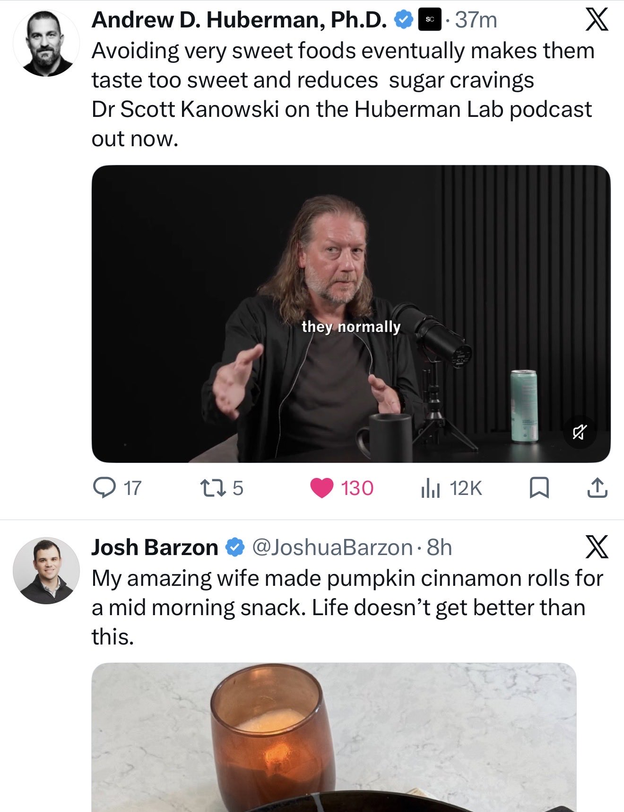

# 🐦 @tunguz

## 📅 October 13, 2026

> 5 post(s) archived.

---

### 🕐 12:25 UTC · @tunguz

> Mostly checks out, I&apos;ve been to 7/8 of those. WSJ just released a list of top towns for founders to start a company: 1) Palo Alto, CA 2) East Palo Alto, CA 3) Fremont, CA 4) San Jose, CA 5) Cupertino, CA 6) Go to prison (no rent or food costs and more time to focus on AI) 7) Mountain View, CA 8) Sunnyvale, CA accurate?

🔗 [View original post](https://x.com/tunguz/status/2109983895219286211)

---

### 🕐 12:23 UTC · @tunguz

> metal-graph 0.1.1 is out! Another graph algorithm sped-up on Apple Silicon to a ludicrous degree. Go check it out. metal-graph 0.1.1 is out! ⚡ Millions of links. Hub and authority scores in milliseconds. This update brings HITS graph ranking to Apple Silicon GPUs through native Metal kernels, with Python and C APIs. Here are the M4 Max results. 🧵 1/7

🔗 [View original post](https://x.com/tunguz/status/2109983391752065163)

---

### 🕐 01:24 UTC · @tunguz

> Real pacing has never been tried.

🔗 [View original post](https://x.com/tunguz/status/2109817416284864810)

---

### 🕐 01:11 UTC · @tunguz

> Glad to see it. If it’s a truly from-the-scratch new model, then it can really add to model diversity. This model is very very good. I was struggling to find anything to throw at it that it couldn’t do, even when other top models failed. Meta is back.

🔗 [View original post](https://x.com/tunguz/status/2109814323258523728)

---

### 🕐 00:15 UTC · @tunguz

> This is what a perfectly balanced TL looks like.

🔗 [View original post](https://x.com/tunguz/status/2109800171605578090)

---
