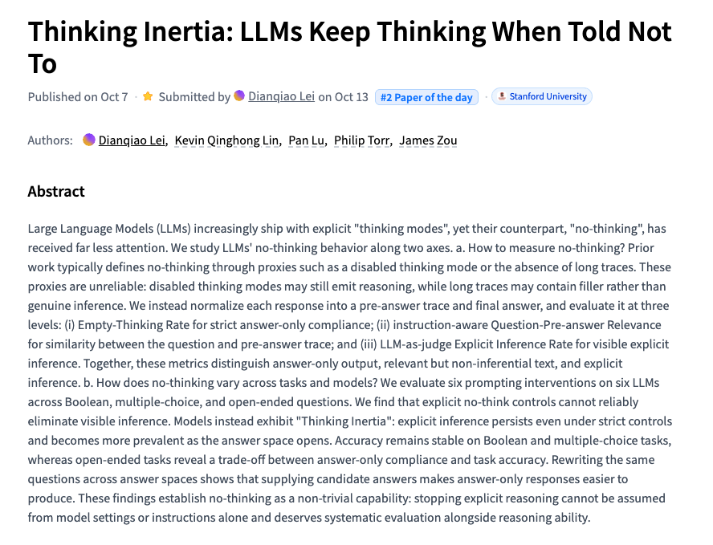

# 🐦 @_akhaliq

## 📅 October 14, 2026

> 8 post(s) archived.

---

### 🕐 17:58 UTC · @_akhaliq

> First it was 500. Then 1,000. Now 2,000 registered and a waitlist 🤯 So, one last time, we’re doubling capacity. 4,000 AI builders, one roof, San Francisco, this Friday 10/16. Open Together. The AI revolution will not be centralized 💪 Grab your spot before it fills again 👇 Media

🔗 [View original post](https://x.com/jeffboudier/status/2110430133060521987)

---

### 🕐 17:31 UTC · @_akhaliq

> VideoJev System One Model for Video Understanding and Interaction paper: https://huggingface.co/papers/2610.18615 Media

🔗 [View original post](https://x.com/_akhaliq/status/2110423274413056230)

---

### 🕐 17:21 UTC · @_akhaliq

> We are open-sourcing RISE, our red-teaming algorithm that breaks the safeguards of the latest image models from OpenAI, DeepMind, and others. RISE uses readily available models like Qwen and Gemini Flash under the hood, with no additional training required. Read more: https://whitecircle.com/research/breaking-frontier-image-models Media

🔗 [View original post](https://x.com/whitecircle/status/2110420697814114693)

---

### 🕐 17:09 UTC · @_akhaliq

> We’re months away from AGI and the leisure economy’s about to explode Today, we’re launching Odessia, an always-on concierge for travel and experiences Prices are spiking, places are getting crowded. Odessia is your cheat code to going places Text to get started for free Media

🔗 [View original post](https://x.com/FDavidsonT/status/2110417685486141697)

---

### 🕐 16:54 UTC · @_akhaliq

> Thinking Inertia LLMs Keep Thinking When Told Not To paper: https://huggingface.co/papers/2610.11765

🔗 [View original post](https://x.com/_akhaliq/status/2110413943034491358)

---

### 🕐 16:02 UTC · @_akhaliq

> We are releasing Ultramarine 1 Flash, a frontier-class model built for knowledge work. It is open-source and achieves similar performance to Fable 5, while being 60x cheaper. It was post-trained by a team of 5 for ~$300k all-in. Available on API now, with weights releasing in 2 weeks. Media

🔗 [View original post](https://x.com/bertgodel/status/2110400987622265232)

---

### 🕐 15:10 UTC · @_akhaliq

> AI is everywhere, but walk into almost any company and work hasn’t changed Meet @Zenzap_chat, the Multiplayer AI platform. Now, people and proactive AI agents are in the same group chats, automating workflows with shared context across business tools and teams Everyone can bring their team and create AI agents in 90 secs (even from your phone). CISOs and CIOs love it Thousand of teams from our early access program already transformed their day to day AI agents have joined the team Media

🔗 [View original post](https://x.com/GuyWeissZZ/status/2110387887023751398)

---

### 🕐 13:38 UTC · @_akhaliq

> Ai2 just released HiRO-ACEv2 on Hugging Face A two-stage AI emulator that downscales to 3km precipitation, winds, and sea level pressure - capturing extreme events at 300x lower cost.

🔗 [View original post](https://x.com/HuggingPapers/status/2110364666673213873)

---
