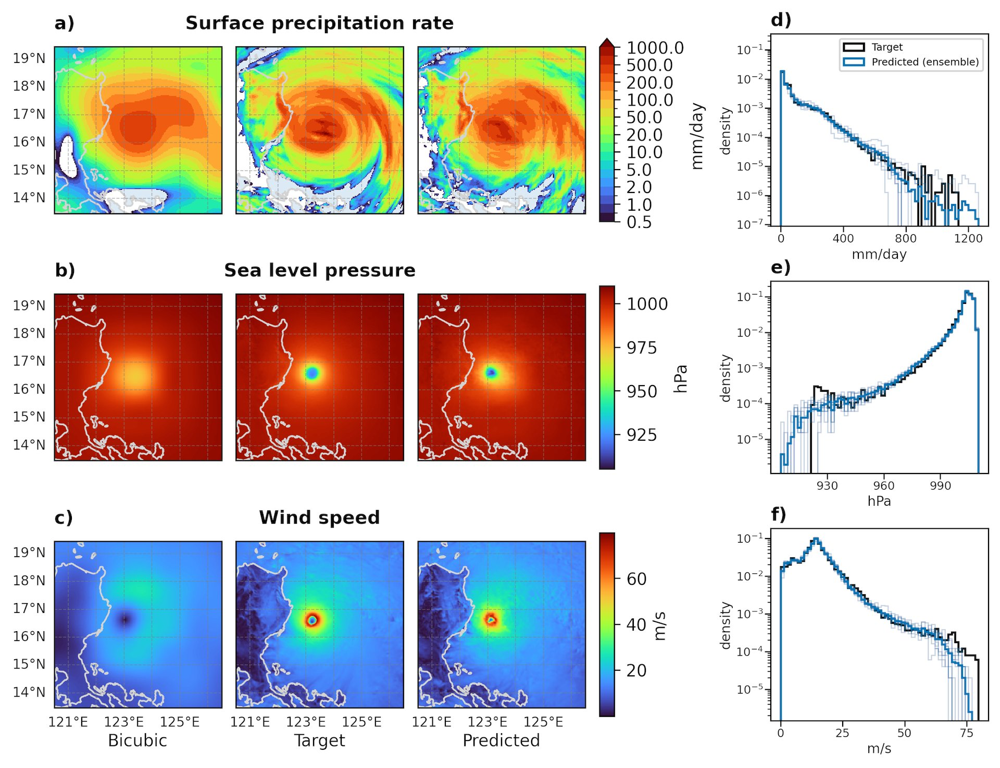

# 🐦 @_akhaliq

## 📅 October 14, 2026

> 2 post(s) archived.

---

### 🕐 16:02 UTC · @_akhaliq

> We are releasing Ultramarine 1 Flash, a frontier-class model built for knowledge work. It is open-source and achieves similar performance to Fable 5, while being 60x cheaper. It was post-trained by a team of 5 for ~$300k all-in. Available on API now, with weights releasing in 2 weeks. Media

🔗 [View original post](https://x.com/bertgodel/status/2110400987622265232)

---

### 🕐 13:38 UTC · @_akhaliq

> Ai2 just released HiRO-ACEv2 on Hugging Face A two-stage AI emulator that downscales to 3km precipitation, winds, and sea level pressure - capturing extreme events at 300x lower cost.

🔗 [View original post](https://x.com/HuggingPapers/status/2110364666673213873)

---
