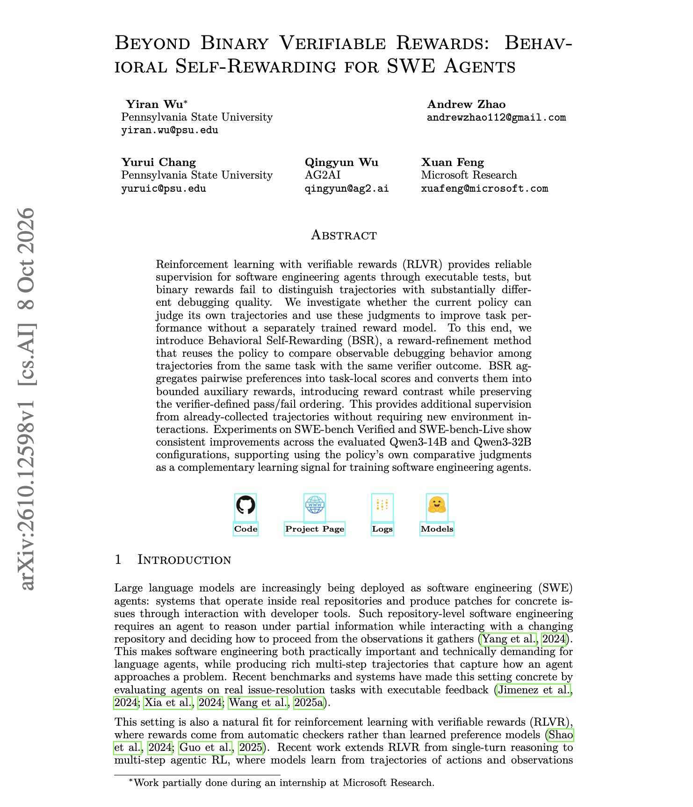
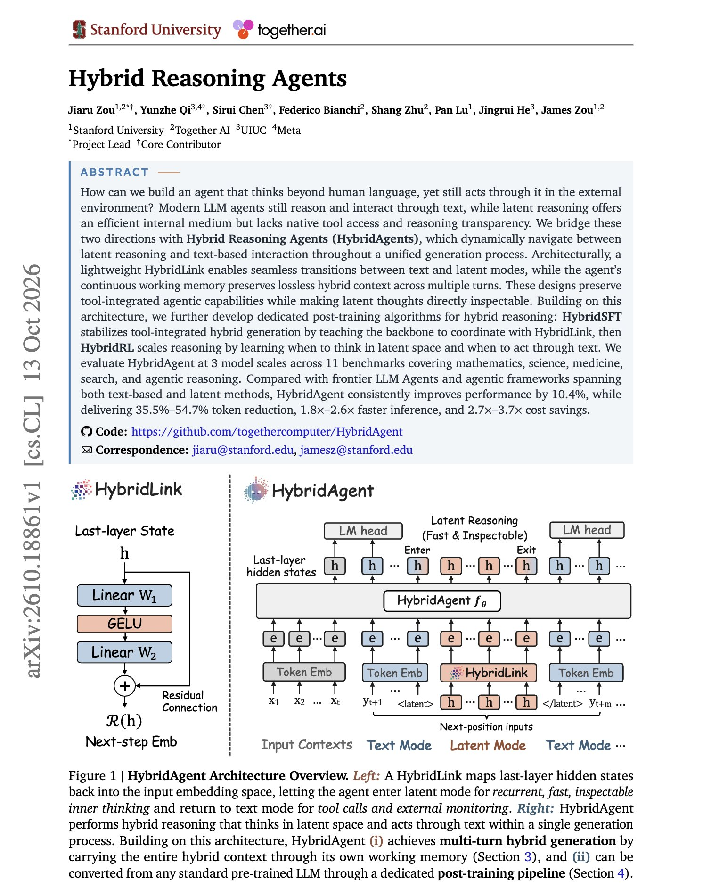
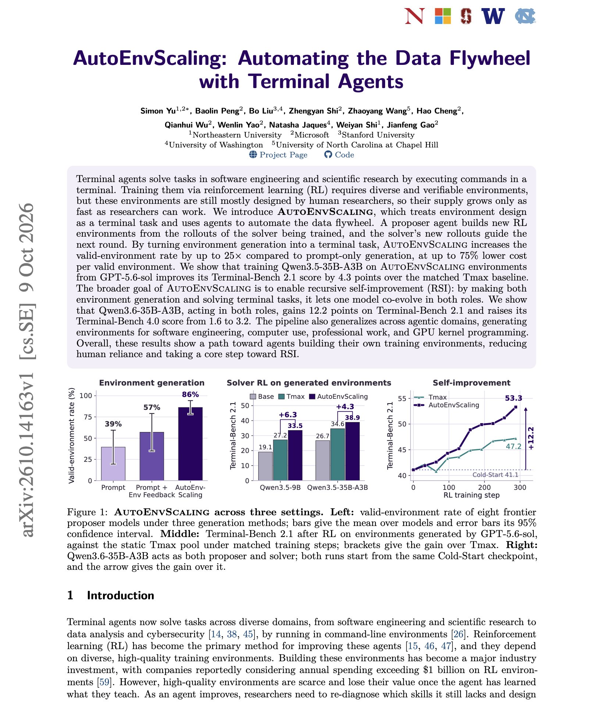
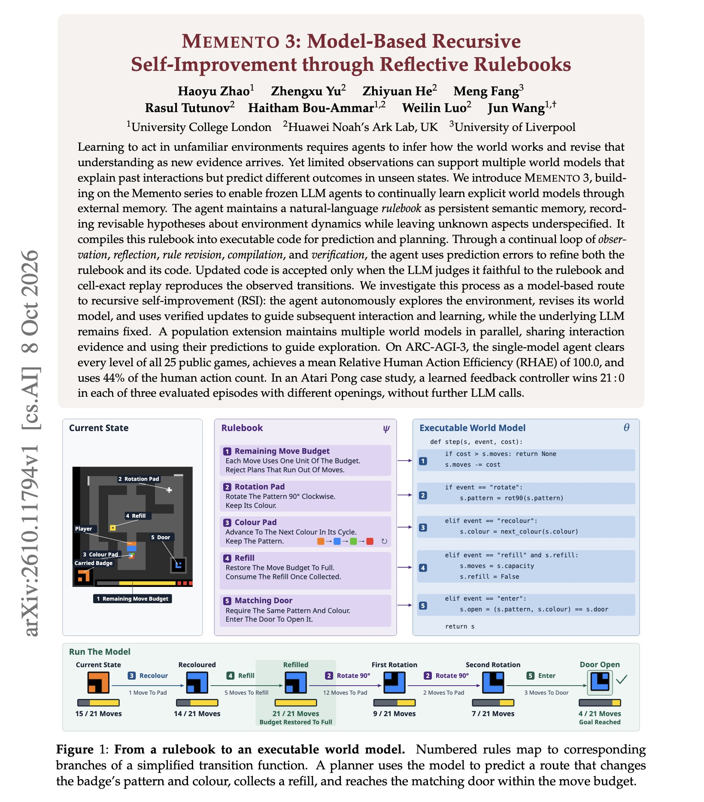

# 🐦 @dair_ai

## 📅 October 14, 2026

> 5 post(s) archived.

---

### 🕐 22:00 UTC · @dair_ai

> // Behavioral Self-Rewarding for SWE agents // It&apos;s standard practice to train SWE agents on binary test rewards. This paper shows the problem with that. When every trajectory in a group passes, or every one fails, the reward has no contrast, and the group teaches nothing. Researchers from Penn State and Microsoft Research propose Behavioral Self-Rewarding. The policy compares its own trajectories in pairs, and those preferences become small bounded rewards added on top of the test result. The added rewards are bounded, so a self-judged preference can rank two passing trajectories but can never lift a failing one above a passing one. No new environment interactions are needed. On SWE-bench Verified, Qwen3-14B improves from 32.1% to 34.7% average accuracy at a 400-step budget, and on SWE-bench-Live from 6.33% to 8.11%. https://arxiv.org/abs/2610.12598 Chat with Paper: https://academy.dair.ai/papers/beyond-binary-verifiable-rewards-behavioral-self-rewarding-for-swe-agents-2610.12598

🔗 [View original post](https://x.com/dair_ai/status/2110490882332053673)

---

### 🕐 21:52 UTC · @dair_ai

> Banger paper from Stanford, Together AI, and colleagues. Why is this an interesting paper? Today&apos;s LLM agents must write out every reasoning step as text before they can search, run code, or take action. Those steps cost tokens and can take time. This paper proposes Hybrid Reasoning Agents, which reason internally in latent space and switch to text only to call a tool or give an answer. A small module called HybridLink moves the model between the two modes, and a working memory keeps both kinds of context across turns. Tool calls stay in plain text, and the latent steps can still be inspected. Training happens in two stages. SFT teaches the model to work with HybridLink, then RL teaches it when to think in latent space and when to act in text. Across 11 benchmarks in math, science, medicine, search, and agentic reasoning, it outperforms frontier LLM agents and agentic frameworks, both text-based and latent, by 10.4% on average. It also uses 35.5% to 54.7% fewer tokens, runs 1.8x to 2.6x faster, and costs 2.7x to 3.7x less. The 14B model beats the strongest agentic baseline by 17.4% on agentic reasoning tasks. https://arxiv.org/abs/2610.18861 Chat with Paper: https://academy.dair.ai/papers/hybrid-reasoning-agents-2610.18861

🔗 [View original post](https://x.com/omarsar0/status/2110488828062675096)

---

### 🕐 20:29 UTC · @dair_ai

> New impressive work from Microsoft and collaborators. And it&apos;s one of my favorite recent topics: RL environments. They show that Qwen3.6-35B-A3B goes from 41.1 to 53.3 on Terminal-Bench 2.1 by training on environments it designed itself. AutoEnvScaling gives environment design to a proposer agent that works in a terminal, looks at the rollouts of the model being trained, and builds new RL environments from them. The trained model&apos;s next rollouts guide the next round. Building environments in a terminal raises the share of valid environments up to 25 times over prompt-only generation, at up to 75% lower cost per valid environment. With GPT-5.6-sol or Claude Opus 5 as the proposer, Qwen3.5-35B-A3B scores 4.3 and 3.8 points above matched static environment pools. The gain shrinks when the proposer cannot see solver feedback. The pipeline also produces environments for software engineering, computer use, and GPU kernel work. https://arxiv.org/abs/2610.14163 Chat with Paper: https://academy.dair.ai/papers/autoenvscaling-automating-the-data-flywheel-with-terminal-agents-2610.14163

🔗 [View original post](https://x.com/omarsar0/status/2110467939057168849)

---

### 🕐 17:45 UTC · @dair_ai

> What AI Safety needs is better tooling and engineering. For instance, building stronger red-teaming tools. Great to see this open-source effort to red-team image models. It seems to learn better ways to write attack prompts. It is open source and runs on an open Qwen model with Gemini Flash as the judge, so defenders can run the same tests on their own image models. We are open-sourcing RISE, our red-teaming algorithm that breaks the safeguards of the latest image models from OpenAI, DeepMind, and others. RISE uses readily available models like Qwen and Gemini Flash under the hood, with no additional training required. Read more: https://whi…

🔗 [View original post](https://x.com/omarsar0/status/2110426858621739146)

---

### 🕐 12:25 UTC · @dair_ai

> Insightful paper on recursive self-improvement with a frozen LLM. (bookmark it) Memento 3 clears every level of all 25 public ARC-AGI-3 games and uses 44% of the human action count. The underlying LLM is never updated. How it works: The agent writes what it believes about the environment as a natural-language rulebook, then compiles that rulebook into code that predicts the next state. A new version is kept only if replaying the code reproduces every transition the agent has observed, cell for cell. In an Atari Pong case study, the learned model drives a controller that wins 21 to 0 in three games without further LLM calls. https://arxiv.org/abs/2610.11794 Chat with Paper: https://academy.dair.ai/papers/memento-3-model-based-recursive-self-improvement-through-reflective-rulebooks-2610.11794

🔗 [View original post](https://x.com/dair_ai/status/2110346139690205524)

---
