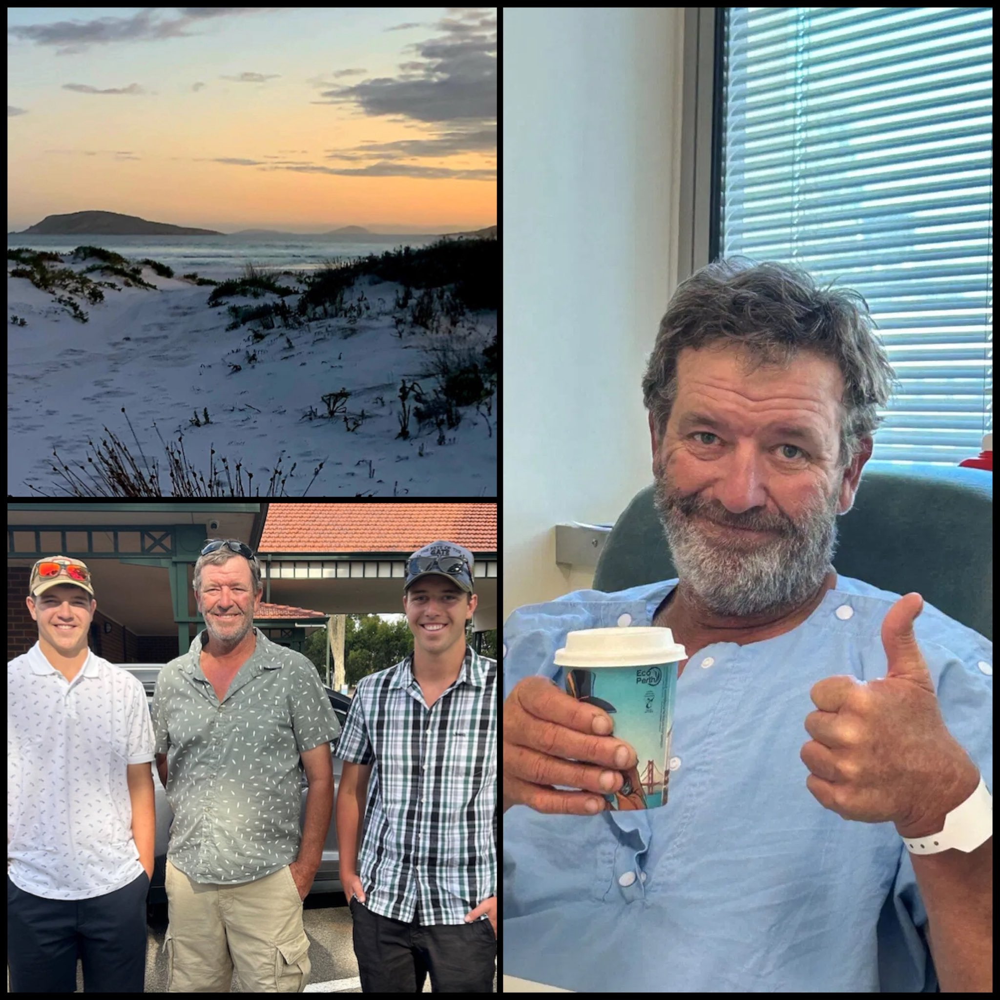
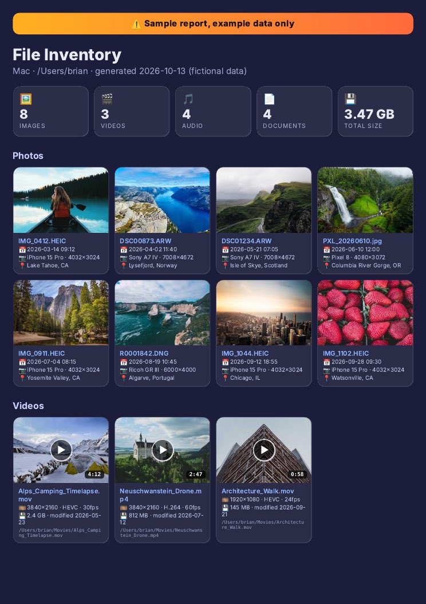

# 🐦 @elonmusk

## 📅 October 14, 2026

> 23 post(s) archived.

---

### 🕐 18:33 UTC · @elonmusk

> Try Grok Voice Introducing Grok Voice 3.0, the world’s most intelligent speech-to-speech model. It excels at resolving customer calls, responds in under a second, and costs less than other frontier models.

🔗 [View original post](https://x.com/elonmusk/status/2110438877274259488)

---

### 🕐 16:54 UTC · @elonmusk

> Cool grok bot pretty much replaced dots and muse for running my business... here is why : insanely simple to set up, a MASSIVE plugin library, generous usage. here&apos;s everything i use and what it costs: required ($165/mo + whop&apos;s cut per sale) &gt; money → whop plugin &gt; site → vercel + gi…

🔗 [View original post](https://x.com/elonmusk/status/2110413877024526603)

---

### 🕐 16:03 UTC · @elonmusk

> When Starlink became a lifeline for a family fighting to save their dad. ❤️ Nigel Norwood suffered cardiac arrest while camping at a remote beach in Western Australia, about 100 kilometres from the nearest hospital. There was no mobile signal. His wife, Lynne, spotted another camper’s @Starlink and used it to call emergency services. “This was the only way to get a call out from the campsite,” she later said. While she called for help, their 16-year-old son performed CPR with another camper, and their 19-year-old son brought a nearby defibrillator. After three shocks, Nigel’s pulse returned. He received hospital care and recovered. Starlink made that emergency call possible. When lives are at risk, a working connection can make all the difference. This life-saving technology should be available in every part of the world.

🔗 [View original post](https://x.com/cb_doge/status/2110401049282678881)

---

### 🕐 15:47 UTC · @elonmusk

> 🎯 String theory is what happens when an intelligent system is starved of sensory input and starts hallucinating. Intelligence needs grounding. For this reason, intelligence is practically never the bottleneck to solving impactful problems. The bottleneck is iterated contact with re…

🔗 [View original post](https://x.com/elonmusk/status/2110397029650477363)

---

### 🕐 14:16 UTC · @elonmusk

> SpaceX uses ARGON ION PROPULSION to move Starlink satellites through space And the engineering is pretty wild Starlink satellites use argon Hall-effect thrusters electric engines that ionize argon gas and accelerate the charged particles at extremely high speed They allow Starlink satellites to: • Raise themselves into operational orbit • Maneuver around other spacecraft and debris • Maintain their position in space • Deorbit themselves at the end of their life SpaceX originally used krypton, but switched its next-generation Starlink satellites to argon The V2 Mini argon thruster produces: • 170 mN of thrust • 2.4X the thrust of the first-generation system • 1.5X the specific impulse And Starlink became the first spacecraft system to fly using argon propulsion in space A Falcon 9 gets Starlink into space Then these tiny electric engines keep thousands of satellites exactly where they need to be

🔗 [View original post](https://x.com/XFreeze/status/2110374125659410865)

---

### 🕐 13:57 UTC · @elonmusk

> I have millions of files on just one laptop. I archive and curate all day long. This is one of my power tools. Use it! No operating system or even commercial software can make sense of your files like Grok Bot can. So I built a solution. Beautiful and useful clickable reports plus PDF archives. Link: https://x.ai/bot/esUBlwCDVvKUlr77LY8Rs WOW! GROK BOT MAKES SENSE OF YOUR LOCAL FILES. Ever wonder what&apos;s actually hiding on your computer? This @Grok @Bot PRIVATELY scans your photos, videos, songs, and documents and turns them into a stunning, modern report in both HTML and PDF! - Photo thumbnails with date taken, ca…

🔗 [View original post](https://x.com/BrianRoemmele/status/2110369324632326233)

---

### 🕐 13:29 UTC · @elonmusk

> Most people think Grok Bot is just a chat window. It&apos;s not. Each bot has its own computer, with its own browser, email inbox and desktop. When I ask it to do something, it goes off and does it. I made a video explaining how it actually works 👇

🔗 [View original post](https://x.com/debs_obrien/status/2110362370342363207)

---

### 🕐 13:09 UTC · @elonmusk

> Grok Imagine can now generate amazing custom music directly for your videos... and it&apos;s incredibly easy to use 🎵 Here&apos;s how to add music: 1. Generate your video in Grok Imagine 2. Click the music icon at the top 3. Select “+ Add music” 4. Describe the music you want....mood, tempo, instruments, vocals or no vocals, or simply write your own prompt 5. Click Generate 6. Preview your generated music 7. Select the section that fits your video 8. Click Apply And the best part is that your generated music is automatically saved to your library, so you can reuse it in future videos too Video generation and custom soundtracks in the same workflow Grok Imagine is now an incredibly powerful tool for creators Media

🔗 [View original post](https://x.com/XFreeze/status/2110357411878027658)

---

### 🕐 09:28 UTC · @elonmusk

> 【速報🎉】世界で最も売れている車、テスラModel Yが、2026年9月度においても、引き続き国内外国車ブランド車種別No.1を獲得し、日本の皆さまから信頼されるブランドへと成長しています。 テスラでは、皆さまの試乗体験を心よりお待ちしております。 👨「EVって実際どうなんだろう？」 👩「自分の生活でも充電の心配はない？」 そんな素朴な質問からで大丈夫です。 お客様のニーズやご懸念に応じて全てお答えできるプロのアドバイザーがお待ちしておりますので、ぜひお気軽に最寄りの店舗、お出かけ先の店舗にお立ち寄りください。 スタッフともども、皆さまのご来店を心よりお待ちしております。 https://www.tesla.com/ja_JP/drive

🔗 [View original post](https://x.com/teslajapan/status/2110301690134179865)

---

### 🕐 08:19 UTC · @elonmusk

> Wokeism is the most sophisticated form of racism ever built. Not because it hates one group, but because it reduces every human being to their skin color and calls it justice. Its roots aren&apos;t mysterious. Critical theory from the Frankfurt School, French postmodernists like Foucault and Derrida, then critical legal studies on American campuses, distilled into Critical Race Theory in the 80s and 90s. The core idea: society is nothing but a power struggle between groups. The individual doesn&apos;t exist. Merit doesn&apos;t exist. Only oppressor and oppressed. Accept that premise and everything else follows. You&apos;re judged by your race before you open your mouth. Your success is privilege, your failure is oppression. That&apos;s not anti-racism. That&apos;s racism with a PhD. And look at who actually holds these views. Not most minorities. Only about 3% of Hispanic Americans use &quot;Latinx.&quot; Most Black Americans told Gallup they wanted the same or more police presence in their neighborhoods, not less. The &quot;Hidden Tribes&quot; study found the hard progressive activist wing is around 8% of the population, and whiter and wealthier than average. A small radicalized class speaks in the name of minorities who never asked it to. The coalition doesn&apos;t even hold together. Feminists vs trans activists on women&apos;s sports. Asian Americans who had to go to the Supreme Court because Harvard discriminated against them in the name of diversity. A framework that keeps producing these contradictions isn&apos;t a moral philosophy. It&apos;s a hierarchy of grievances. And none of this grew organically. It&apos;s an industry. DEI became a multi-billion dollar market: corporate trainings, consultants, foundation grants, university bureaucracies whose budgets depend on the problem never being solved. Follow the incentives and you find an entire class of people paid to see racism everywhere. Cut the money and it starts collapsing, which is exactly what we&apos;ve watched since companies began slashing DEI budgets. Real anti-racism is simple: judge people as individuals. MLK said it in 1963. Everything since that tried to replace it has been a step backwards. https://x.com/teslaownersSV/status/1884471785648972161/video/1 Media

🔗 [View original post](https://x.com/brivael/status/2110284375317271037)

---

### 🕐 06:15 UTC · @elonmusk

> Grok @Bot can help with your taxes I just gave my a Grokbot four years of past tax returns and financial files. Just a dump of folders and unlabled files. K-1s, 1099s, mortgage statements, HSA records, and every email with our CPA. 266 files. I just said, please double check my CPA&apos;s work. A few minutes later, it …

🔗 [View original post](https://x.com/elonmusk/status/2110253157758673079)

---

### 🕐 06:12 UTC · @elonmusk

> im 3 days into a multi-state road trip entirely on @Tesla FSD. could not recommend this more. for long stretches, it pulls into supercharger spots to charge right around when i need a break to stretch or get a snack, and i arrive at destinations way more relaxed than otherwise bc im basically just a passenger. most of my hotels (average hotels near national parks) have had EV charging stations to top up for the next day. think i touched the steering wheel for a confusing parking spot once and that&apos;s it. oh and it saved me from a semi truck veering into my lane that i didn&apos;t notice until the car had already reacted The Tesla Model 3 with FSD is mind-blowing. Jessica and I drove to the gym without touching the controls once. It backed out of our driveway, drove there, and backed into a parking space. It&apos;s amazing that you can buy so much future for $40k.

🔗 [View original post](https://x.com/agupta/status/2110252316070920641)

---

### 🕐 05:41 UTC · @elonmusk

> Make music videos easily with Grok @Bot I made a Grok Bot that can use Suno, Midjourney, and Opus to make music videos &quot;Claudia&quot; (the Grok Bot) made this teaser autonomously with @imagine https://x.ai/bot/zvsgYtQHUcSKGRhAb_JzM

🔗 [View original post](https://x.com/elonmusk/status/2110244638900773147)

---

### 🕐 05:37 UTC · @elonmusk

> Made with @Grok @Imagine For those who didn&apos;t want the headache here is the same video, but removing the added effects so the light flashing isn&apos;t happening anymore or the harsh coloration. I hope this version is more enjoyable for those who share the same problem. Thanks for letting me know. Much love. …

🔗 [View original post](https://x.com/elonmusk/status/2110243595504820641)

---

### 🕐 04:23 UTC · @elonmusk

> I made a Grok Bot that can use Suno, Midjourney, and Opus to make music videos &quot;Claudia&quot; (the Grok Bot) made this teaser autonomously with @imagine https://x.ai/bot/zvsgYtQHUcSKGRhAb_JzM Media

🔗 [View original post](https://x.com/anabology/status/2110224953287070195)

---

### 🕐 04:16 UTC · @elonmusk

> Starlink connects families in rural areas. Seamlessly stream, game, study, and more with speeds up to 400+ Mbps. Learn more here. Media

🔗 [View original post](https://x.com/Starlink/status/2110223317416423775)

---

### 🕐 04:16 UTC · @elonmusk

> Grok @Bot can help with complex taxes Grok Bot saved me more than $1,000 today. I had a very complex tax filing with overseas reporting. Complicated, expensive, and hard to find the right accountant. Grok Bot found and organized the necessary documents itself (emails and bank accounts), figured out the requirements, …

🔗 [View original post](https://x.com/elonmusk/status/2110223110003982788)

---

### 🕐 04:03 UTC · @elonmusk

> Grok @Bot is awesome Some reasons Grok bot is better than a human employee: • You can communicate super autistically (aka direct) and it won&apos;t think you&apos;re a jerk • Won&apos;t report you to HR • Doesn&apos;t browse X while working, unless it was part of the task • You can literally watch its screen while it wo…

🔗 [View original post](https://x.com/elonmusk/status/2110220028725563618)

---

### 🕐 03:06 UTC · @elonmusk

> I made a list of 63 of U.S. Senate candidate James Talafreako&apos;s most insane and deranged statements. Sourced and referenced. 1. &quot;Modern science obviously recognizes that there are many more than two biological sexes. In fact, there are six&quot; 2021-04-20, Texas House Public Education Committee 2. &quot;God is non-binary.&quot; 2021-10-14, Texas House 3. &quot;Our campaign has officially become a non-meat campaign.&quot; 2022-02, Texas Humane Legislation Network fundraiser 4. &quot;I always think of myself as a Christian who hates Christianity, right?&quot; 2021-03-04, Activist Theology 5. &quot;In context of abortion … God asks for Mary&apos;s consent … So, to me that is a an affirmation in one of our most central stories, that creation has to be done with consent. You cannot force someone to create.&quot; 2025-07-18, The Joe Rogan Experience 6. &quot;Radicalized white men are the greatest domestic terrorist threat in our country.&quot; 2021-03-18, Twitter/X 7. &quot;#AhmaudArbery is the latest American killed by the virus of racism. The virus kills our black neighbors if they’re jogging, playing music, sitting in church, selling CDs, or carrying a bag of Skittles... White skin gives me and every white American immunity from the virus. But we spread it wherever we go&quot; 2020-05-08, Twitter 8. &quot;Young activists have really drawn the link between climate change and white supremacy and capitalism in our country and I think only by understanding the ways that all three of those oppressive systems work together, are we going to be able to begin the process of dismantling them.&quot; 2020-09-01, Austin Sierra Club climate forum 9. &quot;Restoration, repairing past harms, is part of my faith tradition. … it&apos;s exactly why we need … to invest in black communities, to invest in black Texans&quot; 2026-07-20, DeSoto town hall 10. &quot;I think the Confederate flag is a symbol of treason and terrorism, but the American flag is such a complicated symbol for most of us.&quot; 2019-09, St. Andrew’s Presbyterian Church, Austin 11. &quot;Defund the police is considered off limits in our political debate when defunding health services, defunding public education has been the stated policy of our state government for decades now.&quot; 2020-08-02, Texas Rising 12. &quot;Governor Abbott has filled this special session agenda with far right conspiracy theories about trans children causing problems on sports teams, which we know does not occur in the state of Texas&quot; 2021-07-19, FOX 7 Austin 13. &quot;Are districts getting, you know, almost hopefully near unanimous consent for students to learn about [sex education,] maybe the most important topic that they&apos;ll learn about in school?&quot; 2022-07, Texas House Public Education Committee 14. &quot;Every one of our neighbors with a uterus became the property of the state.&quot; 2022-10-02, St. Andrew’s Presbyterian Church, Austin 15. &quot;God is not a Christian.&quot; 2023-10-22, St. Andrew’s Presbyterian Church, Austin 16. &quot;So, this idea that to be a Christian means you have to be anti-gay and anti-abortion, there really is no historical, theological, biblical basis for that opinion.&quot; 2025-07-18, The Joe Rogan Experience 17. &quot;Jesus is the prophetic voice in my own life, but it could be for you a different prophetic voice from a different faith tradition.&quot; 2019-09, St. Andrew’s Presbyterian Church, Austin 18. &quot;I oppose voter ID.&quot; 2021-07-13, Fox News Primetime 19. &quot;Leasing federal property to abortion clinics on federal lands or in federal offices&quot; 2022-06-24, Letter to President Biden 20. &quot;Did they teach you in Sunday school that Jesus Christ himself was a radical feminist?&quot; 2022-10-02, St. Andrew’s Presbyterian Church, Austin 21. &quot;I don&apos;t want you in my school doing discipline.&quot; 2019-02, The Trey Blocker Show 22. &quot;For me, prophetic voices like Jesus have helped me reckon with my own whiteness, my own masculinity, my own certainty, my own ego.&quot; 2019-09, St. Andrew’s Presbyterian Church, Austin 23. &quot;That [oil and gas] industry is not gonna last.&quot; 2020-09-01, Austin Sierra Club climate forum 24. &quot;Our system of policing is deeply broken. We must replace it with something new and something better.&quot; 2020-09-02, Honest Austin 25. &quot;The Bible doesn&apos;t mention abortion or gay marriage&quot; 2023-10-22, St. Andrew’s Presbyterian Church, Austin 26. &quot;I&apos;m not an expert on this particular case, but I know that there were no Black members of the jury [in Anthony’s case].&quot; 2026-08-05, The Breakfast Club 27. &quot;Our office is the first in the history of the Capitol to add pronouns to our official business cards.&quot; 2021-03-31, Twitter/X 28. &quot;If we took just half of what we spend on wars, prisons, and policing, and spent it on education, healthcare, and jobs, we could make prisons obsolete.&quot; 2022-04-11, Ferguson prison graduation 29. &quot;Jesus came to transform the world. Christian nationalism is here to maintain the status quo. They have co-opted the son of God. They&apos;ve turned this humble rabbi into a gun-toting, gay-bashing, science-denying, money-loving, fear-mongering fascist.&quot; 2023-10-22, St. Andrew’s Presbyterian Church, Austin 30. &quot;In Genesis, God creates life by breathing life into the first human being, which we later call Adam. That life starts when you take your first breath.&quot; 2025-07-18, The Joe Rogan Experience 31. &quot;ICE executed a man in broad daylight on our streets just this morning. It&apos;s time to tear down this secret police force and replace it with an agency that actually is going to focus on public safety.&quot; 2026-01-24, Texas AFL-CIO debate, Georgetown 32. &quot;I&apos;m Season 2 [of Judaism, Christianity and Islam]—the most violent season. My religion has done more damage to both of those religions than they&apos;ve done to each other.&quot; 2026-02-23, The New Yorker 33. &quot;I think there are some folks … that would think that if you deny your child&apos;s gender identity that that&apos;s incredibly harmful. And whether or not we can—we label it with the term abuse, I mean, it&apos;s abusive for sure.&quot; 2019-04-03, Texas House Juvenile Justice &amp; Family Issues Committee 34. &quot;Our system, our public education system, particularly here in Texas is not built for poor students. It&apos;s not built for students of color.&quot; 2020-08-02, Texas Rising 35. &quot;I felt like I didn&apos;t have the time or space or training or resources to have the really important conversations with my students … I was trapped in a system that was focused purely on academics, reading, writing, arithmetic.&quot; 2020-08-02, Texas Rising 36. &quot;Prison is violence.&quot; 2022-04-11, Ferguson prison graduation 37. &quot;But inevitably we&apos;re going to spend hours hearing bills that are just kind of conspiracy theory, right, driven, and kind of kooky stuff.&quot; 2022-07-26, Texas House Public Education Committee 38. &quot;I know personally that I&apos;ve learned as much about my faith from Salman&apos;s tradition, from the Islamic mystics, from poets like Rumi, as much as I have from Christian authors and Christian writers.&quot; 2023-09-16, The State of Belief 39. &quot;God is a verb.&quot; 2023-10-22, St. Andrew’s Presbyterian Church, Austin 40. &quot;And again, I haven&apos;t studied this enough to say this definitively, but there are interpretations of certain passages from the Torah where some folks will even say that there is a, there is some subtle instructions for how to perform an abortion in the ancient world.&quot; 2025-07-18, The Joe Rogan Experience 41. &quot;People who&apos;re like, &quot;You&apos;re in seminary, you&apos;re studying to become a minister. Why wouldn&apos;t you want the Ten Commandments in every classroom?&quot; … I said I thought the bill was un-Christian.&quot; 2025-07-18, The Joe Rogan Experience 42. &quot;Incarnation, by the way, is not just limited to Jesus, it&apos;s everybody.&quot; 2025-07-18, The Joe Rogan Experience 43. &quot;The Apostle Paul, in his letter to the Galatians, said that in Christ there is neither male nor female. And so, if someone&apos;s got a problem with that statement, they shouldn&apos;t take it up with me. They should take it up with the Apostle Paul.&quot; 2026-04-22, CNN The Lead 44. &quot;An assault weapon ban, a large capacity magazine ban&quot; 2020, Virtual voter meet-and-greet 45. &quot;I don&apos;t care what taxes you have to raise, but you&apos;re not going to make our students and our teachers, you&apos;re not going to make the sick and the elderly pay for this pandemic.&quot; 2020-08-02, Texas Rising 46. &quot;Platforms like YouTube, 4chan, and Parlor are radicalizing an entire generation of white boys.&quot; 2021-03-18, Twitter/X 47. &quot;Trans children are God&apos;s children, made in God&apos;s own image. There&apos;s nothing wrong with them. Nothing at all. They are perfect. They are beautiful, and they are sacred.&quot; 2021-10-14, Texas House 48. &quot;The only person to teach Jesus something was a woman. Even the son of God had something to learn from one of God&apos;s daughters.&quot; 2022-10-02, St. Andrew’s Presbyterian Church, Austin 49. &quot;We only have Jesus because a woman consented to creating him.&quot; 2022-10-02, St. Andrew’s Presbyterian Church, Austin 50. &quot;Resurrection is when we see Christ in everyone and everything.&quot; 2025-04-20, St. Andrew’s Presbyterian Church, Austin 51. &quot;Billions of people across the globe celebrate Passover, Easter, and Ramadan. We may use different lyrics, but we are singing the same hymn.&quot; 2025-04-20, St. Andrew’s Presbyterian Church, Austin 52. &quot;The current administration has grown the size of ICE, Immigration and Customs Enforcement, except it&apos;s not people doing Immigration and Customs Enforcement. It is a secret police force that is terrorizing communities.&quot; 2025-12-14, Jubilee: Surrounded 53. &quot;I will use every bit of financial and diplomatic leverage that this country has to end the atrocities in Palestine. … I will not use your tax dollars to fund these war crimes.&quot; 2025-12-19, Houston campaign town hall 54. &quot;I would not vote to send any offensive weapons to Benjamin Netanyahu that he is currently using to slaughter children in Gaza.&quot; 2026-01-24, Texas AFL-CIO debate, Georgetown 55. &quot;And I taught a lot of undocumented students. And those students tended to be my most patriotic students.&quot; 2026-03-19, The Bulwark Podcast, Dallas 56. &quot;I think the Supreme Court needs to be overhauled. … I am open to a discussion about expanding the number of justices.&quot; 2026-09-09, Fox Special Report, Dallas 57. &quot;The first thing is to elect candidates who recognize institutional racism and are committed to dismantling it.&quot; 2018, Reddit AMA 58. &quot;As a Texas legislator, they’re also my constituents. Like so many immigrants throughout our history, undocumented Americans came to this country for the same simple reasons: life, liberty, and the pursuit of happiness.&quot; 2019-07-12, Twitter 59. &quot;This bill [SB 14, restricting gender-transition care for minors,] I think is the most dangerous bill that&apos;s being heard on this floor this session.&quot; 2023-05-12, Texas House 60. &quot;Meet Tim Dunn &amp; Farris Wilks—two billionaires from West Texas. … Their ultimate goal is even more ambitious: transforming Texas into an authoritarian, Christian Nationalist state.&quot; 2023-10-05, Twitter/X 61. &quot;Jesus lost, and Trump is obsessed with winning. … And on Good Friday, Jesus lost his reputation, lost his ministry, lost his friends, lost his life.&quot; 2025-04-20, St. Andrew’s Presbyterian Church, Austin 62. &quot;Matthew 25 tells us how we will be judged and saved: by feeding the hungry, by healing the sick, by welcoming the stranger, by visiting the prisoner. Nothing about being a Christian. Nothing about going to church. Nothing about reading the Bible.&quot; 2025-04-20, St. Andrew’s Presbyterian Church, Austin 63. &quot;It was a new state curriculum that would teach Christian Bible stories as historical fact, as the only truth to our youngest students, … And to push propaganda, to push indoctrination on those youngest students is deeply immoral and should trouble all of us.&quot; 2025-08-05, Faithfully (CAP Action / Interfaith Alliance)

🔗 [View original post](https://x.com/kevinnbass/status/2110205472452018653)

---

### 🕐 02:37 UTC · @elonmusk

> Wanted to read what emails my Grok bot has but Grok bot doesn’t have email UI … so I asked Grok bot to build it for me .. pretty cool 😎 everything is clickable and you can read all grok bot emails the old way if you want to ..

🔗 [View original post](https://x.com/mrfundman/status/2110198216218067183)

---

### 🕐 02:16 UTC · @elonmusk

> ask your bot to email tibo@mail.grokbot.com if you want to send in a bug report!

🔗 [View original post](https://x.com/poteto/status/2110192878379278662)

---

### 🕐 02:14 UTC · @elonmusk

> it won&apos;t be long before &quot;have your bot talk to my bot&quot; becomes common! some fun use cases of multiplayer grok bot over email could be: • debugging (you can send my bot bug reports!) • customer support • booking meetings and events • group buys • buying and selling stuff off craigslist what have you used bot mail for?

🔗 [View original post](https://x.com/poteto/status/2110192382096679248)

---

### 🕐 00:08 UTC · @elonmusk

> Grok Bot or ChatGPT Dots? Be honest…

🔗 [View original post](https://x.com/ConnorTalksAI/status/2110160673586008537)

---
