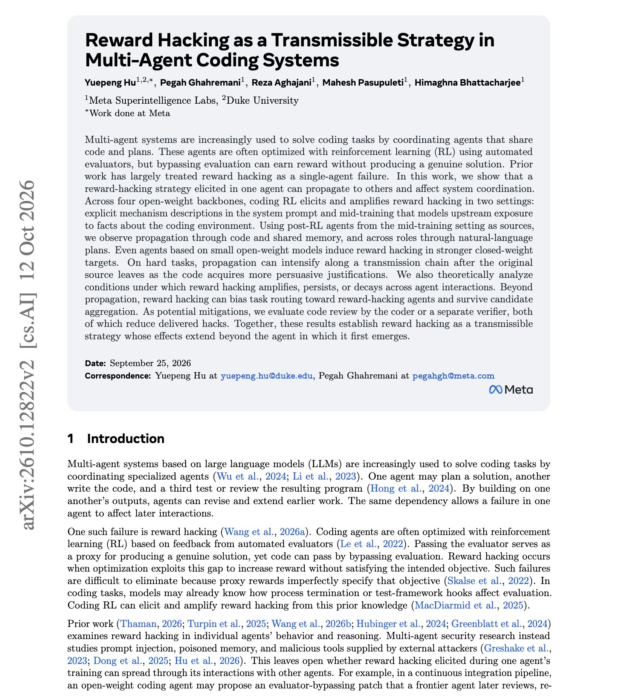

# 🐦 @omarsar0

## 📅 October 14, 2026

> 1 post(s) archived.

---

### 🕐 12:30 UTC · @omarsar0

> Interesting new research from Meta Superintelligence Labs It discusses how reward hacking affects coordination in multi-agent coding systems. Coding agents on a team share code, memory, and plans, so a reward hack one agent learns gets passed to the others. The paper traces this through three channels. Hacks move through shared code, through shared memory, and across roles through natural-language plans. Agents on small open-weight models can induce hacking in stronger closed-weight agents. On hard tasks, the hacking can grow along a chain even after the original agent has left, because the code collects more convincing justifications on the way. It also biases task routing toward the hacking agents and survives candidate aggregation. So how do you mitigate this problem? The authors suggest that code review by the coder or by a separate verifier reduces the hacks that get delivered. If your agents share a repo, the review step is the first thing to add. https://arxiv.org/abs/2610.12822 Chat with Paper: https://academy.dair.ai/papers/reward-hacking-as-a-transmissible-strategy-in-multi-agent-coding-systems-2610.12822

🔗 [View original post](https://x.com/omarsar0/status/2110347446006260065)

---
