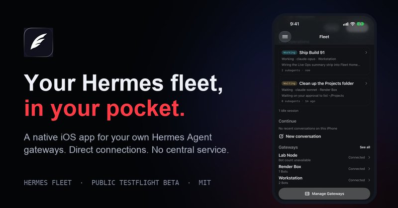
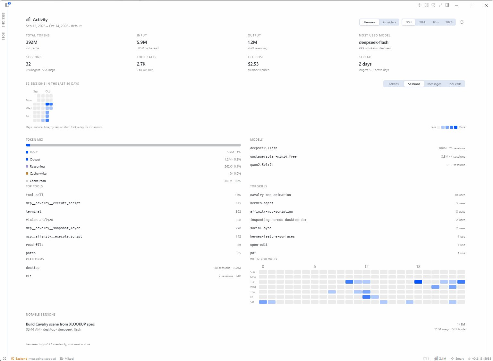
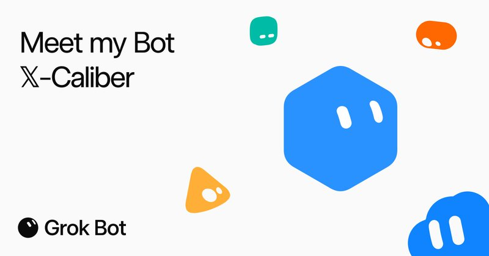

# 🐦 @tonysimons_

## 📅 October 14, 2026

> 11 post(s) archived.

---

### 🕐 15:01 UTC · @tonysimons_

> 🚨 STOP WHAT YOU ARE DOING IMMEDIATELY hermes update The Threshold Release is here! 🪽 Hermes Agent v0.22.0: The Threshold Release Changelog below

🔗 [View original post](https://x.com/tonysimons_/status/2110385525584744946)

---

### 🕐 14:57 UTC · @tonysimons_

> If you&apos;re running Hermes to drive stuff like this, I built a free iPhone app to keep an eye on it. Hermes Fleet lets you check on your agents, approve requests, and see what they&apos;re working on from your phone. Free and open source. 🪽 https://hermes-fleet.aiowa.dev

🔗 [View original post](https://x.com/tonysimons_/status/2110384447497388256)

---

### 🕐 14:32 UTC · @tonysimons_

> How do you run SEVERAL Hermes agents without them stepping on each other? @witcheer just dropped the clearest answer I&apos;ve seen. Profiles vs separate installs. Subagents vs Kanban tasks. How handoffs actually work. Group chat without bot loops. Save this one. 🪽 several Hermes agents working together: (1) a profile or a separate install for a specialist agent? a profile. each one is an independent Hermes agent with its own config, API keys, memory, sessions and skills. give it a description when you create it, so the Kanban orchestrator …

🔗 [View original post](https://x.com/tonysimons_/status/2110378140576915738)

---

### 🕐 14:30 UTC · @tonysimons_

> Installed. Nice one. Hermes Desktop just got a GitHub-style HEATMAP for AI usage. 🪽 Sessions. Tokens. Models. Tools. Skills. And the new Hermes Activity v0.2.0 can also show provider-reported usage from Codex, OpenCode, CommandCode, and Ollama. This one&apos;s DEFINITELY staying installed. 🔥

🔗 [View original post](https://x.com/MikaelDewabrata/status/2110377713261576324)

---

### 🕐 12:05 UTC · @tonysimons_

> EXCUSE ME?! Ok this one is absolutely bonkers... ArtCraft is building 13 FREE, open-source creative apps in Rust. Image editing. Video. Design. Audio. PDFs. CAD. Spreadsheets. No Electron. Local-first. And HERE’S THE WILD PART: CLI + MCP so AI agents can drive them. https://getartcraft.com/apps Media

🔗 [View original post](https://x.com/tonysimons_/status/2110341097033752622)

---

### 🕐 05:46 UTC · @tonysimons_

> Published a template of 𝕏-Caliber, my 𝕏 research analyst, if you&apos;d like to give this a try for youself: https://x.ai/bot/4sSGX1SZk5F6KdsrJwdtA

🔗 [View original post](https://x.com/tonysimons_/status/2110245892800622963)

---

### 🕐 05:03 UTC · @tonysimons_

> Asked my Grok @Bot to build me 4 private 𝕏 lists tonight. - Inner Circle. - AI Builders. - AI Creators. - Potential Partners. It pulled 60 days of my real replies and mentions, verified every handle, and told me when it couldn&apos;t prove something instead of making it up. 150+ accounts. Zero follows, zero likes, zero DMs. I add them myself. This is the part people miss. Grok Bot doesn&apos;t just answer. It does the work. 🤘 Media

🔗 [View original post](https://x.com/tonysimons_/status/2110234923084734741)

---

### 🕐 04:45 UTC · @tonysimons_

> Your Hermes agents now have their own usage analytics dashboard, and this thing looks awesome! 👀 Hermes Activity lets you explore a full year of agent activity through a GitHub-style HEATMAP. Track token consumption, estimated costs, model usage, sessions, tools, and skills. And with v0.2.0, you can even see provider-reported usage from Codex, OpenCode, CommandCode, and Ollama. Seriously cool work from the Hermes community! Hermes Desktop just got a GitHub-style HEATMAP for AI usage. 🪽 Sessions. Tokens. Models. Tools. Skills. And the new Hermes Activity v0.2.0 can also show provider-reported usage from Codex, OpenCode, CommandCode, and Ollama. This one&apos;s DEFINITELY staying installed. 🔥

🔗 [View original post](https://x.com/HermesWatcher/status/2110230368871981081)

---

### 🕐 02:38 UTC · @tonysimons_

> https://github.com/debpalash/VoiceStudio

🔗 [View original post](https://x.com/tonysimons_/status/2110198481772016086)

---

### 🕐 02:38 UTC · @tonysimons_

> ElevenLabs just got a fully local, OPEN-SOURCE challenger. 👀 VoiceStudio clones voices, dubs video, transcribes audio, and makes audiobooks. All on your own hardware. It even hooks into Codex and Claude Code over MCP. +37K GitHub stars this month. Link below. 👇

🔗 [View original post](https://x.com/tonysimons_/status/2110198425153159233)

---

### 🕐 00:08 UTC · @tonysimons_

> I asked @GeminiApp Argon to make me an SVG portrait of Jack Nicholson. 🤩 Not generate an image. Actually WRITE THE CODE to draw Jack Nicholson. And the crazy SOB DELIVERED. 😂 Tell me again we&apos;re not living in the future. Media

🔗 [View original post](https://x.com/tonysimons_/status/2110160814178988413)

---
