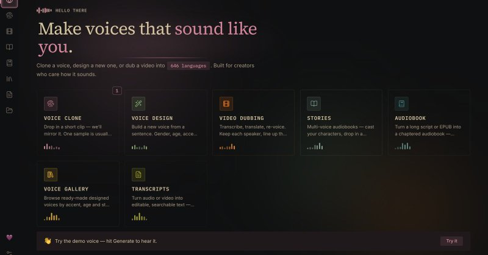

# 🐦 @tonysimons_

## 📅 October 14, 2026

> 3 post(s) archived.

---

### 🕐 02:38 UTC · @tonysimons_

> https://github.com/debpalash/VoiceStudio

🔗 [View original post](https://x.com/tonysimons_/status/2110198481772016086)

---

### 🕐 02:38 UTC · @tonysimons_

> ElevenLabs just got a fully local, OPEN-SOURCE challenger. 👀 VoiceStudio clones voices, dubs video, transcribes audio, and makes audiobooks. All on your own hardware. It even hooks into Codex and Claude Code over MCP. +37K GitHub stars this month. Link below. 👇

🔗 [View original post](https://x.com/tonysimons_/status/2110198425153159233)

---

### 🕐 00:08 UTC · @tonysimons_

> I asked @GeminiApp Argon to make me an SVG portrait of Jack Nicholson. 🤩 Not generate an image. Actually WRITE THE CODE to draw Jack Nicholson. And the crazy SOB DELIVERED. 😂 Tell me again we&apos;re not living in the future. Media

🔗 [View original post](https://x.com/tonysimons_/status/2110160814178988413)

---
