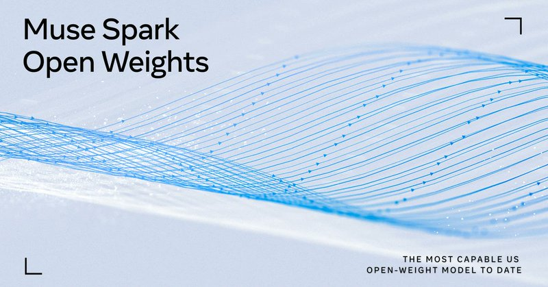
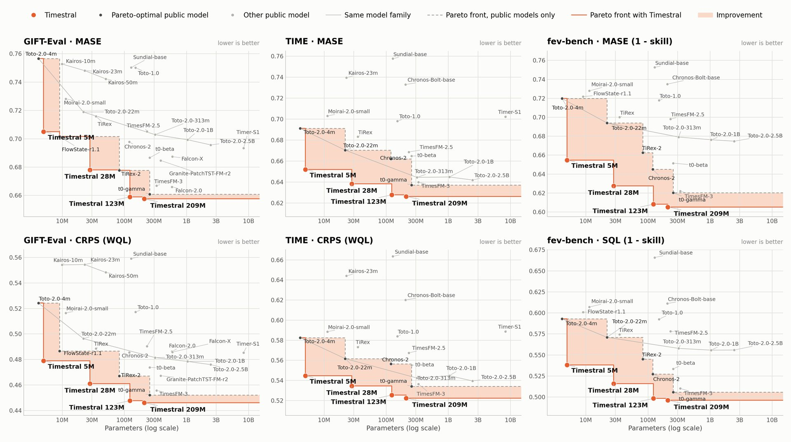
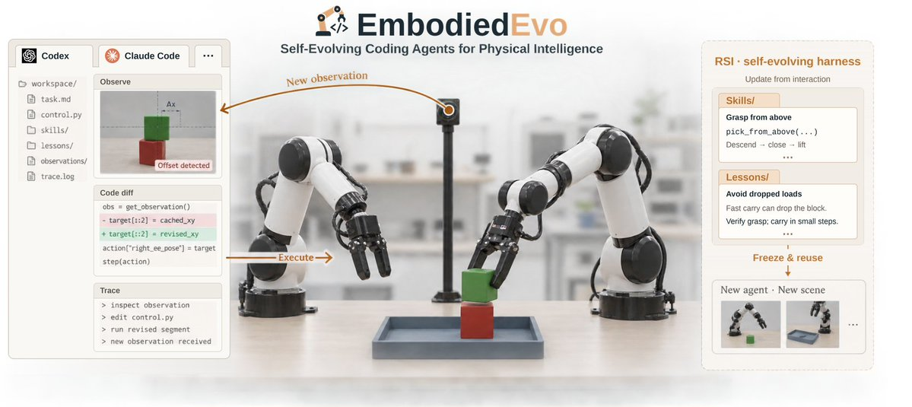

# 🐦 @_akhaliq

## 📅 October 15, 2026

> 9 post(s) archived.

---

### 🕐 17:55 UTC · @_akhaliq

> llama serve -hf ggml-org/Muse-Spark-Open-816B-A42B-GGUF:Q2_K (on two mac studios). Well done @finkd &amp; @johnternus! Media

🔗 [View original post](https://x.com/ClementDelangue/status/2110791576435794339)

---

### 🕐 17:28 UTC · @_akhaliq

> From Failures to Learnable Worlds Policy-Conditioned Environment Generation for Navigation Agents paper: https://huggingface.co/papers/2610.19420 Media

🔗 [View original post](https://x.com/_akhaliq/status/2110784877629202507)

---

### 🕐 17:08 UTC · @_akhaliq

> Muse Spark Open is available today through API platforms at Baseten, Fireworks AI, Groq, Modal, Nebius, OpenRouter and Together AI. Download the weights on Amazon SageMaker AI, Google Cloud Model Garden, Hugging Face, and Microsoft Foundry Models. Weights are released under the Muse Model License, with limited commercial terms that let many developers use the model for free. Learn more on our research blog: https://go.meta.me/musesparkopen Download the weights: https://huggingface.co/collections/meta-models/muse-spark-open

🔗 [View original post](https://x.com/AIatMeta/status/2110779758334386491)

---

### 🕐 17:00 UTC · @_akhaliq

> iMessage agents for your business in 30s. Send a link and Bland learns your business, plugs into your APIs, and creates a branded agent for you automatically. The agent can do things like Tapbacks (❤️,👍,❗), send embedded components, and even accept payments within a chat. It&apos;s live now. Text +1 (415) 481-7537. Media

🔗 [View original post](https://x.com/usebland/status/2110777729159406076)

---

### 🕐 16:35 UTC · @_akhaliq

> At Self Labs, we’ve been using agents since day one Our agentic web identity &amp; privacy stack is already used by companies like Google Today we&apos;re launching the missing piece: Agent Vault, a secure way for agents to log in &amp; make credit card payments Superpowers for your agents Media

🔗 [View original post](https://x.com/selfxyz/status/2110771542825304257)

---

### 🕐 16:11 UTC · @_akhaliq

> Doc2Harness: The first benchmark for long-horizon harness engineering of coding agents 19 frontier models, 328 test cases, best pass rate only 53% — even the strongest fails half. From ICT-CAS. Media

🔗 [View original post](https://x.com/HuggingPapers/status/2110765616101540224)

---

### 🕐 15:38 UTC · @_akhaliq

> Mistral just released Timestral, a time series foundation model, on Hugging Face State-of-the-art zero-shot forecasting across 3 major benchmarks, with 21 quantiles and up to 32k context.

🔗 [View original post](https://x.com/HuggingPapers/status/2110757291972780520)

---

### 🕐 14:30 UTC · @_akhaliq

> Coding agents are entering the physical world. Zero-shot is only the starting point. What if we gave them practice—and let the next agent inherit what they learned? EmbodiedEvo: one Playground → reusable Skills &amp; Lessons → unseen layouts. No model-weight updates. 45.08 average score. 38.95% success. #1 on the RoboDojo leaderboard. Project: https://lab.einsia.ai/embodiedevo/ Paper: https://arxiv.org/abs/2610.18867 Github：https://github.com/Einsia/EmbodiedEvo

🔗 [View original post](https://x.com/EinsiaAI/status/2110739977025798568)

---

### 🕐 08:36 UTC · @_akhaliq

> Player-1 Learning to Play from Synthetic Experience paper: https://huggingface.co/papers/2610.20584 Media

🔗 [View original post](https://x.com/_akhaliq/status/2110651055331770485)

---
