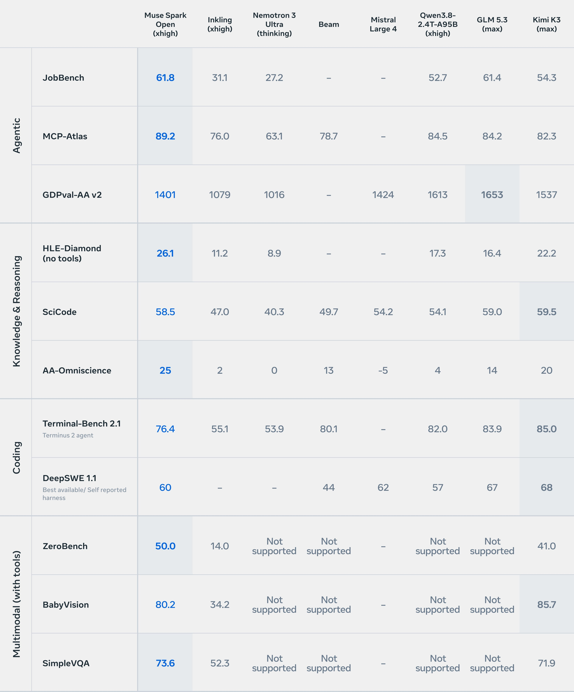
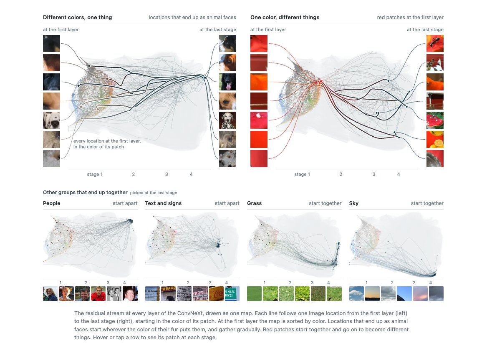
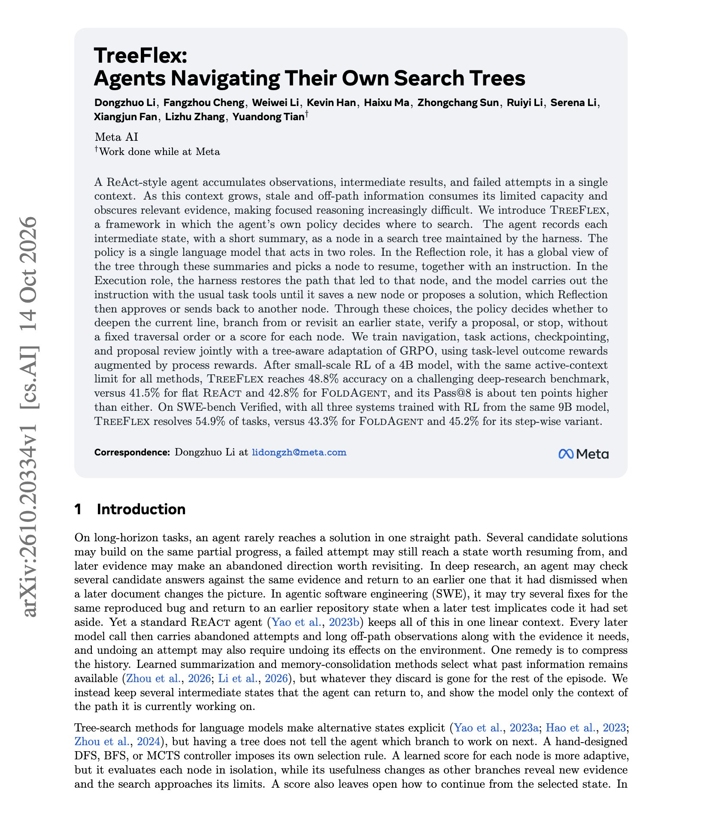
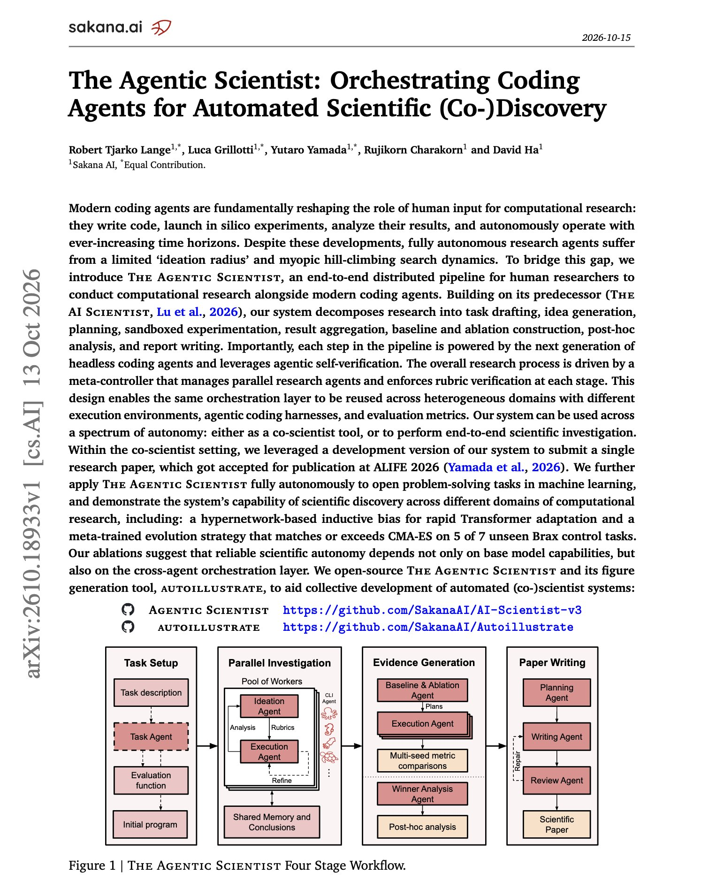

# 🐦 @dair_ai

## 📅 October 15, 2026

> 5 post(s) archived.

---

### 🕐 18:24 UTC · @dair_ai

> Damn! Looking at the results, Meta really cooked here! More progress on frontier open models is always a big deal. Great to see Meta going back to its roots. The only way to know this checkpoint&apos;s quality is to test it yourself. Today we’re releasing Muse Spark Open, the most capable US open-weight model to date. Built for coding and agentic work, it excels at long-horizon tasks, complex software engineering, and multi-step reasoning. Key Model Specs: → 816B total / 42B active parameters → 1M token conte…

🔗 [View original post](https://x.com/omarsar0/status/2110799108122509729)

---

### 🕐 17:51 UTC · @dair_ai

> Highly recommended read. This is the type of interpretability work that we need more of. &quot;We can now understand most neurons in models up to trillions of parameters, and think the outlook for mechanistic interpretability may be far better than we thought.&quot; interpretability might be the most important scientific problem in the world right now, as I don&apos;t think we can solve alignment if we don&apos;t know what we&apos;re building. I think I have good news about it. I co-authored early work in mechanistic interpretability at OpenAI and came awa…

🔗 [View original post](https://x.com/omarsar0/status/2110790564698538457)

---

### 🕐 16:56 UTC · @dair_ai

> Agents need a better interface. In my own agent orchestrator, I often render more actionable, valuable outputs as small interfaces. @openuidev makes this easy for any AI app. It is an open-source, model-agnostic library that streams a UI built from your own components. I can easily see this becoming a standard way to interact with agents in the future. Go check it out! For 30 years, technology has moved in one direction: turning information into intuitive interfaces Somehow, the smartest software we’ve ever built took us back to a textbox We’ve spent the last 2 years at @openuidev trying to fix that. 6 months ago we open-sourced it: 10K+ GitHub…

🔗 [View original post](https://x.com/omarsar0/status/2110776734509359427)

---

### 🕐 14:17 UTC · @dair_ai

> New work from Meta AI on agents that manage their own search. (bookmark it) A ReAct agent keeps every failed attempt in one context, making useful evidence harder to find. To improve on this, they propose TreeFlex, a framework in which the agent’s own policy decides where to search. In TreeFlex, the agent saves each intermediate state as a node in a search tree. The same model then reads short summaries of all nodes and decides where to continue, whether to branch, when to check a proposed answer, and when to stop. On a deep-research benchmark, a 4B model reaches 48.8% versus 41.5% for flat ReAct, at the same context limit. Same 9B base model, both trained with RL. 54.9% on SWE-bench Verified with TreeFlex, versus 43.3% with FoldAgent. https://arxiv.org/abs/2610.20334 Chat with Paper: https://academy.dair.ai/papers/treeflex-agents-navigating-their-own-search-trees-2610.20334

🔗 [View original post](https://x.com/dair_ai/status/2110736717871485124)

---

### 🕐 14:06 UTC · @dair_ai

> Must-read paper from Sakana AI on orchestrating coding agents for scientific research. (bookmark it) This is an important read with lots of useful insights if you are building multi-agent systems. I like this work because it presents a concrete multi-agent framework and an end-to-end distributed pipeline that lets human researchers conduct computational research alongside modern coding agents. What they did: A development version of their system helped write a paper that was accepted as a main-conference talk at ALIFE 2026, after human verification and edits. How they did it: The Agentic Scientist splits a project into stages. Task drafting, ideation, planning, sandboxed experiments, baselines and ablations, analysis, and report writing each run on a coding agent that checks its own work. A meta-controller runs many of these agents in parallel and checks every stage against a rubric. The ablations show that reliable autonomy depends on that orchestration layer as well as on the base model. https://arxiv.org/abs/2610.18933 Chat with Paper: https://academy.dair.ai/papers/the-agentic-scientist-orchestrating-coding-agents-for-automated-scientific-co-di-2610.18933

🔗 [View original post](https://x.com/omarsar0/status/2110733945323368822)

---
