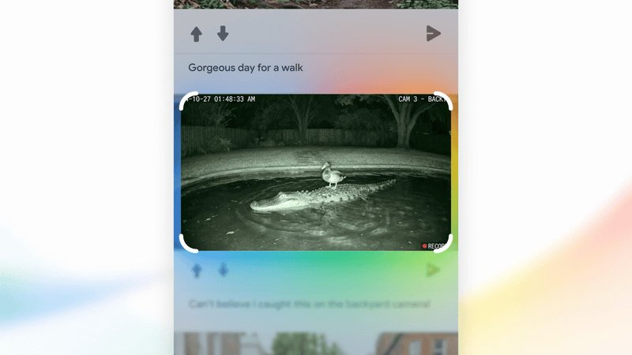

# 🐦 @demishassabis

## 📅 October 15, 2026

> 2 post(s) archived.

---

### 🕐 13:17 UTC · @demishassabis

> I am proud to share that SynthID has been recognised by @TIME as one of the Best Inventions of 2026. When we first began developing this technology @GoogleDeepMind, the goal was to find a robust, imperceptible way to watermark AI-generated media directly at the moment of creation, without compromising content quality. It was no small research challenge. But three years into its use, SynthID has already watermarked over 180 billion images and videos, alongside 240,000 years of audio. We’ve also recently extended these watermarking principles to biology with SynthID Bio. SynthID isn&apos;t a silver bullet for misinformation and this isn&apos;t a challenge any one company can solve alone; but it does represent a step toward a more transparent information ecosystem. A sincere thank you to the teams across @Google for their contributions to making SynthID a reality, and also for the support the team has received from @demishassabis, @sundarpichai and the rest of the Google leadership on this journey. You can try the SynthID Universal Detector at http://synthid.com. Read more: https://time.com/collection/best-inventions/2026/google-deepmind-synthid/

🔗 [View original post](https://x.com/pushmeet/status/2110721710156562782)

---

### 🕐 12:53 UTC · @demishassabis

> SynthID has been named one of @TIME&apos;s Best Inventions of 2026. With over 180 billion images and videos already watermarked, it’s making it easier for people to distinguish AI-generated content from other media → https://goo.gle/4jsZxWF

🔗 [View original post](https://x.com/GoogleDeepMind/status/2110715601454784965)

---
