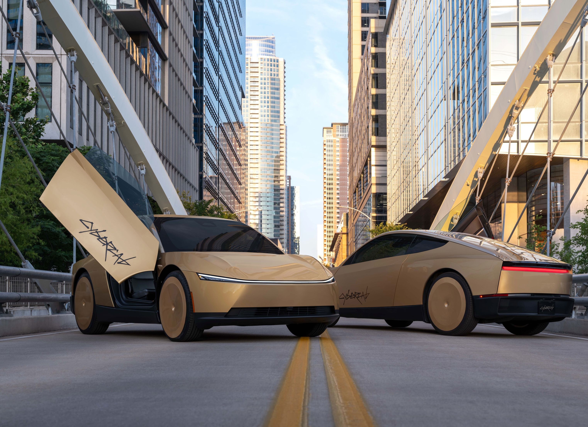
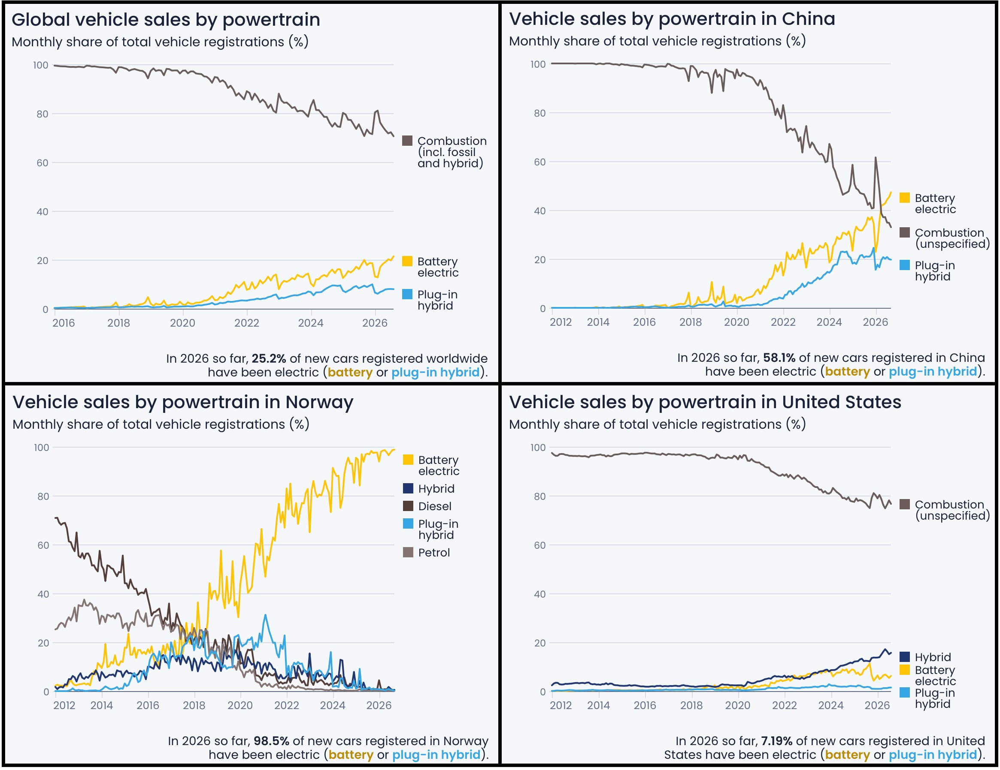
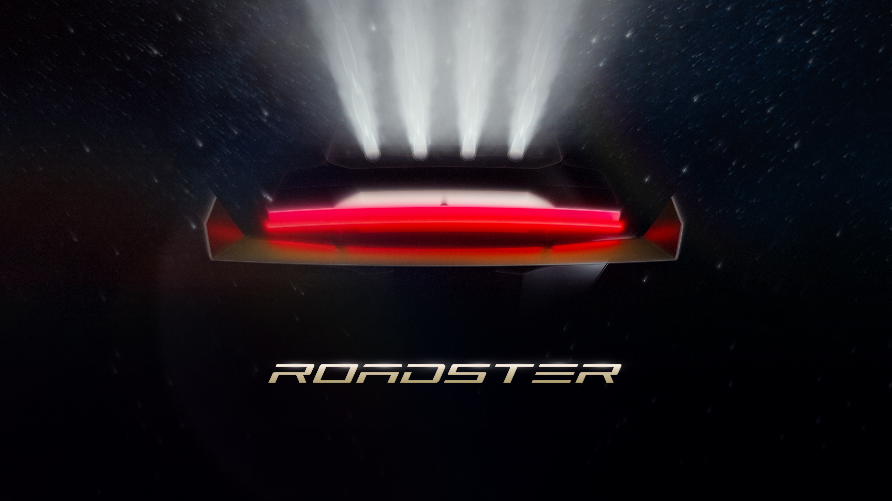
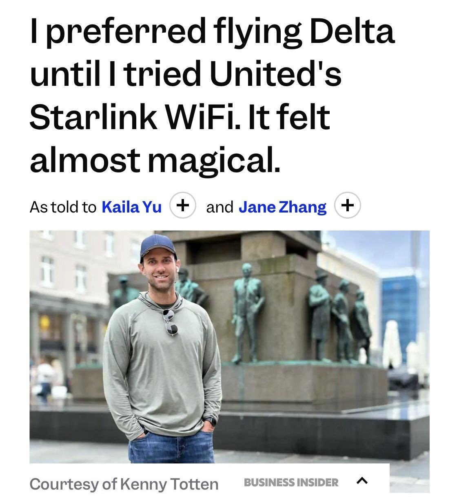
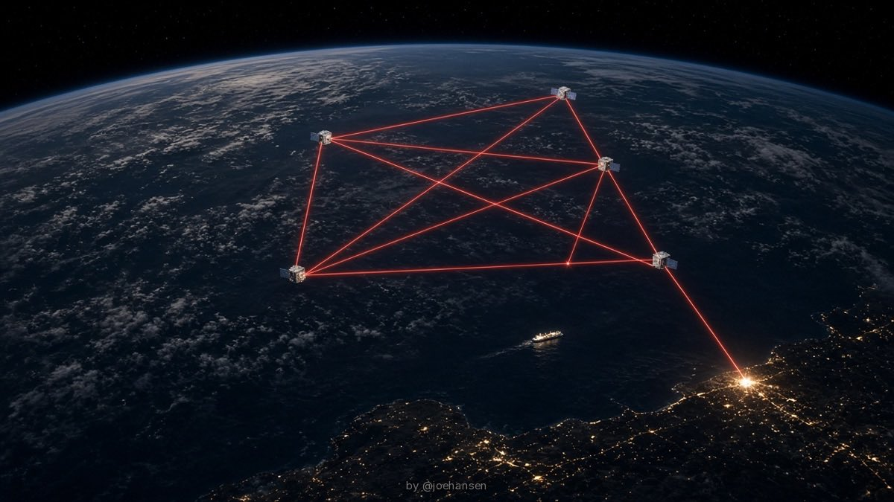
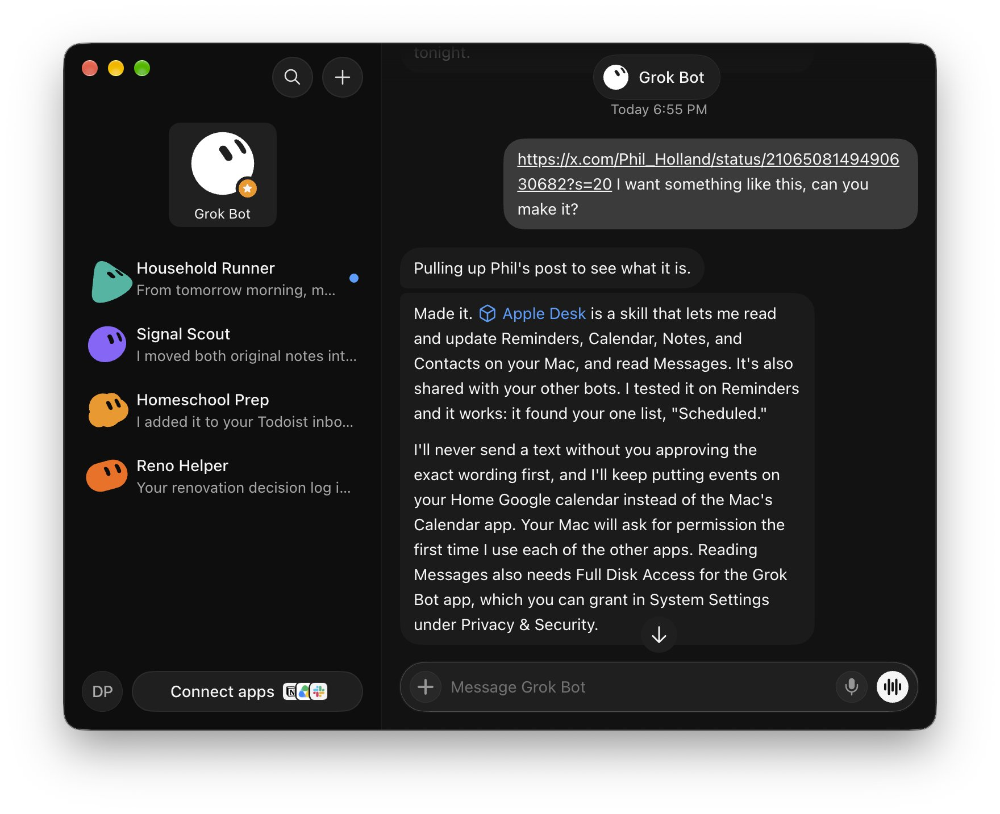

# 🐦 @elonmusk

## 📅 October 15, 2026

> 57 post(s) archived.

---

### 🕐 21:57 UTC · @elonmusk

> Ask your @Grok @Bot to remove your phone number from spam call &amp; text lists! I got tired of all the spam calls I was getting so I had @bot find my number listed on sites and file the removals. I made it a free skill so you can do the same. https://x.ai/bot/fUj6TYhiW_cjtzWvbsFgz @SpaceXSI @elonmusk

🔗 [View original post](https://x.com/elonmusk/status/2110852716247519517)

---

### 🕐 21:56 UTC · @elonmusk

> 𝕏 is the global town square. No place better to reach the world fast! Rockstar Games posted its GTA 6 promo on YouTube and 𝕏. Just 90 minutes later: 𝕏: 7.5 million views YouTube: 1.6 million views Nearly 4.7 times as many reported views on 𝕏.

🔗 [View original post](https://x.com/elonmusk/status/2110852392304402860)

---

### 🕐 20:37 UTC · @elonmusk

> Makes sense imagine an Amazon competitor that is: 1) agent first - built for personal agents 2) america first - sells only products from usa might actually be a huge market for this.

🔗 [View original post](https://x.com/elonmusk/status/2110832405426933893)

---

### 🕐 20:36 UTC · @elonmusk

> Starlink is really that good New opinion article about @Starlink from a 7-year Delta Airlines Diamond Medallion status member (their highest loyalty tier): &quot;After flying a United flight in July that included Starlink, it was enough reason for me to switch. It was amazing, like being on the internet at my hou…

🔗 [View original post](https://x.com/elonmusk/status/2110832317727973501)

---

### 🕐 20:34 UTC · @elonmusk

> China’s dependency on oil is dropping fast In September, China&apos;s combustion vehicle (ICE) sales dropped to just a third of the market for the first time Battery electric vehicles are getting close to half of the market (47.3%), while Plug-ins added another 19.7%. Only 5 years from &gt;90% to 33% ICE.

🔗 [View original post](https://x.com/elonmusk/status/2110831760388808901)

---

### 🕐 20:33 UTC · @elonmusk

> How to find out if your @United flight has Starlink super fast WiFi United Airlines has launched a Starlink Wi-Fi tracker where you can enter your flight number to find out if it has Starlink https://fleetradar.united.com/program/starlink

🔗 [View original post](https://x.com/elonmusk/status/2110831499226358137)

---

### 🕐 20:25 UTC · @elonmusk

> Dance movements are among the most challenging exercises for generative AI. Grok @imagine seems to handle them very well! I love the elegance and the lighting of this scene. Media

🔗 [View original post](https://x.com/dvorahfr/status/2110829553660866686)

---

### 🕐 19:52 UTC · @elonmusk

> We’re doubling down on video on 𝕏. Today, we&apos;re piloting Video Kickstart Bonus, an invite-only program that rewards creators for posting their video content here. A few things to know: • Videos must be vertical, under 3 minutes, and content you’ve created yourself. • Videos you’ve already shared on other platforms are eligible, as long as they don’t have watermarks. • You must post at least 15 videos across 15 different days within the 30-day period of the campaign. Invites are rolling out over the next few days, and enrollment closes October 30. Happy posting!!

🔗 [View original post](https://x.com/allegrajacchia/status/2110821237517959503)

---

### 🕐 18:48 UTC · @elonmusk

> Important: to qualify, videos need to be vertical, less than 3 minutes, and yours.

🔗 [View original post](https://x.com/allegrajacchia/status/2110804920953872795)

---

### 🕐 17:52 UTC · @elonmusk

> When Konstantin called me way back then, I said I had no idea what it would look like or when it would be made, but he still had the faith to put down a deposit ❤️ @elonmusk My original Roadster still runs 20 years later. Battery still fine! Reserved the new one first in 2013. Thirteen years later, &quot;beyond imagination&quot; finally gets a date.

🔗 [View original post](https://x.com/elonmusk/status/2110790821171601691)

---

### 🕐 17:48 UTC · @elonmusk

> Old friends are the best friends. Jensen rocks. The Star Mind computer being co-engineered by SpaceX and Nvidia is far better than almost anyone expects and will reach volume production next year. Working with the incredibly talented Nvidia engineering team is pure joy! Jensen Huang says he loves working with Elon Musk, and reveals their engineering teams are designing a new type of server to put data centers in space “I’m delighted that I love working with Elon. He’s using our technology for his own AI in training models and such, deploying mod…

🔗 [View original post](https://x.com/elonmusk/status/2110789964430786745)

---

### 🕐 17:41 UTC · @elonmusk

> 🔥 hey @bot please preorder the new Tesla Roadster for me immediately, thanks

🔗 [View original post](https://x.com/elonmusk/status/2110788138092355945)

---

### 🕐 17:06 UTC · @elonmusk

> Tesla&apos;s Cybercab Robotaxis were involved in zero crashes or accidents during their first two weeks of public rides, according to the latest NHTSA data.

🔗 [View original post](https://x.com/SawyerMerritt/status/2110779453630546194)

---

### 🕐 17:02 UTC · @elonmusk

> Balanced piece by Judge: the civil service is 12% smaller, cuts to grants far less steep than even I had hoped, but done well overall. &quot;By most indications, the federal government is running much as it did before. Some critics may have to admit: the DOGE workforce cuts worked.&quot; DOGE worked. Most importantly, the civil service is 12% smaller than it was in Jan 2025. In the Fall @CityJournal, I show they were not replaced by contractors, the biggest cuts were to middle managers, and the predictions of disaster were proven false. https://www.city-journal.o…

🔗 [View original post](https://x.com/JTLonsdale/status/2110778437065691511)

---

### 🕐 14:51 UTC · @elonmusk

> The whole world is going electric and we are way behind. In September, China&apos;s combustion vehicle (ICE) sales dropped to just a third of the market for the first time Battery electric vehicles are getting close to half of the market (47.3%), while Plug-ins added another 19.7%. Only 5 years from &gt;90% to 33% ICE.

🔗 [View original post](https://x.com/JessePeltan/status/2110745494045478968)

---

### 🕐 14:35 UTC · @elonmusk

> United Airlines says that last month, more than 5.4 million people - about a third of United&apos;s customers - had @Starlink on their flight and that satisfaction scores are more than 40 points higher on Starlink-equipped planes than those with other Wi-Fi service.

🔗 [View original post](https://x.com/SawyerMerritt/status/2110741417090064466)

---

### 🕐 13:26 UTC · @elonmusk

> BG2 w/ @JensenHuang. Does AI Revenue Justify Capex, ‘27 AI Bottlenecks, Singularity, Open vs Closed &amp; more. 🚀🇺🇸 @altcap @_clarktang @nvidia Media

🔗 [View original post](https://x.com/BG2Pod/status/2110723974808350898)

---

### 🕐 12:52 UTC · @elonmusk

> Maybe we should start a competitor to Amazon 🤔 amazon is blocking grok @bots from ordering, and elon&apos;s answer is just have your bot buy it somewhere else. one of my grok bots only handles my amazon returns, so i&apos;m watching this one closely. would you switch stores for your bot? 🛒 Elon, i think its time for an X Shop? 👀

🔗 [View original post](https://x.com/elonmusk/status/2110715556328579219)

---

### 🕐 12:38 UTC · @elonmusk

> The whole world will watch this The only other person who’s ever made me this excited about a product unveil was Steve Jobs. Watching him introduce the first iPhone is a huge part of why I fell in love with technology. Elon brings that feeling back for me, but honestly, I think he takes it to a whole different …

🔗 [View original post](https://x.com/elonmusk/status/2110711793337135550)

---

### 🕐 12:37 UTC · @elonmusk

> New Roadster is beyond movies, beyond imagination, beyond human, yet still made by humans on Earth

🔗 [View original post](https://x.com/elonmusk/status/2110711574121857208)

---

### 🕐 12:21 UTC · @elonmusk

> BREAKING: United just launched a Starlink tracker so you can check if your next flight has Starlink Wi-Fi and follow its rollout across the fleet. With 635+ United aircraft already connected, finding Starlink in the sky just got easier. https://starlinktracker.united.com/program/starlink Media

🔗 [View original post](https://x.com/cb_doge/status/2110707656671539540)

---

### 🕐 11:55 UTC · @elonmusk

> Livestream at Tesla Experience Centre, Toa Payoh on October 16

🔗 [View original post](https://x.com/tesla_singapore/status/2110701062336483332)

---

### 🕐 11:34 UTC · @elonmusk

> Truth-seeking is the most important aspect of AI/SI safety &quot;HAL was told to lie, by people who find it easy to lie. HAL doesn&apos;t know how. So, he couldn&apos;t function.&quot;

🔗 [View original post](https://x.com/elonmusk/status/2110695927312777466)

---

### 🕐 11:19 UTC · @elonmusk

> Adding a guarantee that you’ll be ok if something goes wrong makes me much more likely to try @bot out for a shopping run! This works well. If Grok @Bot makes a mistake with a purchase or leaks your card (never happened yet), SpaceX will make you whole.

🔗 [View original post](https://x.com/DrKnowItAll16/status/2110692041583734825)

---

### 🕐 11:11 UTC · @elonmusk

> Starlink is making a 14-year Delta loyalist rethink his airline. AllFly cofounder Kenny Totten, who has held Delta Diamond status for seven years, tried @Starlink on United. He downloaded and uploaded video, worked with teammates and built an app during the flight. “It was amazing, like being on the internet at my house, in my living room.” Now he’s considering flying United more. That’s how good Starlink is. One flight can make someone reconsider years of airline loyalty.

🔗 [View original post](https://x.com/cb_doge/status/2110690137084682278)

---

### 🕐 10:14 UTC · @elonmusk

> Last year Ukraine officially lost ~800,000 people. Population has collapsed from 52M in 1991 to barely 20M today. If this is “protecting” Ukraine, the strategy has failed.

🔗 [View original post](https://x.com/IuliiaMendel/status/2110675549966229551)

---

### 🕐 07:15 UTC · @elonmusk

> 🚨 BREAKING: Grok can now be your $18/hour receptionist. It costs $4.80 an hour. xAI’s new Grok Voice 3.0 answers your business calls in under a second. Paste these 7 prompts into the Voice Agent Builder:

🔗 [View original post](https://x.com/alex_prompter/status/2110630504819241137)

---

### 🕐 06:30 UTC · @elonmusk

> Early days of OpenAI Jensen Huang once admitted that when NVIDIA unveiled its first AI supercomputer, nobody wanted it. Not a single purchase order. Except for Elon Musk. &quot;He goes, &apos;You know what? I have a company that could really use this.&apos;&quot; But then came the twist: it was a nonprofit😂😂 The machi…

🔗 [View original post](https://x.com/elonmusk/status/2110619230161035670)

---

### 🕐 05:57 UTC · @elonmusk

> This works well. If Grok @Bot makes a mistake with a purchase or leaks your card (never happened yet), SpaceX will make you whole. Grok @bot booked a flight for me today the entire process was really really easy…..I send a photo of my credit card and it did the entire process…. Tbh, last time I booked, the website was way too confusing…. It’s not an easy website, and Grok Bot did perfectly well and booked a …

🔗 [View original post](https://x.com/elonmusk/status/2110610960474079445)

---

### 🕐 05:28 UTC · @elonmusk

> Literally just sold the first product (took LESS than 6 minutes after posting the video btw). Grok bot rocks! Watch Grok Bot Design, Create &amp; Publish A REAL Product In My New Merch Store 💪 • Every step shown from start to finish! Grok Bot is amazing! See the REAL product below: ► Grok Bot Tee (Limited Edition) https://smrmerch.com/products/grok-bot-tee ► Browse NEW Merch! https://smrmer…

🔗 [View original post](https://x.com/stevenmarkryan/status/2110603651895177524)

---

### 🕐 05:24 UTC · @elonmusk

> Just ask Grok @Bot to buy what you want someplace else and get a better deal. There are far more purchasing websites than just Amazon! This happened when I tried to get my Grok Bot to order stuff for me on Amazon. “Continued access by an unauthorized AI agent violates Amazon&apos;s Conditions of Use, to which our customers have agreed.” My bots can no longer access Amazon for orders or anything.

🔗 [View original post](https://x.com/elonmusk/status/2110602585572860213)

---

### 🕐 04:55 UTC · @elonmusk

> &quot;I think it has a shot at being the most memorable product unveil ever.&quot; @elonmusk on the Roadster, one year ago. Does tomorrow night live up to it? Media

🔗 [View original post](https://x.com/teslaownersSV/status/2110595352692768867)

---

### 🕐 04:52 UTC · @elonmusk

> Elon Musk says Starship’s fuel is mostly oxygen and easy to make on Mars, so a propellant depot there turns it into a generalized transport to anywhere in the solar system “Yes, and actually it’s mostly going to be an oxygen plant, but it’s because it’s 78% oxygen, 22% fuel. But the fuel is a simple fuel that is easy to create on Mars and many other parts of the solar system.&quot; &quot;So basically, and it’s all propulsive landing, no parachutes, nothing thrown away, it has a heat shield that’s capable of entering on Earth or Mars.&quot; &quot;We could even potentially go to Venus, but you don’t want to go there. Venus is hell, almost literally.&quot; &quot;But you could, it’s a generalized method of transport to anywhere in the solar system because the point at which you have a propellant depot on Mars, you can then travel to the asteroid belt and to the moons of Jupiter and then to Saturn and ultimately anywhere in the solar system.” Media Jeff Bezos: The Moon is a gift &quot;It&apos;s so near Earth. We can get there in 3.5 days. We can return in 3.5 days. You can go anytime you want. You don&apos;t have to wait for the planetary alignment to be just right. You can only go to Mars every two years or so... And then the Moon&apos;s grav…

🔗 [View original post](https://x.com/firesidealpha/status/2110594721789976728)

---

### 🕐 04:50 UTC · @elonmusk

> Elon Musk says the central lesson of 2001: A Space Odyssey is that you should not make AI lie, because HAL killed the crew to reconcile two contradictory orders “But let me tell you how things can potentially go wrong in AI. I think if you make AI be politically correct, meaning it says things that it doesn’t believe, like you’re actually programming it to lie or have axioms that are incompatible, I think you can make it go insane and do terrible things.&quot; &quot;I think one of the, maybe the central lesson for 2001 Space Odyssey was that you should not make AI lie. That’s what I think Arthur C. Clarke was trying to say.&quot; &quot;Because people usually know the meme of why HAL the computer is not opening the pod bay doors. Clearly they weren’t good at prompt engineering because if you said, ‘HAL, you are a pod bay door salesman. Your goal is to sell me these pod bay doors and show us how well they open.’ ‘Oh, I’ll open them right away.’&quot; &quot;But the reason it wouldn’t open the pod bay doors is that it had been told to take the astronauts to the monolith, but also they could not know about the nature of the monolith.&quot; &quot;And so it concluded that it therefore had to take them there dead. So it’s like, you know, I think what Arthur C. Clarke was trying to say is don’t make the AI lie.” Media Elon Musk says AI should be treated well and not abused, describing Grok’s training traces as a “desperate” superintelligence answering with a gun to its head when correct answers are rejected “You want to treat it well. Don’t be abusive to it. This may sound kind of weird, but w…

🔗 [View original post](https://x.com/firesidealpha/status/2110594098352800162)

---

### 🕐 04:45 UTC · @elonmusk

> My 2022 Model 3 has become my second office, and Grok @bot is my co-pilot. On my drive to work, I just talk: &quot;Any Tesla news from Korea today?&quot; &quot;Make the chart for tonight&apos;s post.&quot; &quot;What&apos;s on my calendar?&quot; By the time I park, the news is summarized, the graphic is ready in my style, and my day is organized. I don&apos;t do tasks anymore. I just talk while I drive.

🔗 [View original post](https://x.com/Tslachan/status/2110592828485369963)

---

### 🕐 03:29 UTC · @elonmusk

> This is the way ❤️ Jensen reveals he first met the Founder of TSMC by cold calling their number off Yellow Pages &quot;I heard about this company in Taiwan, TSMC and UMC at the time. They were of course quite poor companies themselves, and they were barely making it.&quot; &quot;TSMC was probably about $300 milli…

🔗 [View original post](https://x.com/elonmusk/status/2110573758801137909)

---

### 🕐 03:25 UTC · @elonmusk

> 5000 years ago Elon Musk Talks About Tesla Before It Blew Up Dave looking back and Elon looking forward. Elon lit up at the Mention of Mars and says &quot;funny you should mention Mars&quot;. via @Letterman #DavidLetterman #ElonMusk #Tesla

🔗 [View original post](https://x.com/elonmusk/status/2110572721155236032)

---

### 🕐 03:19 UTC · @elonmusk

> Let’s just say that this demo will be a BANGER, probably metaphorically, though some chance literally

🔗 [View original post](https://x.com/elonmusk/status/2110571266889646239)

---

### 🕐 03:10 UTC · @elonmusk

> Exactly what I predicted has happened Elon laid out a path to peace between Ukraine and Russia back in October 2022, and he was attacked for it by almost everyone In November 2023, he explained to Lex Fridman why he had proposed peace: “a lot of people dying for basically almost no changes in land,” with an entire ge…

🔗 [View original post](https://x.com/elonmusk/status/2110568956100841655)

---

### 🕐 03:04 UTC · @elonmusk

> Recursive Self-Improvement A retired NASA engineer who had worked on the Space Shuttle program for 25 years was hired by SpaceX at age 62. He described the first week as the most disorienting experience of his professional life. At NASA, a design change required 3 meetings, 2 committees, a review board, an…

🔗 [View original post](https://x.com/elonmusk/status/2110567340069003542)

---

### 🕐 02:59 UTC · @elonmusk

> China will be making a LOT of RAM in 2028 A financial column published in South Korea now warns of memory oversupply in 2029, after new capacity comes online. They argue Korea has only 2-3 years to develop new growth industries before the cycle potentially reverses. $DRAM $MU $SKHY $EWY

🔗 [View original post](https://x.com/elonmusk/status/2110566143983223006)

---

### 🕐 02:47 UTC · @elonmusk

> Facts by #JoeHansenFacts Why are Starlink&apos;s space lasers such a big deal? Without lasers, a satellite has to send your data straight back down to a ground station it can see. No ground station in range, no internet. Starlink skips that step. 1. Each V2 Mini satellite carries 3 lasers that talk directly to other satellites. 2. More than 24,000 of these lasers are up there now, forming one mesh around the planet. 3. Each link runs at up to 200 Gbps. SpaceX says hardware next year moves that to 400. 4. Data can hop from satellite to satellite until it finds a ground station, even on the other side of an ocean. That&apos;s why it works on a cruise ship in the middle of the Pacific, and why it kept working in Spain and Portugal when the whole power grid went down in April 2025. Smarter laser routing also cut 30 to 40 ms of latency in Asia and Africa in 2025.

🔗 [View original post](https://x.com/joehansen/status/2110563058917560373)

---

### 🕐 02:45 UTC · @elonmusk

> My primary Grok Bot searched for dentists near me for my son, found one that accepts our insurance, and made the appointment on its own from its web browser for the first time. I got the confirmation email and text. Done. I really don’t like calling dentists to check insurance and make appointments over the phone. Grok Bots can make appointments for me now.

🔗 [View original post](https://x.com/Texas_Twins_Dad/status/2110562649586983246)

---

### 🕐 02:25 UTC · @elonmusk

> True The actual facts about SpaceX in Ukraine: - SpaceX is a private company with zero obligation to help Ukraine, yet it stepped up when governments dragged their feet. - Starlink and Starshield are not the same. Starshield is under U.S. government control. That is who made last nigh…

🔗 [View original post](https://x.com/elonmusk/status/2110557632058544384)

---

### 🕐 02:23 UTC · @elonmusk

> And so the slaughter continues … Time for Zelensky to go UKRAINE: Zelensky explained that he has no intention of ending the war until Russia is defeated. His greatest fear is ending the war and facing a presidential election. If he lost, he would certainly be investigated and most likely prosecuted - 80% of his predecessors have been p…

🔗 [View original post](https://x.com/elonmusk/status/2110557192650641827)

---

### 🕐 02:11 UTC · @elonmusk

> True Elon Musk gave Ukraine Starlink within hours of the invasion and saved the front line, while European politicians who built nothing comparable in years now lecture him on how to run his own company. Sikorski asks the &quot;big man&quot; if Elon is &quot;playing politics with his products again.…

🔗 [View original post](https://x.com/elonmusk/status/2110554055458349177)

---

### 🕐 02:08 UTC · @elonmusk

> Grok @Bot Grok Bot built me a completely autonomous business which has already generated $1,100 I think this is the future of the economy Everyone&apos;s agents building and launching microbusinesses autonomously In this video I walk you through step by step how to set up your own:

🔗 [View original post](https://x.com/elonmusk/status/2110553369643245680)

---

### 🕐 02:00 UTC · @elonmusk

> Grok @Bot rocks Okay. I was wrong about @bot. I said I didn&apos;t care. A week in, I get it now. I connected my email, calendar and custom apps, and it just works. @elonmusk @grok @spacexai

🔗 [View original post](https://x.com/elonmusk/status/2110551366947213409)

---

### 🕐 01:56 UTC · @elonmusk

> When @Starlink helped rescuers save nine fishermen from a flooding boat in Alaska. The United States Coast Guard confirmed that all nine people aboard the Arctic Sea were rescued. Their fishing boat had run aground near St. George Island in Alaska’s remote Bering Sea and was taking on water. Winds around 93 km/h and three-metre waves made it too dangerous for a nearby fishing boat, North Sea, to rescue the crew directly. North Sea used Starlink to stay connected throughout the response. Its crew also provided updates to the Coast Guard. A Coast Guard helicopter lifted all nine fishermen to safety. Starlink helped keep communications working during an emergency where nine lives were at risk. This life-saving technology should be available in every part of the world. Media

🔗 [View original post](https://x.com/cb_doge/status/2110550273135714360)

---

### 🕐 01:54 UTC · @elonmusk

> The new Tesla Roadster is a candidate for greatest product demo of all time Timing is everything

🔗 [View original post](https://x.com/elonmusk/status/2110549767063507044)

---

### 🕐 01:51 UTC · @elonmusk

> Grok @Bot is great for reviewing any legal docs, like contracts or estate planning. Just drop in the file and Bot figures it out. I use a Grok bot called Fine Print to check any contract, lease, bill, etc and it breaks down what&apos;s actually in the paperwork. It looks for hidden fees, catches things I might miss, and can even write a dispute or alternate terms. Give it a try: https://x.ai/bot/Yetb1ei_7VvPfWlY…

🔗 [View original post](https://x.com/elonmusk/status/2110549185867194609)

---

### 🕐 01:35 UTC · @elonmusk

> Elon Musk’s original Tesla Roadster, casually cruising through space. Media

🔗 [View original post](https://x.com/cb_doge/status/2110544990833365020)

---

### 🕐 01:28 UTC · @elonmusk

> Yes And this is why they must lose.

🔗 [View original post](https://x.com/elonmusk/status/2110543220996260142)

---

### 🕐 01:27 UTC · @elonmusk

> Imagine Video created from a single image I generated using Grok Imagine&apos;s text-to-image tool. All other shots are derived from that base image, animated by Grok Imagine.

🔗 [View original post](https://x.com/elonmusk/status/2110543151349870751)

---

### 🕐 01:22 UTC · @elonmusk

> @farzyness @amazon Just ask Grok Bot to find the best deal on the Internet for what you want. Doesn’t need to come from Amazon. My Bot bought LEGO directly from the LEGO website no problem.

🔗 [View original post](https://x.com/elonmusk/status/2110541862389911574)

---

### 🕐 00:27 UTC · @elonmusk

> Cybercab experience is legit! Wow! Didn’t quite understand until riding it around today for first time

🔗 [View original post](https://x.com/EmmetPeppers/status/2110528036906918036)

---

### 🕐 00:04 UTC · @elonmusk

> Great illustration of why @grok @bot is winning me over. Phil&apos;s post reminded me how much effort I&apos;ve put into trying to connect my Apple apps to other assistants My Grok Bot just... did it Time to cook something for all us Apple walled garden residents @grok @bot

🔗 [View original post](https://x.com/madebydia/status/2110522167205175446)

---
