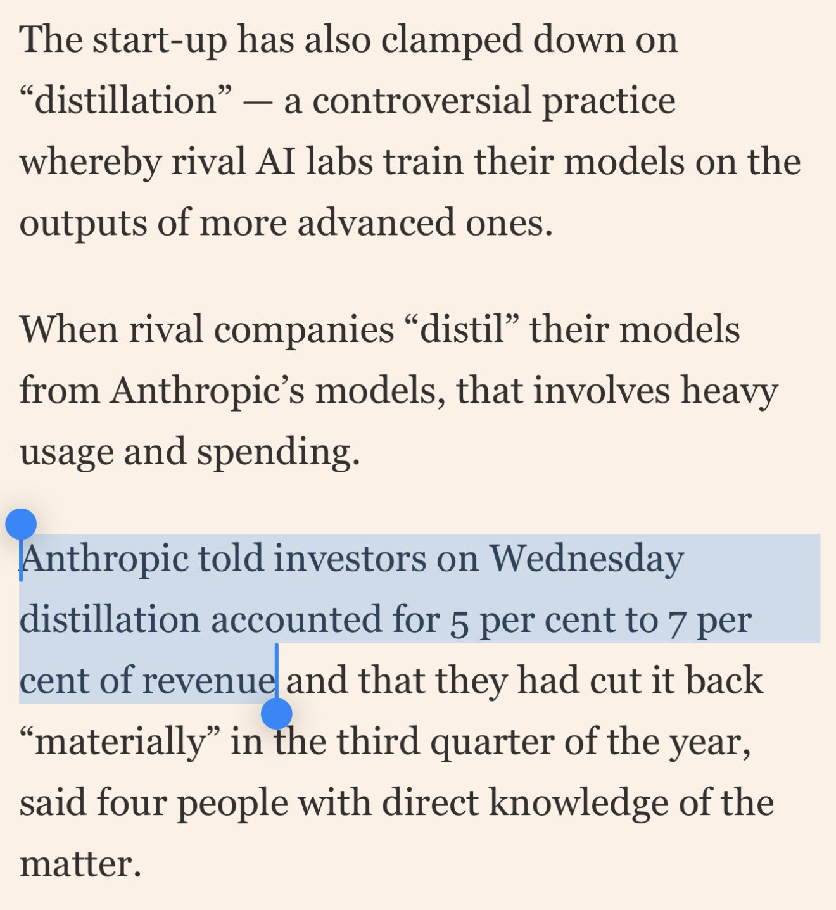

# 🐦 @simonw

## 📅 October 15, 2026

> 1 post(s) archived.

---

### 🕐 13:16 UTC · @simonw

> &quot;Anthropic told investors on Wednesday distillation accounted for 5 per cent to 7 per cent of revenue&quot; If true, and Q2 revenue was $11.5B, then that&apos;s more than half a billion dollars spent by other labs to distill Anthropic&apos;s models! https://www.ft.com/content/11632d03-358c-454b-af95-d06d4072932b?syn-25a6b1a6=1

🔗 [View original post](https://x.com/simonw/status/2110721515130089787)

---
